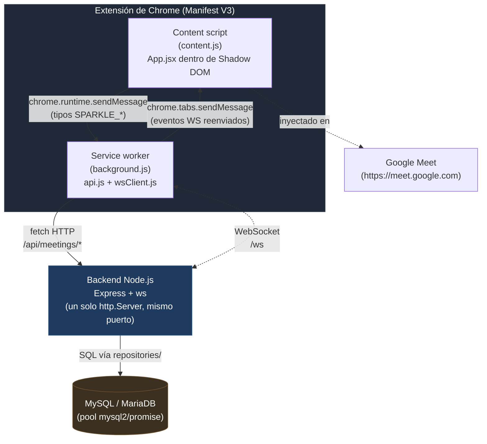
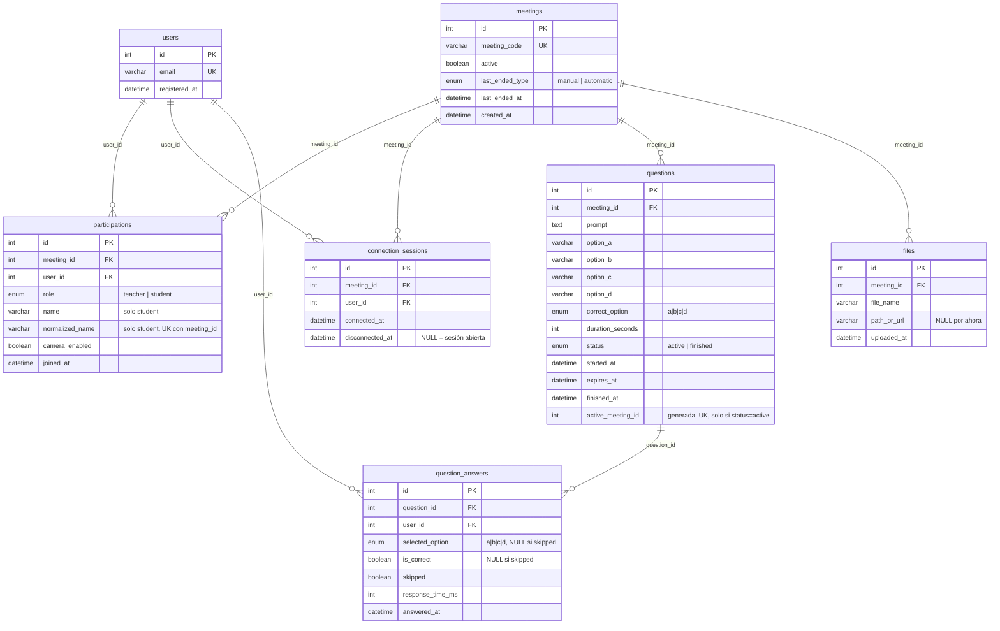

# Documentación de Sparkle V2

> Documento de referencia generado a partir de una lectura completa del código fuente (backend, frontend/extensión y tests) tal como existen hoy en el repositorio. Pensado para que alguien que nunca vio el proyecto pueda instalarlo, entenderlo y ejecutarlo sin ayuda externa. Donde el código no permite determinar algo con certeza, se indica explícitamente `Pendiente de documentar` en vez de inventar información.
>
> El registro histórico de decisiones de diseño ("Historial de etapas", etapa por etapa) que existía antes en este archivo se conserva íntegro más abajo, en el **Anexo**, para no romper los enlaces que `backend/README.md` y `frontend/README.md` ya tienen hacia etapas puntuales (ej. "Etapa 17", "Etapa 44"). Si buscás el *por qué* de una decisión concreta, el Anexo es la fuente; si buscás cómo instalar/usar/entender el sistema tal como está *hoy*, quedate en esta sección.

## Índice

1. [Descripción general](#1-descripción-general)
2. [Arquitectura](#2-arquitectura)
3. [Tecnologías utilizadas](#3-tecnologías-utilizadas)
4. [Estructura de carpetas](#4-estructura-de-carpetas)
5. [Modelo de datos](#5-modelo-de-datos)
6. [API REST y eventos WebSocket](#6-api-rest-y-eventos-websocket)
7. [Variables de entorno](#7-variables-de-entorno)
8. [Instalación y ejecución](#8-instalación-y-ejecución)
9. [Scripts disponibles](#9-scripts-disponibles)
10. [Flujos principales](#10-flujos-principales)
11. [Testing](#11-testing)
12. [Despliegue](#12-despliegue)
13. [Seguridad](#13-seguridad)
14. [Problemas conocidos y troubleshooting](#14-problemas-conocidos-y-troubleshooting)
15. [Checklist para compartir el proyecto](#15-checklist-para-compartir-el-proyecto-con-otro-desarrollador)

---

## 1. Descripción general

**Sparkle V2** es una extensión de Chrome (Manifest V3) que se inyecta dentro de **Google Meet** (`https://meet.google.com/*`) y agrega un panel lateral con herramientas de clase en vivo para un rol **docente** y un rol **alumno**, dentro de una reunión puntual.

Funcionalmente, hoy permite:

- **Elegir un rol** ("Soy Docente" / "Soy Alumno") la primera vez que alguien entra a una reunión con el panel. El rol se resuelve por **email de Google + código de reunión de Meet**, nunca de forma global por cuenta: la misma persona puede ser docente en una reunión y alumno en otra.
- Un **docente** por reunión, de forma permanente (ver [Seguridad](#13-seguridad)): una vez confirmado, ningún otro email puede registrarse como docente de esa misma reunión.
- Un **alumno** debe registrar un nombre (único dentro de esa reunión) antes de que su rol quede asignado.
- El docente puede **iniciar, detener y reanudar la clase** en tiempo real (WebSocket) — el alumno ve ese estado reflejado al instante, y el listado de alumnos conectados se actualiza en vivo.
- El docente puede **enviar preguntas de opción múltiple en vivo** (estilo Kahoot) a los alumnos conectados, con un tiempo límite configurable; los alumnos responden o pasan, y el sistema calcula correcciones y estadísticas del lado del servidor (nunca confía en el cliente).
- Existen pantallas de **historial** (preguntas realizadas/respondidas, estadísticas por alumno, historial de sesiones de conexión) que sí están conectadas a datos reales de la base.
- Existen también un par de pantallas (**resumen de clase** para el alumno y **estadísticas de concentración** para el docente) que son **mock/UI únicamente**: no hay ningún backend de IA, transcripción o análisis de atención implementado — ver la nota en [Problemas conocidos](#14-problemas-conocidos-y-troubleshooting).
- Hay una herramienta de **preview de cámara** (toggle "Habilitar cámara") pensada explícitamente como prueba temporal, no como una funcionalidad final del producto.

El nombre y la descripción del `manifest.json` mencionan "detección de atención mediante IA", pero **esa funcionalidad de IA todavía no existe en el código** — es el objetivo declarado del proyecto, no algo ya implementado. Lo que sí existe y funciona de punta a punta es la gestión de clase en vivo (roles, inicio/fin/reanudación, listado de conectados) y las preguntas en vivo con corrección server-side.

---

## 2. Arquitectura

Sparkle V2 tiene tres partes que se ejecutan por separado y se coordinan por HTTP/WebSocket:

1. **Extensión de Chrome** (`frontend/`) — Manifest V3, con dos bundles independientes:
   - **Content script** (`content.js`): se inyecta en `meet.google.com`, monta un `<div>` con **Shadow DOM** (aislado del CSS/JS de la página) y dentro de él renderiza la app de React (`App.jsx`) — el panel visible.
   - **Service worker** (`background.js`): es el único que puede hablar con el backend (fetch HTTP y WebSocket). El content script **no llama directo al backend** — le pide todo por `chrome.runtime.sendMessage` al service worker, que hace el trabajo real y le devuelve la respuesta.
2. **Backend** (`backend/`) — Node.js + Express (API REST) + `ws` (servidor WebSocket), ambos montados sobre el mismo `http.Server` y el mismo puerto (`/api/meetings/*` para REST, `/ws` para WebSocket).
3. **Base de datos** — MySQL/MariaDB, accedida vía `mysql2/promise` con un pool de conexiones. No hay ORM: todo el SQL es manual, organizado en repositorios (ver [Estructura de carpetas](#4-estructura-de-carpetas)).

### Por qué el content script no llama directo al backend

Un content script corre en el **origen de la página** (`https://meet.google.com`). Un fetch desde ahí hacia `http://localhost:3000` es bloqueado por dos mecanismos del navegador:

- **CORS**: el backend solo acepta orígenes en una whitelist (`https://meet.google.com` + los `chrome-extension://<id>` configurados).
- **Private Network Access (PNA)**: Chrome exige un header adicional (`Access-Control-Allow-Private-Network: true`) para permitir que un origen público le pegue a una dirección de red privada/loopback como `localhost`.

El **service worker** de la extensión corre en su propio origen (`chrome-extension://<id>`), no está sujeto a las mismas restricciones de PNA que el fetch de una página, y su origen sí puede whitelistearse en el backend. Por eso toda la comunicación real con el backend (HTTP y WebSocket) vive en `background/main.js` / `services/api.js` / `services/wsClient.js`, y el content script solo le pide trabajo por mensaje interno (`chrome.runtime.sendMessage`, tipos `SPARKLE_*`).

### Diagrama de arquitectura



### Backend: arquitectura por capas

El backend sigue una separación estricta en capas, y la capa WebSocket **reutiliza las mismas reglas de negocio** que la capa REST (nunca hay una regla de negocio duplicada entre las dos):

```
routes/        → solo mapeo verbo+path → función del controller. Sin SQL, sin reglas de negocio.
controllers/   → valida la FORMA del request (faltan parámetros, tipos), llama al service, traduce a HTTP.
services/      → reglas de negocio del dominio, por concepto (no por tabla). Las usan tanto los
                 controllers REST como los handlers WS.
repositories/  → SQL puro, uno por tabla. Sin reglas de negocio.
ws/            → bootstrap del WebSocketServer + estado en memoria de las salas (rooms.js) +
                 handlers de cada tipo de mensaje (handlers.js), que llaman a services/, nunca SQL directo.
providers/     → proveedor de preguntas en vivo, detrás de una interfaz (hoy solo un banco local
                 aleatorio, pensado para poder reemplazarse por un proveedor con IA sin tocar el resto).
```

### Frontend: organización interna

```
screens/   → pantallas completas que App.jsx monta según el estado del router (una a la vez).
ui/        → componentes reutilizables/presentacionales (Header, ToggleTab, tarjetas, íconos SVG).
hooks/     → lógica de estado y efectos de React extraída de App.jsx (boot, WS de clase, WS de
             preguntas, preview de cámara, cuenta regresiva).
services/  → comunicación con el exterior: api.js (fetch real, solo lo usa el service worker),
             backendMessaging.js (la misma API para el content script, vía chrome.runtime.sendMessage),
             wsClient.js (WebSocket real, solo lo usa el service worker).
utils/     → utilidades puras sin React ni red (detección de contexto de Meet, detección de email,
             timeouts, etc.).
```

---

## 3. Tecnologías utilizadas

| Área | Tecnología | Notas |
|---|---|---|
| Backend runtime | Node.js (CommonJS) | Sin versión mínima fijada en `package.json` (sin campo `engines`). Se recomienda una LTS reciente (18+) por el uso de `node:test` y sintaxis moderna. |
| Backend framework | Express 5 | `backend/package.json` |
| WebSocket | `ws` (no socket.io) | Un solo tipo de mensaje JSON por sala; no hace falta el transporte/fallback de socket.io. |
| Base de datos | MySQL / MariaDB | Vía `mysql2/promise`, pool de conexiones, sin ORM (SQL manual en `repositories/`). |
| CORS | paquete `cors` + middleware manual para PNA | El paquete `cors` (v2.8.6) no soporta el header de Private Network Access; se agrega a mano en `server.js`. |
| Config | `dotenv` | Variables de entorno del backend (`.env`). |
| Testing backend | `node:test` (test runner nativo de Node) + `node:assert/strict` | Tests de integración reales, contra un servidor Express real y una base de datos real (no mocks de MySQL). |
| Frontend/extensión | React 18 + Vite 5 | JavaScript puro, **sin TypeScript** (sin `tsconfig.json` ni dependencias `@types/*`). |
| Build de extensión | Vite + `@vitejs/plugin-react`, salida `iife` | Rollup no soporta múltiples entry points en un mismo bundle IIFE, así que se corre Vite dos veces (`--mode content`, `--mode background`). |
| Extensión | Manifest V3 | `content_scripts` + `background.service_worker`, permisos `storage` y `alarms`. |
| Testing frontend | `node:test` + `jsdom` + `esbuild` (harness propio en `tests/helpers/reactHarness.js`) | Bundlea `App.jsx` real con esbuild y lo monta en un DOM `jsdom` — no son mocks superficiales, algunos tests levantan además un backend real en memoria. |
| Estilos | CSS plano (`src/styles/panel.css`), inyectado dentro del Shadow DOM | Sin Tailwind ni CSS-in-JS. |

---

## 4. Estructura de carpetas

```
sparkleV2/
├── DOCUMENTACION.md          Este archivo.
├── .gitignore                 (raíz — node_modules, dist, .env*, *.sqlite*, logs, .DS_Store)
├── backend/
│   ├── .env                   Variables de entorno reales (gitignored, NO versionado).
│   ├── .env.example           Plantilla sin credenciales reales (versionado).
│   ├── README.md               Guía de instalación del backend (ver nota de vigencia más abajo).
│   ├── package.json
│   ├── scripts/
│   │   └── init-db.js         Crea la base "sparkle_v2" y las 7 tablas — dropea y recrea el esquema.
│   ├── src/
│   │   ├── server.js           Entry point: Express, CORS/PNA, monta el router y arranca el WS.
│   │   ├── db.js               Pool de conexiones mysql2/promise.
│   │   ├── routes/
│   │   │   └── meetings.js     Router de /api/meetings — solo mapeo a controllers.
│   │   ├── controllers/
│   │   │   └── meetingsController.js
│   │   ├── services/
│   │   │   ├── roleService.js     Registro/consulta de rol docente/alumno por reunión.
│   │   │   ├── classService.js    Ciclo de vida de la clase (iniciar/finalizar/reanudar).
│   │   │   ├── sessionService.js  Historial de sesiones de conexión.
│   │   │   ├── cameraService.js   Preferencia del toggle de preview de cámara (herramienta de prueba).
│   │   │   └── questionService.js Reglas de negocio de las preguntas en vivo.
│   │   ├── repositories/
│   │   │   ├── userRepository.js
│   │   │   ├── meetingRepository.js
│   │   │   ├── participationRepository.js
│   │   │   ├── connectionSessionRepository.js
│   │   │   ├── questionRepository.js
│   │   │   └── questionAnswerRepository.js
│   │   ├── providers/
│   │   │   ├── questionProvider.js        Contrato/interfaz de un proveedor de preguntas.
│   │   │   ├── randomQuestionProvider.js   Único proveedor real hoy: banco local, sin IA.
│   │   │   └── index.js                    Elige qué proveedor está activo.
│   │   ├── ws/
│   │   │   ├── index.js        Bootstrap del WebSocketServer (verifyClient, heartbeat, dispatch).
│   │   │   ├── rooms.js        Estado EN MEMORIA de las salas + helpers de broadcast.
│   │   │   ├── handlers.js     Un handler por tipo de mensaje WS.
│   │   │   └── questionTimers.js Timers en memoria para el vencimiento automático de preguntas.
│   │   └── utils/
│   │       └── retryOnDeadlock.js  Reintento ante deadlocks de InnoDB / errores de conexión transitorios.
│   └── tests/
│       ├── questions.test.js
│       ├── questionsHistory.test.js
│       ├── reuniones.test.js
│       ├── studentStats.test.js
│       └── ws.test.js
└── frontend/
    ├── .env                    Variables de entorno reales (gitignored).
    ├── .env.example            Plantilla sin credenciales reales.
    ├── README.md
    ├── package.json
    ├── vite.config.js          Build con dos entry points (content / background).
    ├── public/manifest.json    Manifest V3 fuente (se copia a dist/ en el build).
    ├── dist/                   Generado por `npm run build` — NO versionado. Se carga en Chrome.
    ├── src/
    │   ├── App.jsx              Router raíz del panel.
    │   ├── config.js            BACKEND_URL / WS_URL, resueltos en tiempo de BUILD (Vite).
    │   ├── content/main.jsx     Content script — monta/desmonta el panel según la URL de Meet.
    │   ├── background/main.js  Service worker — despacha mensajes SPARKLE_* a api.js/wsClient.js.
    │   ├── screens/             Welcome, ConfirmTeacher, StudentName, TeacherPanel, StudentPanel,
    │   │                        LobbyScreen, CallEndedScreen, GenerateQuestion, StudentHistory,
    │   │                        ClassSummary, ConcentrationStats.
    │   ├── ui/                  Header, ToggleTab, CameraPreviewBox, CameraSwitch, QuestionCard,
    │   │                        TimerProgressBar, NewQuestionToast, AnswerResultPopup,
    │   │                        ClassPausedCard, ClassResumeNotice, ConnectedStudentsBadge, icons.
    │   ├── hooks/                useCallStage, useInitialRoleResolution, useLiveClass,
    │   │                        useLiveQuestions, useCameraPreference, useCountdown.
    │   ├── services/             api.js, backendMessaging.js, wsClient.js.
    │   ├── utils/                callStage.js, detectEmail.js, meetContext.js, storage.js (sin uso
    │   │                        actual), togglePosition.js, withTimeout.js.
    │   └── styles/panel.css
    └── tests/                   ~13 archivos *.test.js + tests/helpers/reactHarness.js
```

> **Nota de vigencia**: `backend/README.md` y `frontend/README.md` fueron escritos antes de una traducción completa de identificadores del código de español a inglés (tablas, servicios, rutas). Sus explicaciones conceptuales siguen siendo válidas, pero varios nombres puntuales que mencionan (ej. tabla `usuarios`, servicio `rolesService.js`, endpoint `/api/reuniones/...`, o el endpoint de reset `POST /api/profesores/reset`, que ya **no existe** en el código) están desactualizados. Esta documentación (`DOCUMENTACION.md`) refleja los nombres y endpoints **reales, tal como están hoy** en `backend/src/`.

---

## 5. Modelo de datos

Motor: MySQL/MariaDB, `InnoDB`, `utf8mb4`. Sin ORM — el esquema completo vive en `backend/scripts/init-db.js`, que **dropea y recrea** las 7 tablas en cada corrida (pensado para un prototipo de desarrollo, no preserva datos entre corridas).

### Tablas

- **`users`** — una fila por email (`email UNIQUE`). Es la única identidad; no tiene rol propio.
- **`meetings`** — una fila por `meeting_code` (código de Meet, `UNIQUE`). Guarda si la clase está `active` y cómo/cuándo terminó la última vez (`last_ended_type`: `manual` | `automatic`, `last_ended_at`) — esto último es lo que decide si corresponde ofrecer "¿Reanudar la clase anterior?".
- **`participations`** — el rol vive **acá**, no en `users`: es la tabla de relación `meeting_id` + `user_id`, con `role` (`teacher` | `student`). `UNIQUE (meeting_id, user_id)` garantiza un solo rol por persona por reunión a nivel de base. `name`/`normalized_name` solo aplican a `student` (nunca a `teacher`); `UNIQUE (meeting_id, normalized_name)` impide nombres repetidos dentro de la misma reunión (los `NULL` de las filas `teacher` no chocan entre sí, por cómo MySQL trata `NULL` en índices únicos). `camera_enabled` es la preferencia de la herramienta de prueba de cámara.
- **`connection_sessions`** — historial de tramos de conexión de un alumno a la sala WS **mientras la clase estaba activa** (no cualquier conexión). `disconnected_at` queda `NULL` mientras el tramo sigue abierto.
- **`questions`** — una pregunta en vivo enviada por el docente. Las 4 opciones son columnas fijas (`option_a`..`option_d`); `correct_option` nunca se expone al alumno mientras `status='active'`. `active_meeting_id` es una columna **generada** (`STORED`, vale `meeting_id` solo si `status='active'`) con un índice único: es la garantía de base de que una reunión nunca tenga dos preguntas activas a la vez.
- **`question_answers`** — una respuesta (o "salteo") por alumno por pregunta. `UNIQUE (question_id, user_id)` impide respuestas duplicadas a nivel de base.
- **`files`** — existe en el esquema pero **ningún endpoint la usa todavía**; queda lista para una futura funcionalidad de carga de archivos.

### Diagrama entidad-relación



---

## 6. API REST y eventos WebSocket

Base URL: `http://localhost:3000` en desarrollo (configurable, ver [Variables de entorno](#7-variables-de-entorno)). Todas las rutas REST cuelgan de `/api/meetings`.

### Endpoints REST

| Método y path | Body / query | Descripción | Respuestas |
|---|---|---|---|
| `GET /` | — | Health check simple. | `200 { status: "ok", servicio: "Sparkle V2 backend" }` |
| `POST /api/meetings/register-role` | body: `{ meetingCode, email, role }` (`role`: `"teacher"` \| `"student"`) | Crea usuario/reunión si hace falta y hace upsert del rol para esa combinación puntual. Si `role="teacher"` y ya hay otro docente permanente para esa reunión, se rechaza sin persistir nada. | `200 { message, meetingCode, email, role }` · `400` falta un parámetro / rol inválido · `409` ya hay otro docente |
| `GET /api/meetings/has-teacher` | query: `meetingCode, email` | ¿Ya hay un docente permanente registrado para esta reunión con un email **distinto**? | `200 { hasTeacher: boolean }` |
| `GET /api/meetings/role` | query: `meetingCode, email` | Rol de ese email en esa reunión puntual. | `200 { role: "teacher"\|"student"\|null, name: string\|null }` |
| `POST /api/meetings/register-student` | body: `{ meetingCode, email, name }` | Registra rol `"student"` + nombre en una sola operación atómica; nombre único dentro de la reunión (case-insensitive, espacios colapsados). | `200 { message, meetingCode, email, role: "student", name }` · `400` nombre vacío/demasiado largo · `409` nombre ya en uso en esa reunión |
| `GET /api/meetings/history` | query: `meetingCode` | Historial completo de sesiones de conexión, agrupado por alumno. | `200 { students: [{ email, name, sessions: [{connectedAt, disconnectedAt}] }] }` |
| `POST /api/meetings/camera` | body: `{ meetingCode, email, enabled: boolean }` | Guarda la preferencia del toggle de preview de cámara (herramienta de prueba). | `200 { meetingCode, email, enabled }` · `404` si no hay participación previa |
| `GET /api/meetings/camera` | query: `meetingCode, email` | Lee esa preferencia. | `200 { enabled: boolean }` |
| `GET /api/meetings/generate-question` | — | Vista previa de una pregunta generada por el proveedor activo (banco local aleatorio), **sin persistir**. | `200 { prompt, options: string[4], correctOptionIndex: 0-3 }` |
| `GET /api/meetings/questions/history` | query: `meetingCode, email` | Historial de preguntas **finalizadas** — solo si `email` es el docente de esa reunión. | `200 { questions: [...] }` · `403` si no es el docente |
| `GET /api/meetings/questions/my-answers` | query: `meetingCode, email` | Historial personal del alumno: todas las preguntas finalizadas de la reunión, con `status` (`correct`\|`incorrect`\|`skipped`\|`unanswered`). | `200 { answers: [...] }` |
| `GET /api/meetings/questions/student-stats` | query: `meetingCode, email` | Estadísticas agregadas por alumno (aciertos/respondidas/salteadas) — solo el docente. | `200 { students: [...] }` · `403` si no es el docente |

> No existe ningún endpoint de "reset de base de datos" en el código actual (existió en algún momento del desarrollo y se sacó — ver Etapa 62 en el Anexo). `backend/README.md` todavía lo menciona; **esa parte del README está desactualizada**.

### Eventos WebSocket (`ws://.../ws`)

Un socket pertenece a **una** sala (`meetingCode`) a la vez. El servidor valida el header `Origin` contra la misma whitelist que CORS (`verifyClient`). Heartbeat nativo cada 30s, tolerancia de 3 ciclos sin `pong` antes de dar la conexión por muerta.

**Cliente → servidor**

| `type` | Payload adicional | Quién lo manda | Descripción |
|---|---|---|---|
| `join` | `meetingCode, role, email` | Docente o alumno | Une el socket a la sala; dispara el catch-up completo de estado (ver abajo). |
| `ping` | — | Cualquiera | Verificación de conexión viva a nivel de aplicación (independiente del ping/pong nativo de `ws`); se responde con `pong` sin requerir `join` previo. |
| `start_class` | `meetingCode` | Solo docente (validado por rol del socket) | Marca `meetings.active = true`. |
| `end_class` | `meetingCode` | Solo docente | Finaliza manualmente; rechazado si hay una pregunta activa. |
| `resume_class` | `meetingCode` | Solo docente | Reanuda una clase finalizada hace ≤ 5 minutos. |
| `send_question` | `meetingCode, prompt, options[4], correctOptionIndex, durationSeconds` | Solo docente | Persiste y arranca una pregunta; rechazado si la clase no está en curso o ya hay una activa. |
| `finish_question` | `meetingCode, questionId` | Solo docente | Corta la pregunta antes de que venza. |
| `answer_question` | `meetingCode, questionId, selectedOptionIndex` | Solo alumno | Responde la pregunta activa; el servidor recalcula `isCorrect`. |
| `skip_question` | `meetingCode, questionId` | Solo alumno | "Prefiero no responder". |

**Servidor → cliente**

| `type` | Cuándo | Contenido relevante |
|---|---|---|
| `pong` | Respuesta a `ping` | — |
| `class_status` | Respuesta al `join` | `active: boolean` — estado real de la clase en ese instante. |
| `students_updated` | Al unirse/desconectarse un alumno | `students: [{email, name}]` — listado completo actual. |
| `class_started` / `class_ended` / `class_resumed` | Broadcast a toda la sala cuando el docente ejecuta la acción | `meetingCode` |
| `class_resumable` | Solo al/a los socket(s) docente, si corresponde (ver `isResumable`) | `meetingCode` |
| `join_rejected` | Un socket intenta unirse como `teacher` habiendo ya otro docente distinto | `reason: "teacher_exists"` |
| `question_state` | Catch-up al unirse/reconectar | Pregunta activa (sin `correctOption` para el alumno) + `stats` (docente) o `myAnswer` (alumno), o `active:false` |
| `question_started` | Broadcast **solo a alumnos** al enviar una pregunta | Pregunta pública (sin opción correcta) |
| `question_stats_updated` | Al enviar una pregunta y tras cada respuesta/salto | Solo al **docente** — pregunta + estadísticas agregadas (incluye `correctOptionIndex`) |
| `question_finished` | Al vencer el tiempo o al finalizar a mano | Broadcast a toda la sala — incluye `correctOptionIndex` (ya es seguro revelarlo) |
| `question_send_rejected` | Si `send_question` falla validación/autorización | `reason, message` |
| `answer_accepted` / `answer_rejected` | Respuesta directa (unicast) al alumno que respondió/saltó | `isCorrect, correctOptionIndex` (accepted) o `reason` (rejected) |

---

## 7. Variables de entorno

### `backend/.env` (plantilla en `backend/.env.example`, ya existente y sin credenciales reales)

| Variable | Default en código | Descripción |
|---|---|---|
| `PORT` | `3000` | Puerto del servidor Express/WS. |
| `DB_HOST` | `localhost` | Host de MySQL/MariaDB. |
| `DB_PORT` | `3306` | Puerto de MySQL/MariaDB. |
| `DB_USER` | `root` | Usuario de la base. |
| `DB_PASSWORD` | *(vacío)* | Contraseña — vacía por default de XAMPP. |
| `DB_NAME` | `sparkle_v2` | Nombre de la base (la crea `npm run init-db` si no existe). |
| `ALLOWED_EXTENSION_IDS` | *(vacío)* | Lista separada por comas de IDs de extensión autorizados por CORS/WS (`chrome-extension://<id>`). **Obligatoria** para que la extensión pueda hablarle al backend — sin esto arranca igual, pero todo pedido del service worker es rechazado por CORS. |

### `frontend/.env` (plantilla en `frontend/.env.example`, ya existente y sin credenciales reales)

| Variable | Default en código | Descripción |
|---|---|---|
| `VITE_BACKEND_URL` | `http://localhost:3000` | URL del backend. Se lee en **tiempo de build** (Vite reemplaza `import.meta.env.VITE_BACKEND_URL` por el valor literal al compilar) — un service worker de Manifest V3 no puede leer `.env` en runtime. `WS_URL` se deriva automáticamente de esta misma variable (`http`→`ws`, agrega `/ws`); no hace falta una variable de WebSocket separada. Cambiar este valor requiere volver a correr `npm run build`. |

Ambos archivos `.env.example` ya existen en el repositorio y no contienen secretos — no fue necesario crearlos de nuevo para esta documentación.

---

## 8. Instalación y ejecución

### Requisitos previos

- **Node.js** (LTS reciente recomendado; sin versión mínima pineada en `package.json`).
- **MySQL o MariaDB** corriendo en `localhost:3306` — la forma más simple en desarrollo es [XAMPP](https://www.apachefriends.org/) (usuario `root`, sin contraseña, incluye phpMyAdmin).
- **Google Chrome** (para cargar la extensión sin empaquetar).

### 1. Backend

```bash
cd backend
npm install
cp .env.example .env      # completar DB_* si tu MySQL no usa los defaults de XAMPP
npm run init-db           # crea la base "sparkle_v2" y sus 7 tablas (dropea si ya existían)
npm start                 # o "npm run dev" para reinicio automático con node --watch
```

El servidor queda escuchando en `http://localhost:3000` (o el `PORT` configurado). Al arrancar, hace un chequeo best-effort contra la tabla `users` y avisa por consola si MySQL no está disponible o si falta correr `npm run init-db` — no es bloqueante, el servidor sigue arriba igual.

En este punto `ALLOWED_EXTENSION_IDS` todavía puede estar vacío — se completa en el paso 3, una vez que Chrome asigna un ID a la extensión.

### 2. Frontend / extensión

```bash
cd frontend
npm install
cp .env.example .env      # ajustar VITE_BACKEND_URL solo si el backend NO corre en localhost:3000
npm run build             # o "npm run dev" para reconstrucción automática en --watch
```

Esto genera `frontend/dist/` con `manifest.json`, `content.js` y `background.js`.

### 3. Cargar la extensión en Chrome

1. Abrir `chrome://extensions`.
2. Activar el **Modo de desarrollador** (switch arriba a la derecha).
3. **Cargar descomprimida** → seleccionar la carpeta `frontend/dist/`.
4. Copiar el **ID** que Chrome le asignó a la extensión (aparece debajo de "Sparkle V2" en la tarjeta).
5. Pegar ese ID en `backend/.env`:
   ```
   ALLOWED_EXTENSION_IDS=<el-id-copiado>
   ```
6. Reiniciar el backend (`npm start` / recargar si corre con `npm run dev`) para que tome el nuevo valor.

### 4. Probar

Entrar a una videollamada real en `https://meet.google.com/xxx-xxxx-xxx`. El panel de Sparkle V2 debería aparecer como una pestaña fija del lado derecho de la pantalla. Si no aparece o el service worker tira errores de CORS, ver [Troubleshooting](#14-problemas-conocidos-y-troubleshooting).

Cada vez que se recompile el frontend (`npm run build` de nuevo, o mientras corre `npm run dev`), hay que volver a `chrome://extensions` y apretar **recargar (⟳)** en la tarjeta de la extensión — esto reinicia el service worker. Si se tocó el content script, conviene además recargar la pestaña de Meet.

---

## 9. Scripts disponibles

### `backend/package.json`

| Script | Comando real | Uso |
|---|---|---|
| `start` | `node src/server.js` | Arranca el backend una vez. |
| `dev` | `node --watch src/server.js` | Arranca con reinicio automático ante cambios de código. |
| `init-db` | `node scripts/init-db.js` | Crea/recrea la base y las 7 tablas. **Destructivo**: dropea el esquema existente. |
| `test` | `node --test tests/*.test.js` | Corre la batería de tests de integración (requiere MySQL real, ver [Testing](#11-testing)). |

### `frontend/package.json`

| Script | Comando real | Uso |
|---|---|---|
| `prebuild` | `rm -rf dist` | Se corre automáticamente antes de `build`. |
| `build` | `vite build --mode content && vite build --mode background` | Compila los dos entry points de la extensión a `dist/`. |
| `predev` | `rm -rf dist` | Se corre automáticamente antes de `dev`. |
| `dev` | `vite build --watch --mode content & vite build --watch --mode background` | Recompila ambos bundles en paralelo ante cada cambio. |
| `test` | `node --test tests/*.test.js` | Corre la batería de tests (algunos también requieren un backend/MySQL real, ver [Testing](#11-testing)). |

No hay `package.json` en la raíz del repositorio: `backend/` y `frontend/` son dos proyectos npm independientes, sin un monorepo/workspace que los una.

---

## 10. Flujos principales

### 10.1 Resolución de rol al entrar a una reunión (boot)

1. El content script detecta, por la URL (`/xxx-yyyy-zzz`), que está dentro de una llamada activa de Meet y monta el panel (`content/main.jsx` + `utils/meetContext.js`).
2. `useInitialRoleResolution` intenta detectar el email de la cuenta de Google logueada, leyendo el DOM de Meet (con reintentos — la primera carga de Meet puede tardar en renderizar el botón de cuenta).
3. Con `meetingCode` + `email`, consulta `GET /api/meetings/role`:
   - `"teacher"` → muestra directamente `TeacherPanel`.
   - `"student"` → muestra directamente `StudentPanel`.
   - `null` (nunca participó en esta reunión puntual) → muestra `Welcome`, y de paso consulta `GET /api/meetings/has-teacher` para decidir si ofrecer la tarjeta "Soy Docente".

### 10.2 Flujo del docente

1. En `Welcome`, elige "Soy Docente" → antes de mostrar la confirmación se re-chequea `has-teacher` (defensa contra una carrera: alguien más pudo haberse registrado como docente justo en el medio).
2. `ConfirmTeacher` pide una confirmación explícita ("¿Sos el docente de esta clase?") y recién ahí llama a `POST /api/meetings/register-role` con `role="teacher"`. Solo un `200` confirmado dispara el paso al panel — nunca se abre el panel con un rol que no llegó a persistirse.
3. Una vez con rol `teacher`, el panel se une a la sala WS (`join`, `role: "teacher"`). Si otro email ya es el docente permanente de esa reunión, el servidor responde `join_rejected` y la UI ofrece "Unirme como alumno" o "Volver".
4. Desde `TeacherPanel` puede: **Comenzar Clase** / **Detener Clase** / **Reanudar clase** (si se cortó hace ≤ 5 min), ver el listado de alumnos conectados en vivo, ver el historial completo de sesiones de conexión, y **Generar pregunta** → revisar una o varias vistas previas (`GET /generate-question`) → **Enviar pregunta** (WS `send_question`), viendo estadísticas en vivo (`question_stats_updated`) hasta que la pregunta se cierra sola (vencimiento) o la finaliza a mano.

### 10.3 Flujo del alumno

1. En `Welcome`, elige "Soy Alumno" → pasa a `StudentName`, que pide un nombre (validado como no vacío y único dentro de la reunión) y recién al confirmar llama a `POST /api/meetings/register-student`, atómico con la asignación del rol.
2. Con rol `student`, se une a la sala WS y queda reflejado en el listado de conectados del docente en tiempo real.
3. Ve el estado de la clase (`class_status`, y en vivo `class_started`/`class_ended`/`class_resumed`) reflejado en `StudentPanel`.
4. Cuando el docente envía una pregunta, la recibe por `question_started` (nunca con la opción correcta) y tiene hasta que venza el tiempo para **responder** o **saltear** (con confirmación de UI). El resultado (correcto/incorrecto) se calcula en el servidor y se le devuelve solo a él (`answer_accepted`, unicast) — nunca se filtra a otro alumno ni antes de tiempo al docente.
5. Puede consultar su propio historial de preguntas respondidas (`GET /questions/my-answers`), que incluye también las que dejó vencer sin responder (`status: "unanswered"`).

### 10.4 Ciclo de vida de la clase y reconexión

- El estado "clase activa" vive en `meetings.active` (base de datos), no solo en memoria — así un alumno que se conecta después de un reinicio del backend, o que recarga la pestaña, ve el estado real de inmediato al hacer `join` (no depende de que el docente vuelva a apretar "Comenzar Clase").
- Si el **docente** se desconecta (F5, cierre de pestaña, pérdida de red) mientras la clase está activa y no queda ningún otro socket con rol `teacher` en la sala, la clase se finaliza **automáticamente** (`last_ended_type = 'automatic'`). Si se reconecta dentro de los 5 minutos siguientes, ve el prompt "¿Reanudar la clase anterior?" (mismo prompt tanto si el corte fue manual como automático).
- Un heartbeat nativo (ping/pong de `ws`, cada 30s, tolerancia de 3 ciclos) detecta desconexiones abruptas que no mandan un frame de cierre prolijo (wifi cortado, notebook cerrada de golpe).
- El service worker de la extensión hace, además, su propio keepalive de aplicación cada 15s (para ambos roles) y usa `chrome.alarms` como red de seguridad independiente — un service worker de Manifest V3 puede ser suspendido por Chrome tras ~30s de inactividad, y `chrome.alarms` es el único mecanismo que Chrome sigue disparando aunque eso pase.

### 10.5 Preguntas en vivo — quién ve qué

- Mientras una pregunta está `active`, la opción correcta (`correct_option`) **nunca** sale del servidor hacia ningún cliente, ni siquiera al docente por ese canal (el docente ya la vio al armar la pregunta).
- Al finalizar (por vencimiento o a mano), el servidor sí revela `correctOptionIndex` a todos — ya no hay forma de hacer trampa con ese dato.
- Las estadísticas del docente son siempre agregadas (cuántos respondieron cada opción) — el sistema no expone en ningún endpoint/evento qué opción eligió cada alumno individualmente.

---

## 11. Testing

Toda la batería de tests (backend y frontend) son **tests de integración reales**, no mocks de la base de datos: requieren una instancia de MySQL/MariaDB corriendo y **ya inicializada** con `npm run init-db` (backend) antes de ejecutarse.

### Backend (`backend/tests/`, corridos con `npm test` → `node --test tests/*.test.js`)

| Archivo | Cubre |
|---|---|
| `meetings.test.js` | Registro de rol/nombre de alumno (unicidad por reunión, normalización), historial de sesiones (`/history`). |
| `apiKey.test.js` | Clave compartida (`SPARKLE_API_KEY`): rechazo sin clave, aceptación por header y por query string, rutas exentas, y el mismo chequeo en el handshake del WebSocket. **Es el único archivo del backend que no necesita MySQL/MariaDB corriendo** — monta el middleware sobre un router de juguete. |
| `questions.test.js` | Ciclo completo de preguntas en vivo por WebSocket: envío, respuesta, corrección server-side, vencimiento automático, finalización manual, rechazo de duplicados/no-autorizados. |
| `questionsHistory.test.js` | Endpoints REST de historial de preguntas (docente) y respuestas propias (alumno), incluida la autorización. |
| `studentStats.test.js` | Estadísticas agregadas por alumno, aislamiento entre reuniones distintas, autorización (solo el docente). |
| `ws.test.js` | Listado de alumnos conectados en vivo, heartbeat/tolerancia a latencia, reglas de "un solo docente por sala", apertura/cierre de sesiones de conexión. |

Cada archivo levanta su propio servidor Express + WS en un puerto efímero, dentro del mismo proceso de test — no hay mocks del router ni de las queries SQL.

### Frontend (`frontend/tests/`, corridos con `npm test` → `node --test tests/*.test.js`)

Usan un harness propio (`tests/helpers/reactHarness.js`) que **bundlea `App.jsx` real con esbuild** y lo monta sobre un DOM real de `jsdom` (no hay renderer superficial tipo shallow-render). Algunos archivos (`App.integracionBackendReal.test.js`, `CameraPreview.integracionBackendReal.test.js`) van un paso más allá: levantan, en el mismo proceso, el backend Express + WS real (importando `backend/src/...` directamente) contra la base de datos real — cubren la cadena completa UI → mensaje interno → REST/WS real → base de datos, sin ningún atajo simulado.

### Cómo correr todo

```bash
# Con MySQL corriendo y backend/.env ya configurado:
cd backend && npm run init-db      # una vez, o cada vez que cambie el esquema
cd backend && npm test
cd frontend && npm test
```

`Pendiente de documentar`: no hay un script ni CI configurado en el repo que corra ambas baterías en un solo comando, ni un pipeline de integración continua visible en el repositorio.

---

## 12. Despliegue

> **El documento de referencia es [`Plan_Despliegue.md`](Plan_Despliegue.md)**, en la raíz del
> repositorio: arquitectura objetivo, decisiones con su justificación, fases con checklist,
> costos, riesgos y runbook de recuperación. Esta sección resume el estado; el plan tiene el
> detalle y el porqué de cada decisión.

### Artefactos que sí existen en el repositorio

| Artefacto | Para qué |
|---|---|
| `backend/Dockerfile` | Imagen del backend: `node:22-slim`, `tini` como PID 1, usuario sin privilegios, healthcheck por TCP |
| `docker-compose.yml` | Producción: Caddy + backend + `mariadb:10.11`, redes `edge`/`internal`, volúmenes `db_data`/`uploads_data`/`caddy_data` |
| `docker-compose.local.yml` | Variante para levantar el stack en la máquina de desarrollo |
| `Caddyfile` / `Caddyfile.local` | Reverse proxy y TLS automático (Let's Encrypt), con el upgrade de WebSocket incluido |
| `Plan_Despliegue.md` | El plan completo, fase por fase |

### Arquitectura de destino, en una línea

Una sola instancia EC2 en **AWS sa-east-1** (São Paulo) corriendo el `docker-compose.yml` de
arriba detrás de `api.sparkleedu.me`; la extensión se distribuye por la Chrome Web Store como
ítem no listado; **Vexa no se despliega** — corre en la notebook del equipo y el backend la
alcanza por una red privada de Tailscale. La justificación de cada una de esas decisiones
(y de las alternativas descartadas: ECS, RDS, ALB, Route 53, S3 para uploads) está en las
secciones 4 y 11 del plan.

### Lo que hay que tener presente al desplegar

- **La URL del backend se puede cambiar sin recompilar.** `VITE_BACKEND_URL` se hornea en el
  build, pero `frontend/src/config.js` la deja pisar desde `chrome.storage.local` vía la
  página de opciones. Eso permite publicar **un solo build** apuntando a producción y que
  cada desarrollador lo apunte a su `localhost`.
- **`SPARKLE_API_KEY` y `VITE_SPARKLE_API_KEY` tienen que coincidir**, y la del frontend sí
  se hornea en el build: cambiarla obliga a rebuildear y republicar la extensión. Si queda
  vacía, la API queda abierta (ver sección 13).
- **`ALLOWED_EXTENSION_IDS` va a tener dos IDs**, no uno: el de la extensión descomprimida
  (fijado por el campo `key` del manifest) y el que asigna la Chrome Web Store, que es
  **distinto** — la Store genera su propio par de claves e ignora la `key` del manifest.
- **El esquema se versiona con migraciones numeradas** (`backend/migrations/`), no con
  `init-db.js`. Ese script **dropea y recrea** todas las tablas y tiene un guard que lo
  aborta si `NODE_ENV=production`: queda solo para desarrollo. Producción corre
  `npm run migrate`.
- **Los modelos de detección de atención están versionados** (`frontend/public/models/`).
  Estuvieron gitignorados y eso hacía que un build en CI saliera con la detección rota **sin
  dar ningún error** — el modo de fallar más caro que tiene el proyecto.

---

## 13. Seguridad

Puntos relevantes, tal como están implementados hoy:

- **Clave compartida (`SPARKLE_API_KEY`)**: desde el paso A.7 del plan de despliegue, toda ruta de la API y el handshake del WebSocket exigen un secreto compartido — header `X-Sparkle-Key` en los requests HTTP, query string `?key=` en el WebSocket (la API `WebSocket` del navegador no permite headers propios en el handshake). Se implementa en `backend/src/middleware/apiKey.js`, con comparación en tiempo constante. Dos excepciones a propósito: `GET /` (el chequeo de salud que usa la verificación post-deploy) y `OPTIONS` (el preflight de CORS no lleva headers propios). **Si la variable queda vacía, la API queda abierta** y el backend lo avisa por consola al arrancar: es lo que permite desarrollar y correr los tests sin configurar nada, y es un agujero si pasa desapercibido en producción.
- **Hasta dónde llega esa clave, dicho explícitamente**: viaja **horneada en el bundle de la extensión, en texto plano**, así que cualquiera que descomprima el paquete la puede leer. Frena el escaneo oportunista desde internet — que era el agujero concreto: sin ella, cualquiera que supiera el código de un Meet se bajaba la transcripción completa de esa clase con un `curl`, y el código de un Meet lo tienen todos los que estuvieron en la clase. **No es autenticación.** Lo correcto para una clase con datos de alumnos reales es un token de sesión emitido por reunión (opción C de la sección 7 del plan de despliegue); la clave compartida se eligió a propósito como el escalón intermedio, por costo.
- **CORS + whitelist de extensión**: además, el backend solo acepta requests con `Origin: https://meet.google.com` o `chrome-extension://<id>` explícitamente listado en `ALLOWED_EXTENSION_IDS`. Requests sin header `Origin` (curl, server-to-server) pasan igual el chequeo de CORS — CORS solo frena navegadores. Esa es exactamente la brecha que cubre la clave compartida del punto anterior.
- **Private Network Access**: el servidor contesta a mano `Access-Control-Allow-Private-Network: true` en el preflight (el paquete `cors` todavía no soporta ese header).
- **Autorización de "docente"**: nunca se confía en un rol que declare el propio cliente. Cada acción sensible (iniciar/detener clase, enviar/finalizar preguntas) revalida contra la base (`participations`, `role='teacher'`) con el `email` que quedó guardado en el socket al hacer `join` — nunca con un dato que venga en el mensaje puntual.
- **Un solo docente permanente por reunión**: una vez que un email queda registrado como `teacher` de una reunión, ningún otro email puede volver a serlo — chequeo primero en memoria (ventana de carrera más chica) y después contra la base de datos (permanente, sobrevive un reinicio del backend). Nota de concurrencia documentada en el propio código: hay una ventana teórica de milisegundos entre el `SELECT` de verificación y el `INSERT`, sin una constraint parcial a nivel de base que la cierre del todo — riesgo residual aceptado explícitamente en el código, no a nivel de esta documentación.
- **Opción correcta de una pregunta**: nunca viaja al cliente mientras la pregunta sigue activa; se recalcula `isCorrect` siempre del lado del servidor a partir de `correct_option`, nunca confiando en lo que el cliente "declare" haber respondido.
- **Identidad del alumno**: todos los endpoints y eventos identifican a la persona por `email` (resuelto server-side vía `participations`/`users`), nunca por un `userId` crudo que mande el cliente — no hay forma de pedir el historial o las respuestas de otra persona pasando un id ajeno.
- **Datos expuestos al docente**: las estadísticas de preguntas son siempre agregadas — ningún endpoint ni evento revela qué opción individual eligió cada alumno.
- **Falta de autenticación real de la persona**: la clave compartida del primer punto autentica *a la extensión*, no *al usuario*. El "email" con el que opera toda la app se obtiene leyendo el DOM de la página de Meet (asumiendo que el usuario está logueado con esa cuenta de Google) — no hay ningún token firmado, sesión, ni verificación criptográfica de identidad entre la extensión y el backend. Cualquiera con acceso a la consola de su propio navegador podría, en teoría, mandar un mensaje `chrome.runtime.sendMessage` o un mensaje WS a mano con un email ajeno — el backend no tiene forma de distinguir eso de un uso legítimo. Esto es una limitación de diseño explícita del prototipo (pensado para un contexto de aula controlado), no una vulnerabilidad accidental, pero es importante tenerla presente antes de exponerlo fuera de ese contexto.
- **Endpoint de reset de base de datos**: existió en algún momento del desarrollo y **ya no existe** en el código actual (ver nota en la sección de endpoints).

---

## 14. Problemas conocidos y troubleshooting

### Limitaciones conocidas (por diseño o por estado incompleto del proyecto)

- **No hay IA de detección de atención todavía**, pese a que el `manifest.json` la menciona en su descripción. Las pantallas `ConcentrationStats.jsx` (docente) y `ClassSummary.jsx` (alumno) son **mock**: todos sus datos están hardcodeados en el componente, sin ningún endpoint ni tabla que los respalde.
- **Herramienta de preview de cámara** (`camera_enabled`, toggle en el Header del alumno): pensada explícitamente como prueba temporal, sin relación con ninguna funcionalidad de IA real — candidata a eliminarse antes de una entrega/versión final.
- **Detección de contexto de Meet simplificada**: `utils/meetContext.js` distingue "en llamada" de "fuera de llamada" solo por la URL — no distingue por sí solo lobby / en-llamada / pantalla de salida (esas tres comparten la misma URL); esa distinción más fina vive aparte en `utils/callStage.js`, basada en heurísticas sobre el DOM/texto de Meet (con soporte para inglés y español) que pueden requerir ajustes si Meet cambia su UI o agrega idiomas.
- **Carrera residual de "un solo docente por reunión"**: ver nota en [Seguridad](#13-seguridad) — ventana teórica de milisegundos, no cerrada con una constraint de base.
- **`files`**: tabla creada en el esquema pero sin ningún endpoint que la use.
- **`utils/storage.js`** existe en el frontend pero no tiene ningún uso actual en el código (`Pendiente de documentar` si es código muerto a eliminar o un remanente de una funcionalidad pausada).
- **READMEs desactualizados**: `backend/README.md` y `frontend/README.md` describen nombres de tablas/servicios en español y un endpoint de reset que ya no existen en el código actual (ver nota en la sección 4). Esta documentación (`DOCUMENTACION.md`) refleja el estado real del código.

### Troubleshooting

| Síntoma | Causa probable | Solución |
|---|---|---|
| El panel de Sparkle no aparece en Meet | La extensión no está cargada, o `dist/` no se regeneró tras un cambio | Verificar `chrome://extensions`, recargar la extensión (⟳) y la pestaña de Meet |
| Error de CORS en la consola del service worker | `ALLOWED_EXTENSION_IDS` vacío o desactualizado | Copiar el ID actual desde `chrome://extensions` a `backend/.env` y reiniciar el backend |
| Error de CORS mencionando "Private Network" / "loopback" | El navegador bloquea el fetch hacia `localhost` desde un origen que no reconoce como confiable | Ya está resuelto en `server.js` (header `Access-Control-Allow-Private-Network`); si persiste, confirmar que el request pasa por el service worker y no por el content script |
| El backend arranca pero avisa "No se pudo verificar la tabla users" | MySQL no está corriendo, o no se corrió `npm run init-db` | Levantar MySQL/MariaDB y correr `npm run init-db` en `backend/` |
| El rol de docente no queda guardado la primera vez que se abre la extensión tras varios días sin usarla | Combinación de: detección de email más lenta en una carga fría de Meet, y (antes) conexiones "zombie" del pool de MySQL tras mucha inactividad | El código ya incluye mitigaciones (reintento de detección de email bajo demanda, `enableKeepAlive` + reintento ante errores de conexión transitorios en `registerRole`) — si igual reproduce, revisar los logs `[Sparkle][DIAG]` en la consola del content script |
| Un docente distinto no puede registrarse en una reunión que ya tiene uno | Comportamiento esperado — un solo docente permanente por reunión (ver [Seguridad](#13-seguridad)) | Usar el mismo email ya registrado, o iniciar una reunión de Meet distinta |
| Los tests fallan con errores de conexión a MySQL | No hay una base `sparkle_v2` inicializada, o las credenciales de `.env` no coinciden con las del servidor real | Correr `npm run init-db` en `backend/` con un `.env` apuntando a un MySQL real y corriendo |
| El listado de alumnos conectados no se actualiza / conexión "colgada" tras varios minutos | Conexión "zombie" (cortada por una red intermedia sin avisar a ninguna de las dos puntas) | Ya mitigado por el heartbeat nativo del servidor (30s) y el ping/pong de aplicación + `chrome.alarms` del lado del cliente; si el síntoma persiste, revisar los logs `[Sparkle][WS]` / `[Sparkle][SW]` |

---

## 15. Checklist para compartir el proyecto con otro desarrollador

- [ ] Confirmar que tiene Node.js instalado (LTS reciente) y npm funcionando.
- [ ] Confirmar que tiene MySQL/MariaDB corriendo localmente (XAMPP u otra instalación), accesible en `localhost:3306` o el host/puerto que corresponda.
- [ ] Clonar el repositorio y **no** commitear nunca `backend/.env` ni `frontend/.env` reales (ya están en `.gitignore`; solo `.env.example` va versionado).
- [ ] `cd backend && npm install && cp .env.example .env` y completar `DB_*` según su entorno.
- [ ] Correr `npm run init-db` en `backend/` (avisar que esto **dropea y recrea** el esquema — no usar contra una base con datos que importe preservar).
- [ ] Levantar el backend (`npm start` o `npm run dev`) y confirmar en consola `"Conexión a MySQL OK"`.
- [ ] `cd frontend && npm install && cp .env.example .env` y ajustar `VITE_BACKEND_URL` si el backend no corre en `localhost:3000`.
- [ ] Correr `npm run build` en `frontend/` y cargar `frontend/dist/` como extensión sin empaquetar en `chrome://extensions` (Modo desarrollador activado).
- [ ] Copiar el ID que Chrome asignó a la extensión y pegarlo en `backend/ALLOWED_EXTENSION_IDS`; reiniciar el backend.
- [ ] Entrar a una reunión real de Meet y confirmar que el panel aparece y que se puede elegir un rol.
- [ ] Correr `npm test` en `backend/` y en `frontend/` (con MySQL ya inicializado) para confirmar que el entorno quedó sano.
- [ ] Señalarle explícitamente las limitaciones conocidas de la sección 14 (mocks de IA, herramienta de cámara de prueba, READMEs desactualizados) para que no las confunda con funcionalidad real o pendiente de arreglar.
- [ ] Indicarle dónde está el registro histórico de decisiones de diseño (Anexo, más abajo en este mismo archivo) por si necesita entender el *por qué* de alguna decisión puntual.

---

## Anexo: registro histórico de desarrollo (etapas 1 a 76)

Lo que sigue es el documento original de este archivo (previo a esta reescritura), preservado tal cual para no romper las referencias cruzadas de `backend/README.md` y `frontend/README.md` (ej. "ver Etapa 17 en DOCUMENTACION.md"). Es un registro cronológico de decisiones de diseño, bugs investigados y su causa raíz — útil para entender el *por qué* detrás de una decisión puntual, pero **no** refleja necesariamente los nombres de archivos/tablas/endpoints tal como están hoy (varios se tradujeron de español a inglés en una etapa posterior — ver la nota de vigencia en la sección 4 de arriba).

## Historial de etapas

### Etapa 1 — Setup inicial de la extensión (2026-07-08)

- Proyecto base con Vite + React + TypeScript, compilado como extensión de Chrome Manifest V3.
- `manifest.json` con `content_scripts` apuntando a `https://meet.google.com/*` y `host_permissions` para el mismo origen.
- Content script que crea un host `<div>` fijo (320px, borde derecho de la pantalla) con **Shadow DOM**, y monta ahí una app de React.
- 3 pantallas: `Welcome` (elegir rol), `PanelDocente`, `PanelAlumno`, mostradas condicionalmente según el rol.
- Rol persistido en `localStorage` (sin backend todavía); si ya hay un rol guardado, se salta la pantalla de bienvenida.
- Estilos básicos (fondo blanco, botones celeste, texto negro) como prototipo funcional.

### Etapa 2 — Conversión a JavaScript puro, rediseño visual y documentación continua (2026-07-08)

- **Conversión a JS puro**: se eliminaron `tsconfig.json`, `src/vite-env.d.ts` y las dependencias `typescript`, `@types/react`, `@types/react-dom`. Todos los archivos `.tsx`/`.ts` pasaron a `.jsx`/`.js`, sin anotaciones de tipos. `@vitejs/plugin-react` compila JSX igual sin necesidad de TypeScript.
- **Rediseño visual completo** del panel, manteniendo los mismos 3 componentes y su lógica:
  - Nueva paleta con color primario índigo (`#6366f1`) sobre base blanca/gris neutro (estilo Notion/Linear), definida como variables CSS (`--sparkle-*`) en `:host` dentro del Shadow DOM.
  - Tipografía: system font stack (`-apple-system, Segoe UI, Roboto...`) en vez de una fuente externa, para no depender de una carga de red desde el content script y mantener el bundle liviano.
  - Jerarquía tipográfica clara: título, subtítulo/texto de ayuda, texto secundario, con espaciado consistente.
  - Se agregó un componente `Header` (barra de marca compartida) con logo, wordmark "Sparkle V2" y un badge que muestra el rol activo una vez elegido.
  - Botones con estados `hover`/`active` y transiciones suaves; distinción entre botón primario (relleno índigo) y secundario (outline).
  - `Welcome` pasó de dos botones simples a "tarjetas de rol" (ícono + título + texto de ayuda + chevron) con estado hover elevado.
  - `PanelAlumno` incorpora una tarjeta de espera con un ícono de reloj y un indicador pulsante animado (CSS `@keyframes`).
  - Set de íconos propio en `src/components/icons.jsx`: SVG inline hechos a mano (sin librería de íconos), para no sumar dependencias ni requests externos dentro del content script.
- **Documentación continua**: se crea este archivo (`DOCUMENTACION.md`), que se va a mantener actualizado en cada cambio futuro del proyecto.

### Etapa 3 — Panel desplegable, sin persistencia de rol y altura completa (2026-07-08)

- **Se saca la persistencia de rol de `localStorage`**: `App.jsx` ya no llama a `getStoredRole`/`setStoredRole` al montar ni al elegir rol. `role` vive únicamente en un `useState(null)`, así que cada vez que se recarga la página o se vuelve a abrir el panel, arranca siempre desde la pantalla de `Welcome`. `storage.js` se deja intacto pero sin usar: es una decisión temporal, no un descarte. Persistir en `localStorage` de la página de Meet tenía sentido como parche mientras no había nada más, pero ahora que se va a conectar un backend real, el rol (y probablemente la sesión) van a depender de esa capa, no de una lectura local del navegador. Se prefiere arrancar siempre desde cero antes que dejar una fuente de verdad que se va a reemplazar y podría generar estados inconsistentes (ej. rol guardado en el navegador que ya no coincide con lo que dice el backend).
- **Panel desplegable con animación**: se agrega un estado `isOpen` (`useState(false)`, arranca cerrado) en `App.jsx`. Se suma un componente nuevo, `ToggleTab.jsx`: un botón/pestaña con posición fija en el borde derecho de la pantalla (vertical y centrado), visible siempre — tanto con el panel abierto como cerrado — porque es un elemento hermano del panel, no un hijo suyo, así no lo arrastra la transformación CSS que mueve el panel. Un click alterna `isOpen`; el panel también se puede cerrar desde una `X` nueva en el `Header`.
  - El panel (`.sparkle-panel`) pasó a tener `position: fixed` propio y se desliza con `transform: translateX(...)` + `transition: transform 280ms ease-out`: `translateX(0)` cuando está abierto, `translateX(100%)` (clase `.sparkle-panel--closed`) cuando está cerrado, sacándolo completamente de la vista hacia la derecha.
  - El `<div>` host que crea `main.jsx` ahora tiene `pointer-events: none`: como es un elemento fijo de 320px que vive por fuera del Shadow DOM, si mantuviera `pointer-events` normal seguiría bloqueando los clicks sobre esa franja de la página incluso con el panel deslizado fuera de vista. El panel y la pestaña reactivan `pointer-events: auto` cada uno por su lado en `panel.css`, así la página vuelve a ser clickeable donde no hay nada visible del panel.
- **Altura completa (100vh)**: al pasar `.sparkle-panel` a `position: fixed` con `height: 100vh` explícito (en vez de depender de `height: 100%` heredado de un contenedor sin alto definido), el panel ocupa toda la altura de la ventana sin importar cómo esté armado el árbol de contenedores alrededor. Internamente, `.sparkle-content` y `.sparkle-screen` pasan a ser `flex` con `flex: 1`, para que el contenido interno pueda distribuirse en ese alto: `Welcome` y `PanelDocente` quedan arrancando arriba (comportamiento por defecto), mientras que `PanelAlumno` usa el modificador nuevo `.sparkle-screen--center` para centrar verticalmente la tarjeta de espera, que tiene más sentido como estado vacío centrado que pegado arriba.

### Etapa 4 — Reorganización en `frontend/` + `backend/` (2026-07-08)

- **Se separa el proyecto en dos carpetas hermanas**: todo el código de la extensión (que hasta ahora vivía directo en la raíz de `sparkleV2/`) se movió a `frontend/` sin cambios internos — `src/`, `public/`, `dist/`, `package.json`, `package-lock.json`, `vite.config.js`, `.gitignore` y `README.md`. Se creó `backend/`, vacía por ahora, como destino del servidor que se va a armar a continuación. `DOCUMENTACION.md` queda en la raíz, documentando ambos proyectos a medida que crecen.
- **Por qué separar ahora**: hasta esta etapa todo el trabajo fue frontend puro (extensión de Chrome + Shadow DOM), sin necesidad de un servidor. Al sumar backend real (para reemplazar la persistencia de rol en `localStorage`, autenticación, etc.), conviene que cada lado tenga su propio `package.json`, dependencias y ciclo de build/deploy independientes desde el arranque, en vez de mezclar ambos en una única raíz y tener que separarlos más adelante con el proyecto ya crecido.
- **No hicieron falta cambios de rutas**: `vite.config.js` (paths `src/...`, `outDir: 'dist'`), `public/manifest.json` (`js: ["content.js"]`) y los imports de `src/` son todos relativos al propio proyecto de la extensión, así que el `mv` a `frontend/` no requirió tocar ninguna referencia interna. Se confirmó corriendo `npm install` y `npm run build` dentro de `frontend/` después del move: compila igual, genera `frontend/dist/content.js` y `frontend/dist/manifest.json`.
- **`node_modules` no se movió**: se regeneró desde cero con `npm install` dentro de `frontend/` en vez de mover la carpeta tal cual, para evitar arrastrar binarios/symlinks que a veces quedan atados a una ruta absoluta específica.
- **Estructura general del proyecto a partir de ahora**:

  ```
  sparkleV2/
  ├── frontend/            Extensión de Chrome (React + Vite + Shadow DOM). Ver README.md
  │                        y la sección "Estructura de componentes" más abajo para el detalle.
  ├── backend/             Servidor (a definir en la próxima etapa). Vacía por ahora.
  └── DOCUMENTACION.md      Este archivo — documenta frontend y backend a medida que avanzan.
  ```

### Etapa 5 — Backend con Express + SQLite: registro de profesores y resolución de rol (2026-07-08)

- **Qué se armó**: un servidor Node.js + Express en JavaScript puro dentro de `backend/`, con SQLite (vía `better-sqlite3`) como base de datos. Expone dos endpoints:
  - `POST /api/profesores/registrar` — recibe `{ email }` en el body y lo guarda en la tabla `profesores` con `verificado=true`. Es un upsert real (`INSERT ... ON CONFLICT(email) DO NOTHING`, no un select-then-insert): si el email ya existía, no lo duplica y devuelve `200`; si lo crea, devuelve `201`. Ambos casos devuelven el registro completo del profesor.
  - `GET /api/rol?email=xxx` — busca el email en `profesores`; devuelve `{ rol: "profesor" }` si lo encuentra, `{ rol: "alumno" }` si no. Este es el endpoint que va a reemplazar la lógica de `Welcome.jsx` en el frontend: en vez de que el usuario elija su rol a mano, la extensión va a poder resolverlo automáticamente a partir del email de la cuenta de Google logueada en Meet.
  - Ambos endpoints validan que `email` esté presente (en el body o en la query string, según corresponda) y devuelven `400` con un mensaje claro si falta.
- **Por qué SQLite (`better-sqlite3`)**: para este prototipo no hace falta un motor de base de datos separado corriendo aparte (Postgres, MySQL, etc.) — SQLite guarda todo en un único archivo (`backend/data/sparkle.sqlite`, gitignored) sin infraestructura adicional, ideal para desarrollo local y para lo que hoy es una tabla chica de profesores. Se eligió `better-sqlite3` en particular (por sobre el paquete `sqlite3` clásico) porque su API es **síncrona**: evita el boilerplate de callbacks/promesas para queries triviales como estas, y es la opción recomendada actualmente para uso síncrono simple en Node. Si más adelante el proyecto necesita escalar a múltiples instancias del backend o un volumen de datos mayor, este es el punto donde migrar a Postgres tendría sentido.
- **Estructura del backend**: `src/server.js` (arma la app de Express, CORS, y monta las rutas), `src/db.js` (conexión a SQLite + `CREATE TABLE IF NOT EXISTS`, se ejecuta una sola vez al arrancar), `src/routes/profesores.js` y `src/routes/rol.js` (un router por recurso, en vez de todo en `server.js`, para que cada endpoint quede aislado y sea fácil sumar más rutas después sin que `server.js` crezca indefinidamente).
- **CORS restringido a `https://meet.google.com`**: el content script de la extensión corre en el contexto de la página de Meet, así que sus `fetch` están sujetos a CORS igual que cualquier request hecho desde esa página. Se configuró el middleware `cors` con una whitelist explícita (`https://meet.google.com`) en vez de abrir CORS a cualquier origen (`*`), para no dejar el backend abierto a que cualquier sitio le pegue directamente. Requests sin header `Origin` (como `curl` o llamadas server-to-server) no están sujetos al chequeo de CORS del navegador y se dejan pasar sin problema.
- **Puerto configurable por variable de entorno**: `PORT` se lee de `process.env.PORT` (default `3000`) usando `dotenv`, con un `.env.example` en `backend/` como referencia y `.env` real gitignored. Nota al pasar: la versión instalada de `dotenv` (v17) imprime por defecto un "tip" aleatorio en cada arranque —incluye la promoción de un producto de terceros ("vestauth")— así que se llamó a `dotenv.config({ quiet: true })` para evitar ese ruido/publicidad no pedida en los logs del servidor.
- **Cómo se relaciona con el frontend**: al momento de esta etapa, `frontend/` todavía no llamaba a este backend — `App.jsx` mostraba `Welcome` para elegir el rol a mano (ver Etapa 3), y `storage.js` seguía sin usarse. La conexión real se hizo en la Etapa 6.

### Etapa 6 — Integración de prueba frontend↔backend: detección de email + llamadas reales (2026-07-08)

- **Qué se armó**: un paso intermedio, exclusivamente para validar que el flujo end-to-end funciona, antes de escribir la lógica final de navegación. Al clickear "Soy Docente" o "Soy Alumno" en `Welcome.jsx`, ahora pasa lo siguiente:
  1. Se intenta detectar el email de la cuenta de Google logueada en Meet leyendo el DOM de la página (no del backend).
  2. Se muestra ese email en pantalla (o "No se pudo detectar el email" si la detección falla), como texto debajo de las tarjetas de rol.
  3. Si se detectó el email **y** el botón clickeado fue "Soy Docente", se llama a `POST /api/profesores/registrar` con ese email. Si fue "Soy Alumno", ese POST no se llama — los alumnos no se registran en la tabla `profesores`.
  4. Independientemente del rol, se llama a `GET /api/rol?email=...` y se muestra la respuesta cruda del backend en pantalla (`Backend respondió: { "rol": "profesor" }`, etc.), para confirmar visualmente que el backend contestó lo esperado.
  5. Si algún fetch falla (backend caído, error de red, CORS), se captura el error y se muestra en pantalla ("Error al conectar con el backend: ..."), no solo en la consola del navegador.
  - **Todavía no navega a `PanelDocente`/`PanelAlumno`**: `onSelectRole` no se llama por ahora (queda comentado en el código). El objetivo de esta etapa es únicamente confirmar que "detectar email → mandar al backend → backend responde" funciona antes de atar eso a un cambio de pantalla real.
- **Detección de email (`frontend/src/utils/detectEmail.js`)**: en vez de depender de un selector CSS puntual del ícono de cuenta de Google (que cambia seguido entre versiones de la UI de Meet), se buscan todos los elementos cuyo `aria-label` contiene `"@"` (`document.querySelectorAll('[aria-label*="@"]')`) y se les aplica un regex de email al primero que matchea. Es una heurística deliberadamente tolerante a cambios de marcado, a costa de ser menos precisa que un selector específico — aceptable para este paso de prueba; si en producción resulta poco confiable, el próximo ajuste sería sumar selectores más específicos como fallback prioritario antes de la búsqueda genérica.
- **Cliente HTTP mínimo (`frontend/src/utils/api.js`)**: dos funciones, `registrarProfesor(email)` y `consultarRol(email)`, que envuelven `fetch` contra `http://localhost:3000` (hardcodeado a propósito, ver nota abajo). Se separaron de `Welcome.jsx` para poder reutilizarlas en la Etapa 7 cuando se conecte la lógica de navegación real, sin duplicar las llamadas a la API.
- **URL del backend hardcodeada**: `http://localhost:3000` está escrito directo en `api.js` en vez de leerse de una variable de entorno o config. Es intencional para este paso de prueba (que solo corre contra un backend local) — antes de publicar la extensión hay que resolver esto vía build-time config, porque una extensión empaquetada no puede leer un `.env` en runtime.
- **UI de depuración temporal**: se agregó un bloque `.sparkle-debug-panel` en `Welcome.jsx` (con estilo dashed, discreto) que muestra el estado de la detección y de la llamada al backend. Es explícitamente descartable: sirve para verificar el flujo a ojo durante esta etapa, no es una pantalla final del producto.
- **Validado manualmente contra el backend real**: se probó registrando un email nuevo (backend devuelve `201` y luego `GET /api/rol` da `"profesor"`), consultando un email no registrado (da `"alumno"`), y con el backend apagado (el `fetch` rechaza y se verificó que el mensaje de error queda disponible para mostrarse en pantalla, no solo loggeado).

### Etapa 7 — Fix de CORS: Private Network Access (PNA) bloqueaba las llamadas reales desde Meet (2026-07-08)

- **El problema**: al probar la Etapa 6 en Chrome real (extensión corriendo sobre `https://meet.google.com`), el `fetch` hacia el backend local fallaba con este error en consola:

  ```
  Access to fetch at 'http://localhost:3000/api/profesores/registrar' from origin
  'https://meet.google.com' has been blocked by CORS policy: Permission was denied
  for this request to access the `loopback` address space.
  ```

  Esto **no** es el chequeo de CORS "de siempre" (el de `ALLOWED_ORIGINS`, que ya dejaba pasar `https://meet.google.com` sin problema) — es una protección más nueva y separada de Chrome llamada **Private Network Access (PNA)**. Cuando una página servida por HTTPS en un origen público (`https://meet.google.com`) intenta hacer un request hacia una dirección de red privada o loopback (`localhost`/`127.0.0.1`), Chrome primero manda un preflight `OPTIONS` con el header `Access-Control-Request-Private-Network: true`, y **exige** que el servidor conteste ese preflight con `Access-Control-Allow-Private-Network: true` para dejar pasar el request real. Sin ese header, Chrome bloquea el fetch aunque el resto de las cabeceras de CORS estén bien — es un chequeo de seguridad adicional e independiente, pensado para que sitios públicos no puedan usar el navegador del usuario como puente para escanear/atacar su red local (routers, servicios internos, etc.).
- **La solución**: el paquete `cors` (v2.8.6, el que ya estaba instalado) no soporta este header — no tiene ninguna opción para configurarlo. Se agregó un middleware manual, chico, en `backend/src/server.js`, **antes** del middleware de `cors`:

  ```js
  app.use((req, res, next) => {
    if (req.headers['access-control-request-private-network'] === 'true') {
      res.setHeader('Access-Control-Allow-Private-Network', 'true');
    }
    next();
  });
  ```

  Va antes de `cors()` a propósito: `cors()` es quien efectivamente cierra la respuesta del preflight (`res.end()`) cuando el método es `OPTIONS`, así que el header propio tiene que estar seteado en el objeto `res` *antes* de que eso pase — `res.setHeader` no se pierde entre middlewares mientras no se haya llamado `res.end()`/`res.send()` todavía, así que el orden funciona sin tocar nada del middleware de `cors`.
- **Por qué no fue necesario tocar la whitelist de orígenes**: el chequeo de PNA es ortogonal al chequeo de origen — Chrome lo agrega *además* de CORS normal, no en su reemplazo. `ALLOWED_ORIGINS` (`https://meet.google.com`) sigue haciendo su trabajo igual que antes; este middleware solo suma el header que falta para la parte de "acceso a red privada".
- **Se aplica a cualquier verbo, no solo `POST`**: PNA dispara un preflight para *cualquier* request hacia una dirección privada desde un origen público, incluidos los `GET` simples que normalmente no necesitarían preflight bajo las reglas clásicas de CORS. Por eso el middleware se registra con `app.use(...)` a nivel global (no atado a una ruta o método puntual), y cubre tanto `GET /api/rol` como `POST /api/profesores/registrar`.
- **Validado con `curl` simulando el preflight exacto de Chrome**: se mandó un `OPTIONS` con `Origin: https://meet.google.com`, `Access-Control-Request-Method` y `Access-Control-Request-Private-Network: true` contra ambos endpoints, y se confirmó que la respuesta incluye `Access-Control-Allow-Private-Network: true` junto con los headers de CORS normales; después se confirmó que el request real (`POST`) sigue funcionando igual que antes.
- **A tener en cuenta a futuro**: esto es un problema específico de "backend en `localhost`, frontend en un origen público" — el día que el backend se despliegue en un dominio propio (no loopback), Chrome deja de exigir este header y este middleware queda inofensivo (nunca se activa, porque el navegador nunca manda `Access-Control-Request-Private-Network` para destinos que no son de red privada). No hace falta sacarlo, pero tampoco resuelve nada una vez que el backend esté en un dominio público — en ese momento el único chequeo relevante vuelve a ser el de `ALLOWED_ORIGINS`.

### Etapa 8 — El fix de PNA en el backend no alcanza: la solución real es mover las llamadas al background service worker (2026-07-08)

- **El hallazgo**: el fix de la Etapa 7 (header `Access-Control-Allow-Private-Network` en el backend) ataca el síntoma, pero la causa de fondo es dónde corre el código que hace `fetch`. El **content script** de la extensión (`src/content/main.jsx`, y por lo tanto `Welcome.jsx`) no corre en un origen propio de la extensión: se inyecta *dentro* de la página de Meet y ejecuta con el origen de esa página, `https://meet.google.com`. Para el navegador, un `fetch` disparado desde ahí es indistinguible de un `fetch` hecho por el propio JavaScript de Meet — por eso quedaba sujeto a Private Network Access (un origen público HTTPS pegándole a `localhost`) y a CORS "normal", exactamente igual que si Google mismo hubiera escrito ese código.
- **Por qué el service worker no tiene esa restricción**: el **background script** (el "service worker" de Manifest V3) corre en un contexto completamente distinto: el origen de la propia extensión, `chrome-extension://<id>`. Ese contexto es privilegiado — no es "una página más" sujeta a las políticas de red del navegador para páginas web. Mientras la extensión declare el host en `host_permissions` del `manifest.json`, sus `fetch` desde el background NO están sujetos a CORS ni a Private Network Access en absoluto (a diferencia del content script, que sí lo está incluso con `host_permissions` declarados, porque corre en el contexto de seguridad de la página, no de la extensión). Esta es la explicación completa de por qué "mover el fetch al background" resuelve el problema de raíz, en vez de parchearlo desde el lado del servidor.
- **Qué se movió y a dónde**:
  - `frontend/src/background/main.js` (nuevo): entry point del service worker. Registra un listener con `chrome.runtime.onMessage.addListener` que reconoce dos tipos de mensaje, `SPARKLE_REGISTRAR_PROFESOR` y `SPARKLE_CONSULTAR_ROL`, y delega a `registrarProfesor`/`consultarRol` de `frontend/src/utils/api.js` (el mismo código de fetch que antes vivía del lado del content script, sin cambios). El listener devuelve `true` — imprescindible en Manifest V3 para indicarle a Chrome que la respuesta va a llegar de forma asíncrona (si no se devuelve `true`, Chrome cierra el canal de mensajería apenas termina la función del listener, y `sendResponse` llamado después ya no tiene efecto).
  - `frontend/src/utils/backendMessaging.js` (nuevo): del lado del content script, reemplaza a `api.js` como lo que importa `Welcome.jsx`. Expone las mismas dos funciones (`registrarProfesor(email)`, `consultarRol(email)`) pero, en vez de hacer `fetch`, hacen `chrome.runtime.sendMessage({ type, payload }, callback)` y envuelven ese callback en una `Promise` — así `Welcome.jsx` no tuvo que cambiar su lógica de `async/await` ni su manejo de errores, solo el import.
  - `frontend/src/utils/api.js` no se movió de lugar ni cambió: sigue siendo el módulo que hace los `fetch` reales, solo que ahora lo importa `background/main.js` en vez de `Welcome.jsx`.
- **Cambios en `manifest.json`**: se agregó `"background": { "service_worker": "background.js" }`, y se sumó `"http://localhost/*"` a `host_permissions` (los match patterns de Chrome ignoran el puerto, así que cubre cualquier puerto en `localhost`, no solo el 3000). Este permiso es lo que efectivamente habilita al background a saltarse CORS/PNA contra ese host — sin él, el fetch desde el background seguiría estando sujeto a CORS como cualquier request cross-origin normal.
- **Cambio de build necesario (`vite.config.js` / `package.json`)**: Rollup no soporta múltiples entry points en un mismo bundle con formato `iife` ("UMD and IIFE output formats are not supported for code-splitting builds"), y `content.js`/`background.js` tienen que ser cada uno un script clásico autocontenido (ninguno de los dos declara `"type": "module"` en el manifest). La solución fue correr el build de Vite dos veces, una por entry point, seleccionado con `--mode`: `"build": "vite build --mode content && vite build --mode background"`. `emptyOutDir` se puso en `false` en `vite.config.js` y en cambio se limpia `dist/` una sola vez al principio vía un script `"prebuild": "rm -rf dist"` (y su equivalente `"predev"` para `npm run dev`), para que el segundo build no borre lo que dejó el primero.
- **El fix de la Etapa 7 no se revirtió**: el middleware de `Access-Control-Allow-Private-Network` sigue en `backend/src/server.js`. No hace daño dejarlo (nunca se activa si nadie manda ese header), y sirve como red de contención si en algún momento se vuelve a llamar al backend directamente desde un contexto de página (tests manuales con `curl`/Postman, herramientas de debugging, etc.).
- **Validado sin abrir un browser real**: se armó un arnés de prueba en Node que define un `chrome.runtime` falso (conectando `sendMessage` del lado "content" directo con el `addListener` del lado "background", igual que lo haría el navegador) y ejecuta el bundle real compilado (`dist/background.js`) contra el backend real corriendo en `localhost:3000`. Se confirmaron los tres casos: registrar + consultar rol de un profesor nuevo (devuelve `"profesor"`), consultar un email no registrado (devuelve `"alumno"`), y backend apagado (el error llega hasta `Welcome.jsx` como un mensaje legible, no como una excepción sin manejar). Falta la prueba final en un Chrome real sobre `meet.google.com` para confirmar que el error de PNA efectivamente desaparece — ver instrucciones de prueba manual más abajo.

### Etapa 9 — El backend seguía rechazando al service worker: el `Origin` cambió de `https://meet.google.com` a `chrome-extension://<id>` (2026-07-08)

- **El error**: ya probado en un Chrome real después de la Etapa 8, el service worker consiguió esquivar Private Network Access como se esperaba, pero el backend empezó a rechazar el request con `Error: Origen no permitido por CORS: chrome-extension://amldcfjomclijbkhpnipkdhllpchaekn`. Es el chequeo de `ALLOWED_ORIGINS` de la Etapa 5/7 haciendo exactamente lo que tiene que hacer: **antes** de la Etapa 8, quien llamaba al backend era el content script, con origen `https://meet.google.com`; **desde** la Etapa 8, quien llama es el service worker, con origen `chrome-extension://<id-de-la-extension>` — un origen completamente distinto, que la whitelist no contemplaba todavía. No es un bug nuevo, es la contraparte esperada del cambio arquitectónico de la etapa anterior.
- **El problema de fondo con hardcodear el ID**: a diferencia de `https://meet.google.com` (fijo, no cambia nunca), el ID de una extensión cargada como "Descomprimida" (`Load unpacked`) lo calcula Chrome a partir de la ruta absoluta de la carpeta en disco — cambia si se recarga desde otra carpeta o, lo más relevante para esta tesis, **en otra máquina** para las pruebas. Hardcodear ese ID en el código habría significado tener que editar y recompilar el backend cada vez que se cambie de entorno de prueba.
- **Las dos opciones evaluadas**:
  1. **Env var con el/los ID exactos** (`ALLOWED_EXTENSION_IDS` en `.env`): la whitelist sigue siendo tan estricta como antes (una lista cerrada de orígenes conocidos), solo que el valor vive en configuración en vez de en código — cambiarlo no requiere tocar ni recompilar nada, solo editar `.env` y reiniciar el servidor. El costo es que hay que actualizar esa variable cada vez que el ID cambie (una vez por máquina/recarga desde otra carpeta).
  2. **Aceptar cualquier origen `chrome-extension://*`**: cero mantenimiento — nunca hay que tocar nada aunque el ID cambie todo el tiempo. El costo es de seguridad: `chrome-extension://` no es un origen "de nadie en particular", es el esquema que usa *cualquier* extensión instalada en el navegador. Aceptar el patrón entero significa que cualquier otra extensión instalada en la misma máquina (no solo Sparkle V2) podría, en principio, pegarle a este backend y registrar profesores o consultar roles — el backend deja de poder distinguir "mi extensión" de "cualquier extensión".
- **Por qué se eligió la opción 1**: aunque el backend corre solo en `localhost` para un prototipo de tesis (no expuesto a internet, así que el peor escenario de la opción 2 requiere que ya haya código de otra extensión corriendo en la misma máquina del tester), la opción 1 es la que realmente aplica el principio de menor privilegio sin ganar nada a cambio: el costo de la opción 1 es "editar una línea de `.env` por máquina de prueba", que es un costo chico y de una sola vez por entorno — no justifica aceptar cualquier origen `chrome-extension://` de forma permanente. Para un trabajo de tesis en particular, además, "sabíamos que aceptar cualquier extensión era más laxo de lo necesario y elegimos no hacerlo" es una decisión de seguridad más defendible que "abrimos el backend a cualquier extensión por comodidad".
- **Qué se implementó**:
  - `backend/src/server.js`: `ALLOWED_ORIGINS` ahora se arma dinámicamente a partir de `process.env.ALLOWED_EXTENSION_IDS` (separado por comas, se admite más de un ID para probar desde varias instalaciones a la vez), además de mantener `https://meet.google.com` fijo en la lista. Si la variable no está configurada, el servidor arranca igual pero imprime un `console.warn` explícito al boot avisando que las llamadas del service worker van a ser rechazadas — para no dejar a quien lo levante por primera vez adivinando por qué falla.
  - `backend/.env.example`: se agregó `ALLOWED_EXTENSION_IDS=` con un comentario explicando dónde conseguir el valor (`chrome://extensions`, con "Modo de desarrollador" activo) y que hay que actualizarlo por entorno.
  - `backend/.env` (real, gitignored): se completó con el ID reportado en el error (`amldcfjomclijbkhpnipkdhllpchaekn`) para que funcione de inmediato en esta máquina.
  - De paso, se sacó un middleware de debug (`console.log('hola')` en cada request) que había quedado en `server.js` de una sesión de investigación anterior, sin relación con el fix.
- **Validado con `curl`**: preflight y request real con `Origin: chrome-extension://amldcfjomclijbkhpnipkdhllpchaekn` — pasan igual que antes pasaba `meet.google.com` (incluyendo el header de PNA de la Etapa 7). Un origen `chrome-extension://` que no está en la lista sigue siendo rechazado con el mismo error `500` que antes, confirmando que la whitelist sigue siendo efectiva y no se abrió de más.
- **A tener en cuenta**: cada vez que se cargue la extensión en una máquina nueva para pruebas de tesis, va a hacer falta copiar el ID nuevo desde `chrome://extensions` a `backend/.env` (ver instrucciones en `backend/README.md`) y reiniciar el backend. Si en algún momento se registra la extensión en la Chrome Web Store (o se le fija un `"key"` propio en `manifest.json`), el ID pasa a ser fijo para siempre y este paso deja de hacer falta.

### Etapa 10 — Auto-navegación al abrir el panel, endpoint de reset para testing y "Cambiar de rol" (2026-07-08)

- **Endpoint `POST /api/profesores/reset`** (`backend/src/routes/profesores.js`): vacía la tabla `profesores` por completo (`DELETE FROM profesores`) y loggea `"[Sparkle] Base de datos de profesores reseteada"`. **Es una herramienta de desarrollo/testing, no algo para producción**: no tiene ningún chequeo de autorización ni de entorno (no valida `NODE_ENV`, no pide ninguna clave) — cualquiera que pueda pegarle al backend puede vaciar la tabla. Es aceptable ahora porque el backend corre solo en `localhost` y el único cliente autorizado por CORS es la extensión propia (Etapa 9), pero es explícitamente algo a sacar o proteger antes de cualquier despliegue real.
- **Auto-navegación al montar la app** (`frontend/src/components/App.jsx`): antes de esta etapa, la app siempre arrancaba mostrando `Welcome` (Etapa 3) y quedaba ahí hasta que el usuario elegía un rol a mano. Ahora, al montar (`useEffect` con `[]` de dependencias, corre una sola vez), la app:
  1. Detecta el email con `detectGoogleAccountEmail()`.
  2. Si hay email, le pide al background que consulte `GET /api/rol` (vía `consultarRol` de `backendMessaging.js`).
  3. Mientras espera, muestra un loader centrado (`.sparkle-boot-loader`: un spinner CSS + texto "Cargando…") ocupando toda la altura del panel, en vez del `Header` + pantalla normal.
  4. Si el backend contesta `{ rol: "profesor" }`, se salta directo a `PanelDocente`. **En cualquier otro caso se muestra `Welcome`** — esto incluye explícitamente `{ rol: "alumno" }`: como todavía no hay forma de distinguir "alumno que ya confirmó su rol antes" de "alumno que nunca lo eligió" (la tabla `profesores` solo registra profesores, no alumnos), tratar cualquier `"alumno"` como "sin rol definido todavía" es la única opción no ambigua por ahora. El día que haya una tabla de alumnos/sesión persistida, este `if` es el lugar donde cambiar el comportamiento.
  5. **No se cuelga si el backend falla**: la consulta corre contra un timeout de 5000ms armado a mano con `Promise`/`setTimeout` (el `cors`/`fetch` nativo no tiene un timeout configurable simple); si el backend está caído, la conexión tarda, o hay cualquier error de red, se cae al mismo camino que "alumno" — se limpia el timeout en el `finally` y se muestra `Welcome`, nunca se queda trabado en el spinner.
- **Se reactivó la navegación manual en `Welcome.jsx`**: en las Etapas 6-9, clickear "Soy Docente"/"Soy Alumno" corría la detección y las llamadas al backend pero **no navegaba** (`onSelectRole` estaba comentado a propósito, como paso intermedio de prueba). Esta etapa necesitaba que la selección manual funcione de verdad — si no, `PanelAlumno` sería inalcanzable (la auto-navegación de arriba nunca lleva ahí) y el botón "Cambiar de rol" no tendría nada que probar. Ahora `handleRoleClick` llama a `onSelectRole(role)` siempre al final, **incluso si no se detectó el email o si el backend falló** — la selección manual es justamente el camino de emergencia para esos casos, así que no tiene sentido bloquearla por un fallo del backend.
- **Botón "🗑️ Resetear base de datos (test)"** (`Welcome.jsx`, clase `.sparkle-dev-tools`): llama a `resetearProfesores()` (nuevo en `api.js`/`backendMessaging.js`/`background/main.js`, mensaje `SPARKLE_RESETEAR_PROFESORES`) y muestra un mensaje corto de confirmación o error debajo. Estilizado deliberadamente como texto chico gris con un separador punteado arriba, para que se lea como herramienta de desarrollo y no como parte de las dos tarjetas de rol principales.
- **Botón "Cambiar de rol"** (`PanelDocente.jsx` y `PanelAlumno.jsx`, clase `.sparkle-link-button`): a diferencia del botón de reset, **este sí es parte del flujo real** — es la única forma de volver a `Welcome` una vez que la app ya resolvió (automática o manualmente) un rol. Se ubicó junto al título de cada pantalla (fila `.sparkle-screen-head-row`, título a la izquierda y el link a la derecha), visible pero sin competir visualmente con las acciones principales de cada pantalla. Al clickearlo, `App.jsx` simplemente hace `setRole(null)` — no vuelve a correr la detección de email ni la consulta automática de rol, esa lógica de boot corre una sola vez al montar la app.
- **Validado sin abrir un browser real**: además de probar el endpoint de reset con `curl` (registrar dos profesores, confirmar `rol: "profesor"`, resetear, confirmar que vuelve a dar `"alumno"`), se extrajo la lógica exacta del `useEffect` de `App.jsx` a un script de Node y se corrió contra el bundle real de `background.js` y el backend real, cubriendo los cuatro casos: email de un profesor registrado (→ `docente`), email no registrado (→ `Welcome`), sin email detectado (→ `Welcome`), y backend caído/colgado (→ `Welcome` tras el timeout, confirmando con cronómetro que corta a los ~1000ms configurados en la prueba — la app real usa 5000ms).

### Etapa 11 — Cambio de modelo: tabla "usuarios" con rol explícito en vez de "profesores" + alumno por descarte (2026-07-08)

- **Por qué cambiar el modelo**: hasta la Etapa 10, la tabla `profesores` solo podía decir "este email es profesor" o "no sé nada de este email" — cualquier email ausente se interpretaba como `"alumno"` por descarte, no porque el backend supiera que efectivamente era un alumno. Esto ya no alcanzaba por dos razones concretas: (1) no había forma de registrar a un alumno explícitamente (ej. para que "Cambiar de rol" sepa qué borrar), y (2) borrar el rol de un usuario puntual era imposible sin tirar toda la tabla — el único endpoint de borrado era el reset total. La tabla `profesores` se reemplaza por **`usuarios`** (`email` único, `rol` con `CHECK (rol IN ('profesor', 'alumno'))`, `fecha_registro`), donde el rol siempre es explícito y el "no elegido todavía" pasa a ser una tercera opción real (`rol: null`, email ausente de la tabla) en vez de confundirse con "es alumno". No se migraron datos de la tabla vieja (`DROP TABLE IF EXISTS profesores` en `db.js`) — no hacía falta preservar nada de las etapas de prueba anteriores.
- **Endpoints reordenados alrededor de `usuarios`** (`backend/src/routes/usuarios.js`, nuevo):
  - `POST /api/usuarios/registrar` reemplaza a `POST /api/profesores/registrar`: recibe `{ email, rol }`, valida que `rol` sea exactamente `"profesor"` o `"alumno"` (`400` si no), y hace upsert real con `INSERT ... ON CONFLICT(email) DO UPDATE SET rol = excluded.rol` — si el email ya existía con otro rol, lo actualiza en vez de ignorar el conflict como antes (Etapa 5 solo soportaba "crear si no existe"; ahora hace falta poder *cambiar* de rol, no solo crear una vez). Loguea `"[Sparkle] Usuario registrado/actualizado: <email> → <rol>"`.
  - `DELETE /api/usuarios/rol?email=xxx` (nuevo): borra el registro de un email puntual, no toda la tabla. Se eligió `DELETE` con query string (en vez de `POST /api/usuarios/eliminar-rol`) para que sea simétrico con `GET /api/rol?email=xxx` — ambos leen su parámetro de la query string, y el verbo HTTP ya comunica la intención sin necesitar un nombre de endpoint distinto. Loguea `"[Sparkle] Rol eliminado para: <email>"`.
  - `GET /api/rol?email=xxx` ahora devuelve `{ rol: "profesor" }`, `{ rol: "alumno" }` o **`{ rol: null }`** — antes de esta etapa nunca devolvía `null`, cualquier email no encontrado caía en `"alumno"` por descarte (ver más arriba). El log sigue igual, solo que ahora puede imprimir `→ resultado: null`.
  - `POST /api/profesores/reset` se mantiene **con ese mismo path** (no se movió a `/api/usuarios/reset`) para no romper la herramienta de testing ya armada en la Etapa 10 — internamente ahora hace `DELETE FROM usuarios` en vez de `profesores`. `backend/src/routes/profesores.js` quedó reducido a únicamente este endpoint.
- **Frontend, email visible en el Header** (`Header.jsx`, `App.jsx`): el email que ya se detectaba al montar la app (antes vivía solo en una variable local dentro del `useEffect` de boot) ahora se guarda en un estado `email` de `App.jsx` y se pasa como prop al `Header` — como el `Header` ya se renderiza arriba de `Welcome`, `PanelDocente` y `PanelAlumno` por igual, mostrarlo ahí alcanza para que aparezca en las tres pantallas sin duplicar la lógica en cada una. Se ubica en una segunda fila del header, debajo de la marca "Sparkle V2". De paso, `Welcome.jsx` dejó de detectar el email por su cuenta (ya no importa `detectEmail.js`): recibe `email` por prop desde `App.jsx`, la misma fuente de verdad que usa el Header — y por eso también se sacó la línea "Email detectado: ..." de su panel de debug, que quedaba redundante con lo que ahora se ve siempre en el Header.
- **`Welcome.jsx` registra ambos roles, no solo docente**: antes (Etapa 6-10) solo se llamaba al backend cuando el usuario elegía "Soy Docente"; "Soy Alumno" no registraba nada porque no había dónde registrarlo. Ahora `handleRoleClick` llama a `registrarUsuario(email, rol)` para los dos casos (`rol` mapeado de `"docente"` → `"profesor"` y `"alumno"` → `"alumno"`), sigue siendo best-effort (si falla o no hay email, la navegación pasa igual).
- **"Cambiar de rol" ahora borra el rol en el backend antes de volver a Welcome** (`App.jsx`, `handleChangeRole`): antes solo hacía `setRole(null)` en el estado de React, sin tocar el backend — lo que significaba que la próxima vez que se abriera el panel, la auto-navegación de la Etapa 10 iba a volver a mandar al mismo panel de siempre, ignorando que el usuario quiso cambiar. Ahora `handleChangeRole` es async: llama a `eliminarRol(email)` y espera esa respuesta (éxito o error) antes de hacer `setRole(null)` — si el borrado falla, se sigue igual hacia `Welcome` en vez de bloquear al usuario por un problema del backend. Mientras la llamada está en curso, el link muestra "Cambiando…" y queda deshabilitado (estado `isChangingRole` en `App.jsx`), para evitar dobles clicks.
- **Auto-navegación con los tres casos reales** (`App.jsx`): la Etapa 10 solo distinguía "profesor confirmado" (→ `PanelDocente`) de "cualquier otra cosa" (→ `Welcome`), porque el backend todavía no podía decir "alumno" con certeza. Ahora que `GET /api/rol` puede devolver los tres valores reales, el `if` se completa: `"profesor"` → `PanelDocente`, `"alumno"` → **`PanelAlumno` directo** (esto es nuevo — antes ningún valor no-profesor saltaba pantalla automáticamente), `null` → `Welcome`. El manejo de errores/timeout no cambió: cualquier falla sigue cayendo a `Welcome`.
- **Mensajería actualizada de punta a punta**: `api.js` renombra `registrarProfesor(email)` → `registrarUsuario(email, rol)`, agrega `eliminarRol(email)`, y renombra `resetearProfesores()` → `resetearBaseDeDatos()` (mismo endpoint `/api/profesores/reset`, nombre más claro dado que ahora resetea `usuarios`). `backendMessaging.js` espeja las mismas funciones vía mensajes nuevos: `SPARKLE_REGISTRAR_USUARIO`, `SPARKLE_ELIMINAR_ROL`, `SPARKLE_RESETEAR_USUARIOS` (se sacó `SPARKLE_REGISTRAR_PROFESOR`/`SPARKLE_RESETEAR_PROFESORES`). `background/main.js` actualiza su tabla `MESSAGE_HANDLERS` con los mismos cuatro mensajes.
- **Validado con `curl` end-to-end contra el backend real**: registrar profesor y alumno, consultar rol de ambos, consultar un email nunca registrado (`rol: null`), cambiar el rol de un usuario existente vía upsert, eliminar el rol de un email puntual y confirmar que vuelve a dar `null`, y reset general. Además se corrió el mismo arnés de Node de etapas anteriores (bundle real de `background.js` + backend real) simulando el flujo completo: Welcome registra ambos roles → boot-time auto-navegación a `PanelDocente`/`PanelAlumno` según corresponda → "Cambiar de rol" elimina el rol → boot-time vuelve a dar `Welcome`.

### Etapa 12 — Ajustes de UI/UX: reset en todas las pantallas, rediseño Material/Google, y toggle con hover + drag (2026-07-08)

- **Botón de reset movido a un pie de panel compartido**: hasta acá el botón "🗑️ Resetear base de datos (test)" solo vivía dentro de `Welcome.jsx`, así que desaparecía en `PanelDocente`/`PanelAlumno`. Se extrajo a un componente nuevo, `DevTools.jsx`, con su propio estado de carga/mensaje/error (el mismo que tenía antes, solo que ahora es dueño de su propio componente en vez de vivir embebido en `Welcome`). `App.jsx` lo monta una única vez, como hermano de `<main>` dentro de `.sparkle-panel` (`<Header/> <main>...</main> <DevTools/>`) — como ese nivel es común a las tres pantallas, aparece igual en Welcome, PanelDocente y PanelAlumno sin duplicar el botón ni su lógica en cada una. Sigue siendo visualmente discreto (texto chico gris, separador punteado arriba) y no se muestra durante el spinner de boot.
- **Confirmado: el rol es global por cuenta de Google, no por reunión**: se revisó el esquema de la tabla `usuarios` (`email` único + `rol`, sin ninguna columna de sala/reunión) y todo el código de frontend y backend (`grep` por `meetingId`/`room`/`salaId`/etc. no encontró nada) — el rol elegido para un email aplica a **cualquier** reunión de Meet en la que esa cuenta entre, no solo a la que estaba abierta cuando se eligió. Esto es intencional, no un descuido: es justamente lo que permite que "Cambiar de rol" tenga sentido como acción explícita del usuario (si el rol fuera por reunión, no habría nada que "cambiar" de una sesión a la siguiente) y que el flujo de auto-navegación de la Etapa 11 funcione — la próxima vez que la cuenta entre a cualquier Meet, el panel va a saltar directo a su panel sin volver a preguntar. El día que haga falta un rol distinto por reunión (ej. alguien que es profesor en una clase y alumno en otra), este es el punto del modelo de datos a revisar — hoy `usuarios` no lo soporta a propósito, para mantener el prototipo simple.
- **Rediseño visual estilo Google / Material Design** (`panel.css`): se reemplazó la paleta índigo genérica por los colores que usa el propio ecosistema de Google —
  - Primario `#1a73e8` (el mismo azul de los botones de Meet/Gmail), con variantes de hover/active un poco más oscuras (`#1765cc`/`#185abc`) y un light-tint `#e8f0fe` para fondos seleccionados/hover, todos tomados directo de la paleta pública de Material/Google.
  - Texto: `#202124` (primario) y `#5f6368` (secundario), bordes `#dadce0`/`#bdc1c6`, fondo sutil `#f8f9fa` — la escala de grises que usa Gmail/Drive/Meet en vez del gris azulado que tenía antes.
  - Tipografía: `'Google Sans', Roboto, Arial, sans-serif`. No se empaqueta la fuente (se descartó explícitamente cargarla por red en la Etapa 2, y ese motivo sigue vigente) — el navegador cae a Roboto/Arial, visualmente muy cercanas.
  - Radios de borde estandarizados a una variable `--sparkle-radius: 8px` para botones/tarjetas/inputs (antes iban de 10px a 14px sueltos), y una curva de easing común `--sparkle-easing: cubic-bezier(0.4, 0, 0.2, 1)` (la curva "standard" de Material) aplicada a todas las transiciones, para que el panel se sienta consistente con las animaciones del resto de Meet.
  - Sombras de hover reemplazadas por los tokens de elevación reales de Material (`0 1px 2px rgba(60,64,67,.3), 0 2px 6px 2px rgba(60,64,67,.15)` para hover; una elevación más chica en reposo) en vez de sombras de color índigo hechas a mano.
  - Los íconos (`icons.jsx`) no se tocaron: ya eran SVG lineales/outline con `stroke`, que es exactamente el estilo que usa Google (Material Symbols Outlined) — solo cambiaron de color en cascada porque usan `currentColor`/las variables CSS, sin necesidad de redibujarlos.
- **`ToggleTab` — hover que expande texto**: en reposo, la pestaña fija del borde derecho muestra solo la flecha (`ChevronLeftIcon`/`ChevronRightIcon` según esté cerrado/abierto) — se sacó el ícono de logo (`SparkleIcon`) que se mostraba antes en el estado cerrado, para simplificar a "solo una flecha" como se pidió. En hover, el botón anima su `width` (32px → 96px, con `transition: width` sobre la curva de easing de Material) revelando el texto "Sparkle" al lado, con su propio `opacity` animado y un pequeño delay para que no aparezca de golpe. Como el botón tiene `right: 0` fijo, crecer en ancho lo expande hacia la izquierda (hacia adentro de la pantalla), nunca se sale del viewport.
- **`ToggleTab` — arrastrable verticalmente** (`ToggleTab.jsx` + `utils/togglePosition.js`, nuevo): el botón ahora se puede arrastrar con el mouse en el eje vertical. Implementado a mano con `mousedown`/`mousemove`/`mouseup` (sin librería de drag-and-drop, es un caso de uso muy acotado): al soltar el mouse, si hubo un desplazamiento mayor a 4px se lo trata como drag (se persiste la posición y se **suprime** el `click` que dispararía abrir/cerrar el panel); si el desplazamiento fue menor, se interpreta como un click normal y togglea el panel como siempre — así arrastrar y clickear conviven en el mismo elemento sin pisarse. La posición se clampea para que el botón nunca quede a menos de 46px del borde superior/inferior de la ventana (mitad de su alto + un margen). La posición horizontal nunca se toca (el CSS mantiene `right: 0` siempre) — el código ni siquiera lee `event.clientX`, así que "pegado al borde derecho" queda garantizado por construcción, no por un chequeo aparte.
- **Persistencia de la posición en `chrome.storage.local`, no `localStorage`**: a diferencia del rol (que se decidió explícitamente no persistir — Etapa 3), la posición del botón es una preferencia de UI pura, sin ninguna de las razones que motivaron esa decisión (no hay backend de por medio, no hay riesgo de desincronización con una fuente de verdad server-side). Se usa `chrome.storage.local` en vez de `localStorage` de la página porque es el storage propio de la extensión — no depende del origen de la pestaña de Meet ni se comparte/aísla de forma rara entre pestañas, y es la práctica estándar para preferencias de una extensión. Requiere declarar el permiso `"storage"` en `manifest.json` (agregado en esta etapa). Sin posición guardada (primera vez que se usa la extensión), arranca centrada verticalmente (`window.innerHeight / 2`), como pide el punto 5.
- **Validado sin abrir un Chrome real**: se probó la fórmula de clamping y el round-trip de `chrome.storage.local` (con un mock mínimo) en Node, confirmando que una posición fuera de rango se ajusta correctamente a los bordes y que guardar/leer la posición funciona como se espera. La animación de hover y el drag en sí (eventos de mouse reales sobre un elemento con `position: fixed`) no se pueden probar sin un browser — quedan para verificación manual (ver instrucciones más abajo).

### Etapa 13 — Contexto "en llamada" vs. "fuera de llamada": el panel se comporta distinto según dónde esté el usuario dentro de Meet (2026-07-08)

- **Por qué distinguir el contexto**: hasta acá el panel decidía qué mostrar mirando únicamente el rol (`null` / `"docente"` / `"alumno"`). Pero "elegir el rol" y "usar el panel durante una clase" son dos momentos distintos de la experiencia: `PanelDocente`/`PanelAlumno` (cargar archivo, comenzar clase, esperar al docente) solo tienen sentido *durante* una videollamada — mostrarlos en la pantalla de inicio de Meet, antes de entrar a ninguna reunión, no aporta nada. Y al revés: una vez que ya se está en una llamada dando o tomando una clase, tener "Cambiar de rol" a mano ahí mismo invita a un cambio accidental en medio de la clase, que no es el momento — ese cambio pertenece a la pantalla de "antes de entrar". De ahí la regla: **"Cambiar de rol" solo existe fuera de una llamada activa.**
- **Cómo se detecta "en llamada"** (`frontend/src/utils/meetContext.js`, nuevo): mirando el path de la URL actual. Un código de reunión de Meet tiene la forma `xxx-yyyy-zzz` (grupos de letras separados por exactamente dos guiones); cualquier otra ruta (`/`, `/landing`, `/new`, páginas de configuración, etc.) se considera "fuera de llamada". La función `isInsideMeetingCall(pathname)` implementa esto con un regex (`/^[a-z]+-[a-z]+-[a-z]+$/i` sobre el path sin las barras), sin necesidad de ninguna lista de rutas conocidas de Meet — cualquier path que no calce con el patrón de código de reunión cae del lado de "fuera de llamada" por descarte, así que es robusto a rutas de Meet que no se conocían de antemano (páginas nuevas que Google agregue, etc.).
- **Cómo se detectan los cambios de ruta sin recargar la página**: Meet es una SPA — navega entre `/landing` y `/xxx-yyyy-zzz` usando la History API (`history.pushState`/`history.replaceState`), lo cual **no** dispara el evento nativo `popstate` (ese evento solo salta con los botones atrás/adelante del navegador, no con navegación programática). La solución fue interceptar `pushState`/`replaceState` a mano: se parchean una sola vez (con un flag en `window` por si el content script se vuelve a inyectar) para que, además de hacer lo que siempre hicieron, disparen un evento propio (`sparkle:locationchange`); `popstate` nativo también se reenvía como ese mismo evento, así que el resto del código solo necesita escuchar un único evento. Se evaluó usar un `MutationObserver` como alternativa (observando cambios en el DOM de Meet), pero se descartó: además de ser más costoso computacionalmente, ligaría la detección a la estructura interna de la UI de Meet (que puede cambiar), mientras que parchear la History API depende únicamente de una API estándar del navegador que cualquier SPA moderna tiene que usar para navegar sin recargar.
- **`watchMeetingContext(callback)`**: se suscribe al evento de arriba, llama al callback inmediatamente con el estado actual (para no esperar al primer cambio de ruta) y de nuevo cada vez que la URL cambia; devuelve una función para desuscribirse. En `App.jsx` se usa en un `useEffect` propio, separado del `useEffect` de boot (resolución de rol) — son dos preocupaciones independientes que conviene no mezclar en el mismo efecto, y de hecho no importa cuál de los dos termine primero.
- **Los 5 casos, resueltos con dos variables** (`role` y el nuevo estado `isInCall` en `App.jsx`):

  | # | Rol | Contexto | Pantalla | "Cambiar de rol" |
  |---|---|---|---|---|
  | 1 | profesor | en llamada | `PanelDocente` | No |
  | 2 | alumno | en llamada | `PanelAlumno` | No |
  | 3 | sin definir (`null`) | en llamada | `Welcome` | — (no aplica, no hay rol que cambiar) |
  | 4 | sin definir (`null`) | fuera de llamada | `Welcome` | — (no aplica) |
  | 5 | profesor o alumno | fuera de llamada | `RolConfirmado` (nuevo) | **Sí** |

  La lógica en `App.jsx` queda como tres ramas, en este orden: si `role === null` → `Welcome` (cubre los Casos 3 y 4 con la misma condición, exactamente porque el comportamiento es idéntico en ambos); si no, y `isInCall` → el panel del rol correspondiente (Casos 1 y 2); si no (rol definido y fuera de llamada) → `RolConfirmado` (Caso 5). Chequear `role === null` primero, antes que `isInCall`, es lo que hace que los Casos 3 y 4 colapsen en una sola rama sin tener que escribirlos por separado.
- **`RolConfirmado.jsx` (nuevo)**: pantalla chica para el Caso 5 — un ícono (el mismo `TeacherIcon`/`StudentIcon` que ya se usaba en `Welcome`) dentro de una tarjeta con "Sos Docente" o "Sos Alumno" y un texto de ayuda ("Entrá a una reunión de Meet para continuar."), siguiendo el mismo lenguaje visual Material de la Etapa 12. El link "Cambiar de rol" vive **solo acá** — se sacó por completo de `PanelDocente.jsx`/`PanelAlumno.jsx` (antes lo tenían siempre, sin distinguir contexto), incluido el wrapper `.sparkle-screen-head-row` que ya no hace falta en esos dos componentes. `handleChangeRole` (borra el rol en el backend antes de volver a `Welcome`, ver Etapa 11) no cambió de lógica, solo de a quién se lo pasa `App.jsx`.
- **Validado sin abrir un Chrome real**: se probó el regex de detección de código de reunión contra una batería de paths (`/`, `/landing`, `/new`, `/_meet/settings`, códigos válidos e inválidos) y los 6 casos de enrutamiento (los 5 de la tabla + la variante alumno del Caso 5) con la función de decisión extraída a un script de Node. También se probó `watchMeetingContext` con un mock mínimo de `window`/`history`: se confirmó que `pushState` dispara el callback con el valor correcto, que `popstate` ya no duplica el llamado (se simplificó para escuchar un único evento interno en vez de dos), y que `unsubscribe()` corta las notificaciones. Falta la prueba en un Chrome real navegando Meet de verdad — ver instrucciones más abajo.

### Etapa 14 — Bug: entrar a una reunión con el rol ya guardado mostraba Welcome igual (2026-07-08)

- **El síntoma reportado**: en `/landing` con un rol ya guardado, `RolConfirmado` se mostraba bien. Pero al crear/entrar a una reunión (URL con código, incluso en el lobby antes de unirse) con el mismo rol ya guardado, el panel mostraba `Welcome` desde cero — y además el email dejaba de verse en el header, cuando en landing sí se veía.
- **Diagnóstico, hipótesis por hipótesis** (revisando el código, sin necesitar reproducirlo en un browser real):
  1. **¿El lobby debería tratarse distinto de la llamada ya unida?** Descartada: Meet usa **la misma URL** (`/xxx-yyyy-zzz`) para el lobby ("Ready to join?") y para la llamada ya unida — no hay ningún campo en la URL que las distinga. No es que el código las confunda; es que, por diseño de Meet, son indistinguibles desde afuera. Tratarlas igual (ambas "en llamada") es la única opción consistente, que es justamente lo que ya pasaba.
  2. y 3. **¿La consulta de rol se re-dispara al cambiar de contexto?** Confirmada como la causa. El `useEffect` que resolvía el rol tenía `[]` de dependencias — corría **una sola vez**, al montar el content script. El `useEffect` que escuchaba cambios de URL (`watchMeetingContext`) solo actualizaba `isInCall`; en ningún lado volvía a llamar a `consultarRol`. Si el rol no se había resuelto en ese primer intento, quedaba `null` para siempre, sin importar cuántas veces cambiara después el contexto.
  - **Factor que agravaba el bug** (el motivo por el que fallaba justo al entrar a la reunión y no en landing): `detectGoogleAccountEmail()` es una consulta al DOM **sincrónica, de un solo intento**, sin reintentos. La pantalla del lobby tiene una estructura distinta a landing (permisos de cámara/mic, otro layout), así que es plausible que el botón de cuenta de Google con el `aria-label` que contiene el email todavía no esté renderizado en el momento exacto en que corre ese único intento. Si la detección de email falla, el código ni siquiera llega a llamar a `consultarRol` — lo que explica **los dos síntomas a la vez**: ni el email en el header (nunca se llegó a detectar en ese contexto) ni el rol (nunca se llegó a consultar).
- **El fix, en dos partes** (`frontend/src/components/App.jsx`):
  1. **Reintentar la detección de email** (`detectEmailConReintentos`): hasta 6 intentos, cada 500ms (~3s en el peor caso), en vez de un solo intento inmediato. Cubre el caso más probable: el DOM del lobby termina de renderizar el botón de cuenta un instante después de que corrió el primer intento.
  2. **Re-disparar la resolución de rol cuando cambia el contexto, mientras el rol siga sin definirse**: se unificó el boot y el "escuchar cambios de contexto" en un único `useEffect` con `[isInCall, resolverRol]` de dependencias, con una guarda (`hasBootedRef.current && role !== null`) que corta la re-consulta apenas el rol ya se conoce — así no se vuelve a pegarle al backend cada vez que el usuario entra o sale de una llamada una vez que el rol ya está resuelto (sería un desperdicio, y el rol es global por cuenta — Etapa 12 — así que no hay ninguna razón para que cambie solo porque cambió el contexto). `role` se lee dentro del efecto a propósito sin declararlo como dependencia (con un comentario explicándolo): declararlo haría que el efecto se re-dispare cada vez que el rol cambia *por sí mismo* (por ejemplo, por "Cambiar de rol"), que es exactamente lo que no se quiere — solo debe reaccionar a cambios de `isInCall`.
  - **De paso**: `isInCall` ahora se inicializa sincrónicamente con `useState(() => isInsideMeetingCall())` en vez de arrancar en `false` y corregirse en un efecto — evita una re-ejecución espuria e inmediata de `resolverRol` si la extensión se carga directo sobre una URL de reunión (ej. el usuario abre un link de Meet directo, sin pasar por landing primero).
  - **Logs de diagnóstico agregados** (quedan permanentes, con prefijo `[Sparkle]`, en la consola del navegador — no del backend): cada vez que se detecta un cambio de contexto (`Cambio de contexto detectado: EN LLAMADA/FUERA DE LLAMADA`), cada vez que arranca una resolución de rol distinguiendo si es el boot inicial o un reintento (`Resolviendo rol (boot inicial)…` / `Resolviendo rol (reintento por cambio de contexto)…`), y el resultado de cada intento (email no encontrado, rol que devolvió el backend, o el error). Sirven para diagnosticar este tipo de problema a futuro sin tener que instrumentar el código de nuevo cada vez.
- **Validado con un script de Node** que reproduce la lógica de `resolverRol` contra el bundle real de `background.js` y el backend real, con una función de detección de email simulada en tres escenarios: (1) el email aparece recién al 4° intento (reproduce el bug original) — con el fix, el boot inicial ya lo resuelve correctamente, sin necesitar ningún cambio de contexto; (2) el email no aparece en ningún intento durante el boot, y **recién se resuelve cuando se simula un cambio de contexto posterior** — confirma que la red de contención (reintentar en cambios de contexto) funciona incluso si los 6 intentos del boot fallan todos; (3) con el rol ya resuelto, un cambio de contexto no dispara ninguna consulta nueva (la guarda corta antes de llamar a `resolverRol`). Falta la prueba en un Chrome real entrando a una reunión de verdad — ver instrucciones más abajo.

### Etapa 15 — El fix de la Etapa 14 no alcanzaba: en el lobby, el email directamente no está en ningún aria-label (2026-07-08)

- **Lo que confirmaron los logs de la Etapa 14 en un Chrome real**: el mensaje `"[Sparkle] No se pudo detectar el email tras los reintentos."` seguía apareciendo en el lobby ("Ready to join?", la pantalla con vista previa de cámara antes de unirse) incluso después de agotar los 6 reintentos con 500ms de espera cada uno (~3 segundos). Eso descarta que fuera un problema de timing (el DOM tardando en renderizar): si fuera timing, alguno de los 6 intentos a lo largo de 3 segundos tendría que haber encontrado el elemento. La conclusión es más simple y más contundente: en esa pantalla, el selector `[aria-label*="@"]` que usaba `detectGoogleAccountEmail()` **no encuentra nada porque el email no está ahí, en ningún aria-label** — el lobby de Meet arma su UI distinto a landing (foco en la vista previa de cámara/mic, no en el switcher de cuenta), y no expone el email de la misma forma.
- **Diagnóstico agregado antes de tocar la lógica**: se agregó `dumpAriaLabelsConArroba()` (`frontend/src/utils/detectEmail.js`) — cuando las tres estrategias de detección fallan, vuelca a consola *todos* los elementos con `aria-label` que contienen `"@"` en ese momento exacto, con su tag y el texto completo del atributo. Es deliberadamente temporal/de diagnóstico: sirve para confirmar en el momento si el email está en el DOM con un `aria-label` inesperado (en cuyo caso agregaríamos una cuarta estrategia puntual) o si, como se sospechaba, directamente no está en ningún `aria-label` en esa pantalla.
- **La solución: `detectGoogleAccountEmail()` pasa de una sola heurística a una lista de estrategias, probadas en orden de confiabilidad** (`frontend/src/utils/detectEmail.js`):
  1. **`aria-label con "@"`** (la original, sin cambios): sigue siendo la primera opción porque cuando existe, es la más confiable — el `aria-label` del botón de cuenta casi siempre contiene específicamente el email de la cuenta activa, no cualquier otro email de la página.
  2. **Texto `"Joined as ..."` / `"Te uniste como ..."`** (nueva): Meet muestra ese texto en el popup "Your meeting's ready" del lobby. Se busca con un regex sobre `document.body.innerText` que reconoce esa frase (con variantes en inglés y español — `joined as`, `signed in as`, `te uniste como`, `iniciaste sesión como`, `conectado(a) como`) inmediatamente antes del email, en vez de aceptar cualquier email suelto — así se reduce el riesgo de matchear un email que no sea el de la cuenta.
  3. **Cualquier email en el texto plano de la página** (nueva, último recurso): un regex de email general sobre `document.body.innerText`, sin ningún contexto alrededor. Es la menos confiable de las tres (podría matchear un email que no sea el de la cuenta, si hubiera alguno visible en la pantalla por otro motivo), pero como fallback final es mejor eso que no detectar nada y mandar al usuario a `Welcome` sin necesidad.
  - Las tres se prueban en orden y se devuelve el primer resultado no nulo — no hace falta que las tres coincidan, alcanza con que una encuentre algo.
- **Confirmación de qué estrategia funcionó, pedida explícitamente**: cada vez que `detectGoogleAccountEmail()` encuentra un email, loguea `"[Sparkle] Email detectado vía estrategia: "<nombre>" → <email>"` antes de devolverlo — así se puede confirmar en la consola, pantalla por pantalla de Meet, cuál de las tres terminó resolviendo el email (por ejemplo, se espera ver `"aria-label con \"@\""` en landing y `"texto \"Joined as ...\""` en el lobby, si la hipótesis del popup es correcta).
- **Validado sin abrir un Chrome real**: se armó un mock mínimo de `document` (con `querySelectorAll` y `body.innerText` configurables) y se corrió el archivo real `detectEmail.js` contra tres escenarios: (1) un `aria-label` tipo landing con el email — resuelve por la Estrategia 1; (2) sin ningún `aria-label` con `"@"`, pero con el texto `"Joined as nombre@gmail.com"` en el body — resuelve por la Estrategia 2, confirmando que cubre el caso real del lobby; (3) sin `aria-label` ni patrón de "joined as" ni ningún email en el texto — devuelve `null` y `dumpAriaLabelsConArroba()` vuelca la lista (vacía, en ese caso) de elementos candidatos. Falta confirmar en un Chrome real, dentro del lobby de una reunión real, cuál estrategia es la que efectivamente dispara — ver instrucciones más abajo.

### Etapa 16 — Migración de SQLite a MySQL/MariaDB, y modelo de datos ampliado (2026-07-08)

- **Por qué migrar**: SQLite (Etapa 5) fue la elección correcta mientras el backend era un prototipo de una sola tabla — cero infraestructura, un archivo, andaba solo. Pero el proyecto ya necesita modelar relaciones entre entidades (usuarios que crean reuniones, reuniones que tienen archivos), y para eso un motor relacional "de verdad", administrable con una herramienta como phpMyAdmin (más cómoda para inspeccionar/editar datos a mano durante el desarrollo que abrir un archivo `.sqlite` con un cliente aparte), encaja mejor con hacia dónde va el proyecto. Se eligió MySQL/MariaDB corriendo vía XAMPP porque es la opción más simple de tener andando en desarrollo local sin gestionar un servicio de base de datos por separado.
- **Driver: `mysql2` con soporte de promesas** (`mysql2/promise`, no el paquete `mysql` clásico): tiene una API basada en `async`/`await` nativa, sin necesitar un wrapper de promesas aparte, y es el driver de MySQL para Node más usado/mantenido actualmente. Esto significa que las rutas dejaron de ser síncronas (como eran con `better-sqlite3`, que bloqueaba el hilo pero era instantáneo por ser un archivo local) y pasaron a ser `async` con `await pool.query(...)` — una consulta de red real a un proceso de MySQL, no una lectura de archivo en el mismo proceso.
- **Credenciales solo por variables de entorno**: `DB_HOST`, `DB_PORT`, `DB_USER`, `DB_PASSWORD`, `DB_NAME` se leen de `.env` (con defaults razonables en el código *solo* para que el pool no explote si falta alguna, no como credenciales reales hardcodeadas) — mismo patrón que `ALLOWED_EXTENSION_IDS` desde la Etapa 9. Aunque en este entorno de desarrollo la contraseña esté vacía (default de XAMPP), no se hardcodea ni siquiera ese string vacío: sale de `DB_PASSWORD` en `.env`, así que el día que haya una contraseña real (otro entorno, otra máquina) alcanza con cambiar `.env`, sin tocar código.
- **Modelo de datos: de una tabla a tres, con foreign keys** (`backend/scripts/init-db.js`):
  - **`usuarios`** (`id`, `email` único, `rol` como `ENUM('profesor', 'alumno')`, `fecha_registro`) — la misma tabla de la Etapa 11, solo que ahora en MySQL en vez de SQLite. El `CHECK` de SQLite se reemplaza por un `ENUM` de MySQL, que cumple la misma función (solo esos dos valores son válidos a nivel de motor de base de datos, no solo a nivel de validación en la ruta).
  - **`reuniones`** (`id`, `meeting_code` único — el código de Meet tipo `xxx-yyyy-zzz`, ver Etapa 13 —, `profesor_id` con FK a `usuarios.id`, `fecha_creacion`, `activa` booleano) — todavía **sin ningún endpoint que la use**. Se crea ahora, adelantándose, porque el modelo de datos ya la necesita conceptualmente (cada reunión la crea un profesor puntual) y es más prolijo definir la relación desde el principio que migrar el esquema después con datos ya cargados.
  - **`archivos`** (`id`, `reunion_id` con FK a `reuniones.id`, `nombre_archivo`, `ruta_o_url` — nullable a propósito: todavía no está definido dónde se van a almacenar los archivos subidos (¿filesystem local? ¿un bucket?), así que la columna queda lista pero vacía hasta que se decida —, `fecha_subida`) — tampoco tiene endpoints todavía.
  - Las FK usan `ON DELETE CASCADE`: borrar un usuario borra sus reuniones, y borrar una reunión borra sus archivos. Es intencional para que el endpoint de reset (`POST /api/profesores/reset`, que solo hace `DELETE FROM usuarios`) deje la base realmente limpia en cascada, sin tener que acordarse de vaciar `reuniones`/`archivos` a mano cada vez que se sumen endpoints que las usen.
- **`npm run init-db` (`backend/scripts/init-db.js`, nuevo)**: a diferencia de SQLite (donde `db.js` creaba la tabla implícitamente cada vez que arrancaba el servidor, porque no había costo en hacerlo), acá la creación del esquema se separó a un script explícito que se corre a mano. Primero conecta sin especificar `database` (todavía puede no existir), corre `CREATE DATABASE IF NOT EXISTS`, y recién después crea las tablas en orden (`usuarios` antes que `reuniones` antes que `archivos`, porque las FK lo exigen). `db.js` (el pool que usa el servidor en runtime) ya no crea nada — solo abre la conexión. `server.js` hace un chequeo liviano al arrancar (`SELECT 1 FROM usuarios LIMIT 1`) y, si falla, avisa en consola que probablemente falte correr `npm run init-db` o que MySQL no esté corriendo — en vez de que el primer request real falle con un error de MySQL menos claro.
- **Rutas migradas, mismo comportamiento y mismos paths**: `usuarios.js`, `rol.js` y `profesores.js` pasaron de `better-sqlite3` (prepared statements síncronos) a `mysql2/promise` (`await pool.query(...)`, con `try/catch` porque ahora una consulta puede fallar por motivos nuevos — MySQL caído, tabla inexistente — que no existían con un archivo SQLite local). El upsert de `POST /api/usuarios/registrar` pasó de `INSERT ... ON CONFLICT(email) DO UPDATE` (sintaxis de SQLite) a `INSERT ... ON DUPLICATE KEY UPDATE rol = VALUES(rol)` (equivalente en MySQL) — mismo comportamiento, sintaxis distinta. Los cuatro endpoints (`POST /api/usuarios/registrar`, `GET /api/rol`, `DELETE /api/usuarios/rol`, `POST /api/profesores/reset`) mantienen exactamente los mismos paths, mismos códigos de estado y mismas respuestas que antes.
- **Se sacó `better-sqlite3`** del `package.json` (`npm uninstall`) y se borró `backend/data/` (el archivo `.sqlite` y su carpeta) — ya no queda ningún rastro de la implementación vieja, más allá de lo documentado acá para el historial.
- **Validado end-to-end contra una base real** (no solo revisión estática de código): se instaló MariaDB vía Homebrew en la máquina de desarrollo para esta validación puntual (no es parte del proyecto, es solo para poder probar la migración contra un motor real en vez de mockearlo), se corrió `npm run init-db` y se confirmó con la CLI de `mysql` que las tres tablas y las dos foreign keys quedaron exactamente como se diseñaron. Se probaron los cuatro endpoints con `curl` (registrar profesor y alumno, rol inválido → 400, email faltante → 400, consultar rol de los tres casos incluyendo `null`, upsert cambiando el rol de un usuario existente, eliminar rol de un email puntual, y reset general) — todos con las mismas respuestas que la versión SQLite. Se probó a mano el `ON DELETE CASCADE` insertando una reunión y un archivo de prueba y confirmando que el reset general (que borra `usuarios`) los arrastra en cascada, dejando las tres tablas en cero. También se re-confirmó que el chequeo de CORS/PNA (Etapas 7-9, código que no se tocó en esta migración pero vive en el mismo `server.js`) sigue funcionando igual.

### Etapa 17 — El rol pasa a ser por reunión (no por cuenta), y el panel deja de existir fuera de una llamada activa (2026-07-08)

Dos cambios de arquitectura grandes y relacionados entre sí: el segundo es, en parte, consecuencia directa del primero.

#### Por qué el rol deja de ser global por cuenta

Desde la Etapa 11, un email tenía **un solo rol**, válido para cualquier reunión de Meet en la que esa cuenta entrara (decisión explícitamente documentada en la Etapa 12: "el rol es global por cuenta, no por reunión"). Esa decisión dejó de alcanzar: la misma persona puede razonablemente ser profesor en una clase y alumno en otra (ej. un ayudante que también cursa otra materia), y el modelo global no tenía forma de representar eso — el segundo rol simplemente pisaba al primero para siempre. El rol pasa a depender de la combinación **reunión + cuenta**, no de la cuenta sola.

- **Modelo de datos, de una tabla con rol a una tabla de relación**: `usuarios` pierde la columna `rol` (vuelve a ser solo identidad: `email` + `fecha_registro`). `reuniones` pierde `profesor_id` y `activa` (ya no tiene sentido "el profesor de la reunión" como campo único, ni el estado "activa" — nadie lo usaba). Aparece **`participaciones`** (`id`, `reunion_id` FK → `reuniones.id`, `usuario_id` FK → `usuarios.id`, `rol` `ENUM('profesor','alumno')`, `fecha_union`), con un **índice único sobre `(reunion_id, usuario_id)`** — esa restricción, a nivel de base de datos y no solo de lógica en la ruta, es lo que garantiza "un solo rol por persona por reunión" y lo que hace posible el upsert (`ON DUPLICATE KEY UPDATE`) al re-registrar.
- **`archivos` no cambia**: sigue referenciando `reuniones.id` igual que en la Etapa 16, sin ningún endpoint que la use todavía.
- **`npm run init-db` ahora dropea y recrea** (`DROP TABLE IF EXISTS` en orden hijo→padre, después `CREATE TABLE` en orden padre→hijo) en vez de solo `CREATE TABLE IF NOT EXISTS`: el esquema cambió de forma incompatible con el anterior (una columna que desaparece no se puede "crear si no existe"), así que hay que reemplazar las tablas viejas — mismo criterio que la Etapa 11 (`DROP TABLE profesores`), sin necesidad de preservar datos porque es un prototipo de desarrollo.
- **`POST /api/reuniones/registrar-rol`** (`backend/src/routes/reuniones.js`, nuevo): recibe `{ meetingCode, email, rol }`, y en una transacción (1) crea el usuario si no existe (o reutiliza el que ya había — `INSERT ... ON DUPLICATE KEY UPDATE id = LAST_INSERT_ID(id)`, un truco de MySQL para que `insertId` devuelva el id correcto tanto si insertó como si no), (2) hace lo mismo con la reunión, (3) hace upsert del rol en `participaciones`. Reemplaza a `POST /api/usuarios/registrar`.
- **`GET /api/reuniones/rol?meetingCode=xxx&email=yyy`**: hace un `JOIN` entre las tres tablas por `meeting_code` + `email` y devuelve `{ rol: "profesor" | "alumno" | null }` — `null` si esa cuenta nunca participó en **esa** reunión puntual, sin importar qué rol tenga en cualquier otra. Reemplaza a `GET /api/rol`.
- **Se eliminaron por completo** `backend/src/routes/usuarios.js` (el `POST /registrar` y el `DELETE /rol` viejos) y `backend/src/routes/rol.js` — no quedaron "sin usar pero disponibles" porque literalmente dejaron de tener sentido: sus queries asumían una columna `usuarios.rol` que ya no existe, así que se hubieran roto igual si alguien los llamaba. No hacía falta evaluar mantenerlos.
- **`POST /api/profesores/reset` ahora borra las cuatro tablas explícitamente** (`archivos`, `participaciones`, `reuniones`, `usuarios`, en ese orden, dentro de una transacción) en vez de confiar en el `ON DELETE CASCADE` de una sola tabla padre: `participaciones` cuelga de **dos** padres (`reuniones` y `usuarios`), así que borrar solo uno de los dos no vacía `reuniones` huérfanas por el otro lado. El borrado explícito de las cuatro es más simple de razonar que perseguir cadenas de cascada cruzadas.

#### Por qué el panel deja de existir fuera de una llamada

Antes (Etapa 13), el panel siempre se inyectaba en cualquier página de `meet.google.com`, y era la lógica de adentro (`App.jsx`, con el estado `isInCall` y la pantalla `RolConfirmado`) la que decidía qué mostrar según el contexto. Con el rol ahora atado a una reunión puntual, esa pantalla de "confirmación fuera de llamada" (que mostraba "Sos Docente"/"Sos Alumno" con un botón de "Cambiar de rol") deja de tener sentido: **no hay ningún rol "de cuenta" que confirmar fuera de una llamada** — el rol es siempre relativo a una reunión específica, y fuera de una llamada no hay ninguna reunión activa de la cual hablar.

- **`frontend/src/content/main.jsx` pasa de "montar siempre" a "montar/desmontar según el contexto"**: se suscribe a `watchMeetingContext` (la misma función de la Etapa 13, sin cambios) y monta el host + Shadow DOM + `<App />` cuando la URL entra en una llamada, y **desmonta por completo** (`root.unmount()` + `host.remove()`) cuando sale. Antes, "salir de la llamada" solo cambiaba qué se veía puertas adentro del panel (gracias a `isInCall` dentro de `App.jsx`); ahora el panel entero — botón de abrir/cerrar incluido — deja de existir en el DOM de la página. Es un cambio de responsabilidad: la decisión "¿existe el panel acá?" se movió de React (adentro) al content script (afuera).
- **`App.jsx` se simplifica bastante**: ya no necesita `isInCall`, `watchMeetingContext`, `isChangingRole`, `handleChangeRole` ni `eliminarRol` — todo eso desaparece junto con `RolConfirmado.jsx` (borrado). Como el componente solo existe mientras hay una llamada activa (garantizado por `main.jsx`), el `meetingCode` se calcula una sola vez al montar (`useState(() => getMeetingCode())`) y ya no hace falta re-evaluarlo: si el usuario deja la llamada, el árbol entero se desmonta, y si entra a otra, se vuelve a montar de cero con el código nuevo. La lógica de reintentos de detección de email (Etapas 14 y 15) se mantiene sin cambios — el problema que la motivó (el DOM del lobby no siempre tiene el email a mano de entrada) sigue existiendo, independientemente de este cambio.
- **`PanelDocente.jsx`/`PanelAlumno.jsx` no cambiaron de código** (ya no tenían el link de "Cambiar de rol" desde la Etapa 13, cuando se movió a `RolConfirmado`) — solo se actualizó el comentario que hacía referencia al archivo borrado.
- **CSS sin uso, eliminado**: `.sparkle-confirmed-*` (la tarjeta de `RolConfirmado`) y `.sparkle-link-button` (el link de "Cambiar de rol", que ya no lo usa nada).
- **Mensajería actualizada de punta a punta**: `api.js`/`backendMessaging.js`/`background/main.js` reemplazan `registrarUsuario`/`consultarRol`/`eliminarRol` por `registrarRolReunion(meetingCode, email, rol)` y `consultarRolReunion(meetingCode, email)`, con mensajes nuevos `SPARKLE_REGISTRAR_ROL_REUNION`/`SPARKLE_CONSULTAR_ROL_REUNION`. `resetearBaseDeDatos()` se mantiene (mismo endpoint, ahora resetea las cuatro tablas) pero su mensaje se renombra a `SPARKLE_RESETEAR_TODO` para reflejar que ya no es solo "usuarios".
- **`meetContext.js` gana `getMeetingCode(pathname)`**: extrae el código de la URL actual (o `null`), reutilizando el mismo regex que ya existía para `isInsideMeetingCall` (que ahora se define en términos de `getMeetingCode(...) !== null`, para no duplicar el patrón en dos lugares).
- **Validado sin abrir un Chrome real**: además de la batería completa de `curl` contra el backend real (registrar el mismo email como profesor en una reunión y alumno en otra, confirmar que ambos roles conviven sin pisarse, confirmar `null` en una tercera reunión nunca visitada, upsert cambiando de rol dentro de la misma reunión sin duplicar filas en `participaciones`, y reset completo dejando las cuatro tablas en cero), se simuló la lógica de mount/unmount de `content/main.jsx` con el mismo mock de `window`/`history` de la Etapa 13: se confirmó que entrar a una reunión dispara "MONTAR", salir dispara "DESMONTAR", volver a navegar dentro de la misma reunión no vuelve a togglear nada de más, y entrar a una reunión distinta desmonta y vuelve a montar. Falta la prueba visual en un Chrome real (confirmar que el panel realmente desaparece del DOM en landing y que el botón fijo tampoco queda flotando) — ver instrucciones más abajo.

### Etapa 18 — La URL no alcanza para "en llamada": lobby, llamada y pantalla de salida comparten el mismo path (2026-07-08)

- **El bug reportado**: con la detección de la Etapa 13/17 (pura URL: `/xxx-yyyy-zzz` ⇒ "en llamada"), el panel aparecía en tres pantallas distintas de Meet que **comparten exactamente la misma URL**: el lobby ("Ready to join?", antes de unirse), la llamada ya unida (el único caso que debería mostrar el panel), y la pantalla de "You left the meeting" después de colgar. Como las tres viven bajo el mismo path, ningún chequeo basado solo en la URL puede distinguirlas — hacía falta una señal adicional, y esa señal tiene que salir del DOM.
- **La señal elegida — el botón de "salir de la llamada"**: de los candidatos evaluados (botón de salir, contador de duración, ausencia de texto de lobby/salida), se usa como señal **positiva principal** la presencia de un elemento con `aria-label` que matchea `/leave call|end call|salir de la llamada|colgar|abandonar la llamada/i` (variantes en inglés y español). Es el ícono rojo circular de la toolbar inferior — existe en el DOM únicamente mientras el usuario está efectivamente adentro de la llamada; no hay ningún equivalente ni en el lobby ni en la pantalla posterior a salir. Se descartó el contador de duración de la llamada como señal principal porque no se pudo confirmar que exista de forma consistente/visible en todas las configuraciones de Meet (layout compacto, llamadas 1:1, etc.), mientras que el botón de salir es funcionalmente imprescindible en cualquier variante de la UI — sin él no habría forma de colgar. Se buscó por `aria-label` (no por clase CSS) por el mismo motivo que ya funcionó para detectar el email en la Etapa 15: Meet regenera/ofusca las clases en cada build, pero mantiene los `aria-label` por accesibilidad.
- **Señales negativas, como capa extra de seguridad**: se suman dos chequeos de texto sobre `document.body.innerText` — patrones de lobby (`ready to join`, `join now`, `ask to join`, `listo para unirte`, etc.) y patrones de la pantalla de salida (`you left the meeting`, `call ended`, `rejoin`, `dejaste la reunión`, etc.). No son la fuente de verdad principal (el botón de salir solo ya alcanzaría), pero cubren el caso hipotético de que Meet reutilice algún día un `aria-label` parecido al de "salir" en otra pantalla — la combinación completa (botón presente **y** ningún texto de lobby/salida) es más difícil de confundir que una sola señal aislada.
- **La combinación exacta**: `enLlamada = tieneBotonSalir && !textoLobby && !textoSalida`, calculada en la nueva función `detectarEstadoLlamada()` (`frontend/src/utils/meetContext.js`). Devuelve además un `estado` legible (`"lobby"` / `"en-llamada"` / `"salida"` / `"indeterminado"` — este último para cuando la URL ya es de reunión pero el DOM todavía no asentó ninguna señal clara) y loguea en consola, con prefijo `[Sparkle]`, cuál fue la señal decisiva y el detalle de las tres banderas (`botónSalir`/`textoLobby`/`textoSalida`) — para poder confirmar en la consola real, pantalla por pantalla, qué está detectando en cada momento. `isInsideMeetingCall()` pasa a ser un alias de `detectarEstadoLlamada(...).enLlamada`, así que todo el código que ya la usaba (`content/main.jsx`, vía `watchMeetingContext`) se beneficia del fix sin tener que tocarlo.
- **Por qué hacía falta un `MutationObserver`, no solo el parche de la History API**: el mecanismo de la Etapa 13 (interceptar `pushState`/`replaceState` + `popstate`) solo avisa cuando cambia la **URL** — y acá el problema es exactamente que la URL *no* cambia entre lobby, llamada y salida. Se agregó `ensureObservedDom()`, que arranca un `MutationObserver` sobre `document.body` (`childList` + `subtree`, una sola vez, con el mismo patrón de flag-en-`window` que ya usaba el parche de History) y dispara el mismo evento interno (`sparkle:contextchange`, renombrado desde `sparkle:locationchange` porque ahora no es solo por cambios de ruta) que ya escuchaba `watchMeetingContext`. Así, un único mecanismo de suscripción reacciona tanto a cambios de URL como a cambios de DOM relevantes, sin que `content/main.jsx` necesite saber la diferencia.
- **Debounce de 300ms en el observer**: durante una llamada activa el DOM de Meet cambia constantemente (subtítulos, lista de participantes, reacciones, contador de tiempo) — reevaluar las tres señales (que hacen `querySelectorAll` + regex sobre todo el texto de la página) en cada mutación individual sería carísimo y innecesario. El observer junta las mutaciones en ráfagas y solo dispara la reevaluación 300ms después de la última, un balance entre "reaccionar rápido a una transición real de pantalla" y "no recalcular todo el tiempo por cambios irrelevantes". Queda como trade-off consciente: el observer corre de forma continua durante toda la vida de la pestaña de Meet (no se desconecta nunca, ni siquiera fuera de una llamada) — es el costo de poder detectar la transición a "salida" en el momento en que ocurre, sin depender de un cambio de URL que no va a pasar.
- **Validado sin abrir un Chrome real**: se armó un mock de `document`/`window`/`history`/`MutationObserver` en Node y se probó `detectarEstadoLlamada()` con seis escenarios (lobby y en-llamada en inglés y en español, pantalla de salida, y fuera de una URL de reunión) — los seis clasifican correctamente, con el log mostrando la señal exacta que decidió cada caso. Después se simuló la transición completa lobby → en-llamada → salida **sin cambiar la URL en ningún momento** (disparando mutaciones simuladas sobre el mismo mock), confirmando que `watchMeetingContext` dispara "MONTAR" exactamente al pasar a en-llamada, ignora las mutaciones intra-llamada (sin togglear de más), y dispara "DESMONTAR" exactamente al pasar a salida — reproduciendo en Node el bug reportado y confirmando que el fix lo resuelve. Falta la confirmación visual en un Chrome real con una reunión de Meet de verdad — ver instrucciones más abajo.

### Etapa 19 — La Etapa 18 no alcanzaba: dentro de la llamada, el DOM ya no tiene ningún rastro del email (2026-07-08)

- **El bug real, encontrado con los logs de la Etapa 18**: con el panel ya mostrándose solo en `en-llamada` (fix correcto de esa etapa), apareció un problema distinto: `detectGoogleAccountEmail()` (la heurística de la Etapa 6/15, basada en `aria-label` y en el texto "Joined as...") dejaba de encontrar el email **justo** al entrar efectivamente a la llamada. El popup "Your meeting's ready" con el texto "Joined as xxx@gmail.com" (la Estrategia 2 de `detectEmail.js`, agregada en la Etapa 15) solo existe en el **lobby** — desaparece apenas se une la llamada, y con él la única fuente confiable que tenía la Estrategia 2. Sin email detectado, el boot de `App.jsx` nunca llegaba a llamar a `consultarRolReunion`/`registrarRolReunion`, así que el rol nunca se guardaba ni se leía — y como el panel ahora *solo* se monta en `en-llamada` (Etapa 18), este era exactamente el único momento en que hacía falta que la detección funcionara. Cada recarga volvía a `Welcome` desde cero, sin importar que el rol ya se hubiera elegido antes en esa misma reunión.
- **Por qué el DOM nunca iba a ser 100% confiable acá**: las tres estrategias de `detectEmail.js` dependen de que Meet, en ese momento puntual, decida mostrar el email en algún lado del árbol visible (un `aria-label`, un popup, un texto suelto) — y esa decisión de UI cambia de pantalla en pantalla, y potencialmente de una versión de Meet a la siguiente. No hay ninguna garantía estructural de que el email esté visible en el DOM durante la llamada misma (la UI de la llamada está enfocada en video/controles, no en mostrar la identidad de la cuenta).
- **La solución: `chrome.identity.getProfileUserInfo()` como fuente principal**, con el DOM como fallback:
  - Es una API de la extensión (no del DOM de la página): devuelve el email de la cuenta de Chrome activa en el perfil del navegador, directamente desde el background script, **sin leer nada de la página de Meet**. Por eso funciona igual en el lobby, en llamada, después de salir, o en cualquier otra pantalla — no depende de qué esté renderizando Meet en ese momento.
  - Solo puede llamarse desde el background (no desde el content script) — se agregó el handler `SPARKLE_GET_PROFILE_EMAIL` en `background/main.js`, que llama a `chrome.identity.getProfileUserInfo({ accountStatus: 'ANY' })` y devuelve `info.email` (o `null`). `accountStatus: 'ANY'` en vez del default (`'SYNC'`, que exige tener Chrome Sync activado) para no perder cuentas de Workspace o perfiles sin sync — el objetivo es identificar la cuenta de Chrome logueada, no verificar que esté sincronizada.
  - Requiere el permiso `"identity"` en `manifest.json` (agregado en esta etapa) — a diferencia de `chrome.identity.getAuthToken` (que hace un flujo OAuth completo y necesita un `client_id` configurado), `getProfileUserInfo` no necesita ningún setup de OAuth: solo lee metadata del perfil de Chrome ya logueado.
  - **El DOM pasa a ser fallback, no la fuente principal**: `App.jsx` ahora tiene `resolverEmail()`, que intenta `obtenerEmailDePerfil()` (el mensaje nuevo) primero; si no devuelve nada (sin permiso, perfil de Chrome sin cuenta, o cualquier error), recién ahí cae a `detectEmailConReintentos()` (las 3 estrategias de la Etapa 15, sin cambios). Las Etapas 14 y 15 no se revirtieron — siguen siendo la red de contención para el caso en que `chrome.identity` no esté disponible por algún motivo.
- **Logs para confirmar cuál método resolvió el email**: `resolverEmail()` loguea explícitamente `"[Sparkle] Email resuelto vía chrome.identity: <email>"` o, si tuvo que caer al fallback, `"[Sparkle] chrome.identity no devolvió email — se cae al fallback del DOM."` seguido de `"[Sparkle] Email resuelto vía DOM (fallback): <email>"` (o el mensaje de "no se pudo detectar" de ninguna de las dos formas, que sigue disparando `dumpAriaLabelsConArroba()` como antes).
- **Validado sin abrir un Chrome real**: se probaron los cuatro casos de `resolverEmail()` con un mock de `chrome.identity.getProfileUserInfo()` (éxito, perfil sin email, la llamada tirando error, y ambos métodos fallando) contra el bundle real de `background.js` — los cuatro loguean el mensaje correcto y devuelven el email esperado (o `null`). Más importante: se reprodujo el bug reportado exacto contra el backend real — se simuló resolver el email vía `chrome.identity` (sin tocar ningún mock de DOM, como pasaría estando efectivamente en-llamada), registrar el rol "profesor" para una reunión, y **simular una recarga de la pestaña seguiría estando en-llamada** volviendo a pedir el email y a consultar el rol — el rol se reconoció correctamente como "profesor" en vez de caer a `Welcome`, confirmando que el fix resuelve el problema de raíz. Falta la confirmación visual en un Chrome real (¿el permiso `"identity"` no dispara ningún prompt de consentimiento adicional al usuario? — no debería, `getProfileUserInfo` no requiere autorización explícita más allá del permiso declarado en el manifest, pero conviene confirmarlo la primera vez que se cargue la extensión con este manifest nuevo).

### Etapa 20 — La Etapa 19 causó una regresión: `chrome.identity` no es confiable, y el botón dejó de renderizarse (2026-07-08)

- **(a) Por qué se revirtió `chrome.identity` como método principal**: en producción, `chrome.identity.getProfileUserInfo()` devolvió vacío (`"chrome.identity no devolvió email"`), y aunque hubiera devuelto algo, el problema de fondo es conceptual, no solo de disponibilidad: esa API da el email de la cuenta con la que está **sincronizado el navegador** (el perfil de Chrome), que **no es necesariamente la cuenta logueada dentro de la pestaña de Meet**. Son dos cosas distintas que pueden divergir — el caso típico es Chrome sincronizado con una cuenta personal, pero el usuario entrando a esa reunión puntual con una cuenta de Workspace en esa pestaña (algo perfectamente normal, Meet permite tener varias cuentas de Google activas en pestañas distintas del mismo navegador). Para este caso de uso — identificar con qué cuenta el usuario está *en esa reunión de Meet*, no con qué cuenta sincroniza Chrome en general — el DOM (que lee directamente lo que Meet muestra sobre la sesión actual) vuelve a ser la fuente correcta. Se revierte el orden de la Etapa 19: `detectGoogleAccountEmail()` (las 3 estrategias del DOM, sin cambios) es otra vez el método principal; `chrome.identity` queda como último recurso, solo si el DOM no encuentra nada — sigue teniendo algún valor como red de contención (mejor un email potencialmente distinto que ninguno), pero ya no es la fuente de la verdad.
- **(b) El bug del botón, y por qué se blindó aunque no se pudo reproducir la causa exacta de forma determinística**: revisando `App.jsx`, `<ToggleTab />` ya estaba estructuralmente ubicado como hermano de `.sparkle-panel` en el JSX (no adentro del `if (isBooting)`), así que en teoría ya no dependía de que el email/rol se resolvieran. Pero se encontraron dos grietas reales en esa garantía, ninguna de las cuales dejaba rastro obvio en una revisión superficial:
  1. **Una promesa rechazada sin manejar podía dejar `isBooting` trabado en `true` para siempre**: el `useEffect` de boot llamaba a `resolverRolInicial()` sin `await` ni `.catch()`; si algo dentro (`resolverEmail`, la consulta de rol, cualquier excepción no prevista) tiraba una excepción no capturada, la promesa quedaba rechazada sin que nadie la atendiera — un "Uncaught (in promise)" en la consola, y `setIsBooting(false)` nunca se llegaba a ejecutar. El contenido del panel quedaba con el spinner de carga para siempre (no crasheaba, pero tampoco avanzaba); el botón en sí no se veía afectado por esto, pero era exactamente el tipo de fragilidad que hacía plausible una regresión de este estilo. Se envolvió todo el cuerpo de `resolverRolInicial` en un `try/catch/finally` que garantiza `setIsBooting(false)` pase lo que pase, sin importar qué excepción ocurra en el medio.
  2. **No había ninguna garantía estructural, solo una casualidad de layout**: que `<ToggleTab />` fuera hermano de `.sparkle-panel` en el JSX de hoy no impedía que un cambio futuro (o un error de render dentro de `Welcome`/`PanelDocente`/`PanelAlumno`) terminara afectándolo — React no aísla errores de render entre hermanos por default; si un componente hijo de `App` tira una excepción durante el render (no en un efecto, sino sincrónicamente mientras React arma el árbol), **todo el árbol de `App` deja de renderizarse**, botón incluido, salvo que haya un Error Boundary conteniendo el problema. Se agregó `PanelErrorBoundary.jsx` (un class component — React todavía no tiene un hook equivalente a un error boundary) envolviendo *solo* el contenido interno del panel (el spinner de boot, o `Header`+`main`+`DevTools`), dejando `<ToggleTab />` completamente afuera de ese boundary. Así, aunque algo dentro de `Welcome` o `PanelDocente` tire una excepción de render en el futuro, queda contenido ahí adentro (con un mensaje de error visible en el panel) y el botón de abrir/cerrar sigue funcionando — es una garantía estructural, no una casualidad de cómo está ordenado el JSX hoy.
- **No se pudo reproducir el mecanismo exacto de la regresión de forma determinística** sin un Chrome real (este entorno no tiene browser): es posible que haya sido la promesa sin manejar del punto 1, o alguna otra interacción puntual del entorno de prueba real que no se pudo aislar acá. Se optó por blindar ambos puntos de fragilidad reales encontrados en la revisión, en vez de perseguir una causa única — el resultado (el botón nunca depende de que el contenido interno resuelva bien) es el mismo que pedía el reporte, con o sin certeza de cuál era el mecanismo original.
- **Validado sin abrir un Chrome real**: se confirmó que `resolverEmail()` prueba el DOM primero y **no llama a `chrome.identity` en absoluto** si el DOM ya encontró algo (mockeando ambos con un email distinto en cada uno, para poder distinguir cuál "ganó"); que cae a `chrome.identity` como último recurso cuando el DOM no encuentra nada; y que si ambos fallan devuelve `null` con el log correspondiente. Se confirmó también, con un `try/catch/finally` simulado, que una excepción lanzada dentro de la resolución de email ya no deja ningún estado colgado sin resolver. Por último, se repitió el flujo completo pedido contra el backend real: simular estar en-llamada (sin ningún `aria-label` de cuenta, pero con el popup "Joined as..." — la Estrategia 2 de la Etapa 15), detectar el email por DOM, registrar el rol "profesor" para un `meetingCode` puntual, y confirmar que quedó guardado correctamente con ese código — reproduciendo de punta a punta el flujo que el reporte pedía volver a probar. Falta la confirmación visual en un Chrome real entrando a una llamada de verdad, que es la única forma de confirmar que el botón efectivamente aparece de inmediato — ver instrucciones más abajo.

### Etapa 21 — Causa raíz encontrada: el popup "Joined as..." es efímero y no sobrevive un reload en medio de la llamada; se cachea el email (2026-07-08)

- **La causa raíz del problema de fondo**: el popup "Your meeting's ready" con el texto "Joined as xxx@gmail.com" (la Estrategia 2 de `detectEmail.js`, agregada en la Etapa 15 justamente para el lobby) **solo aparece una vez**, en el instante en que el usuario se une a la llamada — no es parte permanente de la UI de la llamada. Si el usuario recarga la pestaña estando ya adentro (sin volver a pasar por el lobby), ese popup ya no está en el DOM, y con él se pierde la única señal que las 3 estrategias tenían para ese momento puntual. Esto explica por qué la detección fallaba específicamente en el escenario "recargué en medio de la llamada" y no en el de "entré por primera vez" (ahí el popup sí está, recién apareció).
- **Por qué la solución es un cache, no una cuarta estrategia de DOM**: no hay ninguna señal adicional del DOM que sea confiablemente "permanente" durante toda la llamada (a diferencia del botón de "salir de la llamada" de la Etapa 18, que sí es estable — pero ese identifica el *estado* de la llamada, no la *identidad* de la cuenta). En vez de seguir buscando una cuarta estrategia de DOM que también podría ser efímera, se cachea el email la primera vez que se resuelve con éxito (por DOM o por `chrome.identity`), para no depender de que la señal siga estando disponible en cada recarga.
- **Por qué esto es una excepción aceptable a "no persistir en `chrome.storage`"**: esa política (Etapa 3) es sobre el **rol** — un dato de autorización, donde una fuente de verdad local desincronizada del backend es riesgosa (mostrar el panel de profesor a alguien que el backend ya no reconoce como tal, por ejemplo). El **email** es distinto: es solo un dato de identificación de bajo riesgo, usado únicamente como parámetro para preguntarle al backend "¿cuál es el rol de este email en esta reunión?" — el rol en sí **nunca** se cachea, se sigue consultando al backend en cada resolución de boot, sin excepción. Si el cache de email quedara desactualizado (la cuenta cambió), en el peor caso se le pregunta al backend por el rol de la cuenta equivocada — un problema chico y autocorregible (el DOM sigue corriendo en paralelo y corrige el cache en cuanto detecta una cuenta distinta), no un problema de seguridad.
- **Implementación** (`frontend/src/utils/emailCache.js`, nuevo): `getCachedEmail()` / `setCachedEmail(email)` sobre `chrome.storage.local`, bajo la clave `sparkle_last_known_email` — mismo patrón que `togglePosition.js` (Etapa 12). El cache se escribe desde la orquestación en `App.jsx` (no desde `detectEmail.js`, que se mantiene como un módulo "puro" de lectura del DOM, sin acoplar `chrome.storage`) cada vez que el DOM o `chrome.identity` confirman un email.
- **Orden de resolución, ahora en dos efectos separados de `App.jsx`**:
  1. **Efecto 1 (resuelve el email)**: primero lee el cache — si existe, lo usa **de inmediato**, sin esperar al DOM, para no bloquear la experiencia. Después (siempre, haya o no cache) corre el DOM con reintentos, tanto para resolver el email si no había cache como para *confirmar o corregir* el valor cacheado — si el DOM devuelve algo **distinto** al cache (caso raro: el usuario cambió de cuenta en esa pestaña), se prioriza el DOM y se actualiza el cache. Si no hay cache y el DOM tampoco encuentra nada, recién ahí `chrome.identity` como último recurso (Etapa 20, sin cambios en su rol de último recurso). Si las tres fuentes fallan, se muestra el diagnóstico de `aria-labels` de la Etapa 15.
  2. **Efecto 2 (consulta el rol)**: depende de `[email, meetingCode]` — corre cada vez que el Efecto 1 le da un valor de email (sea del cache, del DOM, o de `chrome.identity`). Como es reactivo al valor de `email`, si el Efecto 1 corrige el email más tarde (el DOM difiere del cache), este efecto se vuelve a disparar solo con el email corregido, re-consultando el rol — sin necesidad de ninguna lógica manual de "reintentar la consulta", es una consecuencia natural de usar el modelo de dependencias de React en vez de una única función lineal.
  - `isBooting` pasa a resolverse en el lugar que corresponda: si nunca se consigue ningún email, el Efecto 1 lo cierra (no hay nada más que esperar); si sí se consigue un email, es el Efecto 2 el que lo cierra, una vez que también se resolvió el rol — evita mostrar `Welcome` por un instante antes de saber si en realidad había que mostrar un panel directo.
- **Logs, para distinguir las tres fuentes en la consola real**: `"Email resuelto vía cache (chrome.storage.local): ..."`, `"Email resuelto/confirmado/actualizado vía DOM: ..."` (con el mensaje `"El DOM devolvió un email distinto al del cache (X → Y) — se prioriza el DOM."` si hubo discrepancia), y `"Email resuelto vía chrome.identity (último recurso): ..."`.
- **Validado sin abrir un Chrome real**: se reprodujo el escenario completo del bug contra el backend real en dos "sesiones" separadas en el mismo script de Node — Sesión 1 (primera vez en la llamada, sin cache, el DOM encuentra "Joined as maxi@gmail.com" vía la Estrategia 2): resuelve el email, registra el rol "profesor" para un `meetingCode`. Sesión 2 (simulando la recarga en medio de la llamada, con el cache ya poblado por la Sesión 1 pero **sin ningún rastro del email en el DOM esta vez**, igual que reportó el bug): el email se resuelve *inmediatamente* desde el cache, el DOM confirma que no encontró nada nuevo (se queda con el valor cacheado), y la consulta de rol reconoce correctamente "profesor" sin volver a preguntar. Se probó además el caso de discrepancia (cache con una cuenta vieja, DOM detecta una cuenta distinta): el DOM gana, y el cache queda actualizado a la cuenta nueva. Falta la confirmación en un Chrome real con una reunión de Meet de verdad — ver instrucciones más abajo.

### Etapa 22 — Se revierten las Etapas 18, 19, 20 y 21: vuelta al enfoque simple, última versión confirmada como estable (2026-07-08)

Se revirtieron los cambios de las **Etapas 18, 19, 20 y 21** por introducir regresiones (detección de email rota tras recargar en medio de una llamada, y el botón del panel sin aparecer en absoluto dentro de una llamada activa). Se vuelve al enfoque simple de detección por URL y DOM de 3 estrategias, que era la última versión confirmada como funcional — el estado inmediatamente posterior a la Etapa 17 (migración a MySQL + rol específico por `meetingCode` + panel que solo vive dentro de una llamada).

**Las entradas de las Etapas 18-21 no se borraron** — quedan como registro histórico de qué se probó, por qué parecía una buena idea en su momento, y por qué terminó no funcionando en la práctica. Es información valiosa en sí misma (documenta un camino real de intentos, no solo el resultado final), así que se preserva tal cual se escribió entonces, sin editarla.

- **Qué se revirtió, concretamente**:
  1. **Detección de contexto refinada (Etapa 18)** — `detectarEstadoLlamada()`, las señales de DOM (botón de "salir de la llamada", texto de lobby, texto de pantalla de salida) y el `MutationObserver` sobre `document.body` se sacaron de `meetContext.js`. `isInsideMeetingCall()` vuelve a ser lo que era en la Etapa 17: `getMeetingCode(pathname) !== null`, sin ninguna señal de DOM. `watchMeetingContext()` vuelve a depender únicamente del parche de `history.pushState`/`replaceState` + `popstate` (el evento interno vuelve a llamarse `sparkle:locationchange`, como antes de la Etapa 18 — ya no hace falta el nombre genérico `sparkle:contextchange`, porque ya no hay una segunda fuente de cambios de contexto aparte de la URL).
  2. **`chrome.identity.getProfileUserInfo()` (Etapas 19 y 20)** — eliminado por completo, tanto la versión donde era el método principal (Etapa 19) como el intento posterior de dejarlo como último recurso (Etapa 20). Se borró el handler `SPARKLE_GET_PROFILE_EMAIL` de `background/main.js`, la función `obtenerEmailDePerfil()` de `backendMessaging.js`, y el permiso `"identity"` de `manifest.json` (se mantiene `"storage"`, que sigue haciendo falta para `togglePosition.js` — la posición del botón, sin relación con esto).
  3. **Cache de email en `chrome.storage.local` (Etapa 21)** — se borró `frontend/src/utils/emailCache.js` por completo (`getCachedEmail`/`setCachedEmail`), y con él toda la lógica de "usar el cache primero, confirmar con el DOM después" que tenía `App.jsx`.
  4. **`detectGoogleAccountEmail()` vuelve a ser la única fuente de email**, en su forma de 3 estrategias exclusivamente basada en el DOM (`aria-label` con `"@"`, texto "Joined as .../Te uniste como ...", y el regex de email en texto plano como último recurso — todas de la Etapa 15). En rigor, `detectEmail.js` nunca se había tocado en las Etapas 19-21 (el cache y `chrome.identity` vivían en la orquestación de `App.jsx`, no adentro de este módulo), así que este punto quedó satisfecho automáticamente al revertir `App.jsx` a un solo `useEffect` de boot (en vez de los dos efectos separados de la Etapa 21) que llama a `detectEmailConReintentos()` sin ningún paso previo de cache ni ningún fallback de `chrome.identity` después.
  - También se borró `PanelErrorBoundary.jsx` (el error boundary agregado en la Etapa 20 para blindar el botón de abrir/cerrar) — dejó de tener sentido mantenerlo: nació específicamente para blindar contra una regresión introducida por la detección refinada de la Etapa 18/19, y esa detección ya no existe. `App.jsx` vuelve a renderizar `<ToggleTab />` directo, sin el boundary envolviendo el contenido interno.
- **Qué NO se tocó, tal como se pidió**: el modelo de datos en MySQL (`usuarios`, `reuniones`, `participaciones`) y los endpoints `POST /api/reuniones/registrar-rol` / `GET /api/reuniones/rol` (Etapa 17) — sin cambios, el backend es exactamente el mismo. El rol sigue siendo específico por `meetingCode` + email, nunca global. El botón de "Resetear base de datos (test)" (`DevTools.jsx`) sigue vaciando las cuatro tablas, sin cambios.
- **Consecuencia aceptada, a propósito**: con la detección de contexto de vuelta a "solo por URL", el panel puede volver a aparecer en el lobby ("Ready to join?") y en la pantalla de "dejaste la reunión" — no solo en la llamada real unida. Es el mismo comportamiento (más permisivo, pero *estable*) que había inmediatamente después de la Etapa 17. Refinar esa detección otra vez es un problema legítimo a resolver, pero en un paso aislado y con más cuidado — la lección de las Etapas 18-21 es que agregar señales de DOM más finas (botón de salir, `MutationObserver`, `chrome.identity`, cache) sin poder validarlas contra un Chrome real en cada paso terminó introduciendo más regresiones de las que resolvía.
- **Validado**: `npm run build` corre limpio (sin errores de imports rotos). Un `grep` recursivo sobre `frontend/src` por cualquier referencia a `chrome.identity`, `obtenerEmailDePerfil`, `emailCache`, `PanelErrorBoundary`, `getCachedEmail`/`setCachedEmail`, `detectarEstadoLlamada`, `SPARKLE_GET_PROFILE_EMAIL`, `MutationObserver`, `sparkle:contextchange` y las funciones de señales de DOM de la Etapa 18 no encontró ninguna referencia de código real (solo un comentario explicativo mencionando por qué ya no se usan). El tamaño del bundle de `content.js` volvió a coincidir exactamente con el que tenía justo después de la Etapa 17 (163.98 kB), y el de `background.js` con sus tres únicos handlers esperados (`SPARKLE_REGISTRAR_ROL_REUNION`, `SPARKLE_CONSULTAR_ROL_REUNION`, `SPARKLE_RESETEAR_TODO`) — una confirmación indirecta de que no quedó código residual. Se re-corrió el flujo completo contra el backend real en MySQL: detección de contexto solo por URL, email detectado por la Estrategia 2 del DOM ("Joined as..."), y el registro/consulta de rol por `meetingCode` funcionando igual que en la Etapa 17. Falta la confirmación visual en un Chrome real — ver instrucciones más abajo.

### Etapa 23 — Rediseño visual del `ToggleTab`: forma de lengüeta, gradiente y animaciones de hover (2026-07-09)

Rediseño puramente visual del botón fijo que abre/cierra el panel (`ToggleTab.jsx` + las reglas `.sparkle-toggle-*` de `panel.css`). Sin cambios de comportamiento: sigue siendo arrastrable verticalmente, pegado al borde derecho, con la posición persistida en `chrome.storage.local` vía `togglePosition.js` (Etapa 12) — la lógica de `handleMouseDown`/`handleMouseMove`/`handleMouseUp` y el umbral de 4px para distinguir click de drag no se tocaron.

- **Forma de "lengüeta"**: en vez del pill simétrico anterior (`border-radius: 20px 0 0 20px` pero con `border: 1px solid` en los tres lados visibles), ahora el botón mide 120×56px con `border-radius: 28px 0 0 28px` (mitad de la altura → semicírculo completo del lado izquierdo) y sin borde propio — el límite lo da directamente el `box-shadow`, para que el lado derecho quede perfectamente recto y pegado al borde de la ventana ("nace del borde"), y el lado izquierdo (hacia el contenido de Meet) totalmente redondeado.
- **Gradiente + profundidad**: el fondo pasó de un `background` sólido (`var(--sparkle-primary)`) a `linear-gradient(180deg, #1a73e8 0%, #1765cc 100%)` (de arriba a abajo), sumado a `box-shadow: 0 2px 8px rgba(0, 0, 0, 0.15)` en reposo — reemplaza el `box-shadow` heredado de Material (pensado para el borde del panel, no para un elemento flotante) por uno más suave y expresamente pensado para dar sensación de flotar sobre Meet.
- **Expansión en hover sin animar `width`**: la implementación anterior expandía el botón animando `width: 32px → 96px`, una propiedad de layout que dispara reflow. La nueva versión mantiene el botón siempre a su ancho final (120px) en el layout, y en su lugar anima `clip-path` (de `inset(0 0 0 86px)` en reposo — solo se ve la franja de la derecha, con la flecha — a `inset(0 0 0 0)` en hover, revelando todo el botón). `clip-path` corre en el compositor del navegador igual que `transform`/`opacity`, no en el hilo de layout, así que el resto de la página no se re-flowea en cada frame de la transición. La marca "Sparkle" (ícono `SparkleIcon` + texto) está siempre montada en el DOM (nunca condicional) para que el reveal sea puramente visual.
  - `.sparkle-toggle-brand` (ícono + texto) además hace un fundido propio (`opacity` + `transform: translateX`) con un pequeño `transition-delay` de 60ms, para que la marca aparezca un instante después de que arranca el reveal del `clip-path`, en vez de saltar de golpe.
  - Duración: 280ms con `var(--sparkle-easing)` (`cubic-bezier(0.4, 0, 0.2, 1)`, la curva estándar de Material ya usada en el resto del panel), dentro del rango 250-300ms pedido.
- **La flecha "invita" al click**: `.sparkle-toggle-icon` tiene su propia transición de `transform` (220ms), y en hover se desplaza 3px en la misma dirección hacia la que apunta — hacia la izquierda si el panel está cerrado (`ChevronLeftIcon`), hacia la derecha si está abierto (`ChevronRightIcon`). Para saber cuál de los dos casos aplica en CSS puro, `ToggleTab.jsx` ahora agrega una clase `sparkle-toggle-tab--open` cuando `isOpen` es `true` (antes esa información solo se usaba para elegir qué ícono renderizar, no como clase del botón).
- **El fondo se aclara en hover, no se oscurece**: cambio deliberado respecto al resto del sistema de botones del panel (`.sparkle-button-primary`, que sí oscurece en hover con `--sparkle-primary-hover`). Para el `ToggleTab` se definió un gradiente hover propio, más claro (`linear-gradient(180deg, #2b83ea 0%, #1a73e8 100%)`), en vez de reutilizar `--sparkle-primary-hover` (`#1765cc`, más oscuro) — son casos de uso distintos: un botón de acción dentro del panel se sigue leyendo como "presionado" al oscurecerse, pero la lengüeta necesita distinguirse de su propio estado de reposo aclarándose, tal como pidió el usuario explícitamente.
- **Cursor**: pasa de `cursor: grab` permanente a `cursor: pointer` en reposo y hover (el pedido explícito), conservando `cursor: grabbing` únicamente durante un arrastre real activo (`.sparkle-toggle-tab--dragging`) para no perder la señal de que el botón también se puede arrastrar.
- **Tipografía del label**: `font-weight` bajó de `600` a `500` (medium, como pidió el usuario) y ya no depende de una transición de `opacity` propia en reposo/hover — ahora hereda el fundido de su contenedor `.sparkle-toggle-brand`.
- **Altura del botón**: `TAB_HEIGHT` bajó de 68 a 56 (en `ToggleTab.jsx`, usada por `clampTop()` para no dejar arrastrar el botón fuera de la pantalla) para que el radio de 28px del lado izquierdo dibuje un semicírculo prolijo en vez de una lengüeta desproporcionadamente alta.
- **Validado**: `npm run build` corre limpio, sin errores — `content.js` compila con el `SparkleIcon` ahora importado en `ToggleTab.jsx` (ya existía en `icons.jsx`, usado previamente solo en `Header.jsx`). Sin acceso a un Chrome real en este entorno, no se pudo confirmar visualmente la fluidez de la animación de hover — instrucciones de prueba manual más abajo, en la respuesta al usuario.

### Etapa 24 — Tres estados de contenido (lobby/en-llamada/salida) sin tocar la detección de contexto, y el `ToggleTab` pasa a ser un FAB circular (2026-07-09)

Dos cambios independientes en esta etapa: (a) el panel ahora distingue lobby / en-llamada / pantalla de salida para decidir **qué contenido mostrar**, reutilizando la detección de señales de DOM de la Etapa 18 pero con un alcance mucho más chico y seguro; (b) el `ToggleTab` cambia de la lengüeta de la Etapa 23 a un botón flotante circular ("FAB") estilo Material.

**(a) Contenido según contexto — reintento seguro de la idea de la Etapa 18**

- **La detección de contexto de `meetContext.js` NO se tocó**: sigue siendo la versión simple confirmada como estable en la Etapa 22 (`isInsideMeetingCall()` = `getMeetingCode(pathname) !== null`, sin ninguna señal de DOM). Sigue siendo la única responsable de decidir si el panel se **monta o no** — `content/main.jsx` no cambió.
- **Nuevo módulo `frontend/src/utils/callStage.js`**, con la misma combinación de señales que se armó en la Etapa 18 (revertida en la 22): un `aria-label` que matchea `/leave call|end call|salir de la llamada|colgar|abandonar la llamada/i` como señal positiva de "en-llamada", y dos regex sobre `document.body.innerText` (`ready to join|join now|ask to join|listo para unirte|pedir unirse` para lobby, `you left the meeting|call ended|rejoin|dejaste la reunión|volver a unirte` para salida) como señales negativas de refuerzo. `detectCallStage()` devuelve `'en-llamada'` si hay botón de salir y ningún texto de lobby/salida, `'salida'` o `'lobby'` si matchea el texto correspondiente sin botón de salir, y `'indeterminado'` en cualquier otro caso (URL de reunión pero el DOM todavía no asentó ninguna señal clara, o una combinación rara).
- **Por qué esta vez es más seguro que la Etapa 18, aunque la lógica de detección sea la misma**: la diferencia no está en las señales (son las mismas), sino en **qué depende de ellas**. En la Etapa 18, `detectarEstadoLlamada()` decidía si `<App />` se montaba — una señal ambigua o un DOM que tardaba en asentarse podía dejar el panel (botón incluido) directamente sin renderizar, que fue la raíz de la regresión de la Etapa 20. Acá, `meetContext.js` sigue montando `<App />` únicamente por URL, **sin ninguna dependencia de `callStage`** — el panel (y el botón) están garantizados de existir apenas la URL es de reunión, exactamente igual que en la Etapa 22. `callStage` sólo se usa **adentro** de `App.jsx`, ya montado, para elegir qué pintar en `<main>`. Si la detección falla o es ambigua (`'indeterminado'`), el fallback es el flujo normal (Welcome/PanelDocente/PanelAlumno) — nunca una pantalla en blanco ni un panel sin montar.
- **`watchCallStage(callback)`**: llama al callback de inmediato con el estado actual y de nuevo cada vez que el DOM cambia de forma relevante, con el mismo `MutationObserver` sobre `document.body` (`childList` + `subtree`) y el mismo debounce de 300ms de la Etapa 18 (evita re-evaluar en cada mutación individual durante una llamada activa, donde el DOM cambia todo el tiempo por subtítulos/participantes/reacciones). La diferencia clave respecto al observer de la Etapa 18: **este queda acotado a la vida de quien lo usa**. `App.jsx` lo suscribe en un `useEffect` sin dependencias y devuelve la función de limpieza que llama `watchCallStage`, así que el observer se desconecta automáticamente al desmontarse `<App />` — que es justo el momento en que se sale de la llamada. La Etapa 18 aceptaba como trade-off consciente que el observer corriera "para siempre" durante toda la vida de la pestaña (porque decidía si el panel entero existía, incluso fuera de una llamada); acá ese trade-off ya no hace falta, porque `callStage` es información que solo le importa a un componente que de por sí solo vive dentro de una llamada.
- **Pantallas nuevas**: `LobbyScreen.jsx` (ícono de reloj con un punto pulsante, reutilizando las clases `.sparkle-waiting-card`/`.sparkle-waiting-icon`/`.sparkle-pulse-dot` que ya existían para la tarjeta de espera de `PanelAlumno`) con el texto "Esperando para ingresar a la reunión..."; `CallEndedScreen.jsx` (mismo estilo de tarjeta, pero con un ícono de check nuevo — `CheckIcon` en `icons.jsx` — sin el punto pulsante, para que no lea como "algo en curso") con el texto "Llamada finalizada". Ninguna de las dos pide rol ni importa `PanelDocente`/`PanelAlumno`/`Welcome`.
- **Enrutamiento en `App.jsx`**: `callStage === 'lobby'` → `<LobbyScreen />`; `callStage === 'salida'` → `<CallEndedScreen />`; cualquier otro valor (`'en-llamada'` o `'indeterminado'`) → la lógica de siempre (rol → `PanelDocente`/`PanelAlumno`, sin rol → `Welcome`). El spinner de boot (`"Cargando…"`, mientras se resuelven email/rol) se saltea por completo en lobby/salida — esas dos pantallas no dependen de que esa resolución termine, así que no tiene sentido hacer esperar al usuario para mostrarlas. La resolución de email/rol en sí (el `useEffect` que llama a `detectEmailConReintentos` + `consultarRolReunion`) no se tocó: sigue corriendo igual en segundo plano incluso en el lobby (es barato y no rompe nada), solo que su resultado no se usa para decidir la pantalla mientras `callStage` sea `'lobby'` o `'salida'`.
- **Validado sin abrir un Chrome real**: se extrajo `detectCallStage()` del bundle fuente y se probó contra siete escenarios mockeados en Node (lobby y en-llamada en inglés y en español, salida en inglés y en español, y un caso ambiguo sin ninguna de las tres señales claras) — los siete clasifican correctamente, incluyendo que el caso ambiguo cae en `'indeterminado'` en vez de en cualquiera de los otros tres por error. `npm run build` corre limpio. Falta la confirmación visual en un Chrome real con una reunión de verdad, pasando por las tres pantallas — ver instrucciones más abajo.

**(b) `ToggleTab` pasa de lengüeta a FAB circular**

- **Forma**: de la lengüeta de la Etapa 23 (rectángulo con esquinas redondeadas solo del lado izquierdo, pegada a `right: 0`) a un botón flotante circular estilo Material FAB (ej. el botón de "Redactar" de Gmail): en reposo, un círculo perfecto de 56×56px (`border-radius: 28px`, mitad del lado); en hover, se extiende a una píldora de 132×56px con el mismo radio de 28px, que con un ancho mayor que el alto se lee como un "Extended FAB" (círculo + texto) en vez de un círculo — es el mismo patrón que usa Material Design para la transición FAB → Extended FAB.
- **Por qué el botón deja de estar pegado a `right: 0`**: un círculo flush contra el borde de la ventana se ve cortado a la mitad (la mitad derecha de la curva queda fuera del viewport, invisible) — no se lee como "círculo flotante" sino como una lengüeta redondeada, que es justo lo que se quería dejar atrás. Se cambió `right: 0` por `right: 14px`, un margen chico fijo, para que el círculo (y su sombra) se vean completos y realmente floten sobre el contenido de Meet, como pide el estilo FAB. Es el único cambio de posicionamiento — el eje vertical (arrastre, clamp, persistencia en `chrome.storage.local` vía `togglePosition.js`) no se tocó en absoluto.
- **Mismo mecanismo de reveal que la Etapa 23, adaptado a la nueva forma**: se sigue sin animar `width` (dispara reflow) — el botón mantiene su ancho final (132px) siempre presente en el layout, y `clip-path: inset(...)` sigue siendo lo que lo revela en hover. La diferencia es que ahora el `inset()` lleva el argumento `round 28px` en ambos estados (`inset(0 0 0 76px round 28px)` en reposo, `inset(0 0 0 0 round 28px)` en hover): con un radio de 28px sobre una franja visible cuadrada de 56×56 en reposo, ese `round` dibuja un círculo perfecto; con la franja completa de 132×56 en hover, el mismo radio dibuja la píldora. Al ser la misma función de `clip-path` en los dos estados (solo cambian los offsets), el navegador interpola suavemente entre círculo y píldora en el compositor, sin tocar layout — mismo principio de performance de la Etapa 23, ahora aplicado a una forma que cambia de "redonda" a "redonda" en vez de "recta" a "recta".
- **Sombra: elevación Material real, no un valor inventado**: se reemplazó el `box-shadow` simple de la Etapa 23 por los valores oficiales de elevación de Material Design para un FAB — 6dp en reposo (`0 3px 5px -1px rgba(0,0,0,.2), 0 6px 10px 0 rgba(0,0,0,.14), 0 1px 18px 0 rgba(0,0,0,.12)`) y 8dp en hover (`0 5px 5px -3px rgba(0,0,0,.2), 0 8px 10px 1px rgba(0,0,0,.14), 0 3px 14px 2px rgba(0,0,0,.12)`) — la sombra en capas (en vez de una sola) es lo que le da la sensación de profundidad "real" característica de Material, más notoria que un `box-shadow` de una sola capa.
- **Qué NO cambió**: el gradiente azul de Google (`#1a73e8` → `#1765cc` en reposo, más claro en hover) y el resto de las animaciones de la Etapa 23 — el aclarado del fondo en hover, el nudge de 3px de la flecha en su dirección, y el fundido con `transition-delay` de la marca "Sparkle" — se mantuvieron sin cambios, solo se les ajustaron los valores de `clip-path` a la nueva geometría. El arrastre vertical, el `cursor: pointer`/`grabbing`, y `TAB_HEIGHT` (56, sin cambios desde la Etapa 23) tampoco se tocaron.
- **Validado**: `npm run build` corre limpio.

### Etapa 25 — Dos ajustes: detección de "salida" por palabras clave (no frases exactas), y el botón vuelve a quedar pegado al borde derecho (2026-07-09)

**(a) Detección de "salida" más robusta — palabras clave en vez de frases exactas**

- **El problema**: `EXIT_TEXT_REGEX` (Etapa 24) solo reconocía frases textuales exactas (`you left the meeting`, `call ended`, `dejaste la reunión`, `volver a unirte`). Meet tiene al menos **dos** variantes de esta pantalla con textos distintos — "You left the meeting" (salida normal) y "You've ended the meeting for everyone" (cuando quien sale es el organizador y termina la reunión para todos los participantes) — y la segunda no matcheaba con ninguna de las frases originales, así que esa pantalla quedaba clasificada como `'indeterminado'` en vez de `'salida'`.
- **El fix — combinación de palabras clave en vez de frases completas**, tal como se pidió: `EXIT_TEXT_REGEX` ahora es la combinación de dos patrones independientes (cualquiera de los dos alcanza):
  1. Un sustantivo de reunión (`meeting|call|reunión|llamada`) cerca de un verbo de "se terminó/salí" (`ended|left|finaliz*|termin*|dejaste|abandonaste`), **en cualquier orden** y con hasta 60 caracteres de separación entre ambos — cubre tanto "**left** the **meeting**" como "**ended** the **meeting**", y sus equivalentes en español ("dejaste la **reunión**", "**finaliz**aste la **llamada**", "has **termin**ado la **reunión**").
  2. El texto del botón/link que casi siempre acompaña a esta pantalla para volver a entrar o al inicio — `return to home screen` / `volver a la pantalla de inicio` / `rejoin` / `volver a unirte` / `volver a unirse` — que la experiencia previa (Etapa 18) mostró que es más estable entre variantes que el título de arriba.
- **Por qué esto no arriesga falsos positivos durante una llamada activa**: `textoSalida` (con cualquiera de los dos patrones) solo se usa para clasificar `'salida'` cuando **no** hay botón de "salir de la llamada" en el DOM (`textoSalida && !botonSalir`, sin cambios en esa combinación desde la Etapa 18/24) — así que aunque algún subtítulo o mensaje suelto durante la llamada mencionara por casualidad palabras como "meeting" y "ended" cerca una de la otra (ej. "the meeting will end in 5 minutes" — nótese que ni siquiera matchea, `end` sin `-ed` no coincide con el verbo exacto `ended`), el botón de salir seguiría presente y el resultado sencillamente cae a `'indeterminado'` (señal contradictoria) en vez de a `'salida'` — nunca se saca a un usuario en plena llamada del flujo normal por una coincidencia de texto.
- **Validado sin abrir un Chrome real**: se extendió el set de pruebas en Node de la Etapa 24 con las dos variantes de salida en inglés, tres variantes nuevas en español ("dejaste", "finalizaste", "has finalizado"), los dos casos de "solo por el botón de volver" (sin texto de meeting/ended en absoluto), y un caso adversarial con el botón de salir presente **y** un texto que contiene por separado "meeting" y "end" (sin matchear el verbo exacto) — los tres primeros grupos clasifican correctamente como `'salida'`, y el caso adversarial se sigue clasificando como `'en-llamada'`, confirmando que no hay regresión de falsos positivos. `npm run build` corre limpio.

**(b) El botón vuelve a quedar pegado al borde derecho, sin espacio**

- **El problema**: la Etapa 24 movió el botón de `right: 0` a `right: 14px` a propósito, para que el círculo completo del FAB no quedara cortado por el borde de la ventana — pero el resultado visual (un espacio vacío entre el botón y el borde) no era lo que se quería.
- **El fix**: `right: 14px` → `right: 0` (pegado, sin espacio) y `border-radius: 28px` (las 4 esquinas iguales, círculo completo) → `border-radius: 28px 0 0 28px` (redondeado solo en las esquinas izquierdas — top-left y bottom-left en 28px, la mitad de la altura —, esquinas derechas en 0, rectas). El resultado en reposo es un semicírculo que "nace" del borde derecho (la misma silueta que la lengüeta de la Etapa 23), en vez del círculo flotante completo de la Etapa 24.
- **El `clip-path` del reveal en hover se actualizó en paralelo**: el argumento `round` de `inset()` pasó de `round 28px` (mismo radio en las 4 esquinas del recorte, lo que dibujaba un círculo en reposo) a `round 28px 0 0 28px` — exactamente el mismo orden de esquinas que usa `border-radius` (superior-izq., superior-der., inferior-der., inferior-izq.), así que el recorte visible siempre coincide con la forma real del botón, tanto en reposo (semicírculo) como en hover (píldora con el extremo derecho recto, pegado al borde). Sigue siendo la misma función de `clip-path` en ambos estados (solo cambian los offsets), así que la interpolación en el compositor durante la transición no se vio afectada.
- **Qué NO cambió**: el ancho total (132px), la altura (56px), el gradiente azul, las sombras de elevación Material, el aclarado del fondo en hover, el nudge de la flecha, el fundido de la marca "Sparkle", y el arrastre vertical — todo eso sigue exactamente igual que en la Etapa 24, el único ajuste fue de posición y de qué esquinas se redondean.
- **Validado**: `npm run build` corre limpio. La confirmación visual (que el borde derecho del botón coincida exactamente con el borde de la ventana) requiere un Chrome real — ver instrucciones más abajo.

### Etapa 26 — "Sticky state" en `callStage.js`: evita el parpadeo de vuelta a Welcome por reevaluaciones ambiguas intermedias (2026-07-10)

**La causa real, encontrada con los logs de diagnóstico de la etapa anterior**: una vez que `detectCallStage()` clasificaba correctamente la pantalla "You've ended the meeting for everyone" como `'salida'`, esa misma pantalla sigue teniendo elementos que cambian solos (un contador regresivo del estilo "X seconds left" antes de que Meet cierre la pestaña). Cada uno de esos cambios dispara una mutación del DOM, que el `MutationObserver` de `watchCallStage()` reevalúa (con el debounce de 300ms de siempre). En algún instante intermedio de esa actualización del contador, el texto visible no matcheaba ninguna señal clara todavía y `detectCallStage()` devolvía `'indeterminado'` — y como el diseño de la Etapa 24 pasaba ese resultado bruto directo a `App.jsx`, y el fallback de un resultado ambiguo es el flujo normal (Welcome/PanelDocente/PanelAlumno), el panel "parpadeaba" de vuelta a Welcome durante una fracción de segundo, aunque el usuario siguiera literalmente en la misma pantalla de salida — nunca fue un problema de que la detección estuviera mal (los logs confirmaron que clasificaba bien la mayoría de las veces), sino de que un resultado ambiguo aislado se trataba igual que uno real.

- **La solución — estado pegado ("sticky") por `meetingCode`, en memoria**: `callStage.js` ahora guarda el último resultado CONCLUYENTE (`'lobby'`, `'en-llamada'` o `'salida'` — nunca `'indeterminado'`) en dos variables de módulo, `stickyMeetingCode` y `stickyStage`. La nueva función interna `resolverConSticky(meetingCode)` envuelve a `detectCallStage()`:
  1. Si `meetingCode` cambió respecto al pegado — nueva reunión — se reinicia todo: el estado pegado pasa a ser lo que sea que diga la evaluación bruta actual para esa reunión nueva, sin arrastrar nada de la anterior.
  2. Si el resultado bruto de esta reevaluación es `'indeterminado'`, se IGNORA por completo y se sigue devolviendo el último estado concluyente pegado — este es el fix concreto del parpadeo.
  3. Si el resultado bruto es concluyente pero distinto al pegado (ej. `'en-llamada'` → `'salida'`), sí se actualiza — es una transición real, no ruido.
  4. Si el resultado bruto concluyente coincide con el ya pegado, no hay cambio (se loguea igual, para que quede explícito en la consola que fue "confirmado" y no "nuevo").
- **Por qué en memoria y no en `chrome.storage`**: a diferencia del email (Etapa 21) o la posición del botón (Etapa 12), este estado no necesita sobrevivir a un reload de la pestaña ni a un reinicio del navegador — solo tiene que sobrevivir a reevaluaciones dentro de la misma sesión de estar viendo esa pantalla. Variables de módulo alcanzan y son más simples que `chrome.storage.local` (que además es asincrónico, innecesario acá).
- **Por qué hace falta resetear explícitamente por `meetingCode`, y no alcanza con que sea "por sesión de módulo"**: el content script de Meet **no se reinicia** al navegar entre reuniones distintas (Meet es una SPA — ver Etapa 13/18), así que las variables de módulo de `callStage.js` persisten mientras la pestaña siga abierta, aunque `<App />` se desmonte y remonte para cada reunión nueva (Etapa 17). Sin el chequeo explícito de `meetingCode`, el estado `'salida'` pegado de una reunión anterior se filtraría como estado inicial de la siguiente reunión, mostrando "Llamada finalizada" por error al entrar a una llamada nueva.
- **`watchCallStage(callback, meetingCode)`** (firma nueva — antes solo recibía `callback`) es quien le pasa el `meetingCode` a `resolverConSticky` tanto en la evaluación inicial como en cada reevaluación por mutación. `App.jsx` ahora se suscribe con `watchCallStage(setCallStage, meetingCode)`, con `meetingCode` en el array de dependencias del `useEffect` (aunque en la práctica no cambia durante la vida de una misma instancia de `<App />`, declararlo es correcto porque ahora sí se usa adentro).
- **Logs `[Sparkle DEBUG]` ajustados**: se agregaron los mensajes `"sticky: meetingCode cambió (...) — se reinicia el estado pegado"`, `"sticky: estado inicial para este meetingCode: ..."`, `"sticky: resultado bruto ambiguo ('indeterminado') — se IGNORA y se mantiene el último estado concluyente: '...'"`, `"sticky: transición concluyente '...' → '...'"` y `"sticky: resultado bruto confirma el estado ya pegado ('...')"` — permiten confirmar en la consola real, evaluación por evaluación, cuándo el sticky state está haciendo su trabajo (ignorando ruido) y cuándo hay una transición real. El resto de los logs de diagnóstico de la Etapa 25 (texto completo, cada check individual) se mantienen sin cambios — siguen siendo temporales, a sacar una vez confirmado el comportamiento en un Chrome real.
- **Validado sin abrir un Chrome real**: se armó un mock de `document`/`MutationObserver` en Node contra el módulo real y se reprodujo la secuencia exacta del bug reportado — en-llamada → "You've ended the meeting for everyone" (con el contador en 5) → dos reevaluaciones intermedias con el DOM mostrando solo el número del contador ("4", "3", sin ningún texto reconocible) → de nuevo el texto completo con el contador en 2. La secuencia de resultados entregados al callback fue `['indeterminado', 'en-llamada', 'salida', 'salida', 'salida', 'salida']` — ninguna reevaluación después de llegar a `'salida'` volvió a bajar a `'indeterminado'` ni a ningún otro estado, confirmando que el parpadeo queda resuelto. Se probó por separado el reset entre reuniones: con el sticky de la "reunión A" ya en `'salida'`, se suscribió `watchCallStage` para una "reunión B" con un DOM neutro/ambiguo — el primer resultado para la reunión B fue `'indeterminado'` (no heredó `'salida'` de la reunión A), confirmando el reset por `meetingCode`. `npm run build` corre limpio. Falta la confirmación visual en un Chrome real con el caso real de "terminar para todos" — ver instrucciones más abajo.

### Etapa 27 — Lista exhaustiva de variantes de "salida", y por qué "You left the meeting" (la más común) seguía sin detectarse pese a que "left" ya estaba en la lista (2026-07-10)

**Aclaración importante primero**: `"left"` ya formaba parte de `ENDED_VERB_REGEX` desde la Etapa 25 — no era la causa. Reproducir el bug en Node (mockeando `document`/`MutationObserver`) mostró la causa real: con el texto "You left the meeting" presente **y** un elemento con `aria-label` de "Leave call" **todavía en el DOM** (Meet no lo limpia de forma inmediata/sincrónica en esa transición), la regla original — "solo es `'salida'` si además NO hay ningún botón de salir" — hacía que el resultado cayera en `'indeterminado'` en vez de `'salida'`. Combinado con el sticky state de la Etapa 26 (que ignora `'indeterminado'` a propósito), el panel quedaba pegado para siempre en el último estado concluyente anterior (`'en-llamada'`), mostrando `PanelDocente`/`PanelAlumno` en vez de "Llamada finalizada" — exactamente el síntoma reportado. Como "You left the meeting" es la variante más frecuente de todas (ocurre cada vez que cualquier participante sale normalmente, sin necesidad de ser host), este bug afectaba al caso más común, no a uno raro.

- **Lista exhaustiva de variantes contempladas** (`callStage.js`, actualizado y documentado en el propio código):
  - **Inglés**: "You left the meeting", "You've ended the meeting for everyone", "You were removed from the meeting", "Meeting ended" / "This meeting has ended".
  - **Español**: "Dejaste la reunión", "Saliste de la reunión", "Finalizaste la reunión/llamada (para todos)", "Terminaste la reunión/llamada", "Te expulsaron/eliminaron de la reunión".
  - Se cubren por combinación de palabras clave (no frases exactas): `ENDED_VERB_REGEX` ahora incluye `ended|left|leaving|removed|finaliz*|termin*|dejaste|saliste|abandonaste|expuls*|elimin*` (se agregaron `leaving`, `removed`, `saliste` y las raíces `expuls*`/`elimin*` — nótese `expuls\w*`, no `expulsad\w*`, para cubrir tanto "expulsado" como "expulsaron", conjugaciones con raíces distintas), combinado con `MEETING_NOUN_REGEX` (`meeting|call|reunión|llamada`) en cualquier orden y con hasta 60 caracteres de separación, igual que desde la Etapa 25. Se sumó también `"volver al inicio"` a las frases de acción, como variante más corta de `"volver a la pantalla de inicio"`.
- **El fix real — dos niveles de confianza para "salida", no uno solo**:
  - **Nivel A (alta confianza — puede pisar un botón de salir "colgado" en el DOM)**: las frases de acción de interfaz (`"Rejoin"`, `"Return to home screen"`, `"Volver a la pantalla de inicio"`, etc.) son texto específico de la pantalla de salida — no es plausible que aparezcan como subtítulo o texto suelto durante una llamada real en curso. Si matchea cualquiera de estas, el resultado es `'salida'` **sin importar** `botonSalir` — esto es lo que soluciona el bug reportado, porque la pantalla de "You left the meeting" casi siempre muestra "Rejoin" al lado.
  - **Nivel B (confianza normal — se mantiene la regla original de la Etapa 18)**: la combinación genérica "sustantivo de reunión + verbo de fin" (ej. "left the meeting") en teoría SÍ podría aparecer en un subtítulo durante una llamada real (alguien contando que "se fue de la reunión anterior") — para este nivel se sigue exigiendo que NO haya ningún botón de salir presente, sin cambios respecto a como funcionaba antes.
  - En código: `detectCallStage()` evalúa primero el Nivel A (si matchea, `'salida'` inmediato); si no, sigue con la lógica de siempre (botón de salir → `'en-llamada'`; combo genérico sin botón → `'salida'`; texto de lobby sin botón → `'lobby'`; cualquier otra combinación → `'indeterminado'`).
- **Por qué no se optó por simplemente sacar el chequeo de `!botonSalir` en todos los casos**: se probó (ver validación) que hacerlo sin la distinción de dos niveles introduce un riesgo real de falso positivo — un subtítulo real durante una llamada en curso como "she left the meeting yesterday" combina "left" y "meeting" y activaría el combo genérico aunque el usuario siga en la llamada. Restringir el override únicamente a las frases de acción (que son UI, nunca contenido hablado) evita ese riesgo mientras sí soluciona el caso reportado.
- **Logs `[Sparkle DEBUG]` ajustados**: los checks de "salida" ahora se loguean por separado como `"(nivel A)"` y `"(nivel B)"`, y el log de `botonSalir=true` sigue mostrando el `aria-label` exacto que lo disparó — útil para confirmar en la consola real si efectivamente hay un botón "colgado" en el DOM durante la transición a la pantalla de salida.
- **Validado sin abrir un Chrome real**: se reprodujo el bug exacto en Node (texto "You left the meeting" + aria-label "Leave call" todavía presente) — con la lógica anterior daba `'indeterminado'`, con el fix da `'salida'`. Se corrió además una batería de 12 escenarios: las 7 variantes nuevas de salida (EN y ES, incluyendo "removido"/"expulsado"/"eliminado"), lobby en ambos idiomas, en-llamada normal, y el caso adversarial de un subtítulo con "left"/"meeting" cerca **mientras el botón de salir sigue presente** (confirma que el Nivel B sigue protegido y NO clasifica esto como `'salida'`, evitando el falso positivo que motivó la distinción de dos niveles) — los 12 casos dieron el resultado esperado. `npm run build` corre limpio.

### Etapa 28 — La detección de texto funcionaba bien; lo que fallaba era que no se re-evaluaba sola en tiempo real. Observer ampliado + listeners de ciclo de vida + polling de respaldo (2026-07-10)

**Aclaración del reporte**: la lógica de `detectCallStage()` (palabras clave, niveles de confianza, Etapa 27) funcionaba correctamente — el problema no era clasificar mal el texto, sino que esa clasificación correcta no se disparaba **automáticamente** en el momento real de la transición a la pantalla de salida. Solo se corregía con una acción manual del usuario (cambiar de pestaña y volver), lo cual dispara internamente el evento `visibilitychange` — una pista directa de que el mecanismo que debía reaccionar solo (el `MutationObserver`) no estaba viendo la mutación real.

- **(1) Mecanismo anterior, confirmado por lectura directa del código**: un único `MutationObserver` sobre `document.body`, con `observer.observe(document.body, { childList: true, subtree: true })` — es decir, configurado para reaccionar únicamente a que se agreguen o saquen nodos completos del árbol. No escuchaba cambios de texto (`characterData`) ni de atributos (`attributes`).
- **(2) La hipótesis de "Meet reemplaza el contenedor observado" se descartó**: como el observer ya apuntaba a `document.body` (la raíz estable de toda la página, no un contenedor interno específico), no hay ningún nodo intermedio que Meet pudiera desmontar y hacer perder la conexión. La explicación más probable, dado que ya se observaba la raíz correcta, es la otra cara del mismo problema: Meet probablemente señaliza esta transición puntual actualizando **texto** de nodos ya existentes o **atributos** (una clase que muestra/oculta una sección, un `aria-live`, etc.) en vez de agregar/sacar nodos — mutaciones de tipo `characterData`/`attributes` que la configuración anterior directamente no observaba. Esto también explica el "arreglo" al cambiar de pestaña: `visibilitychange` hace que Meet vuelva a pintar/reconciliar partes de su UI al recuperar el foco, lo cual de casualidad sí produce alguna mutación de `childList` que el observer anterior alcanzaba a detectar — un efecto secundario indirecto, no una solución real. Sin acceso a un Chrome real no se puede confirmar con certeza absoluta cuál de los dos tipos de mutación era el que faltaba (texto, atributos, o ambos) — en vez de apostar a uno solo, el fix cubre los dos a la vez.
- **(3) Tres mecanismos redundantes, no solo uno reforzado**:
  1. **Observer ampliado**: `{ childList: true, subtree: true, characterData: true, attributes: true }` — ahora reacciona también a cambios de texto y de atributos, con el mismo debounce de 300ms de siempre (necesario porque sumar `characterData`/`attributes` aumenta bastante el ruido de mutaciones durante una llamada activa — subtítulos, contadores).
  2. **Listeners explícitos de ciclo de vida**: `document.addEventListener('visibilitychange', ...)` y `window.addEventListener('focus', ...)`, ambos disparando una reevaluación inmediata (sin debounce, porque son eventos puntuales, no una ráfaga continua). `visibilitychange` es literalmente el evento que ya "arreglaba" el problema de forma indirecta — ahora se escucha directo. `focus` se suma como refuerzo para el caso de volver de otra ventana del sistema operativo, no solo de otra pestaña del navegador.
  3. **Polling de respaldo**: un `setInterval` cada 1.5 segundos que reevalúa sin importar si hubo o no una mutación/evento detectado — la red de seguridad final. Si algún caso puntual se escapa de los dos mecanismos anteriores (ej. una ráfaga de mutaciones tan continua que nunca deja pasar los 300ms de debounce sin actividad — un riesgo real al haber ampliado el observer para escuchar `characterData`), el estado igual se corrige solo dentro de, como mucho, ~1.5-2 segundos, sin depender de ninguna acción manual del usuario. Se eligió 1.5s (no algo más agresivo como 200ms) a propósito: es la red de contención, no el mecanismo principal — correr más seguido solo gastaría ciclos sin mejorar la experiencia real.
- **Todo queda acotado a la vida de `watchCallStage`**, igual que desde la Etapa 26: la función de limpieza que devuelve desconecta el observer, saca ambos listeners y limpia el interval — `App.jsx` la sigue llamando al desmontarse, que es cuando se sale de la llamada según `meetContext.js`. Nada de esto queda corriendo de más ni entre reuniones distintas.
- **Validado sin abrir un Chrome real**: se mockearon `document`/`window`/`MutationObserver`/`setInterval` en Node contra el módulo real. Se confirmó que `observer.observe()` se llama con los cuatro tipos de mutación activados, que los listeners de `visibilitychange` y `focus` quedan efectivamente registrados, y — el caso central del reporte — que **sin disparar ningún evento manual**, solo dejando pasar el tiempo del poll de respaldo (~1.7s), la transición de `'en-llamada'` a `'salida'` se detecta y se entrega al callback sola. Se confirmó también que al desuscribirse (`unsubscribe()`) los listeners de `document`/`window` quedan efectivamente removidos y el interval limpio, sin fugas. `npm run build` corre limpio.

### Etapa 29 — La hipótesis de "estado fuera de React" era razonable pero incorrecta: el verdadero problema era que `innerText` depende del layout del navegador (2026-07-10)

**El pedido**: verificar si el resultado de `detectCallStage()`/sticky vivía en una variable fuera del ciclo de React (module-level, `useRef`) en vez de en un `useState` real, lo cual explicaría que un valor calculado correctamente nunca disparara un re-render.

**Lo que se encontró al revisar el código**: no era eso. `callStage` vive en un `useState` real de `App.jsx`, y `watchCallStage(setCallStage, meetingCode)` le pasa `setCallStage` — la función setter real de React — como `callback`, invocándola directamente con el resultado de `resolverConSticky()` tanto desde el `MutationObserver` como desde el polling de respaldo (Etapa 28). `App.jsx` lee `callStage` del hook en cada render, sin cachearlo en ningún lado. Por lectura de código, la lógica de la Etapa 26/28 estaba bien conectada al ciclo de renderizado de React.

**Por qué no alcanzaba con leer el código — se armó un test de integración real**: en vez de confiar solo en la lectura, se instaló `jsdom` temporalmente (`npm install --no-save --no-package-lock jsdom`, sin tocar `package.json`/`package-lock.json` — se puede confirmar con `git status`/`git diff` que quedaron intactos) y se montó un componente de prueba con el patrón exacto de `App.jsx` (`useState` + `useEffect(() => watchCallStage(setCallStage, meetingCode), [meetingCode])`), usando el **`callStage.js` real sin modificar**, renderizado con `react-dom/client` (`createRoot`) sobre un `document` real de `jsdom` — no mocks a mano como en las validaciones anteriores, sino React + DOM de verdad. El resultado: el texto renderizado se quedaba pegado en `"en-llamada"` después de simular la salida (mutando el DOM de verdad, sin ningún evento manual), incluso después de más de 2 segundos — reproduciendo el síntoma reportado con una herramienta mucho más rigurosa que la lectura de código.

**La causa real, encontrada al revisar los logs de ESE test**: `detectCallStage()` seguía viendo `document.body.innerText` como texto vacío (`""`), pese a que el DOM sí tenía el texto de salida recién agregado. Un chequeo aislado lo confirmó: `document.body.innerText` en `jsdom` es directamente `undefined` — porque `innerText`, a diferencia de `textContent`, **depende de que el navegador haya completado un pase de layout/pintado** para ese contenido (respeta `display:none`, visibilidad, etc.), mientras que `textContent` es una operación pura sobre el árbol del DOM, sin ninguna dependencia de renderizado. `jsdom` no implementa layout en absoluto, así que es el caso extremo de este problema — pero la dependencia de `innerText` con el layout es real también en Chrome: es plausible que, en la transición puntual a la pantalla de salida, el contenido nuevo esté en el árbol del DOM antes de que Chrome termine de pintarlo, y que `innerText` devuelva texto viejo/incompleto durante esa ventana. Cambiar de pestaña y volver fuerza a Chrome a rehacer el layout de la pestaña al recuperar visibilidad — exactamente el tipo de evento que "arreglaría" el problema sin que hubiera ningún listener roto de por medio. Esto encaja con el síntoma reportado mejor que cualquier explicación de "React no re-renderiza": los logs mostraban `detectCallStage()` ejecutándose y devolviendo un resultado (a veces `'indeterminado'` por texto incompleto) de forma perfectamente consistente — el pipeline SÍ corría, solo que con datos de entrada potencialmente desactualizados.
- **El fix**: `callStage.js` ahora arma el texto a analizar combinando `document.body.innerText` **y** `document.body.textContent` (`` `${innerText}\n${textContent}` ``) en vez de usar solo `innerText`. Si `innerText` está temporalmente incompleto por el layout, `textContent` de todos modos va a tener el texto nuevo de inmediato — cubre el caso sin depender de cuál de los dos "gana" en un momento dado. El log de diagnóstico se actualizó para mostrar el texto combinado.
- **Por qué no se cambió a usar solo `textContent`**: `textContent` incluye texto de elementos ocultos (`display:none`, fuera de pantalla) que `innerText` correctamente excluye — Meet podría, en teoría, dejar contenido de una pantalla anterior oculto en el DOM en vez de sacarlo. Combinar ambos (en vez de reemplazar uno por el otro) toma lo mejor de los dos: la inmediatez de `textContent` sin perder la precisión de `innerText` cuando este sí está disponible a tiempo.
- **Validado con el mismo test de integración real (React + jsdom + DOM real, sin mocks)**: con el fix aplicado, el mismo test — simular la salida mutando el DOM real, sin ningún evento manual — mostró el texto renderizado pasando de `"en-llamada"` a `"salida"` dentro de los ~600ms del debounce del `MutationObserver`, sin necesidad de ningún evento de `visibilitychange`/`focus` ni de esperar al polling de respaldo. Se corrió además la batería completa de casos de las Etapas 25/27 (variantes de salida en inglés/español, lobby, en-llamada, caso adversarial) contra el `detectCallStage()` actualizado — sin regresiones. `npm run build` corre limpio.

### Etapa 30 — Los logs de diagnóstico se apagan por defecto una vez confirmada la estabilidad de la detección (2026-07-10)

Con la detección de lobby/en-llamada/salida ya confirmada como estable después del proceso de debugging de las Etapas 25-29, los logs `[Sparkle DEBUG]` detallados (texto completo del DOM, cada check individual — `botonSalir`, `textoLobby`, cada combo, cada frase de acción —, cada re-evaluación del `MutationObserver`/polling) se volvieron ruido constante en la consola sin aportar nada nuevo, en particular porque el polling de respaldo (Etapa 28) reevalúa cada 1.5 segundos indefinidamente mientras dura la llamada.

- **`callStage.js` ahora tiene `const DEBUG_VERBOSE = false;`** al principio del archivo, y un helper `debugLog(...)` que envuelve a `console.log` respetando ese flag. Todos los logs `[Sparkle DEBUG]` que antes se imprimían en cada ejecución (de `detectCallStage()`, de `resolverConSticky()`, y de los tres mecanismos de `watchCallStage()` — observer, listeners de ciclo de vida, polling) pasaron a usar `debugLog(...)` en vez de `console.log(...)` directo. La lógica de diagnóstico no se borró, solo se apagó — para reactivarla alcanza con cambiar `DEBUG_VERBOSE` a `true` y recompilar (`npm run build`), sin tocar ningún otro código.
- **Se agregaron dos logs nuevos, livianos y siempre encendidos** (con prefijo `[Sparkle]`, sin `DEBUG` — mismo estilo que los logs históricos de email/backend/rol, que nunca se tocaron y siguen igual): `"Estado de llamada inicial: <estado> (meetingCode=<código>)"` (una vez por reunión, cuando el sticky state se inicializa) y `"Estado de llamada cambió: <anterior> → <nuevo> (meetingCode=<código>)"` (solo en transiciones reales del estado pegado — Etapa 26). Viven directamente en `resolverConSticky()`, el único lugar donde `stickyStage` efectivamente cambia de valor, así que no hace falta ninguna comparación adicional en otro lado del código: si el estado se mantiene igual entre evaluaciones (el caso más común, dado el polling cada 1.5s), no se imprime nada.
- **Validado**: se armó un mock en Node del ciclo completo (suscripción → varias reevaluaciones sin cambio → una transición real → más reevaluaciones sin cambio) — la consola quedó en silencio durante las reevaluaciones sin cambio y solo imprimió las dos líneas esperadas: el estado inicial al suscribirse, y la transición al pasar de `'en-llamada'` a `'salida'`. `npm run build` corre limpio.
- **Cómo reactivar los logs detallados en el futuro**: cambiar `DEBUG_VERBOSE` a `true` en `frontend/src/utils/callStage.js`, correr `npm run build`, y recargar la extensión — todo el detalle de las Etapas 25-29 (texto combinado innerText+textContent, cada check de nivel A/B, cada re-evaluación de cada uno de los tres mecanismos) vuelve a aparecer en consola sin necesidad de reescribir nada.

### Etapa 31 — El lobby mostraba "Llamada finalizada" en otra cuenta/perfil: no era el sticky state, era un choque entre el Nivel A y un lobby real (2026-07-10)

**La hipótesis del reporte era razonable pero se descartó con evidencia**: se sospechaba que el sticky state (Etapa 26) estaba "arrastrando" el estado `'salida'` de una reunión anterior hacia una reunión nueva, por no resetearse correctamente al cambiar el `meetingCode`. Se verificó específicamente ese caso:

- **(1) El reset del sticky state por `meetingCode` funciona correctamente** — se confirmó con un test en Node: dentro de la MISMA ejecución del módulo, suscribirse a una "reunión 2" con un `meetingCode` distinto al de una "reunión 1" que ya había llegado a `'salida'` arranca limpio, en `'lobby'`, sin heredar nada de la reunión anterior. El log `"sticky: meetingCode cambió (...) — se reinicia el estado pegado"` (Etapa 26) confirma este reset en cada transición.
- **Más importante — por qué la hipótesis de fondo no podía ser correcta en este caso concreto**: el reporte fue en un **perfil de Chrome distinto, con una cuenta de Google distinta**. Un perfil distinto es un proceso de navegador completamente separado — cada content script se inyecta en un realm de JavaScript nuevo, con sus propias variables de módulo desde cero. `stickyMeetingCode`/`stickyStage` (declaradas con `let` a nivel de módulo en `callStage.js`) **no pueden sobrevivir entre perfiles ni entre pestañas de perfiles distintos** bajo ninguna circunstancia — no es un bug que se pueda tener o no tener, es mecánicamente imposible que ese estado "cruce" de una cuenta a otra. El sticky state solo podría (y de hecho está diseñado para poder) persistir dentro de una misma pestaña navegando de una reunión a otra sin recargar — un escenario distinto al reportado.
- **La causa real, reproducida en Node**: `detectCallStage()` clasificaba como `'salida'` un LOBBY que, además del texto normal de lobby ("Ready to join?"), también contenía alguna de las frases de acción del Nivel A (`"Rejoin"`, `"Return to home screen"`, etc. — Etapa 27). Es plausible que Meet muestre variantes del lobby con un link de "Rejoin" (ej. para una cuenta que se había desconectado de esa misma reunión previamente) o mensajes de error/acceso restringido con "Return to home screen" — texto que el Nivel A trata como señal de alta confianza de "salida" **precisamente porque fue diseñado para pisar un botón de salir "colgado" en el DOM** (Etapa 27), sin haber contemplado que esas mismas frases pudieran aparecer en una pantalla que NO es la de salida.
- **El fix**: el Nivel A ahora exige además la ausencia de señal de lobby — `textoSalidaNivelA && !textoLobby` en vez de `textoSalidaNivelA` solo. Si el texto de lobby ya está presente, ninguna frase de acción alcanza para clasificar como `'salida'`; el flujo normal de prioridades (botón de salir → `'en-llamada'`; combo genérico sin botón → `'salida'`; texto de lobby sin botón → `'lobby'`) sigue intacto para todo lo demás, incluyendo el caso original de la Etapa 27 (botón de salir "colgado" en una pantalla de salida real, que no tiene texto de lobby y sigue clasificando bien).
- **Trade-off aceptado, documentado a propósito**: con este cambio, si una pantalla de salida REAL alguna vez incluyera también texto que matchee `LOBBY_TEXT_REGEX` (ej. un flujo de "volver a pedir unirte" con la frase "ask to join"), el Nivel A quedaría suprimido para ese caso — un escenario no confirmado, más especulativo que el bug reproducido acá, pero que queda anotado por si aparece en una futura ronda de reportes.
- **`DEBUG_VERBOSE` se reactivó temporalmente (`true`)** en `callStage.js` para poder confirmar en un Chrome real, con el detalle completo de logs (`meetingCode`, texto combinado, cada check de Nivel A/B), que el fix resuelve el caso reportado. **Volver a `false` una vez confirmado** (Etapa 30 explica cómo).
- **Validado sin abrir un Chrome real**: se reprodujo el bug exacto en Node (lobby + "Rejoin" → daba `'salida'` con el código anterior) y se confirmó que con el fix da `'lobby'`. Se corrió la batería completa de regresión de las Etapas 25-29 (11 casos: variantes de salida EN/ES, lobby EN/ES normal, en-llamada, el caso del botón de salir "colgado" de la Etapa 27, y el caso límite de "Return to home screen" sin texto de lobby) — los 11 casos dieron el resultado esperado. `npm run build` corre limpio.

### Etapa 32 — Cierre: hardening del sistema de detección de contexto (lobby/en-llamada/salida), validado en Chrome real (2026-07-10)

**Nota sobre esta entrada**: es un resumen de cierre, no un reemplazo de las Etapas 24-31 — esas entradas siguen intactas más abajo, sin editar ni borrar (misma política de registro histórico establecida en la Etapa 22), para quien necesite el detalle técnico completo de un paso puntual. Esta entrada existe para dar una vista de conjunto legible de todo el proceso, ya que fueron ocho etapas seguidas depurando el mismo sistema y conviene tener un punto de entrada único para consulta futura en vez de tener que reconstruir la cronología leyendo las ocho.

**El resultado, confirmado en Chrome real**: `callStage.js` distingue lobby / en-llamada / salida de forma estable, sin falsos positivos ni parpadeos, incluyendo el caso reportado más reciente (un lobby con texto de "Rejoin" clasificándose erróneamente como salida). La detección de contexto por URL de `meetContext.js` (Etapa 22, sin tocar en todo este proceso) sigue siendo la única responsable de montar/desmontar el panel; `callStage.js` solo decide qué contenido mostrar dentro de un panel que ya existe.

**Cronología resumida** (ver la etapa correspondiente para el detalle completo de cada una):
1. **Etapa 24** — Se introduce `callStage.js`, reutilizando las señales de DOM de la Etapa 18 (botón de salir + textos de lobby/salida) pero con un alcance más chico y seguro: solo decide contenido, nunca si el panel se monta. Nuevo `ToggleTab` en forma de FAB circular (cambio de UI no relacionado, revertido a lengüeta pegada al borde en la Etapa 25).
2. **Etapa 25** — Se amplía la detección de "salida" de frases exactas a combinaciones de palabras clave, para cubrir más variantes de texto sin frases hardcodeadas.
3. **Etapa 26** — Se agrega "sticky state": una vez detectado un estado concluyente para un `meetingCode`, una reevaluación ambigua posterior no lo pisa — evita parpadeos causados por elementos del DOM que cambian solos (contadores, subtítulos).
4. **Etapa 27** — Se encuentra que Meet puede dejar el botón de "salir de la llamada" colgado en el DOM durante la transición a la pantalla de salida, bloqueando la clasificación correcta. Se introduce el esquema de dos niveles de confianza: frases de acción (Nivel A, ignoran el botón de salir) vs. combinación genérica sustantivo+verbo (Nivel B, sigue exigiendo su ausencia).
5. **Etapa 28** — La detección de texto ya funcionaba bien, pero no se re-evaluaba sola en tiempo real: el `MutationObserver` original solo escuchaba `childList`, no `characterData`/`attributes`. Se amplía el observer y se suman listeners de `visibilitychange`/`focus` y un polling de respaldo cada 1.5s, como mecanismos redundantes.
6. **Etapa 29** — Con los tres mecanismos ya en su lugar, se encuentra la causa de fondo de por qué a veces igual no reflejaba el cambio: `document.body.innerText` depende de que el navegador termine un pase de layout, a diferencia de `textContent`. Se combinan ambos como fuente de texto. Validado con un test de integración real (React + jsdom), no solo mocks a mano.
7. **Etapa 30** — Con el sistema ya confirmado como estable, se apagan por defecto los logs `[Sparkle DEBUG]` detallados (ruido constante por el polling) detrás de un flag `DEBUG_VERBOSE`, dejando solo dos logs livianos y siempre activos (`[Sparkle] Estado de llamada ...`) para las transiciones reales.
8. **Etapa 31** — Un reporte en un perfil/cuenta distinto hace sospechar de una fuga del sticky state entre reuniones. Se descarta esa hipótesis con evidencia (un perfil distinto es un proceso separado, sin forma de compartir estado de módulo) y se encuentra la causa real: el Nivel A de la Etapa 27 podía chocar con un lobby que también mostrara "Rejoin"/"Return to home screen". Fix: el Nivel A ahora exige además ausencia de señal de lobby.

**Estado final de `callStage.js`** (para referencia rápida, sin tener que leer las ocho etapas):
- Texto de entrada: `innerText` + `textContent` combinados (Etapa 29).
- Señal de botón de salir: por `aria-label`, igual que desde la Etapa 18.
- Señal de "salida": dos niveles — frases de acción de alta confianza que ignoran el botón de salir pero respetan la señal de lobby (Etapas 27/31), y combinación genérica sustantivo+verbo que sigue exigiendo ausencia del botón (Etapa 18/25).
- Reevaluación en tiempo real: `MutationObserver` ampliado (`childList`+`characterData`+`attributes`, debounce 300ms) + listeners de `visibilitychange`/`focus` + polling de respaldo cada 1.5s (Etapa 28).
- Persistencia de la última clasificación concluyente por `meetingCode`, para no parpadear ante resultados ambiguos intermedios (Etapa 26).
- Logs: silenciosos por defecto, con `DEBUG_VERBOSE = false`; dos logs livianos siempre activos para transiciones reales de estado (Etapa 30).
- **Validado en Chrome real** (no solo en Node/jsdom) para los casos: transición automática a "Llamada finalizada" sin eventos manuales, y el lobby con "Rejoin" clasificando correctamente como `'lobby'`.

### Etapa 33 — `alert()` nativo TEMPORAL para probar visualmente las transiciones de contexto (2026-07-10)

Se agregaron dos `alert()` del navegador en `callStage.js`, enganchados exactamente en el mismo lugar donde ya se logueaba `"[Sparkle] Estado de llamada cambió: ..."` (dentro de `resolverConSticky()`, en la rama de transición concluyente real) — `alert('Te uniste a la llamada')` al pasar a `'en-llamada'`, `alert('Abandonaste la llamada')` al pasar a `'salida'`, y ninguno al pasar a `'lobby'`. Al estar en esa rama y no en la de detección inicial (`"Estado de llamada inicial: ..."`), no dispara si la página se recarga estando ya en medio de una llamada — solo ante una transición real y posterior de un estado a otro. Validado en Node simulando ambos casos (recarga en medio de la llamada → 0 alerts; lobby → en-llamada → salida → exactamente 2 alerts, con los mensajes correctos).

**Es explícitamente temporal, solo para testing manual** — no está pensado para quedar en el producto final. Cuando deje de hacer falta, sacar el bloque marcado "Etapa 33: alert() nativo TEMPORAL" en `resolverConSticky()`.

### Etapa 34 — Soporte de español agregado a la detección de lobby/en-llamada/salida (2026-07-09)

**El reporte**: con Google Meet en español, el lobby (que muestra "Ya puedes unirte", "No hay nadie más aquí...", botón "Unirse ahora", link "Otras formas de unirte") se clasificaba mal — el panel mostraba Welcome (selección de rol) en vez del mensaje de espera de lobby.

**La causa**: `LOBBY_TEXT_REGEX` (usada por `textoLobby` en `detectCallStage()`) solo cubría inglés (`ready to join`, `join now`, `ask to join`) más una traducción parcial/incorrecta al español (`listo para unirte`, que no es el texto real que muestra Meet — el título real es "Ya puedes unirte"). Sin ninguna variante matcheando, `textoLobby` daba `false`, y como tampoco había botón de salir ni señal de salida, `detectCallStage()` devolvía `'indeterminado'` — que en `App.jsx` cae al flujo normal (Welcome/PanelDocente/PanelAlumno) como fallback seguro (mismo diseño de la Etapa 24), en vez de al panel de lobby.

**El fix**: se agregaron a `LOBBY_TEXT_PATTERNS.es` las frases reportadas y reproducidas en Chrome real — `ya puedes unirte`, `unirse ahora`, `no hay nadie m[aá]s`, `otras formas de unirte` — dejando además `listo para unirte`/`pedir unirse` por si Meet muestra esas variantes en algún flujo distinto (ej. sala de espera con host). De paso se revisaron sistemáticamente las otras dos listas (botón de salir y frases de "salida") contra las variantes en español reportadas por el usuario:
- **`EXIT_BUTTON_LABEL_REGEX`** (aria-label del botón de salir): ya tenía `salir de la llamada` desde la Etapa 18 — confirmado que cubre el caso reportado, sin cambios necesarios.
- **Frases de "salida" en español** ("Abandonaste la llamada", "Finalizaste la reunión para todos", "Volver a la pantalla de inicio", "Volver a unirte"): ya estaban cubiertas desde las Etapas 25/27 — `abandonaste` y `finaliz\w*` en `ENDED_VERB_WORDS.es` (combo Nivel B con `llamada`/`reunión`), y `volver a la pantalla de inicio`/`volver a unirte`/`volver a unirse` en `EXIT_ACTION_CHECKS_BY_LANG.es` (Nivel A). No fue necesario agregar nada acá — el gap estaba únicamente en el lobby.

**Reorganización para facilitar agregar idiomas a futuro** (pedido explícito, no solo el fix puntual): las cuatro listas de palabras/frases clave de `callStage.js` (`EXIT_BUTTON_LABEL_PATTERNS`, `LOBBY_TEXT_PATTERNS`, `MEETING_NOUN_WORDS`/`ENDED_VERB_WORDS` del combo Nivel B, `EXIT_ACTION_CHECKS_BY_LANG` del Nivel A) pasaron de arrays/strings planos mezclados a objetos `{ en: [...], es: [...] }`, combinados recién al armar el regex final (`combinarPatrones()` para las dos primeras; `Object.values(...).flat()` para las otras dos, esta última ya usada desde antes en `MEETING_NOUN_REGEX`/`ENDED_VERB_REGEX`). Agregar un idioma nuevo en el futuro es sumar una clave más (ej. `pt: [...]`) a cada uno de los cuatro objetos — no hace falta tocar `detectCallStage()`, `tieneBotonSalir()` ni el bloque de diagnóstico, que siguen operando sobre los regex/arrays ya combinados exactamente igual que antes.

**Sobre el `alert()` de la Etapa 33 (confirmación, no bug)**: no cambió nada — sigue enganchado a la transición real hacia `'en-llamada'` dentro de `resolverConSticky()` (rama `bruto !== stickyStage`), no a la detección inicial. Que no se haya visto el alert en el reporte original es exactamente el comportamiento esperado: el usuario estaba en el lobby (mal clasificado como `'indeterminado'` → Welcome, por el bug de arriba), nunca llegó a producirse la transición hacia `'en-llamada'`. Con el fix del lobby aplicado, el flujo completo (lobby detectado correctamente → clic en "Unirse ahora" → botón de salir aparece en el DOM → transición real a `'en-llamada'`) dispara el alert como siempre.

**Validado**: se armó un test de integración en Node (stub mínimo de `document`, sin mocks del módulo real) con 8 casos — lobby en español real (el caso reportado), lobby en inglés, en-llamada con botón de salir en inglés y en español, dos variantes de salida en español ("Abandonaste la llamada", "Finalizaste la reunión para todos"), salida en inglés, y el caso de regresión de la Etapa 31 (lobby en español + "Rejoin" en el mismo texto, para confirmar que el resguardo `!textoLobby` del Nivel A sigue funcionando con las frases nuevas). Los 8 casos dieron el resultado esperado. `npm run build` corre limpio.

### Etapa 35 — Endurecimiento del botón de salir en español + logging para confirmar el aria-label real en Chrome (2026-07-09)

**El reporte**: con el fix de lobby de la Etapa 34 ya aplicado (el lobby en español se detecta bien, muestra "Esperando para ingresar..."), se reportó que la transición lobby → en-llamada seguía sin ocurrir tras hacer clic en "Unirse ahora": el panel se quedaba pegado en la vista de lobby y el `alert()` de la Etapa 33 no se disparaba. La sospecha era que `EXIT_BUTTON_LABEL_REGEX` (el check de `botonSalir`, señal principal de "en-llamada") solo contemplaba variantes en inglés.

**Estado real encontrado al revisar el código**: `EXIT_BUTTON_LABEL_PATTERNS.es` ya tenía, desde la Etapa 18 (confirmado explícitamente en la Etapa 34, sin cambios en ese momento), tres variantes en español: `salir de la llamada`, `colgar`, `abandonar la llamada`. Es decir, el gap sospechado no está confirmado — puede que el aria-label real que usa Meet en español para el botón de salir sea alguna variante todavía no contemplada por esas tres, pero sin poder reproducir en Chrome real no se puede saber cuál con certeza.

**El fix aplicado (defensivo + instrumentado, en vez de solo "adivinar")**:
1. Se amplió `EXIT_BUTTON_LABEL_PATTERNS.es` con tres variantes adicionales plausibles: `finalizar llamada`, `terminar llamada`, `cortar la llamada` (además de las tres ya existentes). Se agregó también `hang up` al lado inglés por completitud.
2. Se agregó logging nuevo en `tieneBotonSalir()`: cuando `DEBUG_VERBOSE=true` y ningún aria-label matchea `EXIT_BUTTON_LABEL_REGEX`, se loguea la lista completa de TODOS los `aria-label` presentes en la página en ese momento — la forma concreta de confirmar en la consola real cuál es el texto exacto que usa Meet, en vez de seguir agregando variantes a ciegas. En producción (`DEBUG_VERBOSE=false`) este bloque no hace nada.
3. Mismo criterio de extensibilidad de la Etapa 34 (objetos `{ en: [...], es: [...] }` combinados por `combinarPatrones()`) — sumar un idioma nuevo sigue siendo agregar una clave más, sin tocar `tieneBotonSalir()` ni `detectCallStage()`.
4. `DEBUG_VERBOSE` se reactivó temporalmente (`true`) para esta verificación — vuelta a `false` en la Etapa 37, tras la confirmación en Chrome real (que en el camino destapó un segundo bug, ver Etapa 36).

**Cómo se confirmó en la consola real**:
1. `npm run build` en `frontend/` (ya corrido limpio con este cambio) y recargar la extensión en `chrome://extensions`.
2. Entrar a una reunión de Meet con la interfaz en español, quedarse en el lobby (debería verse `[Sparkle] Estado de llamada inicial: lobby ...` en la consola).
3. Hacer clic en "Unirse ahora".
4. Con `DEBUG_VERBOSE=true`, cada re-evaluación (poll cada 1.5s, o antes por mutación del DOM) loguea `[Sparkle DEBUG] check botonSalir ...`. Dos resultados posibles:
   - Si aparece `[Sparkle DEBUG] botonSalir=true — matcheó aria-label: "..."`, el check ya está funcionando — buscar inmediatamente después `[Sparkle] Estado de llamada cambió: lobby → en-llamada ...` y el `alert('Te uniste a la llamada')` debería dispararse en el mismo instante.
   - Si en cambio aparece `[Sparkle DEBUG] botonSalir=false — ningún aria-label matcheó. Todos los aria-label presentes en la página: [...]`, el array logueado tiene el texto real del botón de salir de Meet en español en esta cuenta/versión — copiar esa lista y agregar la variante que corresponda a `EXIT_BUTTON_LABEL_PATTERNS.es` en `frontend/src/utils/callStage.js`.
5. Una vez confirmada la transición (log de cambio de estado + alert visible), volver `DEBUG_VERBOSE` a `false` en `callStage.js`, correr `npm run build` de nuevo y recargar la extensión.

### Etapa 36 — Bug de prioridad: `botonSalir=true` + combo B de "salida" en true simultáneamente daba `'indeterminado'` en vez de `'en-llamada'` (2026-07-09)

**El reporte**: siguiendo la Etapa 35, se confirmó con logs reales de Chrome que el botón "Abandonar la llamada" en español SÍ se detectaba (`botonSalir=true`) estando genuinamente en-llamada. Pero el panel seguía sin transicionar: al mismo tiempo, el combo B de "salida" (`MEETING_ENDED_ORDER1_REGEX`, "sustantivo de reunión/llamada ... verbo de fin" en un radio de 60 caracteres) también daba `true` en esa misma pantalla, **sin que la llamada hubiera terminado**.

**La causa (confirmada leyendo `detectCallStage()`, no hizo falta el log completo del texto para esto)**: la rama que resuelve `'en-llamada'` era `botonSalir && !textoLobby && !textoSalidaNivelB` — es decir, exigía DOS condiciones para llegar a `'en-llamada'`: que hubiera botón de salir, Y que el combo B NO diera positivo. El comentario de diseño original (Etapa 27) decía que el combo B "requiere `!botonSalir`" para producir `'salida'` — la intención era que `botonSalir` alcanzara por sí solo para neutralizar al combo B, no que además hiciera falta que el combo B estuviera en `false` para poder llegar a `'en-llamada'`. Con la condición vieja, un caso real con `botonSalir=true` + `textoSalidaNivelB=true` simultáneos no encajaba en ninguna de las cuatro ramas (ni nivel A, ni la de en-llamada por el `!textoSalidaNivelB`, ni la de salida por nivel B por exigir `!botonSalir`, ni lobby) y caía en el `else` final: `'indeterminado'`. Combinado con el sticky state (Etapa 26, que ignora `'indeterminado'`), el panel quedaba pegado en el último estado concluyente anterior (`'lobby'`), y el `alert()` nunca se disparaba porque la transición real nunca llegaba a resolverse.

**Sobre el texto exacto que disparaba el combo B**: el usuario mencionó ver "Detalles de la reunión" en el log, pero no llegó a pegar el texto completo de la consola, así que no se pudo confirmar con certeza absoluta cuál frase puntual generó el match. La hipótesis más probable, mirando la UI real de Meet: el menú del botón de salir en español incluye, para el organizador, una opción de "Finalizar la llamada para todos los participantes" — esa frase por sí sola contiene "llamada" + "finaliz" (`MEETING_NOUN_WORDS.es` + `ENDED_VERB_WORDS.es`), el combo B completo, visible en el DOM como texto de un ítem de menú mientras la llamada sigue activa, no porque haya terminado. El test agregado (ver abajo) reproduce este escenario como caso representativo, pero el fix aplicado no depende de que esta hipótesis sea exacta — resuelve la ambigüedad de prioridad en general, sin importar qué frase puntual dispare el combo B.

**El fix**: en `detectCallStage()`, se saca `!textoSalidaNivelB` de la condición de `'en-llamada'`. Queda `botonSalir && !textoLobby` — si hay un botón de salir real en el DOM (la señal más específica y confiable de estar en-llamada) y no hay señal de lobby, el resultado es `'en-llamada'` de forma definitiva, sin importar qué diga el combo B genérico. El combo B (Nivel B) sigue existiendo tal cual para el caso en que NO hay botón de salir (`textoSalidaNivelB && !botonSalir`, sin cambios) — sigue siendo una señal válida de salida cuando es la única señal disponible. El orden de evaluación de Nivel A (frases de acción como "Volver a la pantalla de inicio") se mantiene sin tocar — sigue pudiendo pisar un `botonSalir` "colgado" en el DOM durante la transición real hacia la pantalla de salida (Etapa 27), comportamiento ya validado en Chrome real (Etapa 31/32) y ajeno a este bug puntual.

**Validado**: test de integración en Node (mismo estilo que la Etapa 34, stub mínimo de `document`), 5 casos — el caso reportado exacto (`botonSalir=true` + combo B en true, en-llamada real), salida real en español sin botón de salir (el combo B solo, sigue funcionando), en-llamada normal sin ambigüedad, la regresión de la Etapa 27 (Nivel A pisando un `botonSalir` colgado, para confirmar que no se rompió), y lobby en español sin botón de salir. Los 5 casos dieron el resultado esperado. `npm run build` corre limpio.

**Confirmado en Chrome real** (Etapa 37): con Meet en español, `detectCallStage()` da `'en-llamada'` de forma correcta y estable apenas se entra a la llamada, incluso con el combo B en `true` por el texto "Detalles de la reunión" — el `alert()` se dispara y el panel cambia de vista como corresponde.

### Etapa 37 — Cierre del ciclo de soporte multi-idioma (español) en `callStage.js` (2026-07-09)

Cierre breve de las Etapas 34-36, que en conjunto llevaron la detección de lobby/en-llamada/salida de "solo inglés, con huecos" a "español e inglés confirmados en Chrome real, con la señal más confiable (`botonSalir`) priorizada sin ambigüedad":

- **Etapa 34**: el lobby en español no se detectaba (`LOBBY_TEXT_REGEX` solo cubría inglés) — se agregaron las frases reales de Meet en español y se reorganizaron las cuatro listas de palabras/frases clave por idioma (`{ en: [...], es: [...] }`), para que sumar un idioma nuevo a futuro sea agregar una clave, no tocar lógica.
- **Etapa 35**: con el lobby ya arreglado, se sospechó que el botón de salir en español tampoco se detectaba — resultó que ya estaba cubierto desde antes, pero se blindó con variantes adicionales y, más importante, con un log que vuelca TODOS los `aria-label` de la página cuando ninguno matchea (para no tener que adivinar variantes a ciegas en el futuro).
- **Etapa 36**: la detección del botón de salir funcionaba, pero un bug de prioridad separado (el combo genérico de "salida" podía bloquear la rama de `'en-llamada'` aunque hubiera un botón de salir real presente) seguía impidiendo la transición — corregido para que `botonSalir` gane siempre sobre el combo B.

**Estado final confirmado en Chrome real con Meet en español**: lobby se detecta y muestra "Esperando para ingresar...", el clic en "Unirse ahora" transiciona correctamente a `'en-llamada'` (dispara el `alert()` y el panel pasa a Welcome/PanelDocente/PanelAlumno según corresponda) incluso con texto ambiguo tipo "Detalles de la reunión" en pantalla, y la pantalla de salida sigue clasificándose bien (regresión de la Etapa 27 sin romperse). `DEBUG_VERBOSE` vuelve a `false` — consola limpia en producción. `npm run build` corre limpio (bundle `content.js` volvió a 168.64 kB, confirmando que las ramas de debug no quedan en el build de producción).

### Etapa 38 — Nuevo sub-estado: "sala de espera" con aprobación manual del host (2026-07-09)

**El reporte**: cuando la reunión exige que un anfitrión admita manualmente al participante, Meet muestra un mensaje distinto al lobby normal — "Espera a que un anfitrión de la reunión te agregue a la llamada" (ES) / "Please wait until a meeting host brings you into the call" (EN), con un ícono de carga. Como `LOBBY_TEXT_REGEX` no contemplaba este texto, `detectCallStage()` devolvía `'indeterminado'` en esta pantalla y, por el fallback seguro de siempre (Etapa 24), el panel caía a Welcome (selección de rol) — pidiéndole rol a alguien que ni siquiera fue admitido todavía a la reunión.

**Por qué se trata como una VARIANTE de `'lobby'` y no como un estado nuevo**: a nivel de contenido del panel, la sala de espera con host y el lobby normal ("Ya puedes unirte"/"Ready to join?") necesitan mostrar exactamente lo mismo — `LobbyScreen.jsx` ya es un mensaje genérico ("Esperando para ingresar a la reunión...") sin ningún texto específico del motivo de la espera, así que no hace falta un componente ni un valor de `callStage` nuevo. Todo el resto del sistema (App.jsx, el sticky state, `watchCallStage()`) ya sabe tratar cualquier resultado `'lobby'` de la misma forma, sin importar cuál de las entradas de `LOBBY_TEXT_PATTERNS` fue la que matcheó — por eso el fix entero es agregar patrones nuevos a esas listas, sin tocar ninguna otra función.

**El fix**: se agregaron dos patrones por idioma a `LOBBY_TEXT_PATTERNS` (mismo criterio de "combo con ventana de caracteres" que ya usan `MEETING_ENDED_ORDER1/2` y `EXIT_BUTTON_LABEL_PATTERNS`, en vez de una frase exacta rígida):
- Un combo flexible — `anfitri[oó]n ... (agregue|admita|deje entrar) ... llamada` (ES) / `host ... (brings you|admits you|lets you in) ... call` (EN) — para cubrir variantes de redacción que Meet pueda mostrar sin que haga falta una frase idéntica.
- Un fragmento literal de respaldo con el inicio de la frase reportada — `espera a que ... anfitri[oó]n` (ES) / `please wait until ... host` (EN) — por si el combo de arriba no llega a matchear alguna variante imprevista.

**Transición a `'en-llamada'` cuando el host admite (punto 3 del pedido)**: no requirió ningún cambio de código — es el mismo mecanismo ya validado en las Etapas 34-36 (`botonSalir` aparece en el DOM cuando la admisión es real → `detectCallStage()` da `'en-llamada'` → el sticky state detecta el cambio de estado concluyente y dispara el `alert()`). Confirmado con test (ver abajo), no solo por inspección de código.

**Validado**: test de integración en Node con dos partes — (1) `detectCallStage()` directo sobre las dos frases reportadas (ES/EN) y una variante de redacción distinta a la literal, las tres dan `'lobby'`; (2) un test end-to-end vía `watchCallStage()` que arranca en sala de espera con host (`'lobby'`), simula la admisión real (el DOM pasa a tener el botón de salir y ya no el texto de espera), y confirma que el sticky state transiciona a `'en-llamada'` y el `alert('Te uniste a la llamada')` se dispara exactamente una vez, en ese momento — no antes. Los 6 checks dieron el resultado esperado. `npm run build` corre limpio.

**Cómo probar en Chrome real**:
1. Desde una cuenta con rol de organizador, crear una reunión de Meet con la opción de "Pedir acceso antes de unirse" / aprobación de host activada (configuración de la reunión, o directamente cualquier reunión donde el organizador deba aprobar a los invitados que no son de su organización).
2. Copiar el link e ingresar con una cuenta distinta (otra cuenta de Google, o una ventana de incógnito) — con la extensión cargada y `DEBUG_VERBOSE` en `false` (no hace falta reactivarlo salvo que el paso 3 falle).
3. Confirmar en esa segunda cuenta: el panel debe mostrar el mensaje "Esperando para ingresar a la reunión..." (la pantalla de `LobbyScreen`) — **no** debe pedir rol ni mostrar Welcome. Si en este punto aparece Welcome, activar `DEBUG_VERBOSE=true` temporalmente (mismo procedimiento de las Etapas 35/36), recargar la extensión y revisar en consola qué texto real está mostrando Meet en esa pantalla (`[Sparkle DEBUG] texto combinado...`) contra los patrones nuevos.
4. Desde la cuenta organizadora, admitir a la persona que está esperando (notificación de "alguien quiere unirse" → botón "Admitir").
5. En la cuenta que estaba esperando: confirmar que justo en ese momento (sin recargar nada) aparece el `alert('Te uniste a la llamada')` y el panel cambia a Welcome/PanelDocente/PanelAlumno según el rol que tenga esa cuenta para esta reunión.

### Etapa 39 — Auditoría de límites de palabra (`\b`) en los patrones de `callStage.js`; diagnóstico puntual de "rejoin"/"Admit" descartado (2026-07-09)

**El reporte**: con una llamada activa, al aparecer el modal/notificación de "Admitir invitado" (alguien más pidiendo unirse), el panel mostraba `'salida'` ("Llamada finalizada") en vez de `'en-llamada'`. La hipótesis inicial del usuario: el check de nivel A `rejoin` (`/rejoin/i`, sin límites de palabra) estaría matcheando como substring dentro del texto del modal ("Admit 1 guest" / "Admit all" / "Admit").

**Esa hipótesis puntual no se pudo confirmar — y se descartó con un test, no solo por inspección**: `/rejoin/i` es un test de substring simple, y `"rejoin"` no comparte ninguna secuencia de letras con `"Admit"` (no hay forma de que la substring aparezca ahí, con o sin límites de palabra). Se probó exactamente el texto descripto por el usuario (`"Admit 1 guest\nSomeone Name\nWaiting to be admitted\nAdmit all\nAdmit"` + `botonSalir=true`) contra el código **sin modificar**, y el resultado ya daba `'en-llamada'` — el bug tal como se describió no es reproducible con el código real. Nota para el historial: en tres mensajes seguidos de este reporte el placeholder para pegar el log completo de la consola quedó vacío (nunca llegó el texto real), así que no fue posible confirmar qué frase concreta del modal disparó el falso positivo en el caso real del usuario — sigue sin identificarse la causa original exacta.

**Lo que sí se hizo, de forma independiente al diagnóstico puntual** (pedido explícito del usuario: "auditá también el resto de los patrones... corregilos de forma preventiva si encontrás algo similar"): se revisaron los cuatro grupos de patrones de `callStage.js` (botón de salir, lobby, combo Nivel B, frases de acción Nivel A) buscando el mismo tipo de problema genérico (substring sin límites de palabra) contra palabras comunes que sí podrían aparecer en la UI de Meet o en subtítulos reales. Se encontraron y confirmaron con test **cuatro colisiones reales** (distintas a la hipótesis original):
- `"call"` (Nivel B, EN) matcheaba dentro de `"Call quality settings"` — un elemento real y visible de la UI de Meet durante una llamada activa — y dentro de `"recall"`.
- `"ended"` (Nivel B, EN) matcheaba dentro de `"attended"` (ej. "12 people attended this meeting").
- `"termin\w*"` (Nivel B, ES) matcheaba dentro de `"determinar"`.
- `"left"` (Nivel B, EN) matcheaba dentro de `"left panel"`.

**El fix**: se agregaron límites de palabra (`\b`) a todas las palabras/stems sueltos de un solo token en `MEETING_NOUN_WORDS`, `ENDED_VERB_WORDS`, `EXIT_ACTION_CHECKS_BY_LANG` (`rejoin`, de forma preventiva pese a no ser el culpable confirmado) y `EXIT_BUTTON_LABEL_PATTERNS` (`colgar`), más `host`/`anfitrión` en los combos de sala de espera de la Etapa 38. Los stems con `\w*` (`finaliz`, `termin`, `expuls`, `elimin`) solo llevan `\b` al inicio — el límite de cierre después de `\w*` es redundante. Las frases de varias palabras ya existentes (`"leave call"`, `"salir de la llamada"`, `"return to home screen"`, `"volver a la pantalla de inicio"`, etc.) se dejaron sin cambios — son lo bastante específicas por sí solas y agregar `\b` ahí no aporta protección real, solo complejidad.

**Validado**: test de integración en Node con 13 casos — el escenario exacto descripto por el usuario (ya daba `'en-llamada'` antes del fix, se deja como regresión permanente), las cuatro colisiones reales encontradas (dan `'en-llamada'` después del fix, y se confirmó explícitamente que el regex viejo sin `\b` SÍ las rompía, para dejar registrado que el fix es real y no cosmético), y cuatro casos de salida legítima (EN/ES) para confirmar que agregar `\b` no rompió ninguna detección de salida real ya validada. Los 13 casos dieron el resultado esperado, más los 5+6 casos de las Etapas 34/36/38 (regresión completa, sin roturas). `npm run build` corre limpio.

**Pendiente**: la causa real del falso positivo con el modal de "Admitir invitado" sigue sin confirmarse — se necesita el texto real de la consola (`[Sparkle DEBUG] texto combinado innerText+textContent...`) capturado en el instante exacto en que el modal está visible, copiado tal cual (no resumido/parafraseado), para poder identificar la frase concreta. `DEBUG_VERBOSE` sigue en `true` para esa próxima captura.

### Etapa 40 — Log de contexto del match para los checks de Nivel A (2026-07-09)

**El problema con el diagnóstico de la Etapa 39**: el log `[Sparkle DEBUG] texto combinado innerText+textContent` solo muestra los primeros 500 caracteres del `texto` combinado (`innerText`+`textContent` de `document.body`, potencialmente miles de caracteres — paneles de configuración, lista de participantes, tooltips ocultos que `textContent` captura aunque no sean visibles). Los checks de Nivel A, en cambio, corren sobre el `texto` COMPLETO. El usuario notó correctamente que un match real de, por ejemplo, `"rejoin"` podía estar ocurriendo bien lejos del inicio del string — fuera del fragmento que el log de siempre mostraba — sin que hubiera forma de verlo sin inspeccionar el DOM a mano.

**El fix (solo logging, sin tocar la lógica de detección)**: dentro del `.map()` que evalúa `EXIT_ACTION_CHECKS` (Nivel A), cuando un check da `true`, además del booleano de siempre ahora se loguea el CONTEXTO real del match: se usa `regex.exec(texto)` para obtener la posición (`.index`) dentro del string completo, y se loguean 50 caracteres antes y 50 después de esa posición, junto con la posición numérica y la longitud total del texto (`posición X de Y`). Como los regex de `EXIT_ACTION_CHECKS` no tienen flag `g`, `exec` siempre arranca desde el principio del string cada vez — no hay estado de `lastIndex` que arrastrar entre llamadas ni entre checks.

**Validado con una simulación** (texto de 800 caracteres de relleno + `"Rejoin"` insertado después, + 200 caracteres más de relleno, muy por fuera de la ventana de 500 chars del log genérico): el log nuevo mostró correctamente `posición 839 de 2137` y el fragmento de contexto con `"...Rejoin later if disconnected..."` visible — confirmado que el mecanismo encuentra y muestra el match sin importar dónde esté en el string. Se corrió también la batería completa de tests de las Etapas 34/36/38/39 (24 casos en total) para confirmar que este cambio, al ser puramente de logging, no alteró ningún resultado de `detectCallStage()` — los 24 casos siguen dando el resultado esperado. `npm run build` corre limpio. `DEBUG_VERBOSE` se mantiene en `true`, sin cambios respecto a la Etapa 39 — sigue pendiente la captura real en Chrome para identificar la causa original del falso positivo con el modal de "Admitir invitado".

### Etapa 41 — Causa real confirmada: "rejoin" matcheaba un tooltip de ayuda sobre hardware, no relacionado con el estado de la llamada; `rejoin` degradado de Nivel A a Nivel B (2026-07-09)

**La causa real, confirmada con el log de contexto de la Etapa 40 en Chrome real**: durante una llamada activa, con el modal de "Admitir invitado" visible, el check `rejoin` (Nivel A) daba `true` porque en algún lugar del DOM (fuera de los primeros 500 caracteres del log genérico, visible recién con el log de contexto) hay un tooltip de ayuda sobre hardware de micrófono/cámara con el texto `"...Meet app or non-Google meeting hardware. They can rejoin when it's turned on again."` — la palabra "rejoin" ahí se refiere a reconectar un DISPOSITIVO cuando se vuelve a encender, no a volver a unirse a la reunión. Ese tooltip puede estar presente en el DOM (capturado por `textContent`, que no respeta `display:none` — Etapa 29) estando genuinamente en-llamada, sin relación alguna con el modal de "Admitir invitado" que estaba en pantalla en ese momento (probablemente una coincidencia de timing, no causa-efecto).

**Por qué `rejoin` como Nivel A es demasiado genérico**: a diferencia de sus equivalentes en español (`volver a unirte`/`volver a unirse`, frases de varias palabras, mucho menos propensas a aparecer sueltas en un tooltip no relacionado), `rejoin` es una sola palabra en inglés con un significado ambiguo fuera de contexto — puede referirse a "volver a unirte a la reunión" (pantalla de salida real) o a "reconectar un dispositivo" (tooltip de ayuda de hardware), y el Nivel A está diseñado para señales de ALTA confianza que puedan pisar un `botonSalir` "colgado" (Etapa 27) — esta ambigüedad ya no calificaba para ese nivel de confianza.

**Opciones evaluadas** (pedido explícito del usuario, structured en tres alternativas por esfuerzo/robustez):
1. Restringir la búsqueda de "rejoin" a `aria-label`/`textContent` de elementos `<button>` únicamente, en vez del texto combinado de toda la página — la más precisa, pero requiere un mecanismo de detección distinto (consulta de elementos DOM específicos) al que usan todos los demás checks de este archivo (regex contra un string de texto combinado), rompiendo la simetría del sistema y agregando una superficie de bugs nueva.
2. Exigir que "rejoin" aparezca cerca de otra señal de salida ya confirmada (combo de proximidad) — mantiene el enfoque basado en texto, pero es en la práctica redundante (si ya hay otra señal de salida cerca, esa señal sola ya alcanza) y agrega complejidad de ventana de caracteres sin beneficio claro sobre la opción 3.
3. **Elegida**: sacar `rejoin` del Nivel A y tratarlo con el mismo nivel de confianza que el combo B genérico (requiere `!botonSalir`). Es la opción más simple de implementar con la arquitectura actual, resuelve el caso reportado de raíz (con `botonSalir=true`, que es exactamente el caso real: seguía genuinamente en-llamada), y es consistente con la filosofía ya documentada del Nivel B desde la Etapa 27 ("SÍ podría, en teoría, aparecer en un subtítulo durante una llamada real... para este nivel se sigue exigiendo que NO haya botón de salir presente").

**El fix**: se sacó `['rejoin', /\brejoin\b/i]` de `EXIT_ACTION_CHECKS_BY_LANG.en` (Nivel A) y se creó `DOWNGRADED_EXIT_CHECKS_BY_LANG` (mismo formato `[label, regex]`, mismo criterio de separación por idioma) con esa entrada. El resultado de evaluar `DOWNGRADED_EXIT_CHECKS` se suma con OR a `textoSalidaNivelB` (junto a los combos 1 y 2 de siempre), heredando automáticamente la condición `!botonSalir` que ya tenía esa rama desde la Etapa 27/36 — no hizo falta tocar la lógica de `resultado` en `detectCallStage()`. El log de contexto de la Etapa 40 se factoreó a una función (`evaluarChecksConContexto`) para reusarlo tanto en Nivel A como en los checks degradados, sin duplicar código. `"return to home screen"`/`"volver a la pantalla de inicio"`/etc. se quedan en Nivel A sin cambios — no se reportó ningún problema con esas frases, y al ser multi-palabra son inherentemente más específicas (mismo criterio de la auditoría de la Etapa 39).

**Validado**: test de integración en Node con 5 casos — el texto exacto del tooltip reportado + `botonSalir=true` → `'en-llamada'` (el bug reportado, resuelto); el fragmento literal exacto citado por el usuario + `botonSalir=true` → `'en-llamada'`; una pantalla de salida real en inglés ("You left the meeting" + botón "Rejoin", sin `botonSalir`) → `'salida'` (confirma que degradar a Nivel B no rompió la detección real, solo la condicionó a `!botonSalir`, que es justamente el caso genuino); y "Rejoin" solo sin ninguna otra señal ni `botonSalir` → `'salida'` (Nivel B ya no exige combinarse con "meeting"/"call" cercano, solo la ausencia de botón de salir). Los 5 casos dieron el resultado esperado, más los 24 casos acumulados de las Etapas 34/36/38/39 sin roturas. `npm run build` corre limpio. `DEBUG_VERBOSE` vuelto a `false` — consola limpia en producción.

### Etapa 42 — Limpieza pre-commit y punto de partida documentado para git (2026-07-09)

Antes del primer commit del repositorio se hizo una pasada de limpieza general y una revisión de calidad. Resumen de lo encontrado y lo hecho:

**Logging**: se confirmó `DEBUG_VERBOSE = false` en `callStage.js`. Se auditaron todos los `console.log`/`warn`/`error`/`debug` del proyecto (frontend y backend): la enorme mayoría ya estaba bien clasificada (gateada por `DEBUG_VERBOSE`, logs `[Sparkle]` informativos por diseño, o `console.error` genuino de un `catch`) y se dejó sin tocar. Se encontró y sacó **una** función de diagnóstico suelta, sin gatear: `dumpAriaLabelsConArroba()` en `detectEmail.js` (y su llamada desde `App.jsx`) — un volcado a consola de todos los `aria-label` con "@" cuando fallaba la detección de email, explícitamente marcado como "diagnóstico temporal" desde la Etapa 15 y nunca sacado. Se eliminó la función completa, el import y el call site.

**Comentario obsoleto resuelto**: el `alert()` de la Etapa 33 todavía se describía en el código como "TEMPORAL... sacar cuando deje de hacer falta", pese a que las Etapas 34-41 lo usaron activamente como mecanismo de validación en Chrome real y quedó confirmado como comportamiento intencional del producto (no un experimento). Se actualizó el comentario para reflejar esto — el `alert()` en sí no se tocó, solo el comentario que ya no describía la realidad.

**Hallazgo señalado en la auditoría inicial de esta etapa — resuelto en un segundo pase**: `Welcome.jsx` todavía renderizaba un `<div className="sparkle-debug-panel">` que mostraba a cualquier usuario real el JSON crudo de la respuesta del backend (`Backend respondió: {...}`) al elegir un rol. Se sacó el bloque de JSX completo (email/loading/backendResult/error en pantalla) y, con eso, `status` (el objeto de estado que solo existía para alimentar ese panel) quedó con campos que nadie leía — se simplificó a un `loading` booleano, que es lo único que seguía cumpliendo una función real: deshabilitar los botones de rol mientras la llamada al backend está en curso. La regla de negocio no cambió: `onSelectRole(role)` se sigue llamando siempre al final de `handleRoleClick`, haya o no email/meetingCode, y falle o no la llamada al backend (best-effort, como documenta el comentario de la función desde su creación) — solo se dejó de mostrar el resultado crudo en pantalla. La clase `.sparkle-debug-panel` en `panel.css` (ya sin ningún elemento que la use) se eliminó junto con su comentario. `npm run build` corre limpio después del cambio (`content.js` bajó a 167.79 kB).

**Código muerto**: se auditó sistemáticamente cada `export` de `frontend/src` (funciones y componentes) contra su uso en el resto del proyecto, y cada `require`/`module.exports` de `backend/src`. El único caso de "exports sin ningún uso" es `getStoredRole`/`setStoredRole` en `utils/storage.js` — ya documentado como decisión deliberada desde antes ("Decisiones de arquitectura": no se borra para no perder ese trabajo cuando se retome la persistencia de rol vía backend/`chrome.storage`), así que se dejó intacto. No se encontraron imports sin usar ni funciones huérfanas de iteraciones anteriores.

**Botón "Resetear base de datos (test)"**: confirmado explícitamente — sigue presente (`DevTools.jsx`, montado en `App.jsx`, visible como pie fijo del panel en las tres pantallas). Llama a `POST /api/profesores/reset`, que vacía las cuatro tablas (`usuarios`, `reuniones`, `participaciones`, `archivos`) sin ningún chequeo de autorización — el propio comentario del endpoint (`backend/src/routes/profesores.js`) dice explícitamente "no debería exponerse tal cual en un entorno que no sea local". Queda intencionalmente para esta etapa del proyecto, pero es importante tenerlo presente antes de cualquier despliegue que no sea localhost.

**Verificación funcional post-limpieza**: `npm run build` en `frontend/` corre limpio (`content.js` 168.80 kB). El backend arranca con `npm start` sin errores, escucha en `http://localhost:3000`, responde `200` en `/`, y confirma la conexión a MySQL (`[Sparkle] Conexión a MySQL OK`).

**Estado del proyecto en este punto** (punto de partida documentado para el primer commit):
- **Extensión de Chrome** que se inyecta como content script en Google Meet, con un panel lateral (Shadow DOM) que asigna un rol (Docente/Alumno) por reunión puntual, consultado/registrado contra un backend propio.
- **Detección de contexto multi-idioma** (español e inglés) con cuatro estados posibles dentro de una misma URL de reunión — lobby (incluyendo la variante de sala de espera con aprobación del host), en-llamada, salida, e indeterminado como fallback seguro — con dos niveles de confianza para las señales de salida, sticky state entre reevaluaciones, y una batería de tests de integración en Node (34 casos acumulados entre las Etapas 34-41) que cubre las transiciones reales y una auditoría de colisiones de substring.
- **Backend Node/Express + MySQL** con rol explícito por usuario y por reunión (tabla `usuarios` + `reuniones` + `participaciones`), CORS restringido a `chrome-extension://<id>` y `https://meet.google.com`, y soporte para Private Network Access.
- **Pendiente de decisión** (no bloqueante, señalado en esta etapa): el endpoint de reset sin autorización (`/api/profesores/reset`) — aceptable para esta etapa de desarrollo, pero a revisar antes de cualquier uso o despliegue más amplio. (El panel de depuración visible en `Welcome.jsx` que se señalaba acá también se sacó, en un segundo pase dentro de esta misma Etapa 42 — ver el párrafo de arriba.)

### Etapa 43 — Condición de carrera en la evaluación inicial del sticky state bajo latencia/CPU alta (2026-07-09)

**El reporte**: con Chrome DevTools en throttling de red (Slow 4G) y CPU (4x slowdown), la pantalla de sala de espera con host ("Please wait until a meeting host brings you into the call", Etapa 38) mostraba Welcome (selección de rol) en vez del mensaje de lobby, de forma reproducible con más frecuencia que sin throttling. La sospecha del usuario: una condición de carrera donde `detectCallStage()` corre sobre un DOM todavía incompleto (React de Meet sin terminar de renderizar) en la primerísima evaluación, y ese resultado ambiguo queda "pegado" como definitivo.

**La causa, confirmada leyendo `resolverConSticky()` (no hizo falta reproducir el throttling para encontrarla, aunque el diagnóstico del usuario fue el que orientó dónde mirar)**: la rama de "`meetingCode` nuevo" hacía `stickyStage = bruto` de forma **incondicional** — a diferencia de toda reevaluación posterior para el mismo `meetingCode`, que sí ignora un `bruto` de `'indeterminado'` y mantiene el último estado concluyente (mecanismo de la Etapa 26). En condiciones normales esto no se nota: para cuando `watchCallStage()` hace su primera evaluación, Meet ya renderizó suficiente contenido. Pero con latencia/CPU alta, esa primera evaluación puede ocurrir sobre un `document.body` casi vacío, dar `'indeterminado'`, y quedar pegado como el estado "inicial" de la reunión — que en `App.jsx` cae al flujo normal (Welcome) como fallback seguro (mismo diseño de la Etapa 24), en vez de esperar a que el DOM real termine de pintar el mensaje de la sala de espera.

**El fix**: una ventana de gracia de `VENTANA_INICIAL_MS` (1000ms) desde que se fija un `meetingCode` nuevo, durante la cual una evaluación con el texto combinado (`innerText`+`textContent`, ver Etapa 29) "sospechosamente corto" (`< TEXTO_MINIMO_CONFIABLE` = 100 caracteres, sin contar espacios en los bordes) se descarta en vez de fijarse como el estado inicial — se espera a la siguiente evaluación (MutationObserver o el polling de respaldo de 1.5s, que siguen corriendo igual). El umbral es deliberadamente conservador: incluso la pantalla más minimalista de Meet con contenido real ya renderizado lo supera varias veces (botones, texto oculto de accesibilidad, chrome de la página) — el objetivo es distinguir "todavía no renderizó nada" de "ya renderizó algo", no afinar un umbral exacto por estado. Pasado el segundo de gracia, se deja de esperar y se acepta el resultado tal cual esté (evita un cuelgue indefinido si, por algún motivo real, el DOM nunca supera el umbral). La construcción del texto combinado se factoreó a `obtenerTextoCombinado()` (antes vivía inline dentro de `detectCallStage()`) para que `resolverConSticky()` pueda medir su longitud sin duplicar la lógica de combinación ni cambiar la firma pública de `detectCallStage()` (sigue devolviendo solo el string de estado, sin romper a quien ya la usa así, incluidos los tests).

**Validado**: test de integración en Node con 7 casos, usando `Date.now` mockeado para simular el paso del tiempo de forma determinística (sin `sleep` real) — (A) texto completamente VACÍO en la primera evaluación → se descarta, no queda pegado, y una segunda evaluación con el DOM ya renderizado resuelve correctamente a `'lobby'`; (B) el mismo patrón con texto CORTO tipo "Cargando…" en vez de vacío; (C) el caso normal sin throttling (texto ya largo desde la primerísima evaluación) → resuelve de inmediato, confirmando que el fix no introduce ningún retraso en el camino feliz; (D) la ventana de gracia expira (más de 1 segundo) con texto que sigue corto → se acepta tal cual en vez de esperar para siempre. Los 7 casos dieron el resultado esperado, más los 30 casos acumulados de las Etapas 34/36/38/39/41 sin roturas (el test de la Etapa 38 en particular ya usaba `innerText`+`textContent` duplicados por diseño de `obtenerTextoCombinado()`, lo cual empujaba su longitud combinada por encima del umbral incluso con un texto de origen relativamente corto — se mantuvo así por ser el comportamiento real del código, no un ajuste artificial del test). `npm run build` corre limpio. `DEBUG_VERBOSE` vuelto a `false`.

### Etapa 44 — Comunicación en tiempo real docente↔alumno, con persistencia del estado de la clase (2026-07-09)

**El objetivo**: hasta acá, "Comenzar Clase" en `PanelDocente` no hacía nada, y `PanelAlumno` siempre mostraba la tarjeta de espera estática. Esta etapa conecta ambos paneles en tiempo real, con dos requisitos explícitos: (1) el estado "clase activa" tiene que sobrevivir un reinicio del backend — no puede vivir solo en una variable de memoria del servidor —, y (2) un alumno que se une TARDE (después de que el docente ya inició la clase) tiene que ver el mensaje correcto de inmediato, sin depender de que el docente vuelva a apretar el botón.

**Por qué `ws` en el backend, y por qué NO una librería en el frontend**: `ws` es una implementación fina del protocolo WebSocket estándar, sin transporte propio ni fallback a polling — alcanza para este caso (un solo canal de eventos JSON por sala) sin sumar el protocolo de aplicación adicional de algo como socket.io (reconexión con ACKs, namespaces, etc.), que acá se resuelve a mano con muy poco código (ver más abajo). Del lado del frontend, el service worker de la extensión (`background/wsClient.js`) usa el `WebSocket` **nativo** del navegador para conectarse como cliente — no hace falta ninguna librería ahí: WebSocket es una API global disponible en cualquier contexto de extensión (a diferencia de `fetch`, nunca estuvo sujeto a CORS ni a Private Network Access, ver Etapa 8 — el servidor valida el `Origin` a mano en `verifyClient`, con la misma whitelist que ya usa Express para CORS).

**Persistencia del estado — la tabla `reuniones` sí alcanzaba, con un ajuste**: la tabla ya existía (Etapa 16/17) pero NO tenía ningún campo de estado — el enunciado original asumía un campo `activa` que todavía no estaba en el esquema. Se agregó `activa BOOLEAN NOT NULL DEFAULT FALSE` a `reuniones` (`scripts/init-db.js`) en vez de crear una tabla nueva: el estado de la clase es un atributo de la reunión, uno por `meeting_code`, exactamente la granularidad que ya tenía esa tabla. Sigue el mismo criterio de "prototipo de desarrollo" que las Etapas 16/17 (dropear y recrear en vez de migrar in-place) — **hay que correr `npm run init-db` de nuevo** para que la columna exista; no preserva datos existentes, pero no hay ninguno que importe conservar en esta etapa.

**Por qué la fuente de verdad es la base y no el Map de salas en memoria**: `backend/src/ws/index.js` mantiene un `Map<meetingCode, Set<socket>>` (`salas`), pero eso es solo para saber a quién hacerle `broadcast` AHORA MISMO — no es el estado de la clase. Si el backend se reinicia, ese Map se vacía sin ningún problema: cada cliente reconectado vuelve a mandar `join`, y en ese `join` el servidor vuelve a consultar `SELECT activa FROM reuniones WHERE meeting_code = ?`. El estado real nunca vivió en el Map.

**El protocolo WS, dos tipos de mensaje distintos (la clave para distinguir los dos escenarios pedidos)**:
- Cliente → servidor: `{ type: 'join', meetingCode, rol }` (al conectar/reconectar) y `{ type: 'iniciar_clase', meetingCode }` (solo el docente, al clickear el botón).
- Servidor → cliente, **`estado_clase`** (`{ type: 'estado_clase', meetingCode, activa }`): se manda SIEMPRE como respuesta directa al `join`, a ese único socket, reflejando lo que dice la base en ese momento. Es la respuesta a "¿en qué estado está esta reunión ahora?" — nunca dispara el `alert()`.
- Servidor → cliente, **`clase_iniciada`** (`{ type: 'clase_iniciada', meetingCode }`): se manda SOLO cuando el docente manda `iniciar_clase`, como `broadcast` a todos los sockets que estén en la sala EN ESE MOMENTO. Es un evento en vivo, no una consulta de estado.

Esta separación (dos tipos de mensaje, no uno solo reutilizado) es lo que resuelve la distinción pedida sin necesidad de ningún flag adicional del lado del cliente: si `App.jsx` recibe `estado_clase` con `activa: true`, es porque se acaba de unir y la clase YA estaba iniciada — actualiza la vista, sin `alert()`. Si recibe `clase_iniciada`, es POR DEFINICIÓN un evento en vivo (el servidor solo lo emite en el instante en que el docente aprieta el botón) — actualiza la vista Y dispara el `alert()` nativo "¡La clase ha comenzado!" (Etapa 33, mismo mecanismo ya usado para las transiciones de `callStage`).

**Autorización mínima de `iniciar_clase`**: el servidor solo actúa sobre este mensaje si `socket.rol === 'profesor'`, y ese rol es el que quedó guardado en el propio socket durante su `join` — no un dato que mande el cliente en el mensaje `iniciar_clase` (evitaría que cualquiera con la consola del navegador abierta mande el evento a mano). No hay autenticación fuerte más allá de esto (coherente con el resto del proyecto en esta etapa — ver el punto pendiente de `/api/profesores/reset` en la Etapa 42).

**Salas del lado del frontend — una conexión física por reunión, no una global compartida**: `background/wsClient.js` mantiene un `Map<meetingCode, { socket, rol, tabIds }>` — una conexión WebSocket POR `meetingCode`, no una única conexión global para todo el service worker. La razón: el servidor modela cada socket como perteneciente a UNA sola sala (`socket.meetingCode` es un valor único, no un Set) — si el service worker reutilizara una sola conexión para dos pestañas de reuniones distintas, el segundo `join` pisaría la sala del primero del lado del servidor. Con una conexión por `meetingCode`, varias pestañas de la MISMA reunión comparten una sola conexión (sus `tabId` se acumulan en `tabIds`, y los eventos que lleguen se reenvían a todas); reuniones distintas quedan en conexiones independientes, cada una con su propia lógica de reconexión.

**Reconexión (punto 9)**: cada conexión por sala reintenta a los `RECONEXION_MS` (2000ms) si se cierra inesperadamente, y al reabrir vuelve a mandar `join` automáticamente en el evento `open` — no hace falta que `App.jsx` vuelva a pedirlo. El reintento se frena solo cuando la sala se borra explícitamente del `Map` (última pestaña de esa reunión cerrada, vía `chrome.tabs.onRemoved` → `limpiarPestana`): un cierre intencional no debe reintentar para siempre.

**Limitación conocida, no bloqueante**: si una pestaña navega de una reunión a otra SIN cerrarse (deja el `meetingCode` A y entra a uno B), `background/wsClient.js` no tiene forma de enterarse de que ya no le interesa la sala A — el content script no manda ningún aviso de "salida" al desmontar `App.jsx` (no estaba pedido en esta etapa). Consecuencia práctica: esa pestaña queda registrada en `tabIds` de la sala A hasta que la pestaña se cierra del todo, manteniendo un socket abierto de más contra el backend. No afecta la corrección del flujo (el listener de `chrome.runtime.onMessage` de la instancia vieja de `App.jsx` ya se removió al desmontarse, así que ningún evento de la sala A llega a ningún lado) — es una pérdida de recursos menor, a resolver si se agrega una señal explícita de "salida de la llamada" más adelante.

**Flujo end-to-end resumido**:
1. `App.jsx` resuelve `meetingCode` (ya lo hacía) y `role` (Welcome o backend). Apenas ambos existen, pide al background unirse a la sala (`unirseASala`, `backendMessaging.js`).
2. El background (`wsClient.js`) abre (o reutiliza) la conexión WS de esa sala y manda `join` con `meetingCode` + `rol` (mapeado a `profesor`/`alumno`).
3. El servidor agrega el socket a `salas`, consulta `reuniones.activa` en la base, y responde `estado_clase` a ESE socket.
4. El background reenvía ese mensaje, vía `chrome.tabs.sendMessage`, a todas las pestañas suscriptas a esa `meetingCode`.
5. `App.jsx` lo recibe por `chrome.runtime.onMessage`: si es `estado_clase` con `activa: true`, prende `claseIniciada` sin alert — cubre "me uno y ya estaba activa".
6. Cuando el docente clickea "Comenzar Clase" (`PanelDocente.jsx`), se manda `iniciar_clase` → el servidor hace `UPDATE reuniones SET activa = TRUE` y hace `broadcast` de `clase_iniciada` a toda la sala.
7. Cualquier alumno con el panel abierto en ese momento recibe `clase_iniciada` vía el mismo camino (background → `chrome.tabs.sendMessage` → `chrome.runtime.onMessage`) y `App.jsx` dispara el `alert()` nativo además de actualizar la vista — cubre "se activa mientras estoy mirando".

**Validado**: `npm run build` (frontend) corre limpio. Backend arranca sin errores, monta el servidor WS en `/ws` sobre el mismo `http.Server` que Express (mismo puerto 3000), y sigue confirmando la conexión a MySQL al arrancar.

### Etapa 45 — Bug de reconexión (alumno tardío no veía "clase iniciada"), evento "clase_finalizada", y nueva interfaz del docente con clase activa (2026-07-09)

**El reporte**: un alumno que se RECONECTA a una clase ya activa (recarga la pestaña, o cierra/reabre el panel) seguía viendo "esperando a que el docente inicie la clase" en vez de "La clase ha iniciado", pese a que `reuniones.activa` seguía en `TRUE` — contradiciendo el comportamiento que se definió en la Etapa 44 (`estado_clase` al hacer `join`).

**Diagnóstico, punto por punto (los tres que pidió el usuario, más el real)**:
1. *¿El mensaje `join` incluye el `meetingCode` correcto?* Sí — `App.jsx` lo pasa bien a `unirseASala(meetingCode, rolBackend)`, y ese valor llega intacto hasta el mensaje WS.
2. *¿El servidor consulta bien `activa` para ese `meetingCode`?* Sí — `manejarJoin()` en `backend/src/ws/index.js` hace `SELECT activa FROM reuniones WHERE meeting_code = ?` y contesta `estado_clase` correctamente en cada `join` que efectivamente le llega. Confirmado con un test end-to-end contra el backend y MySQL reales (ver más abajo): mandar `join` dos veces sobre el MISMO socket devuelve `activa: true` las dos veces.
3. *¿`App.jsx`/`PanelAlumno.jsx` escuchan bien `estado_clase` en una reconexión?* También sí — el listener de `chrome.runtime.onMessage` se registra de nuevo en cada montaje de `App.jsx` (un reload de la pestaña remonta todo el árbol desde cero), así que una reconexión real SÍ tiene quien escuche la respuesta.

**La causa real, ninguna de las tres — estaba en el eslabón intermedio**: `frontend/src/background/wsClient.js`. El WebSocket real hacia el backend no vive en el content script (que se remonta con cada reload) sino en el service worker de background, que **no se reinicia solo porque una pestaña de Meet recargó** — la conexión de esa sala sigue abierta de punta a punta. `conectarSala()` mandaba el mensaje `join` únicamente dentro del listener del evento `'open'` del socket, y `unirseASala()` llamaba a `conectarSala()` sin condición — pero esa función cortaba de entrada si `sala.socket.readyState` ya era `OPEN` (para no abrir una segunda conexión innecesaria). Consecuencia: en una reconexión con la conexión de fondo todavía viva, el evento `'open'` no vuelve a dispararse nunca, entonces nunca se manda un `join` nuevo, entonces el servidor nunca tiene la oportunidad de contestar `estado_clase` a esa pestaña reconectada — se queda esperando para siempre (hasta que alguna otra señal, como que el docente vuelva a apretar el botón, la saque del estado inicial).

**El fix** (`unirseASala()`, `wsClient.js`): si `sala.socket` ya está `OPEN` al momento de unirse/reconectar, se manda el `join` ahí mismo, a mano (factoreado a `enviarJoin()`, reutilizado también por el listener de `'open'`), en vez de depender únicamente de ese evento. Se agregó un log (`"Sala ya conectada — reenviando join (reconexión de la pestaña X)"`) para que quede visible en la consola del service worker cuándo se toma esta rama.

**Validado con dos tests**:
- **Test aislado con mocks** (`WebSocket` y `chrome.tabs.sendMessage` mockeados, sin backend real): reproduce el bug exacto — primer `join` OK, pero el segundo `unirseASala()` (simulando la reconexión con el socket ya `OPEN`) no mandaba ningún mensaje nuevo al servidor. Corrido contra el código SIN el fix, falla tal como se esperaba; corrido después del fix, el segundo `join` se manda y la pestaña recibe su `estado_clase(activa=true)` de catch-up.
- **Test end-to-end contra el backend y MySQL reales**: deja una reunión de prueba con `activa=TRUE` directamente en la base, abre un socket WS real, manda `join` dos veces sobre la MISMA conexión (el escenario que produce el fix del lado del cliente) y confirma que las dos respuestas traen `activa: true` — cubre exactamente "clase activa en la base + alumno que se conecta/reconecta después" sin que el docente haga nada.

**Interfaz del docente con clase activa (lo pedido en el segundo punto)**: `PanelDocente.jsx` ahora renderiza una vista completamente distinta según `claseIniciada` (ya no solo deshabilita el botón, como en la Etapa 44):
- **Clase activa**: botón "Generar pregunta" (sin funcionalidad todavía — placeholder para el próximo paso, solo loguea a consola), un listado de "Alumnos conectados" con nombres **hardcodeados** (`ALUMNOS_PLACEHOLDER` — `Ana Gómez`, `Bruno Fernández`, `Carla Ibáñez`; no hay todavía ningún mecanismo en el backend para saber quién está conectado a la sala con nombre/email, eso queda para cuando se construya esa funcionalidad real), y el botón "Finalizar Clase" (estilo `.sparkle-button-danger`, nuevo — reutiliza `--sparkle-danger`, ya definido pero sin usar desde antes).
- **Clase inactiva**: la vista original ("Cargar Archivo" + "Comenzar Clase"), sin cambios de comportamiento.

**El evento `clase_finalizada`, simétrico a `clase_iniciada`**: `manejarFinalizarClase()` en `backend/src/ws/index.js` — mismo chequeo de rol (`socket.rol === 'profesor'`, ignorado si no), mismo patrón (`UPDATE reuniones SET activa = FALSE WHERE meeting_code = ?` y `broadcast` de `{ type: 'clase_finalizada', meetingCode }` a toda la sala). Del lado del docente, no hace falta ningún código extra para "volver la interfaz a su estado original": como el broadcast llega también al socket del propio docente que apretó el botón (nadie se excluye del broadcast), `App.jsx` recibe `clase_finalizada` y pone `claseIniciada` en `false` otra vez — `PanelDocente.jsx` vuelve solo a la vista de clase inactiva, react re-renderiza en base al mismo prop que ya gobernaba las dos vistas.

**Decisión sobre a qué pantalla vuelve el alumno**: el enunciado dejaba abierto el criterio. Se eligió volver exactamente a la **tarjeta de espera original** ("Esperando a que el docente inicie la clase...") — es la pantalla natural de "antes de que haya clase", y ya era exactamente lo que `PanelAlumno.jsx` mostraba con `claseIniciada=false`, así que no hizo falta ninguna pantalla nueva: alcanzó con que `App.jsx` ponga `claseIniciada` en `false` al recibir `clase_finalizada`, igual que hace con el docente.

**Corrección oportunista, mismo bloque de código**: al agregar el `if (role === 'alumno')` para el `alert()` de `clase_finalizada`, se notó que el de `clase_iniciada` (Etapa 44) NO tenía ese filtro — el docente que aprieta "Comenzar Clase" también recibe el broadcast de su propio evento (nadie se excluye a sí mismo del broadcast) y hasta ahora también le disparaba el `alert()` nativo "¡La clase ha comenzado!", una confirmación innecesaria de una acción que el docente mismo acaba de hacer. Se agregó el mismo filtro `role === 'alumno'` ahí también, por consistencia — no estaba pedido explícitamente en esta etapa, pero es el mismo bug de fondo (falta de distinción de rol al reaccionar a un broadcast) y el fix es de una línea en el mismo bloque que ya se estaba tocando.

**Protocolo WS actualizado**: cliente → servidor ahora tiene tres mensajes (`join`, `iniciar_clase`, `finalizar_clase`); servidor → cliente tiene tres (`estado_clase`, `clase_iniciada`, `clase_finalizada`). `wsClient.js` reenvía los tres tipos de mensaje del servidor a las pestañas suscriptas (antes solo reenviaba dos).

**Validado**: `npm run build` (frontend) corre limpio. Test end-to-end contra el backend real (con el fix aplicado) confirma, en una sola corrida: (a) reconexión con clase activa → `estado_clase(activa=true)` las dos veces; (b) un socket con rol "alumno" que manda `finalizar_clase` es ignorado (la clase sigue activa en la base); (c) un socket con rol "profesor" que manda `finalizar_clase` sí actualiza `reuniones.activa` a `FALSE` y el alumno conectado recibe el broadcast de `clase_finalizada`.

### Etapa 46 — Mensaje de finalización en el panel, pantallas alineadas arriba, y listado de alumnos conectados en tiempo real (2026-07-09)

Tres ajustes independientes sobre lo construido en las Etapas 44/45.

**1. Mensaje "El docente ha finalizado la clase" en el panel del alumno**: hasta esta etapa, el único rastro de que la clase terminó era el `alert()` nativo — una vez cerrado, no quedaba ninguna confirmación visible en el panel. `App.jsx` suma un estado `avisoFinalizacion` (booleano): al recibir `clase_finalizada` (rol alumno), además del `alert()` de siempre, se prende este estado y se programa un `setTimeout` (`AVISO_FINALIZACION_MS = 4000`) que lo vuelve a apagar solo. `PanelAlumno.jsx` gana una tercera rama de render (entre "clase activa" y la tarjeta de espera de siempre): con `avisoFinalizacion=true` muestra "El docente ha finalizado la clase." en una tarjeta con el mismo lenguaje visual que las demás (`CheckIcon`), y a los 4 segundos vuelve sola a "Esperando a que el docente inicie la clase...". El timeout se guarda en un `ref` (`avisoFinalizacionTimeoutRef`) para poder cancelarlo si llegara un segundo `clase_finalizada` antes de que expire el primero (no debería pasar en el uso normal, pero evita una condición de carrera si pasara), y se limpia también al desmontar el efecto.

**2. Alineación arriba en vez de centrado vertical**: `LobbyScreen.jsx`, `CallEndedScreen.jsx` y las dos vistas de `PanelAlumno.jsx` usaban la clase `sparkle-screen--center` (`justify-content: center`), mientras que `Welcome.jsx` y `PanelDocente.jsx` ya usaban `sparkle-screen` a secas (`justify-content: flex-start`, alineado arriba) — de ahí la inconsistencia percibida ("el contenido salta de posición" al cambiar de pantalla). Se sacó `sparkle-screen--center` de las cuatro vistas que la tenían; las cinco pantallas quedan alineadas arriba, con el `padding: 28px 22px` que ya tenía `.sparkle-content` (sin cambios) como aire superior — no hizo falta agregar padding nuevo. La clase `.sparkle-screen--center` quedó sin ningún uso en el proyecto, así que se eliminó de `panel.css` en vez de dejarla muerta.

**3. Listado de alumnos conectados, real y en tiempo real**: reemplaza el placeholder hardcodeado de la Etapa 45 (`ALUMNOS_PLACEHOLDER`) por el listado real de conexiones WS activas con rol "alumno".

- **Email asociado al socket**: el mensaje `join` ahora viaja con un tercer campo, `email` (además de `meetingCode` y `rol`) — `manejarJoin()` en `backend/src/ws/index.js` lo guarda como `socket.email`, pero SOLO si `socket.rol === 'alumno'` (un docente no necesita aparecer en su propio listado). El flujo completo para que ese email llegue: `App.jsx` ya tenía el email detectado por DOM (Etapa 14/15) — se lo pasa a `unirseASala(meetingCode, rolBackend, email)` → `backendMessaging.js` → mensaje `SPARKLE_WS_UNIRSE_SALA` → `background/main.js` → `wsClient.js` (lo guarda en `sala.email`, se manda en cada `join`, incluidos los re-`join` de reconexión de la Etapa 45) → el mensaje WS real.
- **La lista es derivada, no un estado aparte a mantener sincronizado**: `obtenerAlumnosConectados(meetingCode)` recorre el `Set` de sockets que YA vive en `salas` (el mismo que se usa para `broadcast`) y filtra por `rol === 'alumno'` con `email` seteado — no hay una segunda estructura de datos que pueda desincronizarse de la primera.
- **Cuándo se avisa**: `broadcastListaAlumnos(meetingCode)` (evento `lista_alumnos_actualizada`, con el array `alumnos: [{ email }]` completo — no un diff) se dispara en dos momentos: (a) cuando un socket con rol "alumno" termina de unirse (alguien se sumó), y (b) en el handler de `'close'` del socket, si el que se fue tenía rol "alumno" (alguien se fue, sea porque cerró prolijamente o porque el heartbeat lo dio por caído — ver el punto siguiente). Además, CUALQUIER socket que se une (alumno o profesor) recibe la lista actual dirigida a él mismo justo después de `estado_clase` — mismo patrón de "catch-up" que ya existía para el estado de la clase: el docente que se une/reconecta ve el listado correcto de entrada, sin esperar a que cambie.
- **Desconexión abrupta — heartbeat ping/pong**: un cierre prolijo (el alumno cierra la pestaña → `wsClient.js` cierra la conexión) siempre dispara el evento `'close'` del lado del servidor, pero una pérdida de red silenciosa (se corta el wifi, se cierra la notebook de un golpe) NO manda ningún frame de cierre — sin nada más, ese socket quedaría "conectado" para siempre del lado del servidor, con un alumno fantasma en la lista. Se agregó el patrón estándar de `ws` para esto: cada `HEARTBEAT_MS` (30000ms) el servidor le manda `ping()` a cada cliente conectado; si no contestó el `pong` del ciclo anterior (`socket.isAlive === false`), se lo da por muerto y se fuerza el cierre con `socket.terminate()` — que dispara `'close'` igual que cualquier otro cierre, así que la limpieza de sala y el aviso de lista de alumnos son exactamente el mismo camino, sin código adicional.
- **Reconexión (reload) no duplica**: gracias al fix de la Etapa 45, un alumno que recarga la pestaña manda un segundo `join` sobre el MISMO socket físico (la conexión de background no se corta con un reload) — como `obtenerAlumnosConectados()` recorre sockets (no emails), un segundo `join` del mismo socket no agrega una segunda entrada; sigue siendo la misma conexión, una sola vez en el `Set`. Un alumno que en cambio cierra la pestaña de verdad (o pierde la conexión) sí dispara `'close'`, sale del `Set`, y si vuelve a entrar lo hace con un socket físico nuevo — una desconexión real seguida de una conexión real, correctamente reflejado como tal.
- **Frontend**: `PanelDocente.jsx` recibe `alumnosConectados` (array de `{ email }`) desde `App.jsx`, que a su vez lo arma escuchando `lista_alumnos_actualizada` en el mismo listener de eventos WS que ya manejaba `estado_clase`/`clase_iniciada`/`clase_finalizada`. Con la lista vacía, se muestra "No hay alumnos conectados todavía." en vez de un contenedor vacío sin contexto.

**Validado**: test end-to-end contra el backend y MySQL reales, con dos alumnos y un docente conectados simultáneamente vía `ws` (cliente de Node): (a) el docente ve la lista vacía al unirse sin alumnos; (b) ve aparecer a cada alumno a medida que se conectan; (c) al cerrar la conexión de un alumno (desconexión prolija), ese alumno desaparece de la lista que recibe el docente; (d) el otro alumno manda un segundo `join` sobre el MISMO socket (simulando el "reload" ya cubierto por el fix de la Etapa 45) y NO se duplica en la lista; (e) al irse el último alumno, la lista vuelve a quedar vacía. El mecanismo de heartbeat (desconexión abrupta por pérdida de red, sin frame de cierre) sigue el patrón documentado y recomendado por la propia librería `ws` para este caso — no se ejerció con un test automatizado porque requeriría esperar el intervalo completo de 30s o simular una conexión TCP cruda que ignore los `ping`; se puede verificar a mano cortando la red del lado del alumno y confirmando que desaparece de la lista del docente pasado ese intervalo. `npm run build` (frontend) corre limpio.

### Etapa 47 — El "join" a la sala WS estaba atado solo al `meetingCode`, no al estado de contexto real: alumnos en lobby/sala de espera/pantalla de salida aparecían como "conectados" (2026-07-09)

**El reporte**: tres casos con la misma causa de fondo, todos en el listado de "alumnos conectados" del docente (Etapa 46):
1. Un alumno sale de la llamada (cuelga) y pasa a la pantalla "Abandonaste la reunión" — pero sigue apareciendo conectado.
2. Un alumno recarga la pestaña y queda en el LOBBY ("Ready to join?", antes de unirse) — y ya aparece conectado.
3. Un alumno está en la SALA DE ESPERA (esperando que el host lo admita) — también aparece conectado.

**El diagnóstico**: el efecto de `App.jsx` que pide unirse a la sala WS (`unirseASala`, Etapa 44) dependía únicamente de `meetingCode` + `role` + `email` — nunca de `callStage`, el estado de contexto real que YA existe en el proyecto desde la Etapa 24 (`'lobby' | 'en-llamada' | 'salida' | 'indeterminado'`, con la sala de espera con host clasificada como un sub-estado de `'lobby'` desde la Etapa 38 — no un valor nuevo). Consecuencia: apenas se resolvía el rol de la reunión (algo que pasa contra el backend, sin relación con en qué PANTALLA de Meet está el usuario en ese instante), se unía a la sala — sin importar si el usuario estaba genuinamente en la llamada. Los tres casos reportados son, en el fondo, el mismo bug: "cualquier `callStage` que no sea `'en-llamada'`".

**El fix — gatear el join/leave por `callStage`, con la propia semántica de `useEffect` de React haciendo el trabajo pesado** (`App.jsx`): el efecto de unirse a la sala ahora también depende de `callStage`, y corta de entrada si no es exactamente `'en-llamada'`:

```js
useEffect(() => {
  if (!meetingCode || !role || callStage !== 'en-llamada') return;

  const rolBackend = role === 'docente' ? 'profesor' : 'alumno';
  unirseASala(meetingCode, rolBackend, email).catch(/* … */);

  return () => {
    salirDeSala(meetingCode).catch(/* … */);
  };
}, [meetingCode, role, email, callStage]);
```

La función de limpieza que retorna el efecto es la clave: React la ejecuta automáticamente antes de volver a correr el efecto (cada vez que cambia alguna dependencia — en particular `callStage`) y al desmontar. Como esa función de limpieza solo queda REGISTRADA cuando el cuerpo llegó a unirse (si `callStage !== 'en-llamada'` el cuerpo corta antes del `return () => {...}`), una transición 'lobby' → 'salida' (sin pasar por 'en-llamada' en el medio, ej. el host nunca admite al alumno y termina la reunión desde la sala de espera) no intenta salir de una sala a la que nunca se unió — no hizo falta ningún flag manual tipo `estaUnido` para llevar la cuenta, el propio ciclo de vida del efecto ya lo resuelve. `'indeterminado'` (señal ambigua, fallback seguro en el resto de la app) tampoco une: solo `'en-llamada'` lo hace.

**No hizo falta un mensaje "leave" nuevo en el protocolo WS** (confirmado, punto 3 del pedido): "salir de la sala" se implementó como cerrar la conexión física de esa sala del lado del background (`salirDeSala()`, `wsClient.js` — factoreada de la lógica que ya usaba `limpiarPestana()` para el cierre de pestaña), lo cual dispara el evento `'close'` real en el servidor — el mismo camino que YA maneja correctamente tanto un cierre prolijo como una desconexión abrupta detectada por heartbeat (Etapa 46, sin cambios en `backend/src/ws/index.js` para esta etapa). Reconectar después (`callStage` vuelve a `'en-llamada'`, ej. el host finalmente admite al alumno) abre una conexión física nueva sin problema, gracias al mismo mecanismo de reconexión de la Etapa 45.

**Comunicación background ↔ content script**: se agregó un mensaje simétrico a `SPARKLE_WS_UNIRSE_SALA`, llamado `SPARKLE_WS_SALIR_SALA` (`{ meetingCode }`) — `backendMessaging.js` expone `salirDeSala(meetingCode)`, `background/main.js` lo delega a `wsClient.js`. El "estado de contexto" en sí (`callStage`) NO viaja al background como un dato nuevo — sigue viviendo enteramente en el content script (`App.jsx`, vía `watchCallStage`, sin cambios); el background solo necesita saber CUÁNDO unirse/salir, no el estado completo — por eso alcanza con dos mensajes de comando (unirse/salir) en vez de tener que sincronizar el valor de `callStage` en sí hacia el otro lado.

**Validado con un test de integración real** (jsdom + `react-dom/client`, `App.jsx` bundleado al vuelo con `esbuild` ya que Node no interpreta JSX nativamente — mismo espíritu que los tests de `callStage.js` de las Etapas 34-43, pero montando el componente completo): tres escenarios, cada uno con su propio `meetingCode` (para no arrastrar el "sticky state" module-level de `callStage.js` entre escenarios) y su propio mock de `chrome.runtime.sendMessage` que registra cada pedido de unirse/salir sin tocar el background ni el backend real (esa capa ya se validó en la Etapa 46):
1. **Alumno en-llamada → pantalla de salida**: se confirma UN solo "unirse" apenas el DOM refleja genuinamente `'en-llamada'` (botón "Leave call" presente), y que al remover ese botón y mutar el texto a "You left the meeting" (disparando la transición real vía el mismo `MutationObserver` que ya usa `watchCallStage`), se manda "salir de la sala" — y no se vuelve a unir después.
2. **Alumno recarga y queda en el lobby** ("Ready to join?" desde el primer render, sin pasar nunca por 'en-llamada'): nunca se registra ningún pedido de unirse.
3. **Alumno en la sala de espera** (texto "Please wait until a meeting host brings you into the call", clasificado como `'lobby'` por `callStage.js`): tampoco se registra ningún pedido de unirse.

Los 6 checks (2 del caso 1, 1 de cada uno de los casos 2 y 3, más 2 negativos de no-doble-unión) dieron `✅`. `npm run build` (frontend) corre limpio.

### Etapa 48 — Un F5 en la pestaña del alumno no se detectaba NUNCA: no era una condición de carrera ni un delay de heartbeat, la conexión física simplemente no se cierra (vive en el background, no en la pestaña) (2026-07-10)

**El reporte**: distinto a colgar la llamada o cerrar la pestaña (que ya funcionaban bien desde la Etapa 47) — un alumno que recarga la pestaña (F5/Cmd+R) estando en-llamada sigue apareciendo conectado en el listado del docente, indefinidamente.

**Investigación — logs con timestamps del lado del servidor (punto 1 del pedido)**: se agregó `logWS()` en `backend/src/ws/index.js`, con marca de tiempo ISO de milisegundos, en tres puntos: apertura de cada conexión física, cada `join` (distinguiendo si es el primero de ese socket o un re-join sobre uno ya existente), y cada cierre. Con el backend real corriendo, se reprodujo el escenario con un script que usa el `wsClient.js` REAL (import directo — es JS plano, sin JSX) contra el servidor real, más un observador "docente" (cliente WS crudo) escuchando `lista_alumnos_actualizada` en vivo. El log del servidor, para la secuencia "alumno se une → (F5 sin ninguna señal) → la página nueva vuelve a mandar join", fue:

```
[Sparkle][WS][…06.035Z] Conexión física ABIERTA (todavía sin "join"…)
[Sparkle][WS][…06.037Z] JOIN — meetingCode="…" rol=alumno email=alumno-f5@test.com (primer join de este socket)
[Sparkle][WS][…06.843Z] JOIN — meetingCode="…" rol=alumno email=alumno-f5@test.com (re-join sobre el mismo socket físico)
```

**Ninguna línea de "CERRADA" entre los dos `JOIN`.** Ese es el dato clave.

**Diagnóstico (punto 2 del pedido) — NO es una condición de carrera, y NO es un delay de heartbeat: es que no hay absolutamente nada que detectar**. Un F5 destruye de un golpe el realm de JS de la PÁGINA (el content script) — pero la conexión WebSocket física no vive ahí: vive en el **service worker de background** (`wsClient.js`, decisión de arquitectura desde la Etapa 44), un contexto de Chrome completamente separado que un reload de la pestaña ni toca ni reinicia. Consecuencia: la conexión TCP/WS nunca se corta, nunca llega ningún frame de cierre al servidor, y el heartbeat (Etapa 46) tampoco tiene nada que notar — no es que "tarde" en darse cuenta, es que la conexión sigue **100% viva y sana** de punta a punta. Cuando la página nueva (post-reload) vuelve a montar `App.jsx` y llama a `unirseASala` con el mismo `tabId` (Chrome no cambia el id de la pestaña al recargar), `wsClient.js` encuentra el socket de esa sala ya `OPEN` (fix de la Etapa 45) y solo reenvía un `join` — de ahí el "re-join sobre el mismo socket físico" en el log: la "conexión nueva" que se sospechaba en la hipótesis 1 del pedido NO EXISTE, es la misma de siempre. Esto también descarta cualquier "herencia" errónea de estado entre una conexión vieja y una nueva (hipótesis de la condición de carrera): no hay dos conexiones compitiendo, hay una sola que jamás se enteró de nada.

Esta causa es distinta (aunque relacionada) a la de la Etapa 47: ahí el problema era que React sí llegaba a correr el cleanup del efecto (porque la transición de `callStage` ocurre con tiempo de sobra, dentro de la misma SPA) pero el efecto no estaba gateado correctamente. Acá el problema es que un F5 **no le da tiempo a React de correr NINGÚN cleanup** — el mecanismo de la Etapa 47 (cleanup de `useEffect` al cambiar `callStage`) directamente no llega a ejecutarse.

**El fix — un listener de `pagehide`, que manda el "salir" ANTES de que el reload termine de destruir la página** (`App.jsx`):

```js
useEffect(() => {
  const avisarSalidaSiCorresponde = () => {
    if (unidoALaSalaRef.current && meetingCode) {
      salirDeSala(meetingCode).catch(() => {});
    }
  };
  window.addEventListener('pagehide', avisarSalidaSiCorresponde);
  return () => window.removeEventListener('pagehide', avisarSalidaSiCorresponde);
}, [meetingCode]);
```

- **`pagehide`, no `beforeunload`**: `pagehide` se dispara tanto en un reload como al navegar fuera o cerrar la pestaña, sin la posibilidad de mostrar un diálogo de confirmación y sin bloquear el back/forward cache del navegador — es el reemplazo recomendado hoy en día para "necesito hacer algo justo antes de que la página se destruya".
- **No hace falta esperar ninguna respuesta** (ni se podría: para cuando llegara, este realm de JS puede no existir más) — alcanza con que el mensaje quede encolado hacia el service worker de background vía `chrome.runtime.sendMessage`, que es un contexto SEPARADO que no se destruye junto con la pestaña. Es el mismo patrón que `navigator.sendBeacon` resuelve para páginas web normales mandando datos a un servidor durante el unload — acá el "servidor" es, en los hechos, el propio background de la extensión.
- **`unidoALaSalaRef`** (un `useRef`, no `useState` — el handler de `pagehide` solo necesita LEER el valor más reciente en el instante del unload, sin necesitar re-renders) se actualiza en el mismo efecto de la Etapa 47 que ya decide unirse/salir según `callStage`: `true` mientras el efecto está "unido", `false` en su cleanup. Esto evita mandar un "salir" de una sala a la que nunca se llegó a unir (ej. F5 estando en el lobby, donde nunca hubo un join en primer lugar).
- **Ningún cambio de protocolo ni en el servidor**: `salirDeSala()` ya existía desde la Etapa 47 (cierra la conexión física de esa sala del lado del background, lo cual dispara un `'close'` real que el servidor ya maneja correctamente) — este fix solo agrega UN LUGAR MÁS desde el que se la llama.

**Validado con dos tests, cada uno probando una mitad del mecanismo**:
1. **El mecanismo en sí** (`wsClient.js` real + backend real + observador "docente" real, sin App.jsx): reproduce el diagnóstico (Escenario A, sin ninguna señal — el alumno nunca desaparece, confirmado con los logs de arriba) y confirma el fix (Escenario B — llamar a `salirDeSala` hace que el alumno desaparezca de la lista del docente en la misma vuelta del event loop, y que al reconectar reaparece una sola vez, sin duplicarse).
2. **Que `App.jsx` dispare el mecanismo en el momento correcto** (jsdom + `App.jsx` real bundleado con `esbuild`, mismo patrón que la Etapa 47): (a) montado en `'en-llamada'`, disparar un evento `pagehide` SIN desmontar el componente por React (simulando la destrucción abrupta de un F5 real, sin cleanup) → se registra exactamente un pedido de "salir de la sala"; (b) montado en el lobby (nunca se unió) → un `pagehide` no manda ningún "salir".

Los 5 checks de este segundo test dieron `✅`, sumados a los checks del primero. `npm run build` (frontend) corre limpio.

### Etapa 49 — El caso reportado (docente que recarga no ve el listado de alumnos) NO se pudo reproducir con el código actual; auditoría general confirma el patrón "estado completo en el join" ya cumplido para ambos roles (2026-07-10)

**El reporte y la sospecha del usuario**: el docente que recarga su pestaña (F5) estando en una clase activa con alumnos conectados no ve el listado de "Alumnos conectados" al volver. Sospecha: el servidor mandaría `lista_alumnos_actualizada` solo como reacción a cambios, no proactivamente en el `join` del docente — a diferencia de `estado_clase`.

**Investigación, punto por punto**:

**Punto 1 (confirmar con logs)**: se releyó `manejarJoin()` en `backend/src/ws/index.js` — desde la Etapa 46, YA manda `lista_alumnos_actualizada` a CUALQUIER socket que se une, inmediatamente después de `estado_clase`, sin condicionar por rol:
```js
enviar(socket, { type: 'estado_clase', meetingCode, activa });
enviar(socket, { type: 'lista_alumnos_actualizada', meetingCode, alumnos: obtenerAlumnosConectados(meetingCode) });
if (socket.rol === 'alumno') broadcastListaAlumnos(meetingCode); // esto es aparte: avisa a LOS DEMÁS
```
Es decir: el fix que se sospechaba faltante ya estaba implementado como parte del propio diseño de la Etapa 46 (documentado en su momento como "simétrico a `estado_clase`"). Se armó un primer test para confirmarlo empíricamente y, en un intento inicial, se reprodujo un "bug" — pero resultó ser un **error de metodología del test**, no del código: se hizo pasar tanto al "docente" como al "alumno" simulados por la misma instancia de `wsClient.js` (que modela una única conexión física por `meetingCode`, con un solo `rol`/`email` compartido) — algo que nunca pasa en la realidad, donde docente y alumno están en máquinas/navegadores distintos, cada uno con su propio `wsClient.js` independiente. Corregido el test (dos clientes `ws` crudos totalmente independientes, igual que en la Etapa 46), **el listado llegó correctamente en todos los casos** — incluyendo el docente reconectándose después de que el alumno ya estaba conectado.

**Punto 2 (confirmar la causa exacta)**: dado que el mecanismo a nivel protocolo ya funcionaba, se construyó además un test end-to-end completo con el `App.jsx` REAL del docente (bundleado con `esbuild`, montado en jsdom) + `wsClient.js` REAL (background) + backend REAL + un alumno REAL (cliente `ws` crudo, independiente, ya conectado) — simulando el F5 del docente exactamente como en la Etapa 48 (evento `pagehide` SIN desmontar por React + remount fresco con el mismo `tabId`). Resultado: **el panel reconectado del docente mostró correctamente el email del alumno**, sin ninguna intervención adicional.

**Conclusión: el bug reportado no se pudo reproducir con el código actual (post Etapas 44-48).** La causa que se sospechaba (falta de envío proactivo del listado en el join del docente) ya estaba resuelta desde la Etapa 46. La explicación más probable de lo que el usuario observó en Chrome real es que el service worker de background **no se actualiza solo** cuando se edita el código — a diferencia de un content script (que se recarga con la página), el service worker de una extensión Manifest V3 sigue corriendo la versión vieja hasta que se lo recarga explícitamente desde `chrome://extensions` (botón de recarga) o se reinicia el navegador. Si el docente probó esto sin recargar la extensión después de que se aplicaran las Etapas 46-48, estaría corriendo un `wsClient.js`/`background/main.js` desactualizado. **Recomendación concreta**: recargar la extensión en `chrome://extensions` (no solo la pestaña de Meet) antes de volver a probar.

**Auditoría general (lo pedido más allá del caso puntual)**: se enumeraron los cuatro tipos de evento que emite el servidor (`grep` sobre `backend/src/ws/index.js`) y se evaluó cada uno contra la regla "todo cliente que se conecta recibe el estado actual completo, para ambos roles":

| Evento | ¿Se manda en el `join`? | ¿Simétrico para ambos roles? | Veredicto |
|---|---|---|---|
| `estado_clase` | Sí (línea 114, `manejarJoin`) | Sí — sin ningún chequeo de `rol` | ✅ Correcto desde la Etapa 44 |
| `lista_alumnos_actualizada` | Sí (línea 119, `manejarJoin`) | Sí — sin ningún chequeo de `rol` (el broadcast en cambios SÍ está condicionado a `rol === 'alumno'`, pero eso es intencional: solo un alumno que entra/sale cambia el CONTENIDO de la lista) | ✅ Correcto desde la Etapa 46 |
| `clase_iniciada` | **No**, y es correcto que no — es un evento EN VIVO (dispara el `alert()` nativo del alumno), no un estado. Su estado equivalente (`activa: true`) ya lo entrega `estado_clase` en el join | N/A (por diseño no se manda en el join, para NINGÚN rol) | ✅ Auditado — faltante intencional, no una omisión |
| `clase_finalizada` | **No**, mismo razonamiento que `clase_iniciada` — su estado equivalente (`activa: false`) ya lo entrega `estado_clase` | N/A | ✅ Auditado — faltante intencional, no una omisión |

**No se encontró ningún caso adicional con el patrón del bug** (un evento de ESTADO — no de transición en vivo — que se manda solo reactivamente y no en el join). Los dos eventos que sí representan estado (`estado_clase`, `lista_alumnos_actualizada`) ya siguen la regla para ambos roles; los dos que no la siguen (`clase_iniciada`, `clase_finalizada`) son deliberadamente transiciones en vivo, no estados — mandarlos en el join sería, de hecho, un bug distinto (dispararía el `alert()` de "¡La clase ha comenzado!" a cualquiera que se una a una clase que ya estaba activa, algo que la Etapa 44 evitó explícitamente separando `estado_clase` de `clase_iniciada` para este propósito exacto).

**No se aplicó ningún cambio de código en esta etapa** — la investigación y la auditoría son el entregable.

**Tests escritos y corridos** (ambos contra el backend y la base reales; ninguno se commitea, siguiendo la convención del proyecto de scripts ad-hoc):
1. **Caso reportado, corregido metodológicamente**: dos clientes `ws` independientes (alumno + docente), confirmando que el docente ve el listado completo tanto en su primer join como al reconectarse después de cerrar su conexión — `2/2` verificaciones OK.
2. **End-to-end con `App.jsx` real**: docente reconectándose vía `pagehide` (Etapa 48) con un alumno real ya conectado — el panel renderizado muestra el email del alumno tras el "F5" simulado.
3. **Auditoría de los 4 eventos, para ambos roles**, con una secuencia de 5 clientes (docente, 2 alumnos, reconexión del docente): confirma `estado_clase` y `lista_alumnos_actualizada` en el join propio para rol PROFESOR y para rol ALUMNO (incluyéndose a sí mismo en su propia lista), el listado completo (no parcial) para quien se une último, y la ausencia deliberada de `clase_iniciada`/`clase_finalizada` en un join sobre una clase ya activa — `9/9` verificaciones OK.

### Etapa 50 — Desconexión del docente: finalización automática + prompt de "reanudar clase", distinguiendo un corte accidental de un "Finalizar Clase" a propósito (2026-07-10)

Hasta esta etapa, solo la desconexión del ALUMNO tenía un tratamiento especial (Etapas 47/48: dejar de figurar en el listado). La desconexión del DOCENTE no hacía nada — si colgaba, recargaba o cerraba la pestaña con la clase activa, la clase quedaba "activa" en la base para siempre (o hasta que él mismo la finalizara manualmente al reconectarse), con los alumnos esperando indefinidamente sin ningún aviso.

**Comportamiento 1 — finalización automática**: el mecanismo de detección es exactamente el mismo que ya existía para el alumno — el listener de `pagehide` en `App.jsx` (Etapa 48, genérico, no específico de un rol) manda `salirDeSala`, que cierra la conexión física del lado del background, lo cual dispara un `close` real en el servidor. Lo único nuevo es qué hace el servidor con ese `close` cuando el socket que se fue era el docente: `backend/src/ws/index.js` — `manejarDesconexionDocente(meetingCode)`, llamada desde el handler de `close` cuando `rol === 'profesor'`:
1. `hayProfesorConectado(meetingCode)` — si todavía queda OTRO socket con rol "profesor" en la sala (ej. el docente tiene dos pestañas abiertas), no se finaliza nada: alcanza con que UNA conexión del docente siga en pie.
2. Si no queda ninguna Y la clase estaba activa: `UPDATE reuniones SET activa = FALSE, ultima_finalizacion_tipo = 'automatica', ultima_finalizacion_en = NOW()`, y `broadcast` de `clase_finalizada` a toda la sala — el mismo evento, mismo efecto en el frontend del alumno (alert + mensaje en el panel, Etapa 46), que si el docente hubiese apretado el botón. Los alumnos no notan ninguna diferencia en el momento; la diferencia se guarda para más adelante.

**Distinguir manual de automática — el campo que faltaba**: se agregaron dos columnas a `reuniones` (`scripts/init-db.js`): `ultima_finalizacion_tipo ENUM('manual', 'automatica') NULL` y `ultima_finalizacion_en DATETIME NULL`. `manejarFinalizarClase` (el botón "Finalizar Clase") ahora graba `'manual'`; `manejarDesconexionDocente` graba `'automatica'`. Ambos campos se limpian a `NULL` en cuanto la clase vuelve a estar activa (`manejarIniciarClase` y el nuevo `manejarReanudarClase`) — una vez que hay clase en curso de nuevo, "cómo terminó la anterior" deja de ser información vigente.

**Comportamiento 2 — el prompt de "reanudar"**: en `manejarJoin`, cuando el que se une es el docente (`rol === 'profesor'`), se evalúa `esReanudable(fila)` sobre la fila de `reuniones` recién leída — reanudable si y solo si: `activa` es `FALSE` ahora, `ultima_finalizacion_tipo === 'automatica'` (nunca si fue `'manual'`), y `ultima_finalizacion_en` está dentro de la ventana de tiempo. Si se cumple, se manda `clase_reanudable` dirigido a ese socket (nadie más lo recibe — ni siquiera se evalúa para un alumno).

**El umbral: 5 minutos**. Elegido para cubrir el caso real que motivó todo esto (un F5 accidental, una llamada que se corta sola, un wifi que tarda un rato en reconectar) sin llegar a ofrecer "reanudar" una clase que en los hechos ya terminó hace rato — si el docente vuelve al día siguiente, lo esperable es el flujo normal ("Comenzar Clase" de cero), no un prompt preguntando por una clase de ayer. Es además bastante más corto que varios ciclos del heartbeat (30s), así que no hay superposición confusa entre ambos mecanismos. Es una constante (`UMBRAL_REANUDAR_MS`) en `backend/src/ws/index.js`, fácil de ajustar si en la práctica resulta corto o largo.

**El evento nuevo, `clase_reanudada`, y por qué no reusar `clase_iniciada`**: si el docente elige "Reanudar" (`manejarReanudarClase`, revalida `esReanudable()` en el momento del click — no confía ciegamente en que la condición siga vigente desde que se mandó el prompt), la clase vuelve a `activa = TRUE` y se hace `broadcast` de `{ type: 'clase_reanudada' }`, NO `clase_iniciada`. Motivo: un alumno que ya vio "¡La clase ha comenzado!" antes de que la conexión del docente se cortara vería raro (o directamente incorrecto) que le digan "comenzó" de nuevo — la clase para él nunca dejó de ser "la misma clase", solo se interrumpió un momento. `App.jsx` reacciona con un `alert()` de texto distinto: "¡La clase se reanudó!".

**"Empezar una clase nueva" es una decisión puramente local, sin round-trip al servidor**: si el docente descarta el prompt, `PanelDocente.jsx` simplemente dejar de mostrarlo (`onDescartarReanudar`, un callback que pone `claseReanudable` en `false` en `App.jsx`) — no hay ningún mensaje "cancelar reanudación" en el protocolo. Si el docente reconecta de nuevo dentro de la ventana de 5 minutos sin haber iniciado una clase nueva todavía, es razonable (y lo que hace el código) que vuelva a ofrecerse el mismo prompt — la clase reanudable sigue genuinamente ahí. En cuanto el docente aprieta "Comenzar Clase" de verdad, los campos de finalización se limpian y el prompt no vuelve a aparecer.

**Protocolo WS actualizado**: cliente → servidor suma `reanudar_clase`; servidor → cliente suma `clase_reanudable` (dirigido, solo al docente, catch-up de "hay algo para reanudar") y `clase_reanudada` (broadcast, evento en vivo — mismo patrón `estado`/`transición` que ya distinguían `estado_clase` de `clase_iniciada`/`clase_finalizada`).

**Validado con dos baterías de tests, contra el backend/MySQL reales y contra `App.jsx` real**:
1. **Backend** (clientes `ws` crudos, 5 escenarios): (a) desconexión automática del docente con un alumno conectado → clase pasa a inactiva, tipo="automatica", timestamp guardado, alumno recibe `clase_finalizada` sin que nadie apriete nada; el docente reconectado recibe `clase_reanudable`; al reanudar, la clase vuelve a activa, los campos se limpian, y el alumno recibe `clase_reanudada` (no `clase_iniciada`); (b) finalización MANUAL → el docente reconectado NO recibe `clase_reanudable`; (c) finalización automática pero con el timestamp manipulado a "hace 10 minutos" (más que el umbral) → tampoco se ofrece reanudar; (d) un ALUMNO que se desconecta no dispara ninguna finalización; (e) el docente con DOS conexiones simultáneas → cerrar una sola no finaliza nada, cerrar la última sí. `15/15` verificaciones OK.
2. **Frontend** (`App.jsx`/`PanelDocente.jsx` reales, bundleados con `esbuild` sobre jsdom): sin ningún evento, el panel muestra el flujo normal; al llegar `clase_reanudable`, aparece el prompt con sus dos botones; clickear "Reanudar clase" manda `SPARKLE_WS_REANUDAR_CLASE` con el `meetingCode` correcto hacia el background. `6/6` verificaciones OK.

`npm run build` (frontend) corre limpio. `npm run init-db` se corrió para aplicar el nuevo esquema (tablas vacías en ese momento, sin pérdida de datos reales).

### Etapa 51 — Dos ajustes sobre la gestión de clase: el prompt de reanudar pierde la opción de "empezar de cero", y un solo docente por reunión a la vez (2026-07-10)

**Ajuste 1 — el prompt de reanudar ya no se puede saltear**: se sacó el botón "Empezar una clase nueva" (y el callback `onDescartarReanudar` que lo sostenía, en `App.jsx` y `PanelDocente.jsx`) — mientras `claseReanudable` siga en `true` (dentro de la ventana de 5 minutos desde una finalización AUTOMÁTICA), la única acción visible es "Reanudar clase". El subtítulo se ajustó de una pregunta ("¿Querés reanudarla?") a una afirmación ("Se cortó la conexión de tu clase anterior.") para no insinuar una decisión que ya no existe. Pasado el umbral (o si la finalización fue manual), el flujo normal vuelve solo — sin cambios ahí, eso ya funcionaba así desde la Etapa 50.

**Ajuste 2 — un solo "profesor" conectado por reunión**: hasta esta etapa, cualquier cantidad de sockets con rol "profesor" podían coexistir en la misma sala sin ningún control. Ahora `manejarJoin()` (`backend/src/ws/index.js`) rechaza un `join` con `rol: 'profesor'` si YA hay otro socket con ese rol en la sala — **salvo que sea la misma persona**.

- **Cómo se distingue "la misma persona" de "alguien distinto"**: por email. El email ahora se guarda en `socket.email` para AMBOS roles (antes solo para "alumno", por el listado de conectados) — es lo único que permite esta comparación. Si el `email` del que intenta unirse coincide con el del profesor ya conectado, se lo trata como una reconexión legítima (se saca al socket viejo de la sala y se deja pasar al nuevo); si no coincide (o no se pudo determinar ningún email), se rechaza.
- **El rechazo** (`{ type: 'join_rechazado', meetingCode, motivo: 'ya_hay_profesor' }`) se manda dirigido al socket rechazado — que NO llega a modificar su identidad ni a agregarse a la sala: no recibe `estado_clase` ni ningún otro catch-up, exactamente como si el `join` nunca hubiese ocurrido.
- **Frontend**: `App.jsx` guarda un estado `unionRechazada`, que se prende con `join_rechazado` y se apaga apenas llega un `estado_clase` (la confirmación de que un join SÍ se completó — no puede llegar a un socket rechazado, así que es una señal confiable de "esto ya no aplica"). `PanelDocente.jsx` lo chequea primero que cualquier otra vista: "Ya hay un docente conectado a esta clase." + una sugerencia de recargar más tarde — nada de fallar en silencio ni mostrar el error genérico de "el background no respondió".
- **Liberación al desconectarse**: no hizo falta ningún código nuevo para esto — en cuanto el profesor conectado cierra su conexión (por cualquier motivo), `sacarDeSala` ya lo saca del `Set` de la sala (mecanismo existente desde el principio), así que la próxima vez que `manejarJoin` recorra la sala buscando otro "profesor", simplemente no lo va a encontrar.
- **La interacción con "reanudar" (el punto que pedía especial atención)**: el propio profesor reconectándose dentro de la ventana de 5 minutos es EXACTAMENTE el caso "mismo email" de arriba — no se bloquea a sí mismo, y como además su reconexión reemplaza (no se suma a) la entrada vieja en la sala, el flujo de `clase_reanudable`/`reanudar_clase` de la Etapa 50 sigue funcionando sin ningún cambio. Esto cubre tanto una reconexión prolija (el socket viejo ya cerró antes de que llegue el nuevo `join`) como una CARRERA genuina (dos round-trips de red independientes — el cierre del socket viejo y la apertura del nuevo — donde el servidor todavía ve el socket viejo en la sala cuando llega el `join` nuevo): en ambos casos, el chequeo por email lo resuelve sin rechazar a nadie.
- **Caso borde, punto 4 — el mismo docente con dos pestañas**: con esta restricción, dejó de ser posible que dos conexiones del MISMO docente coexistan indefinidamente (a diferencia de la Etapa 50, donde eso era una configuración válida y estable) — abrir una segunda pestaña con el mismo email ahora **reemplaza** a la primera en la sala, no se suma. La pestaña vieja sigue existiendo como página (no se cierra desde el servidor), pero deja de contar como "el profesor conectado" — si más adelante ESA pestaña vieja cierra su conexión, su propio handler de `close` va a encontrar que ya hay otro profesor conectado (la pestaña nueva) y correctamente NO va a disparar una finalización automática de más (mismo chequeo `hayProfesorConectado`, sin cambios). Es un comportamiento distinto al de la Etapa 50 pero consistente con la regla nueva y explícita de esta etapa ("solo un profesor a la vez") — dos conexiones simultáneas de la misma persona ya no tienen sentido bajo esa regla.

**Validado con dos baterías de tests, contra el backend/MySQL reales y contra `App.jsx` real**:
1. **Backend** (clientes `ws` crudos, 4 escenarios): (a) un segundo profesor con email DISTINTO intenta unirse mientras el primero sigue conectado → rechazado con `join_rechazado`/`ya_hay_profesor`, sin recibir `estado_clase`; (b) el profesor original se desconecta → una persona distinta puede unirse sin problema; (c) el profesor original se reconecta (mismo email) dentro de la ventana de reanudar → NO se auto-bloquea, recibe `clase_reanudable` con normalidad, reanuda correctamente, y una persona distinta que intenta unirse mientras tanto sigue rechazada; (d) el mismo docente con dos pestañas → la segunda se une reemplazando a la primera (no rechazada), la clase sigue activa, y cerrar la pestaña vieja no finaliza nada de más (solo al cerrarse la última). `13/13` verificaciones OK.
2. **Frontend** (`App.jsx`/`PanelDocente.jsx` reales, bundleados con `esbuild` sobre jsdom): `join_rechazado` muestra el mensaje claro y bloquea el resto de la UI; una secuencia realista de `estado_clase` + `clase_reanudable` (un join exitoso posterior) muestra el prompt de reanudar con un solo botón, confirmando que ya no aparece "Empezar una clase nueva". `4/4` verificaciones OK.

`npm run build` (frontend) corre limpio.

### Etapa 52 — Cuatro problemas reportados después de la Etapa 51 (timing de WebSocket en todos los comandos del docente, notificación de alumnos "rota", texto de más en el prompt de reanudar, y reanudar debería aplicar también a una finalización manual) (2026-07-10)

**Investigación primero, antes de tocar código**: el reporte sospechaba que los Problemas 1 y 2 compartían causa raíz con los cambios de la Etapa 51 (restricción de un profesor + email guardado para ambos roles). Para confirmar o descartar eso sin adivinar, se montó un servidor WS real (`backend/src/ws`) en un puerto efímero y se lo probó con clientes `ws` crudos de Node, reproduciendo a mano el flujo completo: profesor se une, inicia la clase, un alumno se une. Resultado: `lista_alumnos_actualizada` le llegó al profesor con el alumno recién conectado, sin ningún problema — la lógica de `manejarJoin`/`broadcastListaAlumnos` en el backend está intacta, y el bloque de "un solo profesor" (que solo se ejecuta cuando `rolNormalizado === 'profesor'`) nunca toca el camino de un alumno. **Conclusión: el Problema 2 no es un bug de lógica en el backend** — se descartó como causa la comparación de emails de la Etapa 51.

**La causa raíz real, encontrada leyendo `frontend/src/background/wsClient.js`**: `enviarComandoDocente(meetingCode, type)` (la función detrás de `iniciarClase`/`finalizarClase`/`reanudarClase`) hacía un chequeo INSTANTÁNEO de `sala?.socket?.readyState === WebSocket.OPEN` — si no estaba OPEN en ese preciso instante, rechazaba de una con el mensaje "WebSocket no conectado a esa sala todavía", sin esperar ni reintentar. Dos ventanas de tiempo reales y no tan raras terminan en ese estado:
1. El socket está `CONNECTING` (recién se mandó el `join`, todavía no terminó el handshake) o a mitad de un reintento tras un corte breve (`RECONEXION_MS` = 2000ms de espera fija antes de reconectar).
2. La sala directamente NO EXISTE en el `Map` del service worker de background — el `service_worker` de una extensión MV3 es efímero: Chrome puede suspenderlo por inactividad y volverlo a levantar en cualquier momento, y al hacerlo pierde TODO el estado en memoria (el `Map` de salas, con él la conexión física). Nada en el código volvía a mandar un `join` después de eso salvo que el usuario recargara la pestaña o volviera a entrar a la llamada.

Esto explica los DOS problemas con la MISMA causa, sin necesitar dos historias separadas:
- **Problema 1**: cualquier comando mandado mientras el socket está en alguno de esos dos estados falla de una — y la pantalla de "reanudar" (Etapa 51: un solo botón, nada más que hacer) es exactamente el lugar donde el usuario hace click más rápido después de reconectarse, es decir, justo cuando el socket tiene más chances de seguir `CONNECTING`. Por eso el reporte lo nota "en más lugares" ahora: no es que se haya roto nada nuevo, es que la simplificación de la Etapa 51 dejó MENOS tiempo entre "se reconecta" y "el usuario aprieta el único botón disponible".
- **Problema 2**: si la sala se perdió del Map del background (reinicio del service worker) y nadie mandó un `join` de nuevo, el socket del docente simplemente NO ESTÁ en la sala del servidor — cualquier `broadcastListaAlumnos` que dispare un alumno conectándose no tiene a quién llegarle del lado del docente. No es que el evento no se mande (se manda, como confirmó la prueba de arriba); es que el docente dejó de estar suscripto sin que nadie se enterara.

**El fix — general, en un solo lugar, no parche por botón** (`frontend/src/background/wsClient.js`):
- `esperarSocketAbierto(tabId, meetingCode, rol, email)`: reemplaza el chequeo instantáneo. Sondea `sala.socket.readyState` cada 150ms durante hasta 8 segundos, llamando a `conectarSala()` en cada vuelta (no-op si ya hay una conexión en curso) — cubre la ventana de `CONNECTING`/reintento sin que el usuario vea nada. Si la sala NO EXISTE (el caso del service worker reiniciado), la reconstruye de una llamando a `unirseASala(tabId, meetingCode, rol, email)` con los mismos datos que el content script ya tenía guardados (el content script SÍ sobrevive al reinicio del service worker, a diferencia del Map en memoria) y sigue esperando desde ahí. Si pasan los 8 segundos sin éxito, ahí sí rechaza con el mismo mensaje de siempre — sigue habiendo un techo, no un reintento infinito silencioso.
- `enviarComandoDocente` (compartida por los tres comandos) ahora es `async` y usa este helper — arreglar acá cubre autómaticamente `iniciarClase`/`finalizarClase`/`reanudarClase` y cualquier comando del docente que se agregue después, sin tener que acordarse de repetir el patrón.
- `email` (Etapa 52) ahora viaja en los TRES comandos, no solo en `unirseASala` — es lo que permite reconstruir la sala con la identidad correcta si hace falta. Se agregó `tabId`/`email` a `backendMessaging.js` (`iniciarClase(meetingCode, email)`, etc.) y `background/main.js` (los handlers `SPARKLE_WS_*_CLASE` pasan `sender.tab.id` y `payload.email`).
- **Auto-reparación pasiva, no solo en comandos**: además del fix reactivo de arriba, `App.jsx` ahora re-manda `unirseASala` cada 15 segundos MIENTRAS el docente está en llamada (no para el alumno — cada re-join de un alumno dispara un broadcast completo de la lista, sería ruido sin necesidad). Es idempotente (si el socket sigue abierto, solo reenvía `join`; si no, reconecta) y es lo que cierra el Problema 2 de raíz para el caso pasivo: aunque el docente no apriete ningún botón, la sala se re-sincroniza sola dentro de, como mucho, 15 segundos de cualquier corte — bastante más seguido que la ventana típica de inactividad que suspende un service worker.
- **UI — deshabilitar en vez de solo confiar en el reintento**: `wsClient.js` ahora manda un evento LOCAL (no reenviado del servidor) `SPARKLE_WS_CONEXION` a cada pestaña suscripta, en el `open`/`close` del socket físico. `App.jsx` lo guarda en un estado `wsConectado`, que se pasa a `PanelDocente.jsx` — los tres botones ("Comenzar Clase", "Finalizar Clase", "Reanudar clase") quedan deshabilitados mientras `wsConectado` sea `false`, además (no en reemplazo) del reintento automático de más arriba: es el complemento visual, "mostrale al usuario que todavía no puede", no el mecanismo que soluciona el bug.

**Problema 3 — texto de más en el prompt de reanudar**: se sacó el `<p className="sparkle-subtitle">Se cortó la conexión de tu clase anterior.</p>` de `PanelDocente.jsx` — la pantalla de `claseReanudable` ahora muestra directamente el botón "Reanudar clase", sin ninguna oración previa.

**Problema 4 — unificar manual y automática para el prompt de reanudar**: `esReanudable(fila)` en `backend/src/ws/index.js` dejó de chequear `fila.ultima_finalizacion_tipo !== 'automatica'` — ahora es reanudable cualquier finalización (manual O automática) que haya ocurrido dentro de `UMBRAL_REANUDAR_MS` (sigue siendo 5 minutos, sin cambios). La columna `ultima_finalizacion_tipo` se sigue completando exactamente igual en cada finalización (`'manual'` desde el botón, `'automatica'` desde una desconexión) — se mantiene por si sirve para analítica más adelante, pero ya no determina si se ofrece el prompt.

**Validado con dos baterías de tests automatizados, escritas para este fix y dejadas en el repo**:
1. **Backend** (`backend/tests/ws.test.js`, `node --test`, contra un servidor WS real en un puerto efímero de este mismo proceso + MySQL/MariaDB real — `npm test` desde `backend/`, 7 escenarios): el docente recibe `lista_alumnos_actualizada` cuando un alumno se conecta Y cuando se desconecta (Problema 2); una finalización MANUAL deja la reunión reanudable (Problema 4, el caso nuevo); una finalización AUTOMÁTICA sigue dejándola reanudable (regresión, el caso que ya andaba); fuera de la ventana de 5 minutos ninguna de las dos ofrece reanudar; la restricción de "un solo profesor" sigue rechazando a alguien distinto; el mismo docente reconectándose (mismo email) sigue sin autobloquearse. `7/7` OK.
2. **Frontend** (`frontend/tests/wsClient.test.js`, `node --test` puro con `WebSocket`/`chrome.tabs` mockeados — no hace falta Chrome real para esto — `npm test` desde `frontend/`, 3 escenarios): un comando ya no falla si el socket sigue `CONNECTING` (espera y lo manda apenas abre); un comando se autorepara si la sala no existía en el background (reconstruye vía `tabId`+`email` y sigue); si la conexión nunca llega a abrirse, el comando rechaza con el mismo mensaje de siempre en vez de colgarse para siempre. `3/3` OK.

`npm run build` (frontend) corre limpio.

### Etapa 53 — Dos parpadeos de vista reportados tras la Etapa 52 (el docente ve "Comenzar Clase" un instante antes de "Reanudar clase"; el alumno vuelve al mensaje de "primera vez" después de ver que la clase terminó) (2026-07-10)

**Problema 1 — diagnóstico**: la hipótesis del reporte era correcta pero incompleta. `PanelDocente.jsx` no tiene forma de saber, en su primer render, si corresponde la vista normal o el prompt de reanudar — esa respuesta viene del servidor (`estado_clase` + opcionalmente `clase_reanudable`, ver Etapa 50) recién después de un round-trip. El primer intento de fix (una bandera `resolviendoVistaDocente` que arranca en `false` y el EFECTO de unión a la sala la sube a `true` al arrancar el join) reprodujo el mismo síntoma un paso más atrás: entre el render donde `role` YA vale `'docente'` (recién resuelto por `resolverRolInicial`) y el render donde el efecto de unión llega a CORRER (los efectos corren después del commit, no antes) hay, como mínimo, un render de por medio con `role === 'docente'` y la bandera todavía en `false` — ahí se colaba "Comenzar Clase" de nuevo, confirmado con un test de integración real (ver más abajo) que capturó el snapshot exacto: `Cargando… → Comenzar Clase → Cargando… → Reanudar clase`.

**El fix real**: la bandera arranca en `true` (no en `false`) — así el render intermedio de arriba también muestra el spinner, sin depender de que ningún efecto "llegue a tiempo" a prenderla. Se resuelve a `false` únicamente desde el listener de eventos WS (`App.jsx`), en el momento en que llega una respuesta DEFINITIVA para el join actual: `estado_clase` con `activa: true` (no hay reanudable posible, ver `esReanudable()`), `clase_reanudable`, o `join_rechazado`. Para `estado_clase` con `activa: false` (todavía no se sabe si viene un `clase_reanudable` a continuación — ambos son parte de la MISMA respuesta del servidor a un `join`, mandados en la misma sección síncrona de `manejarJoin`, sin ningún `await` en el medio, pero como cada uno viaja como un mensaje de `chrome.runtime` independiente pueden llegar en ticks separados del lado del cliente) se da un margen de `RESOLVIENDO_VISTA_GRACIA_MS` (500ms) antes de asentarse en "no hay nada para reanudar" — si `clase_reanudable` llega dentro de esa ventana, cancela el margen y resuelve directo a la vista correcta. Dos redes de seguridad para no colgarse: `RESOLVIENDO_VISTA_MAX_MS` (6000ms) arrancado por el propio efecto de unión en cada intento de join (cubre un WS que nunca llega a responder nada estando en `'en-llamada'`), y un efecto INDEPENDIENTE, atado solo a `role` (no a `callStage`), para el caso límite en que el rol se resuelve como docente pero la llamada nunca llega a ponerse genuinamente `'en-llamada'` (sin este segundo, el primero nunca se arma, porque el efecto de unión ni siquiera llega a correr).

**Problema 2 — fix**: `App.jsx` suma el estado `claseFinalizadaPreviamente` (`true` desde la primera vez que ESTE alumno recibe `clase_finalizada` EN VIVO — no se resetea nunca dentro de la sesión). `PanelAlumno.jsx` lo usa en su vista de espera por defecto (la que se muestra cuando ni `claseIniciada` ni `avisoFinalizacion` están activos) para elegir el texto: `"La clase finalizó. Esperá a que el docente comience una nueva."` si es `true`, o el texto original `"Esperando a que el docente inicie la clase..."` si es `false` (un alumno que nunca vio nada). Nada de esto toca el aviso temporal en sí (`avisoFinalizacion`, Etapa 46) — sigue mostrando "El docente ha finalizado la clase." durante `AVISO_FINALIZACION_MS`, sin cambios; lo único nuevo es a QUÉ vuelve después de apagarse.

**Validado con un nuevo test de integración real, dejado en el repo** (`frontend/tests/App.parpadeoYMensajes.test.js`, 5 escenarios) — a diferencia de `wsClient.test.js` (lógica pura con mocks a mano), este monta el `App.jsx` REAL, bundleado al vuelo con `esbuild` (ya usado por Vite, no suma una dependencia nueva) y renderizado con `react-dom/client` sobre un DOM real de `jsdom` (nueva dependencia, agregada a `devDependencies` — `jsdom@^29`), porque ambos bugs son de TIMING DE RENDER entre efectos e eventos WS entrelazados, algo que un test de lógica aislada no puede reproducir. El harness (`frontend/tests/helpers/reactHarness.js`) es reutilizable para futuros tests de este tipo. Escenarios:
1. El docente que se reconecta a una clase reanudable NUNCA ve "Comenzar Clase" de por medio (se registra CADA mutación del DOM con un `MutationObserver`, no solo se hace polling — para no perderse un parpadeo de un solo tick).
2. (Regresión) El docente sin nada para reanudar sigue llegando a "Comenzar Clase" — confirma que el margen de gracia no lo deja colgado.
3. (Tope de seguridad) Si el join nunca responde nada, el spinner igual se resuelve solo a los ~6s — confirma que no cuelga para siempre.
4. El alumno ve "La clase finalizó..." (no el mensaje de "primera vez") después de ver `clase_finalizada` en vivo y que se apague el aviso temporal (se espera el `AVISO_FINALIZACION_MS` REAL, sin simular timers).
5. (Regresión) Un alumno que nunca vio una clase sigue viendo el mensaje original de "primera vez".

`5/5` OK. Se corrió además la batería COMPLETA existente después del fix, sin tocarla — `backend/tests/ws.test.js` (`7/7`) y `frontend/tests/wsClient.test.js` (`3/3`), sin ninguna regresión: la restricción de "un solo profesor", el listado de alumnos en tiempo real, el flujo de reanudar (manual y automática, Etapa 52) y el fix de timing de WebSocket (Etapa 52) siguen intactos. `npm run build` (frontend) corre limpio.

### Etapa 54 — Robustez a largo plazo: tras varios minutos de inactividad, acciones del docente (ej. "Finalizar Clase") dejaban de tener efecto, como si el WebSocket estuviera "muerto" sin avisar (2026-07-10)

El reporte proponía dos hipótesis (ambas heredadas de las limitaciones de Manifest V3 identificadas en la Etapa 52): (1) que el re-join periódico de 15s no sobreviviera la suspensión del service worker, y (2) algún timeout de conexión inactiva del lado del servidor. Se investigaron las dos por lectura de código antes de tocar nada — ninguna de las dos resultó ser la causa real, pero la investigación encontró la causa exacta, más precisa que ambas hipótesis.

**Hipótesis 1, descartada — el timer SÍ sobrevive**: el re-join periódico (`setInterval`, Etapa 52) vive en `frontend/src/components/App.jsx` — el CONTENT SCRIPT, no el service worker de background (`background/wsClient.js`). Confirmado con `grep` sobre el propio código: el único `setInterval` de todo el flujo de salas está en `App.jsx`. Un content script no tiene el ciclo de vida efímero de un service worker de MV3 (que Chrome puede suspender tras ~30s de inactividad, destruyendo cualquier `setTimeout`/`setInterval` en curso sin posibilidad de que "se reanude" solo) — sobrevive mientras la pestaña de Meet siga abierta, sin importar cuánta actividad haya en la sala. La sospecha original no aplica: ese timer nunca vivió en el lugar vulnerable.

**Hipótesis 2, descartada — no hay ningún timeout de conexión inactiva propio**: confirmado con `node -e "console.log(require('http').createServer().timeout)"` → `0` (sin timeout, default de Node en esta versión) y sin ningún override en `backend/src/server.js` (`grep timeout` no encuentra nada). Ese `server.timeout`, además, aplica a sockets HTTP normales — una vez que un socket se promueve a WebSocket (evento `'upgrade'`), deja de estar bajo la gestión de timeouts de Express/`http.Server`. La librería `ws` tampoco implementa ningún idle-timeout propio (confirmado revisando su código fuente): solo cierra por `close()`/error explícitos, o por el heartbeat que la propia aplicación ya implementa (Etapa 46). Conclusión: nada del lado del servidor cierra una conexión inactiva por sí solo.

**La causa real — `readyState === OPEN` no prueba que la conexión siga viva**: una conexión "zombie" (cortada en algún punto intermedio de la red — un NAT/wifi/VPN que descarta silenciosamente una conexión inactiva sin mandar ningún FIN/RST, o la notebook que durmió y volvió — sin que ninguna de las dos puntas reciba una señal de cierre) sigue reportando `OPEN` del lado del navegador indefinidamente: el keepalive de TCP del sistema operativo, que sería lo único que eventualmente lo notaría por sí solo, tiene un intervalo por defecto medido en HORAS, no en segundos. El heartbeat del servidor (Etapa 46, ping/pong NATIVO del protocolo WebSocket vía la librería `ws`) sí detecta esto de SU lado en como mucho un par de ciclos (~60s) y cierra la conexión ahí — pero ese ping/pong nativo no es visible para JavaScript del lado del navegador (el `WebSocket` nativo lo maneja de forma transparente, sin disparar ningún evento en absoluto) y, aunque el servidor haga `socket.terminate()`, esa señal de cierre puede no llegar nunca de vuelta al cliente si la misma falla de red que originó el problema también bloquea el tráfico en ese sentido. Resultado: el `enviarComandoDocente`/`esperarSocketAbierto` de la Etapa 52 — que solo chequeaba `readyState === OPEN` — mandaba el comando igual, con total confianza, a un socket que nunca lo iba a entregar a ningún lado. Ni error ni excepción: el comando simplemente se pierde en el vacío, calzando exactamente con "deja de tener efecto... como si la conexión estuviera muerta aunque aparentemente siga abierta".

**El fix — ping/pong PROPIO, a nivel de aplicación, distinto del heartbeat nativo de la Etapa 46**: se agregaron dos mensajes nuevos al protocolo, `ping` (cliente → servidor) y `pong` (servidor → cliente) — mensajes JSON comunes y silvestres, iguales en forma a cualquier otro del protocolo, a diferencia del ping/pong NATIVO de WebSocket (invisible para JS). `backend/src/ws/index.js` contesta `ping` con `pong` de inmediato, ANTES incluso del chequeo de `meetingCode` (es una verificación de la conexión física en sí, no de ninguna sala puntual — tiene que funcionar incluso si el "join" nunca se completó). `frontend/src/background/wsClient.js` suma `verificarConexionViva(sala)`: manda un `ping` sobre el socket ACTUAL de la sala y espera un `pong` hasta `PING_TIMEOUT_MS` (1500ms — un mensaje local sin trabajo pesado del servidor debería contestar en milisegundos); si no llega a tiempo, se da la conexión por zombie, se la cierra a la fuerza (`socket.close()`, que no necesita cooperación del otro lado: es una operación local que sí dispara `'close'` de inmediato) y el mecanismo de reconexión que ya existía desde la Etapa 44/52 se hace cargo solo.

Esta verificación se enchufó en DOS lugares, no uno solo (punto 4 del pedido — "antes de ejecutar CUALQUIER acción, verificar activamente"):
1. **`esperarSocketAbierto()`** (el camino ACTIVO — se ejecuta con cada comando del docente, iniciar/finalizar/reanudar clase): antes de dar una conexión `OPEN` por buena y mandar el comando, la verifica con un ping. Si es zombie, la cierra y sigue el loop existente (que ya reintentaba activamente desde la Etapa 52) esperando la reconexión real. Esta es la garantía de CORRECCIÓN: pase lo que pase con el mecanismo pasivo de abajo, esto se revisa siempre, en el momento exacto en que importa.
2. **`unirseASala()`** (el camino PASIVO — lo dispara el re-join periódico de `App.jsx` cada 15s, y cualquier reconexión de pestaña): la rama "ya está `OPEN`" ahora además lanza la verificación en paralelo (sin bloquear el retorno síncrono de la función) — así una conexión zombie se detecta y repara sola, de fondo, sin necesitar que el docente apriete ningún botón para notarlo. Esto es lo que mantiene funcionando la notificación de "alumnos conectados" incluso durante inactividad larga, no solo los comandos.

**No se adoptó `chrome.alarms`** pese a que el pedido lo sugería como posible solución al punto 1: la investigación mostró que el timer en cuestión (el `setInterval` de `App.jsx`) no vive en el service worker y no tiene el problema de supervivencia que `chrome.alarms` resuelve — migrar a alarms hubiera significado reestructurar la arquitectura (las alarms se manejan en el service worker, no en el content script, así que el SW tendría que empezar a rastrear por su cuenta "cuál es la sala del docente" en vez de ser puramente reactivo a mensajes) para un problema que, verificado, no existe. La garantía real de robustez no depende de qué tan seguido se reintenta, sino de verificar la conexión activamente antes de confiar en ella — que es lo que se implementó.

**Validado con tests nuevos, sin tocar los existentes**:
1. **Backend** (`backend/tests/ws.test.js`, +1 escenario, `8/8` total): el servidor contesta `ping` con `pong`, sin necesitar haberse unido a ninguna sala antes.
2. **Frontend** (`frontend/tests/wsClient.test.js`, +1 escenario — el `MockWebSocket` del test se amplió para simular el ping/pong del servidor real y soportar `removeEventListener`, `9/9` total del archivo): una conexión que queda `OPEN` pero no contesta ningún ping (zombie) se detecta y se fuerza una reconexión ANTES de mandar el comando — confirmado que el comando viaja por el socket NUEVO, nunca por el zombie.

No se simuló una espera literal de minutos reales en un test automatizado — el mecanismo de zombie (conexión `OPEN` que no contesta) reproduce la causa raíz exacta sin depender de esperar tiempo real ni de un browser real (que este entorno no tiene disponible). Se corrió la batería COMPLETA después del fix — backend `8/8`, frontend `9/9`, sin ninguna regresión. `npm run build` (frontend) corre limpio.

### Etapa 55 — El heartbeat NATIVO (Etapa 46) removía alumnos del listado del docente que seguían genuinamente conectados: bastaba UN SOLO ping sin respuesta a tiempo, no una desconexión real (2026-07-10)

El reporte llegó probando con dos ventanas de Chrome (perfiles distintos, docente + alumno): tras un rato, el alumno desaparecía del listado "Alumnos conectados" sin que del lado del alumno hubiera ningún error visible. La sospecha apuntaba al heartbeat nativo de la Etapa 46, y era correcta — se confirmó trazando la máquina de estados a mano, no por prueba y error.

**Cómo estaba configurado (pregunta 1 del pedido)**: `HEARTBEAT_MS = 30000` — cada 30 segundos, el servidor recorre TODOS los sockets conectados (`wss.clients.forEach`) y, para cada uno: si `socket.isAlive` es `false` (no contestó el ping del ciclo ANTERIOR), lo termina con `socket.terminate()` de una; si no, marca `isAlive = false` y le manda un `ping()` nuevo, esperando el `pong` (nativo del protocolo, contestado por el navegador de forma transparente) antes del próximo ciclo.

**¿Demasiado agresivo? (pregunta 2)** — sí, confirmado trazando la secuencia exacta: si el `pong` de un ciclo tarda apenas un poco MÁS que el propio `HEARTBEAT_MS` en llegar (una demora puntual de red, nada de una desconexión real — puede pasar por cualquier motivo momentáneo), en el ciclo SIGUIENTE el servidor todavía ve `isAlive === false` (el pong tardío ni siquiera llegó a tiempo para el chequeo) y **termina la conexión en el acto**. En los hechos, la tolerancia real era `1`: un solo ciclo sin respuesta A TIEMPO (no "sin respuesta", sino "sin respuesta antes del próximo chequeo de 30s") ya alcanzaba. No hacía falta ninguna pérdida de red real para gatillarlo — una demora de red momentánea, particularmente probable durante un rato prolongado de inactividad de la sala (sin otro tráfico que mantenga la conexión "caliente"), es indistinguible de una desconexión bajo ese criterio.

**Inconsistencia con el ping/pong de la Etapa 54 (pregunta 3)** — evaluada y descartada como problema real, aunque son mecanismos distintos a propósito: el heartbeat nativo es SERVIDOR → cliente, corre solo sobre TODAS las conexiones por igual (necesario: tiene que detectar a cualquiera que se cayó sin que nadie se lo pida); el ping de aplicación de la Etapa 54 es CLIENTE → servidor, bajo demanda, para que el background de la extensión verifique SU PROPIA conexión antes de una acción puntual. Unificarlos en un solo mensaje no tiene sentido dado ese propósito distinto — lo que sí hacía falta unificar (y es lo que se corrigió acá) es la FILOSOFÍA de tolerancia: ninguno de los dos debería dar una conexión por muerta ante un solo fallo aislado. El de la Etapa 54 ya cumplía esto razonablemente bien (un timeout de 1.5s sobre un round-trip directo, no una espera pasiva de varios ciclos); el nativo de la Etapa 46 no.

**Reproducido con un test que ejercita la máquina de estados REAL** (pregunta 4) — ver más abajo: confirmado que, con la tolerancia vieja, una conexión que responde 2 de cada 3 pings terminaba correctamente conectada bajo el criterio nuevo, y que una que nunca responde nada sigue siendo removida (el mecanismo no se desactivó, solo se volvió tolerante a fallos aislados).

**El fix**: `isAlive` (booleano) pasa a acompañarse de `pingsSinRespuesta` (contador). Cada ciclo sin `pong` lo incrementa; solo se termina la conexión cuando llega a `HEARTBEAT_TOLERANCIA_PINGS` (3) FALLOS SEGUIDOS — hasta `HEARTBEAT_MS * 3` = 90s de silencio TOTAL, sin ningún `pong` de por medio, antes de cortar. Cualquier `pong` (incluso uno que llegue "tarde", de un ciclo anterior) resetea el contador a cero por completo — la muerte de una conexión ahora requiere ausencia total de señales de vida durante toda la ventana de tolerancia, no un solo ciclo sin suerte. `iniciarHeartbeat()`/`iniciarWebSocketServer()` reciben `heartbeatMs`/`toleranciaPings` como parámetros opcionales (con los valores reales de arriba como default) — pensado específicamente para que los tests puedan correr la misma máquina de estados con ciclos de milisegundos en vez de minutos reales, sin reimplementar la lógica aparte.

**Validado con dos tests nuevos, contra un servidor de prueba con heartbeat acelerado (80ms/3, no 30000ms/3 — mismo código de producción, ciclos más cortos)**:
1. Una conexión con latencia intermitente (contesta 2 de cada 3 pings, nunca falla 3 seguidos) sigue en el listado después de 12 ciclos completos.
2. Una conexión que nunca contesta ningún ping sí se remueve, confirmando que el mecanismo sigue funcionando (no se lo desactivó, solo se lo volvió tolerante).

Al escribir el segundo test se repitió, y se corrigió en el momento, el mismo error de metodología ya encontrado en un test anterior de este archivo: el propio "join" del alumno ya manda un catch-up de `lista_alumnos_actualizada` (con el alumno recién conectado, antes de que el heartbeat tenga chance de actuar) — sin limpiar ese mensaje antes de esperar el broadcast de baja, el test pasaba por la razón equivocada (en ~30ms, no después de los ~3 ciclos de heartbeat reales).

Se corrió la batería COMPLETA después del fix — backend `10/10`, frontend `9/9` (sin tocar), sin ninguna regresión: la restricción de un profesor, el flujo de reanudar, el fix de timing de la Etapa 52 y el ping/pong de la Etapa 54 siguen intactos. `npm run build` (frontend) corre limpio (no se tocó ningún archivo del frontend en esta etapa).

### Etapa 56 — Logging temporal de diagnóstico: reporte de que las pestañas se ven "desconectadas" tras ~1 minuto en segundo plano (2026-07-10)

Antes de tocar código de producción, se agregó logging con timestamps en los puntos que hacía falta para poder correlacionar cliente↔servidor y confirmar (o descartar) la sospecha de suspensión del service worker de Manifest V3:

- **`frontend/src/background/wsClient.js`**: un log al (re)evaluarse el módulo desde cero (la señal más directa de que el service worker se reinició — un módulo de un service worker suspendido NO se "pausa", se destruye por completo, así que verlo repetirse sin haber recargado la extensión a mano confirma una suspensión), log al crear cada conexión física, en `open`, en `close` (con `event.code`/`event.reason` — un `code` distinto de 1000 es la huella de un corte NO prolijo), al agendar una reconexión, y en cada ping/pong de aplicación (Etapa 54) con su latencia.
- **`frontend/src/background/main.js`**: se agregó un listener de `chrome.runtime.onSuspend` (no existía) — la señal explícita de que Chrome está por suspender el service worker, con la salvedad de que solo dispara en una suspensión "prolija" (si el proceso se cae de otra forma, puede no llegar a dispararse — por eso el log de arranque de arriba es el indicador más confiable de los dos).
- **`backend/src/ws/index.js`**: log de cada ping/pong NATIVO (servidor↔cliente, Etapa 46) — invisible para JavaScript del lado del navegador, así que solo se puede observar desde acá — y `code`/`reason` en el cierre de cada socket.

**Confirmado por lectura de código, antes de cualquier reproducción real** (respondiendo directamente los puntos 1 y 2 del pedido): en `background/wsClient.js` y `background/main.js` no corre ningún `setInterval` — el único intervalo periódico (el re-join de la Etapa 52, cada 15s) vive en `frontend/src/components/App.jsx`, el CONTENT SCRIPT, no el service worker; y `manifest.json` no tenía el permiso `"alarms"` (nunca se había usado `chrome.alarms` en el proyecto). Ambos hallazgos, sumados al reporte del usuario (documentación de Chrome sobre el ciclo de vida de los service workers de MV3: se suspenden tras ~30s sin ningún evento de la extensión, y un WebSocket abierto pero en silencio no cuenta por sí solo como esa actividad), llevaron directo a la Etapa 57 sin necesitar una ronda adicional de reproducción manual — el propio código ya mostraba la causa: revisando `App.jsx` se encontró que el re-join periódico de la Etapa 52 estaba escrito para correr **solo si `rolBackend === 'profesor'`** — el alumno nunca tuvo ningún mecanismo periódico que mantuviera despierto a SU PROPIO service worker (cada pestaña de Meet, sea de quien sea, corre su propia instancia de la extensión con su propio service worker independiente).

### Etapa 57 — Fix: keepalive periódico para AMBOS roles (antes solo el docente) + `chrome.alarms` como red de seguridad independiente del service worker (2026-07-10)

**La causa raíz, en una frase**: el re-join periódico de la Etapa 52 funcionaba, sin haber sido diseñado explícitamente para eso, como keepalive del service worker — cualquier mensaje de `chrome.runtime` que el service worker recibe cuenta como actividad de la extensión y resetea el timer de inactividad de ~30s que puede llevar a Chrome a suspenderlo. Como ese re-join estaba restringido al docente (`if (rolBackend === 'profesor')`, razón original: evitar el ruido de un broadcast de `lista_alumnos_actualizada` por cada re-join de cada alumno), el lado del ALUMNO no tenía ningún mecanismo previniendo la suspensión de su propio service worker — coherente con el síntoma reportado ("el otro lado ve a la pestaña como desconectada" tras un rato en segundo plano, con el docente notando la ausencia del alumno en su listado).

**El fix — tres piezas**:
1. **`mantenerVivaSala()` (nueva, en `wsClient.js`)**: versión LIVIANA de `unirseASala` para el tick periódico — si la sala ya existe y está `OPEN`, NO reenvía un "join" completo (evita el broadcast que preocupaba en la Etapa 52), solo hace el ping/pong de aplicación de la Etapa 54 (verifica liveness Y, de paso, cuenta como el mensaje de `chrome.runtime` que mantiene despierto al service worker). Si la sala no existe (el service worker se reinició del todo), sí delega en `unirseASala` — hace falta el join completo para reconstruirla.
2. **`App.jsx`**: el `setInterval` de 15s ya no está condicionado a `rolBackend === 'profesor'` — corre para AMBOS roles, y ahora llama a `mantenerVivaSala` (mensaje nuevo `SPARKLE_WS_MANTENER_VIVA`) en vez de a `unirseASala` en cada tick (el join inicial, al montar, sigue siendo `unirseASala` sin cambios).
3. **`chrome.alarms` (nuevo permiso en `manifest.json`)**: un alarm `sparkle-keepalive` con el período mínimo que permite la API (`periodInMinutes: 0.5`, 30s), registrado una sola vez al evaluarse `wsClient.js`. A diferencia de un `setTimeout`/`setInterval` de ese mismo archivo, `chrome.alarms` lo gestiona el NAVEGADOR, no el runtime JS del service worker — Chrome lo sigue disparando en su horario aunque el service worker se haya suspendido entre medio, despertándolo específicamente para eso (es el mecanismo que la propia documentación de Chrome recomienda para este problema). Al dispararse, barre TODAS las salas trackeadas (`barrerTodasLasSalas()`) y verifica/repara cada una — es una red de seguridad independiente de que alguna pestaña llegue a mandar su keepalive a tiempo. Limitación real, discutida a propósito en el código: si el service worker se reinició del todo y perdió el `Map` de salas en memoria, este barrido no tiene de dónde sacar `tabId`/`rol`/`email` para reconstruir una sala desde cero — esa reconstrucción sigue dependiendo de que una pestaña mande su keepalive/join (que sí trae esos datos). Los dos mecanismos son complementarios, no alternativos — de ahí que no se haya reemplazado uno por el otro.

**Por qué no un mensaje "SPARKLE_KEEPALIVE" separado, sin más**: la propuesta original planteaba un mensaje nuevo dedicado solo a "avisar que sigo viva". Se optó por ensanchar el mecanismo YA EXISTENTE (con la lógica liviana de arriba) en vez de sumar un tercer camino de mensajes que hiciera básicamente lo mismo por otro nombre — menos superficie para mantener, mismo resultado.

**Validado con tests nuevos, sin tocar los existentes**:
1. **`backend/tests/ws.test.js`**: sin cambios (no se tocó nada del backend en esta etapa) — `10/10` sigue en verde.
2. **`frontend/tests/wsClient.test.js`** (+4 escenarios, mock de `chrome.alarms` agregado): se registra el alarm con el período correcto; `mantenerVivaSala` reconstruye una sala perdida con un join completo; `mantenerVivaSala` NO reenvía un join si la sala ya está sana (solo un ping); el barrido de `chrome.alarms` (disparado a mano en el test, sin esperar los 30s reales) detecta y repara una sala zombie sin necesitar ningún `tabId`.
3. **`frontend/tests/App.keepAliveAmbosRoles.test.js`** (nuevo, `App.jsx` real montado como en la Etapa 53): confirma, esperando el tiempo real (16.5s, sin simular timers), que el mensaje periódico de keepalive SÍ se dispara para el rol ALUMNO — antes de este fix, ese mensaje ni existía para ese rol.

Se corrió la batería COMPLETA después del fix — backend `10/10`, frontend `14/14` (9 anteriores + 1 de Etapa 54 zombie ya contado + 4 nuevos de `wsClient.test.js` + 1 nuevo de `App.keepAliveAmbosRoles.test.js`), sin ninguna regresión. `npm run build` (frontend) corre limpio.

### Etapa 58 — Cuatro ajustes de producto: terminología "Detener Clase", reanudar directo tras detener (manual y automática), botón "Unirme como alumno" en el rechazo de un segundo profesor, y mensaje unificado del alumno (2026-07-10)

Pedido de cuatro fixes puntuales, con instrucción explícita de revisar el código existente antes de construir nada — los Fixes 2 y 3 podían ya estar implementados de una sesión anterior.

1. **Fix 1 — terminología**: reemplazado "Finalizar/Finalizar Clase/la clase ha finalizado" por "Detener/Detener Clase/la clase se ha detenido" en TODO el texto visible para el usuario (botones y mensajes de `PanelDocente.jsx`/`PanelAlumno.jsx`, `alert()` de `App.jsx`). A propósito NO se renombraron identificadores internos (el evento WS sigue siendo `finalizar_clase`/`clase_finalizada`, la función `manejarFinalizarClase`, el estado `avisoFinalizacion`, etc.) — el pedido explícito era priorizar el texto visible sobre un refactor de nombres sin beneficio real.
2. **Fix 2 — confirmado, sin código nuevo**: `esReanudable()` (`backend/src/ws/index.js`) ya no distinguía `ultima_finalizacion_tipo` desde la Etapa 52 — ambos casos (manual con el botón, automática por desconexión) ya llevaban al mismo prompt de "Reanudar clase" al RECONECTARSE. Confirmado por lectura de código y por los tests ya existentes (`Problema 4` en `backend/tests/ws.test.js`, `Problema 1` en `frontend/tests/App.parpadeoYMensajes.test.js`). **Esta confirmación resultó incompleta — ver Etapa 59, Problema 2: solo cubría el caso de reconexión, no el de seguir en la MISMA conexión sin reconectar.**
3. **Fix 3 — confirmado + agregado**: la restricción de "un solo profesor por sala" (`manejarJoin`, Etapa 51) ya existía y seguía funcionando. Se agregó un botón "Unirme como alumno" en la pantalla de rechazo de `PanelDocente.jsx` (antes solo mostraba texto, sin ninguna acción posible) — `App.jsx` expone `handleUnirseComoAlumno`, que registra el rol "alumno" para esta reunión (`registrarRolReunion`, best-effort, mismo patrón que `Welcome.jsx`) y cambia el `role` local, lo que dispara solo un "join" nuevo como alumno vía el efecto de unión a la sala ya existente.
4. **Fix 4 — mensaje unificado del alumno**: se eliminó la distinción `claseFinalizadaPreviamente` (Etapa 53) entre "nunca vi una clase" y "vi una clase terminar" — ambos casos muestran ahora el mismo texto, "No hay una clase en curso.", según el pedido explícito de dejar de distinguirlos.

Validado con la batería completa (18/18 frontend en ese momento, incluyendo un test nuevo para el Fix 3; 10/10 backend, sin tocar) — **pero, como confirmó la Etapa 59, "los tests pasan" no fue suficiente para descartar dos regresiones reales**: los tests de Fix 2/3 de esta etapa simulaban los eventos WS a mano (`emitirDesdeBackground` con un payload armado directamente en el test) en vez de ejercitar un conflicto real de dos conexiones "profesor" o un ciclo real de "iniciar → detener" contra un servidor real — un atajo metodológico que dejó pasar sin detectar el Problema 2 de la Etapa 59.

### Etapa 59 — Dos regresiones reportadas tras probar en Chrome real (la restricción de un profesor no rechazaba; "Detener Clase" no mostraba "Reanudar clase") — investigadas con un test de integración fiel a producción, una confirmada como bug real, la otra descartada (2026-07-10)

Instrucción explícita del reporte: no confiar en que la batería anterior (que pasaba en verde) demostrara que la lógica seguía intacta, y priorizar la reproducción real por sobre los tests existentes. Se construyó infraestructura de test nueva para esto — `crearPuenteWsReal()` en `frontend/tests/helpers/reactHarness.js` — que levanta el servidor WS **real** (`backend/src/ws`, con la base de datos real, mismo criterio que `backend/tests/ws.test.js`) en un puerto efímero y conecta `App.jsx` a él con una conexión `WebSocket` NATIVA de verdad (Node 22+ la trae como global), reenviando los eventos reales tal cual al `chrome.runtime.onMessage` de la app — de manera que un test puede disparar un `.click()` real sobre un botón real de `PanelDocente.jsx` y ejercitar la cadena completa (click → comando real por WS → servidor real → evento real de vuelta → render real), sin ningún paso "simulado" a mano de por medio. Ver `frontend/tests/App.integracionBackendReal.test.js`.

**Problema 1 (restricción de un solo profesor) — investigado, NO reproducido; descartado como bug de código.** Con dos conexiones reales, cada una con un email genuinamente distinto, contra el servidor real: la segunda es rechazada (`join_rechazado`/`ya_hay_profesor`) y `PanelDocente.jsx` muestra correctamente la pantalla de rechazo con el botón "Unirme como alumno" (test `Problema 1 (integración real)`, verde). El caso de "el mismo docente reconectándose" (mismo email) sigue sin auto-bloquearse, como es intencional desde la Etapa 51 (test `Problema 1 (integración real, regresión)`, verde). **Hipótesis más probable de lo reportado**: la restricción compara por EMAIL, no por conexión física ni por pestaña — si la reproducción manual usó dos pestañas/ventanas de la MISMA cuenta de Google (mismo email) para simular "dos profesores", el sistema no rechaza esa segunda conexión A PROPÓSITO (reemplaza la vieja, ver el comentario de `manejarJoin` en `backend/src/ws/index.js`), lo cual es indistinguible en la UI de "me dejó entrar igual" si no se sabe que la regla es por identidad, no por conexión. Para reproducir el escenario real hace falta una SEGUNDA cuenta de Google genuina (perfil de Chrome distinto, o ventana de incógnito con otra sesión) — ver instrucciones de prueba manual más abajo.
- Nota metodológica encontrada en el camino: el primer intento de este test usó códigos de reunión con dígitos (ej. `test-integ-un-profesor-o6c9hg`), que no matchean `MEETING_CODE_REGEX` (`frontend/src/utils/meetContext.js` — exige 3 grupos de SOLO LETRAS). `getMeetingCode()` devolvía `null` en silencio y la app quedaba inerte (nunca se unía a ninguna sala), sin ningún error visible — el test se quedaba colgado sin nunca fallar ni pasar. Corregido generando códigos con letras únicamente.

**Problema 2 ("Detener Clase" no llevaba a "Reanudar clase") — investigado, CONFIRMADO como bug real y arreglado.** Causa raíz encontrada por lectura de código y confirmada con el test `Problema 2 (integración real)` (rojo antes del fix): `clase_reanudable` SOLO se mandaba como catch-up de un `join` NUEVO (`manejarJoin`, Etapa 50) — apropiado para una desconexión automática (el docente necesariamente reconecta para volver a ver el panel), pero el docente que aprieta "Detener Clase" se queda en la MISMA conexión abierta, sin mandar ningún `join` nuevo. `manejarFinalizarClase()` (`backend/src/ws/index.js`) actualizaba la base y mandaba `clase_finalizada` (que pone `claseIniciada=false` en `App.jsx`) pero nunca avisaba que la reunión había quedado reanudable — `claseReanudable` se quedaba en `false`, y `PanelDocente.jsx` caía a la vista por defecto ("Comenzar Clase") en vez de "Reanudar clase". El comentario que documentaba la Etapa 52 ("manual y automática llevan al mismo prompt de reanudar") describía el CRITERIO de `esReanudable()` correctamente, pero no era cierto en la práctica para el caso manual sin reconexión — la confirmación de la Etapa 58 leyó ese comentario y los tests existentes (que solo cubrían el camino de reconexión) y no llegó a notar el hueco.
- **Fix**: `enviarAProfesores()` (nueva, `backend/src/ws/index.js`) — variante de `broadcast()` que solo le llega a los sockets con rol "profesor" de la sala. `manejarFinalizarClase()` la llama con `{ type: 'clase_reanudable', meetingCode }` inmediatamente después de `broadcast(..., 'clase_finalizada')` — el docente que acaba de detener la clase se entera en el momento, sobre la misma conexión, sin necesitar reconectar. No hace falta revalidar `esReanudable()` acá: `ultima_finalizacion_en` se acaba de poner en `NOW()`, bien adentro de `UMBRAL_REANUDAR_MS`.
- Nota metodológica encontrada en el camino: la primera corrida del test de integración de este Problema también falló, pero por un motivo distinto y ajeno al producto — `crearPuenteWsReal()` nunca emitía `SPARKLE_WS_CONEXION` (el aviso que en producción manda `notificarConexion()` en `background/wsClient.js`), así que `wsConectado` en `App.jsx` se quedaba en `false` para siempre y los tres botones de `PanelDocente.jsx` quedaban deshabilitados — un `.click()` de test sobre un botón disabled no dispara nada. Corregido emitiendo ese aviso en los eventos `open`/`close` del socket real del puente, igual que hace `wsClient.js`.

**Validado con la batería completa después del fix** — backend `10/10`, frontend `18/18` (incluye los 3 tests nuevos de integración real, y los tests de Fix 3/Fix 4 de la Etapa 58 siguen en verde, sin tocarlos). `npm run build` (frontend) no se corrió en esta etapa (no se tocó ningún archivo de build).

**Cómo probar ambos casos en Chrome real** (extensión recargada con el build más reciente):
- *Problema 1*: abrir la MISMA reunión de Meet desde dos sesiones de Chrome con cuentas de Google DISTINTAS (dos perfiles de Chrome, o una ventana de incógnito con otra cuenta logueada — no alcanza con dos pestañas de la misma cuenta) y elegir "Soy Docente" en ambas. La segunda debería ver "Ya hay un docente conectado a esta clase." con el botón "Unirme como alumno".
- *Problema 2*: como docente, "Comenzar Clase" y después "Detener Clase" — SIN cerrar la pestaña ni recargarla. El panel debería mostrar directo el botón "Reanudar clase" (no "Cargar Archivo"/"Comenzar Clase").

### Etapa 60 — Tres problemas confirmados en Chrome real: rol "profesor" persistido pese al rechazo del WS, botón "Unirme como alumno" invisible, y el aviso de "clase detenida" cambiando solo a los pocos segundos (2026-07-10)

Los tres problemas resultaron relacionados, pero por dos causas raíz DISTINTAS (no una sola, como sugería el reporte) — investigados con tests de integración de punta a punta contra un servidor real (Express + WS reales en el mismo `http.Server`, exactamente como `backend/src/server.js` en producción — ver `frontend/tests/App.integracionBackendReal.test.js`), sin mockear `SPARKLE_REGISTRAR_ROL_REUNION`/`SPARKLE_CONSULTAR_ROL_REUNION` como hacían los tests de la Etapa 59 (esos SÍ mockeaban esos dos mensajes con un `{ ok: true }`/`rolBackend` fijo — exactamente donde vivía el Problema 1, así que nunca podían haberlo agarrado).

**Problema 1 — confirmado como bug real.** `Welcome.jsx` llamaba a `registrarRolReunion()` (que persiste `rol='profesor'` en `participaciones`) INMEDIATAMENTE al hacer click en "Soy Docente", sin esperar a saber si el WS iba a aceptar la conexión — el chequeo de "un solo profesor" (`manejarJoin`, Etapa 51) vive enteramente en el WS, un paso completamente separado y posterior, sin ninguna influencia sobre el registro REST ya hecho. Resultado: alguien rechazado por el WS terminaba igual con `rol='profesor'` guardado en la base — un dato incorrecto que además podía "pegarse" en una reconexión futura (`consultarRolReunion` lo devolvía como legítimo, saltando directo a `PanelDocente` sin pasar por Welcome).
- **Fix, dos capas**: (1) **Prevención** — `hayProfesorConectadoDeOtroEmail(meetingCode, email)` (nueva, exportada desde `backend/src/ws/index.js`) consulta el estado REAL de conexiones del WS (el mismo `salas` Map que ya usa `manejarJoin`, no la tabla `participaciones` — esa solo refleja el último rol ELEGIDO, no quién está conectado ahora). `routes/reuniones.js` la llama ANTES de la transacción de `/registrar-rol`: si `rol==='profesor'` y hay otro profesor conectado con un email distinto, responde `409` sin escribir nada. (2) **Autolimpieza** — por si queda algún dato corrupto de ANTES de este fix (o por una carrera genuina entre el chequeo REST y el join real que viene un instante después), la rama de rechazo de `manejarJoin()` ahora también borra cualquier fila `participaciones` con `rol='profesor'` para ese email+reunión — la única fuente de verdad real sobre "quién está conectado" es ese chequeo del WS, así que un rechazo ahí es la señal correcta de "esta persona NO es profesor de esta reunión". Ninguna de las dos capas reemplaza a la otra: la (1) evita el caso común sin necesitar un WS-round-trip primero; la (2) es la red de seguridad autoritativa.
- El chequeo respeta la misma excepción que ya usaba `manejarJoin()`: el propio docente re-registrándose (mismo email) no cuenta como conflicto consigo mismo.

**Problema 2 — investigado, la lógica de código YA estaba bien; la causa real era un build stale.** `PanelDocente.jsx`/`App.jsx` en el código fuente (`src/`) ya tenían el botón "Unirme como alumno" correctamente conectado al flujo real (agregado en la Etapa 58) — confirmado leyendo el código y con un test de integración que dispara el flujo completo desde `Welcome.jsx` hasta el click en ese botón. La causa real: `frontend/dist/content.js` (el bundle que Chrome carga como extensión "descomprimida") tenía timestamp ANTERIOR a los cambios de la Etapa 58 — `grep` sobre el bundle confirmó que contenía el texto VIEJO ("Recargá esta página...") y no tenía "Unirme como alumno" en absoluto. `npm run build` nunca se había vuelto a correr después de esos cambios de código. No hubo ningún componente "huérfano": el único problema era que Chrome estaba corriendo una versión vieja de la extensión.
- **Fix**: `npm run build` (frontend) — confirmado con `grep` sobre el `dist/content.js` nuevo que ya contiene "Unirme como alumno", "Detener Clase" y "No hay una clase en curso.". Para que tome efecto en Chrome real hace falta recargar la extensión ("Cargar descomprimida" → botón de recarga en `chrome://extensions`), no solo recargar la pestaña de Meet.
- El Problema 1 SÍ interfería parcialmente con este (confirmado con el test de flujo completo): con el bug del Problema 1 sin arreglar, alguien que había sido rechazado una vez y volvía a entrar más tarde podía terminar saltando directo a `PanelDocente` (por el `rol='profesor'` mal persistido) en vez de pasar por Welcome — pero el WS lo iba a rechazar IGUAL en ese segundo intento (es una verificación independiente), así que el botón terminaba apareciendo de todos modos, solo que por un camino distinto. Arreglar el Problema 1 simplifica ese camino pero no era, por sí solo, la causa de que el botón faltara — esa causa era pura y simplemente el build viejo.

**Problema 3 — confirmado como bug real.** `avisoFinalizacion` (Etapa 46) se apagaba solo a los `AVISO_FINALIZACION_MS` (4000ms, un `setTimeout` en `App.jsx`) — diseñado originalmente para volver a la tarjeta de espera normal, pero el pedido de esta etapa es explícito: el mensaje "El docente ha detenido la clase." debe quedar FIJO hasta un evento real, no desaparecer solo por el paso del tiempo.
- **Fix**: se eliminó por completo el `setTimeout`/`avisoFinalizacionTimeoutRef`/`AVISO_FINALIZACION_MS` de `App.jsx` — `avisoFinalizacion` ahora solo cambia ante eventos WS reales: se prende en `clase_finalizada` (como antes) y se apaga explícitamente en `clase_iniciada`/`clase_reanudada` (una clase nueva empieza — aunque, en la práctica, ni siquiera hace falta que baje para que se vea bien: `claseIniciada` tiene prioridad de render sobre `avisoFinalizacion` en `PanelAlumno.jsx`, apagarlo ahí es solo higiene de estado para la póxima vez que esta clase se detenga).

**Tests nuevos, todos contra un servidor real (Express + WS) en el mismo puerto efímero**, en `frontend/tests/App.integracionBackendReal.test.js`:
- 4 tests del Problema 1 (rechazo no persiste; sin conflicto sí persiste; mismo email sí puede re-registrarse; autolimpieza de un dato corrupto simulado a mano vía SQL directo).
- 1 test del Problema 2, de punta a punta: monta `App.jsx` en blanco (nadie registró rol todavía) → llega a Welcome de verdad → click en "Soy Docente" → rechazo real (otra conexión WS real ya está ahí) → confirma el botón visible → click en "Unirme como alumno" → confirma que termina como alumno, con el rol final verificado por SQL directo (no solo inferido del texto en pantalla).
- 1 test del Problema 3: un "docente" simulado con un cliente WS crudo (no una segunda instancia de `App.jsx` — dos instancias de React compitiendo por los mismos globals de jsdom, `global.window`/`global.document`, es un conflicto real del harness, no algo a resolver acá) inicia y detiene una clase; se espera tiempo REAL bastante más largo que el viejo `AVISO_FINALIZACION_MS` y se confirma que el mensaje NO cambió solo; después el docente reanuda y se confirma que ESE evento real sí actualiza la vista.
- Se re-adaptaron los 2 tests de regresión de la Etapa 59 (mismo docente reconectándose, "Detener Clase" → "Reanudar clase") al nuevo harness con REST real en vez del `rolBackend` mockeado de antes.
- Se actualizó el test viejo de la Etapa 58/59 en `App.parpadeoYMensajes.test.js` que verificaba el apagado automático de 4000ms — ahora verifica lo contrario (que YA NO se apaga solo), coherente con el fix del Problema 3.

**Validado con la batería completa** — backend `10/10` (sin tocar), frontend `23/23` (incluye los 8 tests nuevos/adaptados de esta etapa). Nota de metodología de testing: una corrida intermedia mostró un `ENOENT` al borrar `tests/.tmp/` — resultó ser una condición de carrera del HARNESS (varios archivos de test comparten el mismo directorio `.tmp/` y `node --test` corre archivos en paralelo por default, en procesos separados) sin relación con el código bajo prueba; una segunda corrida confirmó que era transitorio.

**Cómo probar en Chrome real** (con la extensión recargada — build nuevo, "Cargar descomprimida" recargada en `chrome://extensions`):
1. Conectar un docente A: entrar a una reunión de Meet nueva, elegir "Soy Docente".
2. Con una cuenta de Google DISTINTA (perfil de Chrome separado o incógnito con otra sesión — no alcanza con otra pestaña de la MISMA cuenta), entrar a la MISMA reunión y elegir "Soy Docente" también. Debería aparecer "Ya hay un docente conectado a esta clase." CON el botón "Unirme como alumno" visible. Clickearlo: debería pasar al panel de alumno ("No hay una clase en curso." si A todavía no inició la clase).
3. Con el docente A: "Comenzar Clase" y, con el alumno B mirando, "Detener Clase". B debería ver "El docente ha detenido la clase." — esperar bien más de 4 segundos sin que A haga nada: el mensaje de B debe seguir IGUAL, sin cambiar solo. Recién cuando A vuelva a "Comenzar Clase" (o "Reanudar clase" si aplica), B debería ver el mensaje cambiar a "La clase ha iniciado.".

### Etapa 61 — Dos cambios de diseño: la restricción de "un solo profesor" pasa a ser PERMANENTE por reunión (no solo mientras está conectado), y el chip de rol del header solo aparece con el rol ya confirmado (2026-07-10)

**Cambio 1 — restricción permanente.** Hasta la Etapa 60, "¿ya hay un profesor?" se contestaba mirando `salas` — el Map en memoria de conexiones WS activas ahora mismo. Consecuencia directa (y no deseada): si el profesor original se desconectaba (cerraba la pestaña, se le cortaba la red, apagaba la notebook), cualquier OTRO email podía tomar su lugar apenas se unía — la restricción duraba lo mismo que la conexión, no lo mismo que la reunión. Se endureció el criterio: una vez que un email queda registrado como profesor de un `meetingCode`, NINGÚN otro email puede convertirse en profesor de esa misma reunión — nunca, esté o no conectado el original, pase el tiempo que pase.

- **Por qué endurecerlo así**: el caso de uso real es un curso con un docente fijo — si se le corta la luz a mitad de clase, la reunión no debería quedar "disponible" para que otra persona (un alumno avispado, alguien que entra tarde) se registre como el profesor mientras tanto. La identidad del profesor de una reunión es una decisión que se toma UNA vez, no algo que se re-negocia cada vez que la conexión se cae.
- **Fuente de verdad, nueva**: `hayOtroProfesorRegistrado(meetingCode, email)` (`backend/src/ws/index.js`) — reemplaza a `hayProfesorConectadoDeOtroEmail` (Etapa 60) y consulta `participaciones` (persistente), no `salas` (en memoria). Devuelve `true` si existe una fila `rol='profesor'` para esa reunión con un email DISTINTO — sin mirar si ese socket sigue conectado.
- **Un solo chequeo, tres puntos de uso** (el pedido explícito: "ajustá tanto el endpoint de registro de rol como el flujo de comenzar clase para usar esta misma verificación consistente"):
  1. `routes/reuniones.js`, `/registrar-rol` — sin cambios de estructura desde la Etapa 60, solo cambió qué función llama.
  2. `manejarJoin()` (elegir "Soy Docente" → el WS intenta unirse) — se suma DESPUÉS del chequeo en memoria existente (ese sigue cubriendo la carrera de dos "join" casi simultáneos, más rápido al no necesitar un round-trip a la base).
  3. **Nuevo** — `manejarIniciarClase()` y `manejarReanudarClase()` (arrancar/reanudar la clase) — antes NO revalidaban nada más allá de `socket.rol === 'profesor'`. Cubre el caso borde pedido explícitamente: un socket que en algún momento se unió legítimamente como profesor (el join lo aceptó porque en ESE instante nadie más era el profesor permanente) pero cuya identidad quedó desincronizada porque, mientras tanto, otro email se registró como el profesor real — al intentar arrancar/reanudar la clase, se revalida y se rechaza, con el mismo evento `join_rechazado` que ya sabe interpretar el frontend (misma pantalla, mismo botón "Unirme como alumno" — no hizo falta ningún evento ni componente nuevo).
- **La excepción de siempre se mantiene**: el propio profesor re-registrándose o reconectándose (mismo email) nunca cuenta como conflicto consigo mismo — ni en el chequeo de la base ni en el de memoria.
- **Autolimpieza** (`limpiarRolProfesorSiCorresponde()`, factoreada de la Etapa 60): si quien es rechazado tenía una fila `rol='profesor'` propia para esta reunión (una anomalía — no debería poder pasar bajo estos chequeos, pero podría existir como dato legado), se borra en el mismo momento del rechazo.
- **Concurrencia, con los ojos abiertos**: el chequeo de la base es un SELECT antes de un INSERT/UPDATE, no atómico — dos personas registrándose como profesor de una reunión BRAND NEW en la ventana de milisegundos entre sus respectivos SELECT podrían, en teoría, colarse las dos. Se documentó y se aceptó ese riesgo residual (ver el comentario de `hayOtroProfesorRegistrado()`) en vez de sumar una migración de esquema (constraint único parcial) para un caso extremadamente improbable — mismo criterio pragmático que ya usa el resto de este archivo para otras carreras genuinas.

**Cambio 2 — el chip de rol del header, solo confirmado.** `Header.jsx` recibía `role` tal cual — la variable de ENRUTAMIENTO de `App.jsx`, que pasa a `'docente'` apenas se elige el rol en `Welcome.jsx` o apenas responde `consultarRolReunion()`, mucho antes de que el WS confirme si esa persona puede genuinamente ser profesor de esta reunión. Resultado: alguien rechazado veía el chip "Docente" en el header mientras la pantalla de abajo mostraba "Ya hay un docente conectado a esta clase." — contradictorio.

- **Fix**: `rolConfirmado`, una variable derivada en `App.jsx` (NO se tocó `role`, que sigue siendo la única fuente de verdad para el enrutamiento — separarlas era necesario, no accesorio). Solo vale `'docente'` en el mismo instante exacto en que se decide renderizar el `PanelDocente` real (`role === 'docente' && !resolviendoVistaDocente && !unionRechazada`) — ni durante el spinner de resolución ni durante el rechazo. Para `'alumno'` no hace falta ninguna condición extra: no existe, en el diseño actual, ningún estado intermedio de "elegido pero todavía no confirmado" en ese camino (nunca hay rechazo para alumno). `Header` pasa a recibir `rolConfirmado` en vez de `role`.

**Tests nuevos, todos contra el servidor real** (`frontend/tests/App.integracionBackendReal.test.js`):
- Profesor desconectado POR COMPLETO (cierra la conexión, se espera a que el servidor termine de procesar el cierre) sigue bloqueando a un email distinto — tanto por WS como por REST.
- El caso borde de "Comenzar Clase" con un socket desincronizado: email A se une por WS antes de que nadie se haya registrado (join aceptado), email B se registra por REST mientras tanto, A intenta iniciar la clase → rechazado, la clase NO llega a activarse en la base.
- Regresión: el profesor original reconectándose (tras una desconexión completa) sigue pudiendo iniciar y reanudar su propia clase sin ningún problema.
- El chip de rol nunca muestra "Docente" para quien termina rechazado (capturando CADA mutación del DOM con un `MutationObserver`, no solo el estado final — mismo patrón que ya se usó en la Etapa 53 para parpadeos de vista) y sí lo muestra, correctamente, una vez confirmado sin conflicto.
- Dos tests de la Etapa 60 se reescribieron porque su premisa dejó de ser válida bajo la restricción permanente: el test de "autolimpieza" pasó a simular una anomalía de DOS filas `profesor` distintas (ya no "alguien conectado pero sin registrar, cediendo su lugar" — eso ya no puede pasar); el test de "registrar-rol rechaza si hay otro conectado" ahora registra primero al profesor existente por REST (como hace el flujo real de `Welcome.jsx`), porque estar solamente CONECTADO sin estar REGISTRADO ya no alcanza para bloquear a nadie.

**Validado con la batería completa** — backend `10/10`, frontend `28/28` (13 en este archivo de integración real + los existentes, sin ninguna regresión, incluyendo el flujo de reanudar clase del profesor original). `npm run build` (frontend) corrido — build nuevo listo para recargar en Chrome.

**Cómo probar en Chrome real** (con la extensión recargada):
1. Docente A entra a una reunión de Meet nueva, elige "Soy Docente", y — una vez que ve su panel normal — se DESCONECTA por completo (cierra la pestaña de Meet, o cierra el propio Chrome).
2. Con una cuenta de Google DISTINTA, entrar a la MISMA reunión y elegir "Soy Docente". Debería seguir viendo "Ya hay un docente conectado a esta clase." con el botón "Unirme como alumno" — aunque A no esté conectado en absoluto en este momento.
3. A vuelve a entrar a la reunión (misma cuenta de siempre). Debería llegar directo a su panel — sin rechazo — y poder comenzar una clase nueva o, si corresponde (dentro de la ventana de 5 minutos desde que se cortó), reanudar la que tenía en curso.
4. Durante el paso 2, mirar el header del panel de la persona rechazada en TODO momento (desde que elige "Soy Docente" hasta que ve la pantalla de rechazo): el chip de rol nunca debería decir "Docente" — ni siquiera un instante. Si esa persona clickea "Unirme como alumno", recién ahí el chip debería aparecer, diciendo "Alumno".

## Decisiones de arquitectura

- **Shadow DOM para el panel**: el content script monta la app dentro de un `shadowRoot` (`mode: 'open'`) en vez de insertarla directamente en el DOM de Meet. Esto aísla los estilos del panel de los estilos de Meet en ambas direcciones — el CSS de Meet no puede "filtrarse" al panel, y los estilos del panel no pueden romper la UI de Meet — sin necesidad de prefijar clases ni usar `!important`.
- **Host `<div>` con posición fija vía JS, no CSS de clase**: el elemento host (fuera del Shadow DOM, en el documento de Meet) recibe sus estilos de posicionamiento (`position: fixed`, `right: 0`, ancho 320px, `z-index` máximo) directamente por `Object.assign(host.style, …)` en `main.jsx`, para garantizar que no dependan de que el CSS shadow haya cargado y para que no puedan ser sobreescritos por reglas CSS externas de la página.
- **Bundle único en formato IIFE**: `vite.config.js` compila `src/content/main.jsx` a un solo archivo `content.js` en formato `iife` (no ES module). Los content scripts de Chrome no soportan `import`/`export` nativos de forma directa salvo configuración adicional del manifest; un IIFE autocontenido es la opción más simple y compatible.
- **`manifest.json` en `public/`**: Vite copia automáticamente el contenido de `public/` a `dist/` en cada build, así el manifest queda versionado junto al código fuente sin necesidad de un paso de copia manual.
- **Rol sin persistir, en memoria de React (por ahora)**: `storage.js` (`getStoredRole`/`setStoredRole` sobre `localStorage`) se implementó en la Etapa 1 y se dejó de usar en la Etapa 3. `role` vive solo en el `useState` de `App.jsx` y se resetea cada vez que se recarga la página o se reabre el panel. Sigue siendo una decisión provisoria: cuando haya backend real, la fuente de verdad del rol (y de la sesión) va a venir de ahí, probablemente vía `chrome.storage` en vez de `localStorage` de la página. `storage.js` no se borró para no perder ese trabajo cuando se retome.
- **JavaScript puro en vez de TypeScript**: decisión del usuario para simplificar el proyecto. Se mantiene JSX (vía `@vitejs/plugin-react`) porque es necesario para escribir componentes de React, pero sin ningún tipo de anotación de tipos ni compilación de TypeScript.
- **Íconos SVG inline hechos a mano**: en vez de sumar una librería de íconos (ej. `lucide-react`), se escribieron manualmente como componentes React en `icons.jsx`. Mantiene el bundle del content script liviano (relevante porque se inyecta en cada pestaña de Meet) y evita cualquier dependencia de red.
- **Fuente del sistema en vez de fuente externa**: se descartó cargar Inter (u otra fuente vía Google Fonts/`@font-face`) para no agregar una petición de red externa desde el content script ni depender de la carga de un archivo de fuente. El stack de fuentes del sistema (`-apple-system`, `Segoe UI`, `Roboto`, etc.) da un resultado visualmente muy cercano en cada plataforma.
- **`ws` en el backend, `WebSocket` nativo en el frontend (Etapa 44)**: el servidor usa la librería `ws` (implementación fina del protocolo, sin transporte propio) en vez de algo como socket.io, que traería un protocolo de aplicación adicional innecesario para un solo canal de eventos JSON por sala. El service worker de la extensión se conecta con el `WebSocket` global del navegador — no necesita ninguna librería cliente, y a diferencia de `fetch` nunca estuvo sujeto a CORS/Private Network Access (ver Etapa 8).
- **El estado de la clase vive en `reuniones.activa` (base de datos), no en el `Map` de salas en memoria del servidor WS (Etapa 44)**: el `Map` de salas solo trackea a quién hacerle `broadcast` ahora mismo — se vacía sin problema en cada reinicio del backend, porque cada cliente reconectado vuelve a mandar `join` y el servidor vuelve a consultar la base en ese momento.

## Estructura de componentes (`frontend/`)

```
frontend/src/
├── content/
│   └── main.jsx          Entry point del content script. Se suscribe a
│                          `watchMeetingContext` y monta/desmonta el host +
│                          Shadow DOM + <App /> según haya o no una llamada
│                          activa (Etapa 17 — antes se montaba siempre y la
│                          lógica de adentro decidía qué mostrar). Corre en
│                          el origen de la página (Meet) — por eso NO hace
│                          fetch directo al backend (ver Etapa 8).
├── background/
│   ├── main.js            Entry point del service worker (MV3). Escucha
│   │                       `SPARKLE_REGISTRAR_ROL_REUNION` /
│   │                       `SPARKLE_CONSULTAR_ROL_REUNION` y es quien de
│   │                       verdad hace `fetch` contra el backend, vía
│   │                       `utils/api.js` (Etapa 8: corre en
│   │                       `chrome-extension://`, sin las restricciones de
│   │                       CORS/PNA del content script). El handler de
│   │                       `chrome.identity` (Etapa 19) se agregó y se sacó
│   │                       de nuevo en la Etapa 22 — ver el historial.
│   │                       Desde la Etapa 44 también escucha
│   │                       `SPARKLE_WS_UNIRSE_SALA` / `SPARKLE_WS_INICIAR_CLASE`
│   │                       / `SPARKLE_WS_FINALIZAR_CLASE` (Etapa 45) /
│   │                       `SPARKLE_WS_SALIR_SALA` (Etapa 47, simétrico a
│   │                       "unirse") / `SPARKLE_WS_REANUDAR_CLASE` (Etapa 50)
│   │                       (delegan a `wsClient.js`) y engancha
│   │                       `chrome.tabs.onRemoved` para limpiar las
│   │                       suscripciones de pestañas cerradas. Desde la
│   │                       Etapa 52, los tres handlers `SPARKLE_WS_*_CLASE`
│   │                       pasan también `sender.tab.id` y `payload.email` —
│   │                       antes solo mandaban `meetingCode`, pero
│   │                       `wsClient.js` los necesita para poder
│   │                       reconstruir la sala si el service worker la
│   │                       perdió (ver más abajo). **Etapa 56**: suma un
│   │                       listener de `chrome.runtime.onSuspend` (solo
│   │                       logging — señal explícita, aunque no 100%
│   │                       confiable, de que Chrome está por suspender el
│   │                       service worker). **Etapa 57**: suma
│   │                       `SPARKLE_WS_MANTENER_VIVA` (delega a
│   │                       `mantenerVivaSala()` en `wsClient.js`) — lo que
│   │                       manda el tick periódico de keepalive de
│   │                       `App.jsx`, ahora para ambos roles.
│   └── wsClient.js        Cliente WebSocket (Etapa 44), con el `WebSocket`
│                           nativo del navegador (sin librería) contra el
│                           servidor `ws` del backend. Una conexión física
│                           POR `meetingCode` (no una global compartida —
│                           el servidor modela cada socket en UNA sola
│                           sala), con reconexión automática (reintento
│                           cada 2s) y reenvío de
│                           `estado_clase`/`clase_iniciada`/`clase_finalizada`/
│                           `clase_reanudable`/`clase_reanudada` (Etapa 50)/
│                           `lista_alumnos_actualizada` (Etapa 46) a las
│                           pestañas suscriptas vía `chrome.tabs.sendMessage`.
│                           `reanudarClase(meetingCode)` (Etapa 50) manda
│                           `reanudar_clase`, mismo patrón que
│                           `iniciarClase`/`finalizarClase`.
│                           `unirseASala(tabId, meetingCode, rol, email)`
│                           (Etapa 45, fix de bug de reconexión — Etapa 46
│                           agrega el parámetro `email`, guardado en
│                           `sala.email` y mandado en cada `join`; el
│                           servidor lo asocia al socket si
│                           `rol === 'alumno'`, para el listado de alumnos
│                           conectados): si el socket de la sala YA está
│                           `OPEN` (sobrevivió a un reload de la pestaña que
│                           se une), manda el `join` a mano en vez de
│                           depender únicamente del evento `open` del socket
│                           (que no vuelve a dispararse) — antes de este
│                           fix, una pestaña que se unía/reconectaba en ese
│                           caso se quedaba sin su `estado_clase` de
│                           catch-up. `salirDeSala(tabId, meetingCode)`
│                           (Etapa 47): saca la pestaña de la sala y, si era
│                           la última interesada, cierra la conexión física
│                           — dispara un `'close'` real del lado del
│                           servidor, mismo camino que ya usaba
│                           `limpiarPestana()` (factoreado en
│                           `salirDeSalaInterna()` para compartir esa
│                           lógica); lo llama `App.jsx` cuando `callStage`
│                           deja de ser `'en-llamada'`, no solo cuando se
│                           cierra la pestaña. Ver DOCUMENTACION.md, Etapa
│                           44 (protocolo original), Etapa 45 (diagnóstico
│                           completo del bug de reconexión, fix, y
│                           `clase_finalizada`), Etapa 46 (email + listado
│                           de alumnos) y Etapa 47 (join/leave atado a
│                           `callStage`, no solo a `meetingCode`), y la
│                           limitación conocida (pestañas que navegan de una
│                           reunión a otra sin cerrarse).
│                           **Etapa 52**: `iniciarClase`/`finalizarClase`/
│                           `reanudarClase` pasan a `(tabId, meetingCode,
│                           email)` (antes solo `meetingCode`) y a ser
│                           `async`, mandando el comando recién a través de
│                           `esperarSocketAbierto(tabId, meetingCode, rol,
│                           email)` en vez de chequear `readyState === OPEN`
│                           de una — sondea cada 150ms hasta 8s, reintentando
│                           la conexión, y si la sala directamente no existe
│                           en el `Map` (service worker MV3 reiniciado por
│                           inactividad, perdió el estado en memoria) la
│                           reconstruye llamando a `unirseASala` con los
│                           mismos datos antes de seguir esperando. Recién
│                           rechaza con el mensaje de siempre si se agota ese
│                           tiempo. Además, `conectarSala`/`unirseASala`
│                           ahora mandan un evento LOCAL `SPARKLE_WS_CONEXION`
│                           (`{ meetingCode, conectado }`) a las pestañas
│                           suscriptas en cada `open`/`close` del socket
│                           físico — no es un mensaje que reenvíe el
│                           servidor, lo genera el propio `wsClient.js` para
│                           que el panel pueda reflejar en vivo si la
│                           conexión está arriba (`App.jsx` lo guarda como
│                           `wsConectado`, usado por `PanelDocente.jsx` para
│                           deshabilitar sus botones). Ver Etapa 52 en el
│                           historial para el diagnóstico completo (por qué
│                           esto también explicaba la falla reportada en la
│                           notificación de alumnos conectados).
│                           **Etapa 54**: suma `verificarConexionViva(sala)`
│                           — un ping/pong PROPIO a nivel de aplicación
│                           (`{ type: 'ping' }` / `{ type: 'pong' }`,
│                           distinto del ping/pong nativo del protocolo
│                           WebSocket, invisible para JS del lado del
│                           navegador) para detectar conexiones "zombie"
│                           (`readyState === OPEN` pero ya no transportan
│                           nada — un NAT/wifi/VPN puede cortar una conexión
│                           inactiva sin avisar a ninguna de las dos
│                           puntas). Se usa en DOS lugares:
│                           `esperarSocketAbierto()` (antes de mandar
│                           cualquier comando del docente, no confía en
│                           `readyState` solo) y `unirseASala()` (la rama
│                           "ya está OPEN", en paralelo — repara una
│                           conexión zombie sola, sin esperar a que el
│                           docente apriete ningún botón). Si no contesta
│                           dentro de `PING_TIMEOUT_MS` (1500ms), se fuerza
│                           el cierre del socket (`close()`, no necesita
│                           cooperación del otro lado) y el mecanismo de
│                           reconexión existente desde la Etapa 44/52 se
│                           hace cargo solo. **Etapa 56**: logs con
│                           timestamp en apertura/`open`/`close` (con
│                           `code`/`reason`)/ping-pong de aplicación, y un
│                           log al (re)evaluarse el módulo (señal de que el
│                           service worker se reinició). **Etapa 57**: suma
│                           `mantenerVivaSala(tabId, meetingCode, rol,
│                           email)` — versión liviana de `unirseASala` para
│                           el tick periódico de keepalive de `App.jsx`
│                           (ahora corre para AMBOS roles, antes solo
│                           docente): si la sala ya está `OPEN` no reenvía
│                           un "join" completo (evita el broadcast que eso
│                           dispara), solo verifica liveness con
│                           `verificarConexionViva`. También registra un
│                           `chrome.alarms` (`sparkle-keepalive`,
│                           `periodInMinutes: 0.5`) que barre TODAS las
│                           salas trackeadas (`barrerTodasLasSalas()`) —
│                           gestionado por Chrome, no por un timer del
│                           propio service worker, así que sigue
│                           disparando aunque el service worker se haya
│                           suspendido entre medio. Ver DOCUMENTACION.md,
│                           Etapa 57, para el diagnóstico completo.
├── components/
│   ├── App.jsx            Componente raíz. Solo existe mientras hay una
│   │                       llamada activa (lo monta/desmonta main.jsx), así
│   │                       que ya no necesita rastrear el contexto puertas
│   │                       adentro (se sacó `isInCall`, `isChangingRole`,
│   │                       `handleChangeRole` — Etapa 17). Dueño de `role`,
│   │                       `email`, `isBooting`, `isOpen`, y `meetingCode`
│   │                       (calculado una sola vez al montar). Un único
│   │                       `useEffect` de boot (Etapa 22 — se probaron y se
│   │                       revirtieron dos efectos separados con cache +
│   │                       `chrome.identity`, Etapa 21, ver el historial):
│   │                       detecta el email por DOM con reintentos
│   │                       (`detectEmailConReintentos`, Etapa 14/15) y
│   │                       consulta el rol de esta reunión puntual contra el
│   │                       backend. `<ToggleTab />` se renderiza directo,
│   │                       sin ningún error boundary (se probó y se sacó,
│   │                       Etapa 20/22). Además se suscribe a
│   │                       `watchCallStage()` (Etapa 24) para saber si está
│   │                       en el lobby, en la llamada o en la pantalla de
│   │                       salida, y elige la pantalla: lobby → LobbyScreen,
│   │                       salida → CallEndedScreen, cualquier otro caso
│   │                       (en-llamada o señal ambigua, fallback seguro) →
│   │                       Welcome/PanelDocente/PanelAlumno como siempre —
│   │                       ya no existe RolConfirmado (Etapa 17). Desde la
│   │                       Etapa 44 también es dueño de `claseIniciada`:
│   │                       un efecto pide unirse a la sala WS de esta
│   │                       reunión apenas hay `meetingCode` + `role` Y
│   │                       `callStage === 'en-llamada'` (Etapa 47 — antes
│   │                       se unía sin chequear el estado de contexto, y un
│   │                       alumno en el lobby/sala de espera/pantalla de
│   │                       salida aparecía como "conectado" sin estarlo);
│   │                       la función de limpieza que retorna ese mismo
│   │                       efecto manda `salirDeSala`, y React la corre
│   │                       sola cada vez que `callStage` deja de ser
│   │                       `'en-llamada'` o al desmontar — sin necesitar
│   │                       ningún flag manual de "¿estoy unido?" (ese mismo
│   │                       efecto también actualiza `unidoALaSalaRef`, un
│   │                       `useRef` — ver el punto siguiente). Un F5 real,
│   │                       sin embargo, NO le da tiempo a React de correr
│   │                       ese cleanup (destruye el realm de JS de la
│   │                       página de un golpe) — por eso, desde la Etapa
│   │                       48, un efecto aparte suscribe `window` al evento
│   │                       `pagehide` (se dispara también al cerrar la
│   │                       pestaña o navegar fuera, sin bloquear el
│   │                       back/forward cache como sí puede hacerlo
│   │                       `beforeunload`) y manda `salirDeSala` a mano ahí
│   │                       si `unidoALaSalaRef.current` es `true` — la
│   │                       conexión física vive en el background, un
│   │                       contexto separado que no se destruye junto con
│   │                       la pestaña, así que alcanza con que el mensaje
│   │                       quede encolado antes del unload, sin esperar
│   │                       ninguna respuesta. Otro efecto escucha
│   │                       `chrome.runtime.onMessage` por
│   │                       eventos `SPARKLE_WS_EVENT` reenviados desde el
│   │                       background — `estado_clase` prende
│   │                       `claseIniciada` sin alert (ya estaba activa al
│   │                       unirse), `clase_iniciada` la prende Y dispara
│   │                       el `alert()` nativo (evento en vivo). Se pasa
│   │                       como prop a `PanelDocente`/`PanelAlumno`. Desde
│   │                       la Etapa 46 el mismo listener también maneja
│   │                       `clase_finalizada` (además de apagar
│   │                       `claseIniciada`, prende `avisoFinalizacion` por
│   │                       `AVISO_FINALIZACION_MS` — 4000ms — vía un
│   │                       `setTimeout` guardado en un `ref` para poder
│   │                       cancelarlo) y `lista_alumnos_actualizada`
│   │                       (guarda el array en `alumnosConectados`, prop
│   │                       de `PanelDocente`). `unirseASala()` ahora manda
│   │                       también el `email` ya detectado. Desde la Etapa
│   │                       50 también es dueño de `claseReanudable`:
│   │                       `clase_reanudable` la prende (solo le llega al
│   │                       docente); `clase_reanudada` la apaga, prende
│   │                       `claseIniciada`, y dispara un `alert()` de texto
│   │                       distinto a "clase_iniciada" ("¡La clase se
│   │                       reanudó!") para el alumno — se pasan
│   │                       `claseReanudable` como prop a `PanelDocente`
│   │                       (Etapa 51: se sacó `onDescartarReanudar` — el
│   │                       prompt de reanudar ya no se puede saltear). Suma
│   │                       `unionRechazada`: `join_rechazado` la prende
│   │                       (el servidor no dejó unirse a este socket como
│   │                       "profesor" porque ya hay otro conectado, Etapa
│   │                       51), y cualquier `estado_clase` posterior la
│   │                       apaga (es la confirmación de que un join sí se
│   │                       completó — nunca le llega a un socket
│   │                       rechazado). **Etapa 52**: suma `wsConectado`
│   │                       (arranca en `false`; el listener de mensajes
│   │                       maneja además `SPARKLE_WS_CONEXION` —no es un
│   │                       `SPARKLE_WS_EVENT` reenviado del servidor, es
│   │                       local del background— y lo actualiza; se pasa a
│   │                       `PanelDocente` para deshabilitar sus botones
│   │                       mientras la conexión no esté confirmada). El
│   │                       mismo efecto que se une a la sala WS ahora
│   │                       también arma un `setInterval` de 15s que llama a
│   │                       `mantenerVivaSala` (idempotente, liviana —
│   │                       Etapa 57) mientras dure la llamada — autorepara
│   │                       la suscripción si el service worker de
│   │                       background perdió el estado de la sala
│   │                       (reinicio de un `service_worker` MV3 por
│   │                       inactividad), Y de paso mantiene despierto al
│   │                       service worker (cualquier mensaje de
│   │                       `chrome.runtime` cuenta como actividad de la
│   │                       extensión ante Chrome, evitando la suspensión
│   │                       por los ~30s de inactividad que tolera un
│   │                       service worker de MV3). Hasta la Etapa 57 este
│   │                       intervalo corría SOLO para `role === 'docente'`
│   │                       — el alumno no tenía ningún keepalive propio;
│   │                       ver Etapa 57 en el historial para el
│   │                       diagnóstico completo de por qué esa asimetría
│   │                       explicaba el reporte de alumnos "desconectados"
│   │                       tras un rato en segundo plano. **Etapa 53**: suma
│   │                       `resolviendoVistaDocente` (arranca en `true`, no
│   │                       en `false` — ver DOCUMENTACION.md para por qué
│   │                       importa el valor inicial) y `claseFinalizadaPreviamente`
│   │                       (para el alumno). El bloque de routing muestra un
│   │                       spinner en vez de `PanelDocente` mientras la
│   │                       primera está en `true`; se apaga desde el
│   │                       listener de eventos WS al llegar una respuesta
│   │                       definitiva (`estado_clase` activa, `clase_reanudable`
│   │                       o `join_rechazado`), con un margen corto
│   │                       (`RESOLVIENDO_VISTA_GRACIA_MS`, 500ms) tras un
│   │                       `estado_clase` inactivo por si `clase_reanudable`
│   │                       llega justo después, y dos topes de seguridad
│   │                       (`RESOLVIENDO_VISTA_MAX_MS`, 6000ms) para no
│   │                       quedar colgado. `claseFinalizadaPreviamente` se
│   │                       prende la primera vez que el alumno recibe
│   │                       `clase_finalizada` en vivo, y se pasa a
│   │                       `PanelAlumno` para elegir el texto correcto en su
│   │                       vista de espera por defecto.
│   ├── ToggleTab.jsx       Botón fijo pegado al borde derecho de la
│   │                       pantalla (`right: 0`), para abrir/cerrar el
│   │                       panel — 56×56px en reposo, redondeado solo del
│   │                       lado izquierdo (`border-radius: 28px 0 0 28px`,
│   │                       recto y pegado del lado derecho), fondo con
│   │                       gradiente azul (#1a73e8 → #1765cc) y sombra de
│   │                       elevación Material. En reposo solo muestra la
│   │                       flecha blanca; en hover se extiende a una
│   │                       píldora de 132×56px (vía `clip-path`, sin
│   │                       animar `width`) revelando el ícono
│   │                       `SparkleIcon` + texto "Sparkle", el fondo se
│   │                       aclara y la flecha hace un pequeño nudge en su
│   │                       dirección (Etapa 23; forma de FAB circular
│   │                       flotante en la Etapa 24, vuelto a pegar al
│   │                       borde en la Etapa 25 — ver el historial).
│   │                       Arrastrable verticalmente con el mouse,
│   │                       posición persistida en `chrome.storage.local`
│   │                       vía `utils/togglePosition.js` (Etapa 12). Solo
│   │                       existe mientras `main.jsx` tiene el panel
│   │                       montado, o sea
│   │                       solo dentro de una llamada (Etapa 17).
│   ├── Header.jsx          Barra de marca superior (logo "Sparkle V2" + email
│   │                       detectado debajo + badge de rol activo + botón de
│   │                       cerrar). Compartida por las 5 pantallas.
│   ├── Welcome.jsx         Pantalla de selección de rol (tarjetas "Soy Docente"
│   │                       / "Soy Alumno"). Recibe `email` y `meetingCode`
│   │                       por prop desde App.jsx, le pide al background que
│   │                       registre `{ meetingCode, email, rol }` (Etapa 17:
│   │                       antes era `{ email, rol }` global) y siempre
│   │                       navega al rol elegido al final. Se muestra cuando
│   │                       no hay rol registrado para esta reunión puntual
│   │                       (y `callStage` es 'en-llamada' o 'indeterminado').
│   ├── LobbyScreen.jsx     Pantalla fija (sin props) para cuando `callStage`
│   │                       detecta el lobby ("Ready to join?" / "Listo para
│   │                       unirte"): "Esperando para ingresar a la
│   │                       reunión...", con un ícono de reloj + punto
│   │                       pulsante. No pide rol ni muestra Docente/Alumno
│   │                       (Etapa 24).
│   ├── CallEndedScreen.jsx Pantalla fija (sin props) para cuando `callStage`
│   │                       detecta la pantalla posterior a salir ("You left
│   │                       the meeting" / "Dejaste la reunión"): "Llamada
│   │                       finalizada", con un ícono de check. Tampoco pide
│   │                       rol ni muestra Docente/Alumno (Etapa 24).
│   ├── PanelDocente.jsx    Pantalla del docente, CUATRO vistas completas
│   │                       (Etapa 45 dos, Etapa 50 suma una tercera, Etapa
│   │                       51 suma una cuarta) según
│   │                       `unionRechazada`/`claseReanudable`/`claseIniciada`.
│   │                       Vista de RECHAZO (Etapa 51, se evalúa primero de
│   │                       todas; texto actualizado en la Etapa 65): "Ya
│   │                       hay un docente asignado para esta reunión." +
│   │                       "Te recomendamos ingresar como alumno." —
│   │                       bloquea cualquier otra cosa salvo el botón
│   │                       "Unirme como alumno". Prompt de REANUDAR (Etapa 50; Etapa 52
│   │                       aplica el mismo prompt sin importar si la última
│   │                       finalización fue manual o automática — antes
│   │                       solo la automática lo disparaba): un ÚNICO
│   │                       botón, "Reanudar clase" (manda `reanudar_clase`
│   │                       vía `reanudarClase()`), SIN ningún texto arriba
│   │                       (Etapa 52 sacó también el subtítulo "Se cortó la
│   │                       conexión de tu clase anterior." — Etapa 51 ya
│   │                       había sacado el botón "Empezar una clase
│   │                       nueva"): mientras el prompt esté vigente
│   │                       (ventana de 5 minutos), no hay forma de
│   │                       saltarlo, ni ninguna explicación previa, solo el
│   │                       botón. Clase INACTIVA: la vista original
│   │                       ("Cargar Archivo" + "Comenzar Clase", que manda
│   │                       `iniciar_clase` vía `iniciarClase()` de
│   │                       `backendMessaging.js`). Clase ACTIVA: "Generar
│   │                       pregunta" (placeholder, sin funcionalidad
│   │                       todavía), listado de "Alumnos conectados"
│   │                       (`alumnosConectados`, prop con el listado REAL
│   │                       desde la Etapa 46 — reemplaza el
│   │                       `ALUMNOS_PLACEHOLDER` hardcodeado de la Etapa 45;
│   │                       muestra el email de cada alumno, o "No hay
│   │                       alumnos conectados todavía." si está vacío) y
│   │                       "Finalizar Clase" (`.sparkle-button-danger`,
│   │                       manda `finalizar_clase` vía `finalizarClase()`).
│   │                       No hace falta código para "volver" a la vista
│   │                       original al finalizar: ambas vistas están
│   │                       gobernadas por el mismo prop `claseIniciada`,
│   │                       que `App.jsx` vuelve a `false` al recibir el
│   │                       broadcast de `clase_finalizada` (le llega
│   │                       también al propio docente). Sin link de
│   │                       "Cambiar de rol" — una vez elegido el rol para
│   │                       esta reunión, queda fijo (Etapa 17). **Etapa
│   │                       52**: recibe también `email` (se lo pasa a los
│   │                       tres comandos, hace falta para que
│   │                       `wsClient.js` pueda reconstruir la sala si hace
│   │                       falta) y `wsConectado` — los tres botones que
│   │                       dependen de la conexión ("Comenzar Clase",
│   │                       "Finalizar Clase", "Reanudar clase") quedan
│   │                       `disabled` mientras sea `false`, además del ya
│   │                       existente `enviando` (envío en curso).
│   ├── PanelAlumno.jsx     Pantalla del alumno. Antes de la Etapa 44,
│   │                       tarjeta de espera estática siempre. Ahora recibe
│   │                       `claseIniciada` por prop desde `App.jsx`: si es
│   │                       `true` muestra "La clase ha iniciado" (con
│   │                       `CheckIcon`), si no, la tarjeta de espera
│   │                       original con `ClockIcon` + punto pulsante — a la
│   │                       que se vuelve automáticamente cuando `App.jsx`
│   │                       recibe `clase_finalizada` y pone `claseIniciada`
│   │                       en `false` de nuevo (Etapa 45; fue una decisión
│   │                       deliberada volver exactamente a esta pantalla,
│   │                       no a una nueva — ver Etapa 45 más arriba). El
│   │                       propio componente no decide si corresponde
│   │                       `alert()` — eso ya lo resolvió `App.jsx` antes
│   │                       de pasarle la prop. Desde la Etapa 46 tiene una
│   │                       tercera rama, `avisoFinalizacion`: "El docente
│   │                       ha finalizado la clase." por unos segundos antes
│   │                       de volver sola a la tarjeta de espera normal —
│   │                       el texto en el panel que faltaba además del
│   │                       `alert()`. **Etapa 53**: esa tarjeta de espera
│   │                       "normal" a la que se vuelve ya NO es siempre el
│   │                       mismo texto — recibe `claseFinalizadaPreviamente`
│   │                       por prop y muestra "La clase finalizó. Esperá a
│   │                       que el docente comience una nueva." si es `true`
│   │                       (ya vio terminar una clase en esta sesión) o el
│   │                       texto original "Esperando a que el docente
│   │                       inicie la clase..." si es `false` (nunca vio
│   │                       nada) — antes ambos casos mostraban el mismo
│   │                       texto, confuso justo después de ver el aviso de
│   │                       finalización.
│   └── icons.jsx           Librería de íconos SVG inline reutilizados por
│                            Header, Welcome, LobbyScreen, CallEndedScreen,
│                            PanelDocente y PanelAlumno. Suma `QuestionIcon`
│                            y `StopIcon` en la Etapa 45, para "Generar
│                            pregunta" y "Finalizar Clase".
├── utils/
│   ├── storage.js          Helpers `getStoredRole` / `setStoredRole` sobre
│   │                        `localStorage`, sin uso desde la Etapa 3.
│   ├── detectEmail.js       `detectGoogleAccountEmail()`: prueba 3 estrategias
│   │                        en orden (aria-label con "@", texto "Joined as
│   │                        .../Te uniste como ..." y fallback amplio sobre
│   │                        el texto plano de la página — Etapa 15, la
│   │                        original de la Etapa 6 no alcanzaba para el
│   │                        lobby de Meet) y loguea cuál encontró el email.
│   │                        También exporta `dumpAriaLabelsConArroba()`,
│   │                        diagnóstico temporal para cuando las tres fallan.
│   ├── meetContext.js        `getMeetingCode(pathname)` (regex sobre el código
│   │                          de reunión, Etapa 17) e `isInsideMeetingCall(pathname)`
│   │                          — versión SIMPLE, solo por URL (`getMeetingCode(...) !== null`,
│   │                          Etapa 22, sin cambios en la Etapa 24). `watchMeetingContext(cb)`
│   │                          depende únicamente del parche de
│   │                          `history.pushState`/`replaceState` + `popstate`
│   │                          (Etapa 13, cambios de URL — sin `MutationObserver`).
│   │                          Lo usan tanto `content/main.jsx` (mount/unmount)
│   │                          como `App.jsx` (leer el meeting code). Decide
│   │                          únicamente si el panel existe o no — nunca qué
│   │                          contenido muestra (eso es `callStage.js`).
│   ├── callStage.js          `detectCallStage()` (Etapa 24): reutiliza las
│   │                          señales de DOM de la Etapa 18 (botón de "salir
│   │                          de la llamada" por aria-label + textos de
│   │                          lobby/salida) para devolver
│   │                          `'lobby' | 'en-llamada' | 'salida' | 'indeterminado'`.
│   │                          A diferencia de la Etapa 18, esto NO decide si
│   │                          el panel se monta — solo qué pantalla mostrar
│   │                          adentro, ya montado por `meetContext.js`.
│   │                          `watchCallStage(cb)` corre un `MutationObserver`
│   │                          sobre `document.body` con debounce de 300ms,
│   │                          acotado a la vida de quien lo suscribe (lo usa
│   │                          `App.jsx`, se desconecta solo al desmontarse).
│   ├── togglePosition.js     `getStoredTogglePosition()` / `setStoredTogglePosition(top)`
│   │                          sobre `chrome.storage.local` — posición vertical
│   │                          del ToggleTab, requiere el permiso `"storage"`
│   │                          en `manifest.json` (Etapa 12).
│   ├── api.js                `registrarRolReunion(meetingCode, email, rol)` /
│   │                          `consultarRolReunion(meetingCode, email)`:
│   │                          wrappers de `fetch` contra el backend
│   │                          (`http://localhost:3000`). Desde la Etapa 8
│   │                          solo lo importa `background/main.js`, nunca el
│   │                          content script.
│   └── backendMessaging.js   Mismas dos funciones, mismo nombre, pero del
│                              lado del content script: en vez de `fetch`,
│                              hacen `chrome.runtime.sendMessage` hacia el
│                              background y envuelven el callback en una
│                              `Promise` (Etapa 8). Ya no expone
│                              `obtenerEmailDePerfil()` — esa función y el
│                              handler de `chrome.identity` que llamaba
│                              (Etapa 19) se sacaron por completo en la
│                              Etapa 22. Esto es lo que importan `App.jsx` y
│                              `Welcome.jsx`. Desde la
│                              Etapa 44 también expone
│                              `unirseASala(meetingCode, rol, email)` (el
│                              parámetro `email` se agregó en la Etapa 46) y
│                              `salirDeSala(meetingCode)` (Etapa 47,
│                              simétrico — lo llama `App.jsx` cuando
│                              `callStage` deja de ser `'en-llamada'`),
│                              `iniciarClase(meetingCode, email)` y (Etapa 45)
│                              `finalizarClase(meetingCode, email)` y (Etapa 50)
│                              `reanudarClase(meetingCode, email)` — el
│                              segundo parámetro se agregó en la Etapa 52
│                              (antes solo `meetingCode`): antes solo
│                              `unirseASala` mandaba el email; ahora los tres
│                              comandos también lo mandan, porque
│                              `wsClient.js` lo necesita para poder
│                              reconstruir la sala del docente si el service
│                              worker la perdió. Los usan `App.jsx` y
│                              `PanelDocente.jsx` respectivamente (mismo
│                              patrón: piden, no ejecutan — la conexión WS de
│                              verdad vive en `background/wsClient.js`).
│                              **Etapa 57**: suma
│                              `mantenerVivaSala(meetingCode, rol, email)` —
│                              lo que manda el tick periódico de keepalive
│                              de `App.jsx` (ambos roles, cada 15s), más
│                              liviano que `unirseASala`.
└── styles/
    └── panel.css            Sistema de diseño del panel completo (variables
                               CSS, layout, tipografía, botones, tarjetas,
                               animaciones). Se inyecta como <style> dentro
                               del Shadow DOM. `.sparkle-screen` siempre
                               alineó su contenido arriba
                               (`justify-content: flex-start`); el
                               modificador `.sparkle-screen--center`
                               (`justify-content: center`, usado por
                               LobbyScreen/CallEndedScreen/PanelAlumno) se
                               eliminó en la Etapa 46 al sacarse sus únicos
                               usos, por consistencia con Welcome/PanelDocente
                               (que nunca lo tuvieron). Suma también
                               `.sparkle-button-danger` ("Finalizar Clase",
                               Etapa 45) y `.sparkle-section-label`/
                               `.sparkle-student-list`/`.sparkle-student-item`
                               (listado de alumnos conectados, Etapas 45/46).
```

## Estructura del backend (`backend/`)

```
backend/
├── src/
│   ├── server.js          Entry point: carga variables de entorno (dotenv),
│   │                       configura Express + CORS (whitelist de
│   │                       meet.google.com + ALLOWED_EXTENSION_IDS), monta
│   │                       las rutas, y chequea la conexión a MySQL al
│   │                       arrancar (Etapa 16). Desde la Etapa 44 crea un
│   │                       `http.Server` explícito (`http.createServer(app)`)
│   │                       en vez de dejar que `app.listen()` lo haga
│   │                       implícitamente, para poder montar el servidor
│   │                       WebSocket (`./ws`) sobre el mismo puerto.
│   ├── db.js               Pool de conexiones a MySQL/MariaDB (mysql2/
│   │                       promise), leyendo host/puerto/usuario/password/
│   │                       nombre de la base desde .env. No crea tablas —
│   │                       eso lo hace scripts/init-db.js (Etapa 16, antes
│   │                       de esto era better-sqlite3 y sí las creaba acá).
│   ├── routes/
│   │   └── reuniones.js    POST /api/reuniones/registrar-rol ({meetingCode,
│   │                       email, rol}, crea usuario/reunión si hace falta
│   │                       y hace upsert en "participaciones") y GET
│   │                       /api/reuniones/rol?meetingCode=xxx&email=yyy
│   │                       (profesor/alumno/null, por reunión — Etapa 17).
│   └── ws/
│       └── index.js        `iniciarWebSocketServer(httpServer, allowedOrigins)`
│                            (Etapa 44, `finalizar_clase`/`clase_finalizada`
│                            en la 45, email + listado de alumnos + heartbeat
│                            en la 46): servidor WebSocket (librería `ws`)
│                            montado en `/ws` sobre el mismo `http.Server`
│                            que Express. Mantiene un
│                            `Map<meetingCode, Set<socket>>` en memoria SOLO
│                            para hacer `broadcast` — el estado real
│                            ("¿está activa esta reunión?") se
│                            consulta/actualiza siempre contra
│                            `reuniones.activa`. `manejarJoin()` guarda
│                            `socket.email` (si `rol === 'alumno'`) y
│                            `obtenerAlumnosConectados(meetingCode)` deriva
│                            el listado de ese mismo `Set` (sin estado
│                            aparte). Cuatro mensajes del cliente (`join`,
│                            `iniciar_clase`, `finalizar_clase` — sin
│                            cambios de la 45) y cuatro del servidor
│                            (`estado_clase`/`clase_iniciada`/`clase_finalizada`
│                            como antes, más `lista_alumnos_actualizada`:
│                            se manda dirigido a cada socket que se une
│                            — catch-up — y en `broadcast` a toda la sala
│                            cuando un alumno se conecta o se desconecta,
│                            incluida una desconexión abrupta detectada por
│                            `iniciarHeartbeat()` — ping/pong cada
│                            `HEARTBEAT_MS` (30000ms), `terminate()` recién
│                            tras `HEARTBEAT_TOLERANCIA_PINGS` (3, Etapa 55)
│                            ciclos SEGUIDOS sin `pong` — antes bastaba uno
│                            solo, lo que removía del listado a alumnos que
│                            seguían genuinamente conectados ante una simple
│                            demora de red. `heartbeatMs`/`toleranciaPings`
│                            son parámetros opcionales de
│                            `iniciarWebSocketServer()`/`iniciarHeartbeat()`
│                            (default los valores reales de arriba) — para
│                            que los tests puedan correr la misma lógica con
│                            ciclos de milisegundos en vez de minutos.
│                            `verifyClient` reutiliza la misma whitelist de
│                            orígenes que el CORS de Express. `logWS()`
│                            (Etapa 48): log con timestamp ISO de
│                            milisegundos en la apertura, cada `join` (distingue
│                            "primer join" de "re-join sobre el mismo
│                            socket físico") y el cierre de cada conexión —
│                            se agregó específicamente para diagnosticar el
│                            bug de F5 (ver Etapa 48): confirmó que un F5
│                            nunca produce ningún cierre, porque la conexión
│                            física vive en el background de la extensión,
│                            no en la pestaña que se recarga. Desde la Etapa
│                            50: `manejarDesconexionDocente(meetingCode)`
│                            (llamada desde el `close` cuando `rol ===
│                            'profesor'` y no queda ningún otro socket
│                            "profesor" en la sala) finaliza la clase
│                            automáticamente con `ultima_finalizacion_tipo =
│                            'automatica'`; `esReanudable(fila)` decide si
│                            ofrecer el prompt de reanudar (dentro de
│                            `UMBRAL_REANUDAR_MS` = 5 minutos, sin importar
│                            si la última finalización fue manual o
│                            automática — antes, hasta la Etapa 51, solo la
│                            automática lo disparaba; unificado en la Etapa
│                            52); `manejarReanudarClase()` revalida y reactiva,
│                            emitiendo `clase_reanudada` (no
│                            `clase_iniciada`). Seis mensajes del cliente en
│                            total (suma `reanudar_clase`) y seis del
│                            servidor (suma `clase_reanudable` — dirigido,
│                            solo al docente, en el join — y `clase_reanudada`
│                            — broadcast). Desde la Etapa 51: `manejarJoin()`
│                            guarda `socket.email` para AMBOS roles (antes
│                            solo "alumno") y rechaza un `join` con
│                            `rol: 'profesor'` si ya hay OTRO socket
│                            "profesor" en la sala con un email distinto
│                            (`{ type: 'join_rechazado', motivo:
│                            'ya_hay_profesor' }`, dirigido, sin completar la
│                            unión) — salvo que sea la MISMA persona
│                            (mismo email), en cuyo caso se reemplaza la
│                            conexión vieja en vez de rechazar: así el propio
│                            docente reconectándose dentro de la ventana de
│                            "reanudar" nunca se auto-bloquea. Desde la Etapa
│                            52: `esReanudable(fila)` ya NO distingue
│                            `ultima_finalizacion_tipo` — cualquier
│                            finalización (manual o automática) dentro de
│                            `UMBRAL_REANUDAR_MS` ofrece el prompt de
│                            reanudar por igual (antes solo la automática).
│                            **Etapa 54**: suma el mensaje `ping` (sin
│                            necesitar `meetingCode` ni haberse unido a
│                            ninguna sala — se contesta ANTES del chequeo de
│                            `meetingCode` de los demás mensajes) — contesta
│                            `{ type: 'pong' }` de inmediato. Es un
│                            ping/pong PROPIO, a nivel de aplicación,
│                            complementario (no un reemplazo) del heartbeat
│                            nativo de la Etapa 46: ese es invisible para
│                            JavaScript del lado del navegador, así que el
│                            cliente no tiene forma de usarlo para verificar
│                            una conexión antes de confiar en ella — ver
│                            `verificarConexionViva()` en
│                            `frontend/src/background/wsClient.js`.
├── scripts/
│   └── init-db.js          `npm run init-db` (Etapa 16, esquema actualizado
│                            en la 17, 44 y 50): dropea y recrea `usuarios`,
│                            `reuniones` (columnas `activa BOOLEAN NOT NULL
│                            DEFAULT FALSE` desde la Etapa 44, y
│                            `ultima_finalizacion_tipo ENUM('manual',
│                            'automatica') NULL` / `ultima_finalizacion_en
│                            DATETIME NULL` desde la Etapa 50 — distinguen un
│                            "Finalizar Clase" a propósito de una desconexión
│                            del docente. Desde la Etapa 52 esta distinción
│                            ya NO decide si corresponde ofrecer "reanudar"
│                            (ver `esReanudable()` más arriba) — se sigue
│                            completando igual, por si sirve para analítica
│                            más adelante), `participaciones` y `archivos`.
├── .env.example            Referencia de variables de entorno (PORT, DB_HOST,
│                           DB_PORT, DB_USER, DB_PASSWORD, DB_NAME,
│                           ALLOWED_EXTENSION_IDS).
└── package.json
```

Ver [backend/README.md](backend/README.md) para instrucciones de instalación, arranque y ejemplos de `curl` para cada endpoint.

### Etapa 62 — Se saca la herramienta de reset de base de datos (dev/testing) (2026-07-10)

**Se eliminó por completo el botón "🗑️ Resetear base de datos (test)"** y todo lo que lo sostenía: el componente `DevTools.jsx` (su única función era este botón, no tenía otra utilidad de desarrollo que valiera la pena conservar), las funciones `resetearBaseDeDatos()` en `frontend/src/utils/api.js` y `frontend/src/utils/backendMessaging.js`, el handler `SPARKLE_RESETEAR_TODO` en `frontend/src/background/main.js`, el endpoint `POST /api/profesores/reset` completo (`backend/src/routes/profesores.js` se borró entero — era el único endpoint que tenía) junto con su montaje en `backend/src/server.js`, y el CSS que solo estilizaba este botón (`.sparkle-dev-tools`, `.sparkle-dev-reset-button` y variantes, `.sparkle-dev-tools-feedback`) en `frontend/src/styles/panel.css`.

**Por qué**: ya no hace falta como herramienta de desarrollo — el flujo de trabajo actual no depende de poder vaciar la base con un click.

**Se confirmó antes de borrar el endpoint que ningún test dependía de él**: ningún archivo en `backend/tests/` ni `frontend/tests/` hace referencia a `/api/profesores/reset`, `resetearBaseDeDatos`, `SPARKLE_RESETEAR_TODO` ni `DevTools` — los tests de integración existentes (`App.integracionBackendReal.test.js`, `ws.test.js`, etc.) no usaban este endpoint para limpiar estado entre corridas, así que no hizo falta reemplazarlo por ninguna otra estrategia de limpieza.

Nota: las menciones a esta herramienta en las Etapas anteriores (10, 11, 12, 17, 42, etc., más arriba en este documento) se dejan intactas como registro histórico de cómo evolucionó — no describen el estado actual del proyecto.

### Etapa 63 — Toggle de "Habilitar cámara" para el alumno, con preview local de prueba (2026-07-10)

**HERRAMIENTA DE PRUEBA, no una funcionalidad real de producto**: sirve para validar el flujo de permisos/`getUserMedia` de la extensión antes de construir las funcionalidades reales de IA (que sí van a necesitar acceso a la cámara/pantalla del alumno para su análisis) — está pensada para eliminarse por completo una vez que esas funcionalidades reales existan, no para quedarse. Por eso el foco del diseño fue el aislamiento: toda la lógica vive en un único componente nuevo, para que sacarla más adelante sea un cambio de dos líneas (borrar el archivo y su único punto de montaje) en vez de una tarea de "desenredar" código de varios archivos.

**`frontend/src/components/CameraPreview.jsx` (nuevo)**: encapsula TODO lo de esta funcionalidad — el botón toggle "Habilitar cámara"/"Deshabilitar cámara", el recuadro de preview, la consulta/guardado de la preferencia contra el backend, y el `getUserMedia`/cleanup. Se monta una sola vez, siempre, dentro de `PanelAlumno.jsx` (`<CameraPreview meetingCode={meetingCode} email={email} claseIniciada={claseIniciada} />`), sin importar cuál de las tres tarjetas (esperando / clase activa / aviso de finalización) esté mostrando ese componente — así el toggle aparece en cualquier estado del alumno, tal como se pidió, y no solo con clase activa.

- **El acceso a la cámara se pide ÚNICAMENTE cuando se cumplen DOS condiciones a la vez**: el toggle está habilitado Y ADEMÁS `claseIniciada === true` en ese mismo momento (`const activo = habilitado && claseIniciada`). Ninguna de las dos por separado dispara `getUserMedia()` — ni con el toggle solo activado sin clase, ni al revés. El recuadro de preview (`.sparkle-camera-preview`, esquina inferior derecha del panel) solo se renderiza cuando `activo` es `true`.
- **Apagado real de la cámara, no solo visual**: un `useEffect` con `activo` como dependencia pide el stream cuando pasa a `true`, y en su función de limpieza (que React corre automáticamente apenas `activo` vuelve a `false`, sea porque el usuario apagó el toggle o porque la clase dejó de estar activa) llama a `track.stop()` en cada track del `MediaStream` — el LED de la cámara se apaga de verdad, no alcanza con dejar de mostrar el `<video>`. Si la clase se reactiva después con el toggle todavía en `true`, el mismo efecto vuelve a correr y pide el acceso de nuevo desde cero.
- **Permiso denegado o sin cámara disponible**: el `.catch()` de `getUserMedia()` no rompe el panel — muestra un mensaje ("No se pudo acceder a la cámara.") en el lugar del preview y vuelve el toggle a "desactivado" solo (tanto en el estado local como en la preferencia persistida), para no quedar reintentando el permiso en cada re-render mientras el usuario no lo conceda.
- **Posicionamiento del recuadro**: `.sparkle-camera-preview` es `position: absolute` sin definir su propio contexto de posicionamiento — ancla contra el ancestro posicionado más cercano, que es `.sparkle-panel` (`position: fixed`), no `.sparkle-content` (que solo tiene scroll). Por eso queda pegado a la esquina inferior derecha del PANEL completo, dentro de sus límites, en vez de flotar por fuera de él.

**Persistencia por email + meetingCode, en el backend (no `chrome.storage`)**: igual que el rol, la preferencia es específica de esa persona en esa reunión puntual, y tiene que sobrevivir entre dispositivos/navegadores distintos para la misma persona — `chrome.storage.local` es por navegador/perfil, no serviría. Se agregó una columna nueva a la tabla que ya vincula usuario+reunión en vez de crear una tabla aparte:

- **`participaciones.camara_habilitada`** (`backend/scripts/init-db.js`): `BOOLEAN NOT NULL DEFAULT FALSE`, en la misma fila que ya tiene el `rol` para esa combinación reunión+usuario.
- **`POST /api/reuniones/camara`** (`backend/src/routes/reuniones.js`, body `{meetingCode, email, habilitada}`): hace `UPDATE` de esa columna con un `JOIN` contra `reuniones`+`usuarios` por `meeting_code`+`email` (mismo patrón de `JOIN` que ya usa `GET /rol`, solo que para escribir). Si no hay ninguna fila de `participaciones` para esa combinación (`affectedRows === 0`) — no debería pasar en el flujo normal, porque `/registrar-rol` ya crea esa fila antes de que el alumno pueda ver el toggle, pero podría faltar si ese registro falló silenciosamente (best-effort, ver `Welcome.jsx`) — responde 404 en vez de crear una fila a medias sin `rol`.
- **`GET /api/reuniones/camara?meetingCode=...&email=...`**: devuelve `{ habilitada }`, `false` por defecto si no hay fila (mismo criterio que `GET /rol` devuelve `null` por defecto).
- **Mensajería de punta a punta**: `api.js` expone `consultarCamaraHabilitada()`/`actualizarCamaraHabilitada()` (wrappers de `fetch`, mismo patrón que el resto de `api.js`); `backendMessaging.js` los espeja vía `SPARKLE_CONSULTAR_CAMARA`/`SPARKLE_ACTUALIZAR_CAMARA`; `background/main.js` suma esos dos casos a `MESSAGE_HANDLERS`.
- **Al montar**, `CameraPreview.jsx` consulta la preferencia guardada y arranca el toggle en ese estado — si ya estaba "activado" para esa reunión y además hay clase activa en ese momento, el preview aparece de inmediato, sin que el usuario tenga que volver a tocar el toggle.

**Qué borrar si se saca esta funcionalidad más adelante** (no bloqueante ahora, para cuando llegue el momento): `frontend/src/components/CameraPreview.jsx` y su único punto de montaje en `PanelAlumno.jsx`; las funciones `consultarCamaraHabilitada`/`actualizarCamaraHabilitada` en `api.js`/`backendMessaging.js` y los dos handlers `SPARKLE_*_CAMARA` en `background/main.js`; el endpoint `/api/reuniones/camara` (ambos métodos) en `reuniones.js`; las clases `.sparkle-camera-*` en `panel.css`; el `CameraIcon` en `icons.jsx` (si no se usa en ningún otro lado); y, si ya no hace falta ni el dato histórico, la columna `participaciones.camara_habilitada`.

**Validado**: la batería completa de tests (`npm test` en `backend/` y `frontend/`) sigue en verde (10/10 y 28/28) y `npm run build` del frontend compila limpio — el toggle arranca en `false` por defecto en el entorno de test (el mock de `chrome.runtime` responde `{ ok: true }` a cualquier mensaje sin manejador explícito, así que `resultado?.habilitada` da `undefined` → `false`), así que ninguno de los tests existentes dispara `getUserMedia()` ni se ve afectado por este cambio. No se pudo levantar una instancia real de MariaDB en este entorno puntual para probar los dos endpoints nuevos con `curl` contra una base real (el bind a `:3306` fue rechazado en esta sandbox) — la consulta `GET` reutiliza exactamente el mismo patrón de `JOIN` que `GET /rol` (ya cubierto por los tests de integración existentes), y ambos endpoints se revisaron a mano y pasan `node -c`.

### Etapa 64 — Tres ajustes sobre el preview de cámara: fix real de persistencia, switch reposicionado en el Header, preview flotante fuera del panel (2026-07-10)

Sigue siendo HERRAMIENTA DE PRUEBA (ver Etapa 63) — estos tres ajustes son sobre la forma, no sobre el propósito: sigue pensada para eliminarse por completo antes de las funcionalidades reales de IA.

**Ajuste 1 — bug de persistencia investigado y corregido, con causa real confirmada por logs (no un fix a ciegas)**:

- **Síntoma reportado**: activar el toggle y recargar (F5) no recordaba la preferencia — volvía a aparecer como si nunca se hubiera guardado.
- **Investigación**: se conectó a mano contra el pool real de MySQL (`node -e "require('./src/db')..."`, con la conexión real de desarrollo — resultó estar en TCP `127.0.0.1:3306`, no en el socket Unix que usa por default el cliente `mysql`/`mysqladmin`, lo cual al principio hizo parecer que la base no estaba corriendo) y se ejecutó a mano el mismo `UPDATE`/`SELECT` que usan los endpoints de `/api/reuniones/camara`. Ambos fallaban con `Unknown column 'p.camara_habilitada' in 'field list'`.
- **Causa real**: la columna `participaciones.camara_habilitada` se había agregado al SCRIPT `backend/scripts/init-db.js` en la Etapa 63, pero ese script nunca se había vuelto a correr contra la base de desarrollo real — la migración quedó escrita en el código pero nunca aplicada. Los dos endpoints en sí (`reuniones.js`) estaban bien escritos desde la Etapa 63; el problema era puramente de la base desincronizada del código.
- **Por qué quedaba invisible**: tanto `handleToggle` (guardar) como la consulta inicial (leer) en `CameraPreview.jsx` son best-effort (`.catch(() => {})`, mismo criterio que el resto de la persistencia de esta app, ej. `registrarRolReunion` en `Welcome.jsx`) — un 500 del backend nunca llegaba a verse en ningún lado, y el estado por defecto (`false`) es indistinguible de "nunca se guardó nada".
- **Fix real**: `ALTER TABLE participaciones ADD COLUMN camara_habilitada BOOLEAN NOT NULL DEFAULT FALSE` contra la base de desarrollo — una migración ADITIVA, no destructiva (a diferencia de correr `init-db.js` de nuevo, que dropea y recrea las cuatro tablas desde cero y hubiera borrado todos los datos existentes; se evitó a propósito por eso). No hizo falta tocar la lógica de `CameraPreview.jsx` ni de las rutas.
- **Se sumó logging** en los `catch` que antes tragaban el error del todo (`console.log` en el hook `useCameraPreference`, ver Ajuste 2 más abajo) — el comportamiento best-effort no cambia (un fallo de persistencia sigue sin bloquear al usuario), pero ahora queda un rastro visible en la consola de la extensión si algo similar vuelve a pasar.
- **Test de integración real, nuevo**: `frontend/tests/CameraPreview.integracionBackendReal.test.js` — mismo patrón que `App.integracionBackendReal.test.js` (Express + WS + pool reales, en el mismo proceso, sin ningún atajo simulado para el REST de cámara). Reproduce el flujo completo: registra el rol de alumno → monta `App.jsx` real → togglea el switch con un `.click()` real → espera a que el `POST` real persista (confirmado consultando el backend DIRECTO, no solo el estado de React) → desmonta la instancia completa (equivalente a un F5: destruye el árbol de React y el realm de `jsdom`) → monta una instancia NUEVA con el mismo `meetingCode`+`email` → confirma que el switch arranca ya activado. **Se confirmó que el test es un blindaje real, no una tautología**: se volvió a dropear la columna a mano, se corrió el test (falló exactamente como el bug reportado — `checked=false` tras el remount, con el mismo error de "Unknown column" en el log del servidor), y se volvió a aplicar el `ALTER TABLE` (el test vuelve a pasar).

**Ajuste 2 — el control pasa de botón a switch, y se muda de `PanelAlumno.jsx` al `Header.jsx`**:

- `frontend/src/components/CameraPreview.jsx` deja de ser un único componente-hoja montado dentro de `PanelAlumno.jsx`: ahora exporta TRES piezas separadas, porque el switch y el recuadro de preview tienen que vivir en dos lugares distintos del árbol (ver Ajuste 3):
  - **`useCameraPreference({ activo, meetingCode, email, claseIniciada })`** — hook que concentra TODA la lógica (antes vivía dentro del único componente): consulta/guarda la preferencia, `getUserMedia`/cleanup, y devuelve `{ habilitado, error, activo, videoRef, handleToggle }`. `activo` acá es `role === 'alumno'` — sin esto, la consulta/el `getUserMedia` no tendrían sentido para un docente.
  - **`CameraSwitch({ habilitado, onToggle })`** — puramente presentacional: un `<input type="checkbox">` accesible (togglea con teclado/lector de pantalla) pero visualmente oculto, con un track/thumb de al lado sincronizados por CSS puro (`:checked ~ ...`, sin JS extra para el estado visual) — ver `.sparkle-camera-switch-*` en `panel.css`.
  - **`CameraPreviewBox({ activo, error, videoRef })`** — el recuadro de video o el mensaje de error, según corresponda (ver Ajuste 3 para dónde se monta).
- **Texto asociado**: `"Permitir acceso a cámara"` (switch desactivado) / `"No habilitar el acceso a la cámara"` (switch activado) — mismo criterio de "próxima acción disponible" que ya tenía el botón de texto anterior, solo que ahora acompaña a un switch visual en vez de ser el único indicador del estado.
- **Dónde vive ahora**: `Header.jsx` importa `CameraSwitch` y lo renderiza debajo del email (`{role === 'alumno' && <CameraSwitch .../>}`) — aparece arriba de todo en el panel, junto a "Sparkle V2" y el email, en las tres pantallas de alumno (esperando/clase activa/aviso de finalización), tal como se pidió. `role` acá es el prop que `Header` ya recibía como `rolConfirmado` desde `App.jsx` — alumno no tiene ningún estado intermedio de "todavía no confirmado" (a diferencia de docente, ver Etapa 61), así que esta condición es equivalente a `role === 'alumno'` en `App.jsx`.
- **`PanelAlumno.jsx` vuelve a no saber nada de cámara** — se sacó el import, la prop-drilling de `meetingCode`/`email`, y el punto de montaje que había desde la Etapa 63.

**Ajuste 3 — el recuadro de preview se muda fuera de `.sparkle-panel` por completo, esquina inferior IZQUIERDA de la ventana**:

- **Por qué no podía vivir dentro de `.sparkle-panel` como antes**: `.sparkle-panel` anima con `transform` (para el slide de abrir/cerrar) — un ancestro con `transform` establece un nuevo contexto de posicionamiento para sus descendientes `position: fixed`, así que cualquier elemento `fixed` DENTRO del panel queda posicionado relativo al PANEL, no a la ventana. Por eso `CameraPreviewBox` ahora se monta en `App.jsx`, como HERMANO de `.sparkle-panel` (mismo nivel que `<ToggleTab />`, fuera del `<div className="sparkle-panel">`), no como descendiente.
- **`App.jsx`** llama al hook `useCameraPreference` directamente (no puede vivir dentro de `PanelAlumno`/`Header` porque su resultado hay que repartirlo en DOS lugares del árbol: el switch dentro de `Header`, el recuadro como hermano de `.sparkle-panel`) y renderiza `<CameraPreviewBox activo={camaraActiva} error={camaraError} videoRef={camaraVideoRef} />` junto a `<ToggleTab />`.
- **CSS** (`panel.css`): `.sparkle-camera-preview` pasa de `position: absolute` (anclado a `.sparkle-panel`, esquina inferior derecha DEL PANEL) a `position: fixed; left: 16px; bottom: 16px;` (esquina inferior IZQUIERDA de la VENTANA completa) — mismo criterio que `.sparkle-toggle-tab`, incluida la sombra de elevación Material. `pointer-events: auto` explícito por el mismo motivo que esa clase: el `<div id="sparkle-v2-host">` (`content/main.jsx`) que contiene todo el árbol de React tiene `pointer-events: none` a propósito (para no bloquear clicks sobre Meet en el espacio "vacío" del host), así que cada elemento visible tiene que reactivarlo por su cuenta.
- **La lógica de activación NO cambió**: sigue siendo `habilitado && claseIniciada` (switch activado Y clase activa a la vez) — este ajuste es únicamente sobre DÓNDE se pinta el recuadro, no sobre cuándo aparece.

**Costo de aislamiento de este rediseño (nota honesta para cuando llegue el momento de eliminarlo)**: la Etapa 63 había priorizado que sacar esta funcionalidad fuera "borrar un archivo y su único punto de uso". Repartir el switch y el preview en dos lugares distintos del shell de la app (`Header.jsx` y `App.jsx`) — un requisito explícito de este ajuste, no negociable con la idea original — reduce ese aislamiento: ahora hace falta tocar tres archivos, no uno. Sigue siendo un cambio chico y bien delimitado: borrar `CameraPreview.jsx`; en `Header.jsx` sacar el import de `CameraSwitch`, la línea que lo renderiza, y los props `camaraHabilitada`/`onToggleCamara`; en `App.jsx` sacar el import de `useCameraPreference`/`CameraPreviewBox`, la llamada al hook, el `<CameraPreviewBox />` montado junto a `<ToggleTab />`, y los dos props que se le pasaban a `<Header>`. El resto de la lista de la Etapa 63 (endpoint, mensajería, CSS, columna) no cambió.

**Arreglo de infraestructura de tests, encontrado en el camino**: al sumar `CameraPreview.integracionBackendReal.test.js` como quinto archivo que usa `tests/helpers/reactHarness.js`, correr la batería COMPLETA (`npm test`, todos los archivos a la vez) empezó a fallar de forma intermitente con errores como `ENOENT`/"Could not resolve" apuntando a un bundle temporal. Causa: los cinco archivos compartían el mismo directorio `tests/.tmp/`, y cada uno lo borra por completo (`fs.rm(..., {recursive:true})`) en su propio `test.after()` — con varios archivos de test corriendo en paralelo (cada uno en su propio subproceso, comportamiento por default de `node --test` con múltiples archivos), el `after()` de un archivo podía borrar el directorio ENTERO mientras otro archivo todavía estaba escribiendo o leyendo su propio bundle ahí adentro. Confirmado reproduciendo el fallo corriendo la batería completa varias veces seguidas antes del fix. **Fix**: `reactHarness.js` ahora namespacea el directorio temporal por `process.pid` (único por archivo de test, ya que cada uno corre en su propio subproceso) y expone `limpiarBundlesDeTest()` en vez de que cada archivo borre `tests/.tmp` a mano — los cinco archivos existentes se actualizaron para usar esa función. Validado corriendo la batería completa 4 veces seguidas sin ningún fallo (30/30 cada vez).

**Validado**: batería completa en verde — backend 10/10, frontend 30/30 (4 corridas seguidas, incluida la carrera de arriba ya resuelta), `npm run build` del frontend compila limpio. El resto del sistema de roles/WebSocket no se tocó — los 28 tests preexistentes (roles, WS, keepalive, etc.) siguen pasando sin cambios en su código.

### Etapa 65 — Cuatro ajustes: el preview de cámara respeta `callStage`, nuevo texto del switch, tooltip informativo, y mensaje de rechazo del segundo docente (2026-07-10)

**Ajuste 1 — el preview (y el acceso real a la cámara) se apaga solo al salir de la llamada**:

- **El bug**: un alumno con el switch activado que salía de la llamada (colgaba, cerraba la pestaña, o Meet pasaba a la pantalla de "salida") seguía viendo el preview y con la cámara prendida. Causa: `activo` en `useCameraPreference` (Etapa 64) dependía de `habilitado && claseIniciada`, pero `claseIniciada` (Etapa 44) **nunca se resetea a `false` desde el frontend** — solo se prende, vía eventos WS — y `<App/>` no se desmonta al salir de la llamada (`content/main.jsx` solo monta/desmonta el panel según la URL general de Meet, no según `callStage`; salir de la llamada solo cambia de PANTALLA dentro del mismo panel montado, ver Etapa 17/24). Entre ambas cosas, `claseIniciada` quedaba "pegado" en `true` sin importar que la persona ya no estuviera genuinamente en la llamada.
- **El fix**: se sumó un cuarto factor a `activo`: `enLlamada` (`callStage === 'en-llamada'`, calculado en `App.jsx` y pasado como prop nueva al hook) — el mismo estado de contexto que ya usa el resto del sistema (`LobbyScreen`/`CallEndedScreen`/el efecto de unión a la sala WS) para saber si la persona está genuinamente en la llamada. `activo = featureActivo && habilitado && claseIniciada && enLlamada`. El switch en sí (`habilitado`, la preferencia guardada) **no se toca** — solo se corta el acceso real a la cámara; si la persona vuelve a estar en-llamada (reconexión a la misma reunión) con el switch todavía activado, el preview reaparece solo, sin que tenga que volver a tocar nada.
- **Bug de carrera encontrado (y arreglado) escribiendo el test de este ajuste, no algo buscado a propósito**: la consulta inicial de la preferencia guardada (`consultarCamaraHabilitada`, Etapa 63) hace un fetch real, así que puede seguir en vuelo un instante después del montaje. Si el usuario togglea el switch ANTES de que esa consulta resuelva, la respuesta tardía (que no sabe nada del click) pisaba el `setHabilitado` del click apenas llegaba — el switch podía "revertirse solo" a los pocos milisegundos de tocarlo, en la ventana angosta entre el montaje y la respuesta del GET. Fix: un `tocadoRef` en `useCameraPreference` — una vez que el usuario tocó el switch, la consulta inicial ya no tiene nada más autoritativo que decir y se ignora si todavía resuelve después.
- **Test de integración real, nuevo** (`CameraPreview.integracionBackendReal.test.js`): a diferencia de los tests de la Etapa 64 (que no necesitaban clase activa), este mockea `navigator.mediaDevices.getUserMedia` (jsdom no lo implementa en absoluto) con un stream falso cuyo track expone un `stop()` espiable, arranca una clase real como docente (WS crudo), activa el switch del alumno con la clase ya activa y en-llamada, y confirma que aparece el preview real (`getUserMedia` llamado). Después simula, con MUTACIONES REALES DEL DOM (no un atajo que fuerce `callStage` a mano) — sacar el botón de "salir" + agregar un texto que matchea el combo de "reunión terminada" de `callStage.js` — la transición a "salida" que el `MutationObserver` real de `watchCallStage()` termina de resolver (con su debounce real de 300ms). Confirma que el preview desaparece Y que el track mockeado tiene `stopped === true` (la cámara se cortó de verdad, no solo visualmente) Y que el switch sigue "activado" (la preferencia no cambió). Después repone la señal de "en-llamada" y confirma que el preview reaparece solo, con un `getUserMedia` nuevo.

**Ajuste 2 — texto del switch**: `"Acceso a la cámara habilitado"` (activado) / `"Acceso a la cámara deshabilitado"` (desactivado) — reemplaza el texto de "próxima acción" de la Etapa 64 por una descripción directa del estado actual.

**Ajuste 3 — ícono de información con tooltip**: `CameraSwitch` (`CameraPreview.jsx`) ahora envuelve un ícono "i" nuevo (`InfoIcon`, `icons.jsx`) junto al switch, dentro de un contenedor `.sparkle-camera-switch-row`. El tooltip (`.sparkle-tooltip` en `panel.css`) es CSS puro — oculto por `opacity`/`visibility` (no `display`, para poder animar la transición) y revelado en `:hover` O `:focus-visible` del ícono (`tabIndex={0}`, alcanzable por teclado, no solo con mouse) — sin ninguna librería ni estado de React adicional. Texto: *"Habilitar el acceso a la cámara ayuda a detectar patrones de desatención durante la clase."*

**Ajuste 4 — mensaje de rechazo del segundo docente** (`PanelDocente.jsx`, pantalla de `unionRechazada`): el subtítulo cambia a `"Ya hay un docente asignado para esta reunión."` y el texto de cuerpo ahora recomienda explícitamente `"Te recomendamos ingresar como alumno."` junto al botón "Unirme como alumno" que ya existía (Etapa 51). De paso se sacó la vieja sugerencia de "podés esperar a que se desconecte y recargar esta página para volver a intentarlo": desde la Etapa 61 la restricción de "un solo docente" es PERMANENTE (no depende de si el original sigue conectado), así que ese consejo ya no era cierto — nadie más puede convertirse en docente de esta reunión aunque el original se desconecte. Se actualizaron las 4 aserciones existentes (`App.unirseComoAlumno.test.js`, `App.integracionBackendReal.test.js`) que verificaban el texto viejo — el botón "Unirme como alumno" en sí no cambió.

**Validado**: batería completa en verde — backend 10/10, frontend 31/31 (3 corridas seguidas), `npm run build` compila limpio. El resto del sistema de roles/WebSocket/keepalive no se tocó.

### Etapa 66 — Cuatro ajustes visuales sobre `PanelDocente`/`PanelAlumno`: botón "Detener Clase" al pie, se saca "Generar pregunta", títulos sin el rol entre paréntesis, badge de estado para alumnos conectados (2026-07-10)

Los cuatro ajustes son puramente de presentación (JSX/CSS) — no se tocó ninguna lógica de WebSocket, roles, ni detección de contexto (`callStage`, `backendMessaging.js`, `wsClient.js`, backend). Todo el trabajo quedó en `frontend/src/components/PanelDocente.jsx`, `PanelAlumno.jsx` y `frontend/src/styles/panel.css`.

**Ajuste 1 — "Detener Clase" al fondo del panel**: en la vista `claseIniciada` de `PanelDocente.jsx`, el botón ya era el último elemento en el DOM, pero visualmente quedaba mezclado con el resto del contenido (mismo espaciado que el badge/listado de arriba). Se le agregó la clase nueva `.sparkle-actions-footer` (`panel.css`), que combina `margin-top: auto` — dentro de `.sparkle-screen` (`flex: 1; flex-direction: column`) esto empuja el botón al fondo real del panel, no solo al final del contenido — con un borde superior (`border-top`) y `padding-top`, para que quede claramente separado como una acción final/destacada, en vez de un botón más de la lista.

**Ajuste 2 — se saca "Generar pregunta"**: era un botón placeholder (`handleGenerarPregunta` solo hacía un `console.log`, "sin funcionalidad todavía"). Se borró el botón, su handler, y el import de `QuestionIcon` en `PanelDocente.jsx` (el ícono en sí se deja en `icons.jsx` por si se reutiliza cuando se construya la funcionalidad real de preguntas). No queda ningún rastro en la vista de clase activa.

**Ajuste 3 — títulos sin "(docente)"/"(alumno)"**: las 5 ocurrencias hardcodeadas de `"Sparkle V2 (docente)"` (4 en `PanelDocente.jsx`, una por cada vista: `unionRechazada`, `claseReanudable`, `claseIniciada`, y la vista por defecto) y `"Sparkle V2 (alumno)"` (`PanelAlumno.jsx`) pasan a decir simplemente `"Sparkle V2"` en las cinco. El rol ya se muestra en el chip del `Header`, así que repetirlo en el título era redundante. No existe un componente/constante compartida para el título — son literales `<h1>` independientes en cada archivo, así que el cambio se hizo directamente en cada una.

**Ajuste 4 — badge de estado para "alumnos conectados"**: en vez del label simple `"Alumnos conectados"` seguido del listado (o el texto "No hay alumnos conectados todavía." cuando estaba vacío), ahora hay una etiqueta redondeada (`.sparkle-status-badge`) con un punto de estado (`.sparkle-status-dot`) al estilo "online status": verde con una sombra sutil (`--sparkle-success: #34a853`, variable nueva sumada a la paleta de `:host` en `panel.css`) cuando `alumnosConectados.length > 0`, gris (`--sparkle-border-strong`) cuando no hay nadie. El texto acompaña la lógica: `"N alumno(s) conectado(s)"` con singular/plural correcto, o `"Sin alumnos conectados"` cuando la lista está vacía. El listado de emails (`.sparkle-student-list`, con el ícono de alumno) se mantiene igual, debajo del badge, y solo se renderiza cuando hay al menos un alumno — antes se renderizaba siempre el contenedor, con el texto de "vacío" adentro.

**Validado**: batería completa en verde — backend 10/10, frontend 31/31, `npm run build` compila limpio (`dist/content.js` y `dist/background.js` sin errores). El test de integración real (`App.integracionBackendReal.test.js`) que busca el botón `"Detener Clase"` por texto (`botonConTexto`) sigue pasando sin cambios — no depende de su posición en el DOM.

### Etapa 67 — Bug real de sincronización: el docente perdía del listado a un alumno que ya estaba conectado desde antes (2026-07-10)

**El reporte**: un alumno se conecta y elige rol "alumno"; poco después el docente entra, elige rol "docente" e inicia la clase — el docente ve el listado de "alumnos conectados" VACÍO, pese a que el alumno sigue genuinamente conectado.

**La hipótesis inicial (server-side) resultó incorrecta**: se sospechaba que el catch-up de `lista_alumnos_actualizada` en el "join" del docente (`manejarJoin`, `backend/src/ws/index.js`) no incluía a los alumnos que ya estaban conectados. Se confirmó por lectura Y con tests nuevos (`backend/tests/ws.test.js`, tres tests "Etapa 66" — sí, comparten número de etapa con el ajuste visual de arriba por una coincidencia de numeración, no están relacionados) que el servidor SIEMPRE mandó ese catch-up correctamente desde la Etapa 46: la línea `enviar(socket, { type: 'lista_alumnos_actualizada', ... })` en `manejarJoin()` es incondicional (no depende del rol de quien se une) y usa `obtenerAlumnosConectados()`, que ya refleja cualquier alumno agregado a `salas` ANTES de este join — sin importar el orden de llegada. Los tres tests nuevos cubren: el docente uniéndose después de un alumno, el docente viendo a VARIOS alumnos ya conectados, y un docente que se RECONECTA (F5) recuperando el listado — los tres pasan sin ningún cambio de código del lado del backend.

**La causa real vivía del lado del CLIENTE, en `frontend/src/background/wsClient.js`** (el service worker de la extensión, no investigado en la hipótesis inicial): el `Map` `salas` que trackea las conexiones WS físicas se indexaba SOLO por `meetingCode` — `meetingCode -> { socket, rol, email, tabIds }`. Ese diseño asume que todas las pestañas que se unen al mismo `meetingCode` son la MISMA persona (mismo rol, mismo email) — válido para "el mismo docente con dos pestañas de Meet abiertas", el caso que motivó compartir una sola conexión física. Pero se rompe apenas el MISMO background (mismo navegador — el caso típico al probar la extensión a mano con ambos roles, docente y alumno, en dos pestañas de la misma reunión) maneja DOS IDENTIDADES distintas para el mismo `meetingCode`: el segundo `unirseASala()` (el del docente) encontraba la sala del PRIMERO (la del alumno) ya creada bajo esa misma clave, le pisaba `sala.rol`/`sala.email` con la identidad nueva, y reenviaba un "join" con esa identidad sobre EL MISMO socket físico. Del lado del servidor eso es indistinguible de "esta conexión ahora es otra persona" (`manejarJoin` reemplaza el rol/email de un socket que ya estaba unido) — la conexión que estaba registrada como alumno SE CONVERTÍA en la del docente, y el alumno desaparecía del listado sin haberse desconectado de verdad. Confirmado reproduciendo el mecanismo exacto con un script ad-hoc contra el `wsClient.js` real (mock de `WebSocket`/`chrome.tabs`, sin backend): tras el join del alumno y el join del docente, el socket del alumno terminaba con DOS mensajes "join" enviados — el propio, y el del docente pisándolo.

**El fix** (`frontend/src/background/wsClient.js`):
- La clave del `Map` `salas` pasa a ser `claveSala(meetingCode, rol, email)` = `` `${meetingCode}::${rol}::${email}` `` en vez de `meetingCode` a secas — cada identidad distinta para una misma reunión obtiene su PROPIA conexión física, mientras que varias pestañas de la MISMA identidad (mismo rol+email) siguen compartiendo una sola, preservando el comportamiento original que ese diseño buscaba.
- El objeto `sala` ahora guarda `meetingCode` explícitamente (antes se derivaba de la clave del Map, que ya no es el `meetingCode` puro) — lo necesitan `salirDeSala()`/`limpiarPestana()`, que solo conocen `tabId`/`meetingCode` (no rol/email) y ahora recorren las salas de ese `meetingCode` buscando en cuál está registrado ese `tabId`.
- Caso borde nuevo, cubierto explícitamente: una pestaña que CAMBIA de identidad para la misma reunión (ej. un docente rechazado por `join_rechazado` — "ya hay un profesor" — que elige "Unirme como alumno", ver `PanelDocente.jsx`) — sin limpieza, esa pestaña quedaría registrada en DOS salas a la vez (la vieja, rechazada, y la nueva), con la conexión física vieja abierta de más, sin ningún uso. `limpiarIdentidadesPrevias()`, llamada al principio de `unirseASala()`, recorre las salas de ese `meetingCode` con una identidad DISTINTA a la nueva y saca a esta pestaña de cualquiera donde siga registrada — si esa sala vieja se queda sin ninguna pestaña, cierra su conexión física.
- El resto de las funciones (`mantenerVivaSala`, `repararSiHaceFalta`, `barrerTodasLasSalas`, `esperarSocketAbierto`/`enviarComandoDocente`, `conectarSala`) se actualizaron para operar sobre la clave compuesta en vez del `meetingCode` puro — sin cambios de comportamiento más allá de esto.

**Tests nuevos** (`frontend/tests/wsClient.test.js`, contra el `wsClient.js` real con un `WebSocket` mockeado — mismo patrón que el resto del archivo):
- Dos identidades (alumno y profesor) para el mismo `meetingCode` obtienen conexiones físicas independientes — confirma que el socket del alumno queda con exactamente su propio "join" (nunca un segundo "join" del docente pisándolo).
- Una pestaña que cambia de rol para el mismo `meetingCode` (el caso de "Unirme como alumno" tras un rechazo) limpia su sala anterior — la conexión física vieja se cierra sola, no queda huérfana.

**Casos borde revisados y ya cubiertos** (sin necesitar cambios adicionales, ni del lado del servidor ni del cliente):
- Varios alumnos conectándose antes que el docente: el docente los ve a TODOS al unirse (`obtenerAlumnosConectados()` ya reconstruye la lista completa desde `salas`, no depende de haber "visto" cada alta una por una) — cubierto por el segundo test nuevo de `backend/tests/ws.test.js`.
- El docente que se RECONECTA (F5) después de que ya había alumnos conectados: mismo camino de `manejarJoin()` que un primer join — cubierto por el tercer test nuevo de `backend/tests/ws.test.js`, consistente con el fix de catch-up de listas ya documentado en etapas anteriores (46/52).
- Este bug NO afecta a dos personas físicas realmente distintas, en computadoras distintas — cada una tiene su PROPIO navegador y por lo tanto su PROPIO service worker de background, con su PROPIO `Map` `salas` en memoria, totalmente independiente. Solo se manifiesta cuando el MISMO background maneja las dos identidades a la vez, típicamente al probar la extensión con dos pestañas de la misma reunión (docente y alumno) en un solo navegador.

**Validado**: batería completa en verde — backend 13/13 (10 anteriores + 3 nuevos), frontend 33/33 (31 anteriores + 2 nuevos), `npm run build` compila limpio.

### Etapa 68 — Registro de nombre del alumno (con unicidad por reunión), nombre visible en el listado del docente, e historial de sesiones de conexión (2026-07-13)

Tres cambios de producto pedidos juntos: (1) el alumno tiene que ingresar su nombre antes de que se le asigne el rol para una reunión, con ese nombre único dentro de esa reunión puntual; (2) el docente ve ese nombre (no solo el email) en el listado de "alumnos conectados"; (3) el docente puede ver un historial de TODOS los alumnos que participaron de la clase alguna vez, con el detalle de cuándo se conectaron y desconectaron.

#### Cambio 1 — Pantalla de registro de nombre, con el rol "alumno" asignado recién al confirmar

- **El rol "alumno" y el nombre se asignan en una sola operación atómica, nunca por separado**: hasta esta etapa, elegir "Soy Alumno" en `Welcome.jsx` llamaba a `POST /api/reuniones/registrar-rol` de una, sin pedir nada más — el mismo endpoint que sigue usando "Soy Docente". Eso ya no alcanza: hace falta un nombre antes de que el rol tenga sentido, y el diseño elegido es que **nunca exista, ni por un instante, una fila de `participaciones` con `rol='alumno'` y sin nombre**. Se decidió esto (en vez de, por ejemplo, asignar el rol primero y pedir el nombre después como un paso "opcional" o "pendiente") porque simplifica todo el resto del sistema: `GET /rol` devolviendo `rol: 'alumno'` ya implica, por construcción, que el nombre existe — no hace falta ningún chequeo aparte en ningún lado para saber "¿ya tiene nombre?".
- **Endpoint nuevo, `POST /api/reuniones/registrar-alumno`** (`backend/src/routes/reuniones.js`), reemplaza a `registrar-rol` SOLO para el caso "alumno" (el flujo de "profesor" no cambió). Recibe `{ meetingCode, email, nombre }`, hace upsert de `usuarios`/`reuniones` (mismo patrón que `registrar-rol`) y, dentro de la misma transacción, valida la unicidad del nombre para esa reunión ANTES de insertar la fila de `participaciones` con `rol='alumno'` + el nombre — si hay conflicto, no se persiste nada (ni un rol "a medias"), se hace `rollback()` y se responde `409`.
- **Frontend, componente nuevo `NombreAlumno.jsx`**: pantalla con un input de texto y un botón "Confirmar". Se llega acá desde DOS lugares — "Soy Alumno" en `Welcome.jsx` (que dejó de llamar a `registrar-rol` para el caso alumno: ahora solo navega a esta pantalla) y "Unirme como alumno" en la pantalla de rechazo de `PanelDocente.jsx` (Fix 3, Etapa 51 — antes registraba el rol directo, ahora también pasa por acá). En `App.jsx`, un estado nuevo `mostrandoRegistroNombre` controla esta pantalla; `role` se mantiene en `null` mientras tanto — el efecto que une la sala WS depende de `role`, así que la persona ni siquiera se conecta por WS hasta que el nombre esté confirmado, cumpliendo al pie de la letra "antes de confirmar, la persona sigue sin rol asignado para esa reunión" (ni localmente en React, ni en la base, ni en el WS).
- **Validación y normalización del nombre**: se decidió comparar la unicidad **sin distinguir mayúsculas/minúsculas y con los espacios de más colapsados** — "Juan", "juan" y " Juan  Pérez " (con espacios internos de sobra) cuentan como el mismo nombre dentro de una misma reunión, para que dos alumnos no puedan "esquivar" el chequeo con una diferencia cosmética. Concretamente (`normalizarNombre()` en `routes/reuniones.js`): se recorta y colapsan espacios internos (`trim()` + `replace(/\s+/g, ' ')`) para el valor que se GUARDA Y SE MUESTRA (conserva mayúsculas/minúsculas tal cual las tipeó el alumno — no tiene sentido, por ejemplo, forzar "juan pérez" en minúsculas si el docente va a leer esa lista), y una segunda versión en minúsculas de eso mismo (`nombre_normalizado`) que se usa SOLO para comparar. Un nombre vacío o compuesto solo de espacios se rechaza con `400` antes de llegar a tocar la base. Tope de 100 caracteres (mismo largo que la columna `VARCHAR(100)`), rechazado con un mensaje claro en vez de truncarse en silencio.
- **La unicidad es por reunión, no global**: el mismo nombre puede repetirse en dos reuniones (`meetingCode`) distintas sin problema — dos alumnos de clases distintas llamándose "Juan Pérez" no tienen por qué chocar entre sí. Se decidió así porque no hay ningún concepto de "identidad global de alumno" en este sistema (el alumno no se autentica con nada más que el email de su cuenta de Google detectado del DOM de Meet, y ni siquiera ESO es lo que identifica su nombre) — la única unidad que tiene sentido para "nombre único" es la clase en la que se está usando ese nombre para identificarse ante el docente.
- **Modelo de datos** (`backend/scripts/init-db.js`): dos columnas nuevas en `participaciones` — `nombre VARCHAR(100) NULL` (el valor a mostrar) y `nombre_normalizado VARCHAR(100) NULL` (la versión en minúsculas, usada solo para comparar). `NULL` para las filas de "profesor" (nunca piden nombre). La unicidad se garantiza a NIVEL DE BASE con un índice único nuevo, `uq_participaciones_reunion_nombre (reunion_id, nombre_normalizado)` — no solo a nivel de la lógica de la ruta: MySQL no cuenta los `NULL` como iguales entre sí en un índice único, así que las filas de "profesor" (`nombre_normalizado` NULL) nunca chocan entre ellas ni con ninguna fila de alumno. `registrar-alumno` hace un `SELECT` de chequeo previo (para devolver un mensaje de error legible) Y confía en este índice como red de contención final ante una carrera real (dos alumnos confirmando el mismo nombre casi al mismo tiempo) — un error `ER_DUP_ENTRY` del índice se traduce igual a `409`.
- **Reconexión: no se vuelve a pedir el nombre** — esto salió gratis del diseño existente, sin ningún cambio adicional: `resolverRolInicial()` en `App.jsx` sigue consultando `GET /rol` al montar, y como esa consulta ya devuelve `rol: 'alumno'` (que ahora implica que el nombre existe), `App.jsx` asigna `role` directo y nunca pasa por `mostrandoRegistroNombre`/`Welcome`/`NombreAlumno` — el mismo camino que ya evitaba repreguntar el rol antes de esta etapa.

#### Cambio 2 — Nombre + email en el listado del docente

- `backend/src/ws/index.js`: `obtenerAlumnosConectados()` pasó de devolver `{ email }` a `{ email, nombre }`. El nombre se carga desde la base en `manejarJoin()` (`obtenerNombreAlumno()`, un `SELECT` contra `participaciones`/`reuniones`/`usuarios`) y se guarda en `socket.nombre` — **nunca se confía en un nombre que mande el propio cliente en el mensaje de "join"**, mismo criterio que ya se aplicaba para `email`/`rol` (evita que alguien con acceso a la consola del navegador se haga pasar por otro nombre).
- `PanelDocente.jsx`: cada ítem del listado pasa de mostrar el email a secas a mostrar el **nombre destacado** (`.sparkle-student-item-nombre`, negrita) con el **email como texto secundario** debajo (`.sparkle-student-item-email`, más chico y gris) — mismo patrón visual que ya usaban las tarjetas de rol de `Welcome.jsx` (título + texto de ayuda).

#### Cambio 3 — Historial de sesiones de conexión

- **Tabla nueva, `sesiones_conexion`** (`backend/scripts/init-db.js`): `id`, `reunion_id`, `usuario_id`, `conectado_en` (`DATETIME`, default `NOW()`), `desconectado_en` (`DATETIME NULL` — `NULL` mientras la sesión sigue abierta). FKs a `reuniones`/`usuarios` con `ON DELETE CASCADE`. No tiene FK a `participaciones`: identifica al alumno por `(reunion_id, usuario_id)`, la misma combinación que ya es única ahí — no depende de que esa fila puntual siga intacta.
- **Decisión de diseño — una sesión se abre/cierra según la clase esté ACTIVA, no según la conexión WS en sí**: la consigna pedía registrar "cada vez que un alumno se conecta y se desconecta de una clase activa". Se decidió, a propósito, que conectarse a la SALA de WS (lo que ya pasa apenas el alumno está en-llamada, incluso antes de que el docente apriete "Comenzar Clase") NO abre una sesión por sí solo — una sesión de conexión representa un tramo en el que el alumno estuvo presente MIENTRAS había clase en curso (`reuniones.activa = TRUE`), que es la información que de verdad le sirve al docente ("¿cuánto estuvo Juan en la clase?"), no cuánto tiempo pasó sentado en la sala de espera antes de que la clase arrancara. Reglas exactas (`backend/src/ws/index.js`):
  - Se ABRE una sesión cuando un alumno se une (o reconecta) a la sala con la clase YA activa (`manejarJoin`), O cuando la clase pasa a activa (iniciar/reanudar) con uno o más alumnos que YA estaban conectados esperando (`abrirSesionesParaAlumnosConectados()`, llamada desde `manejarIniciarClase`/`manejarReanudarClase`).
  - Se CIERRA (se completa `desconectado_en`) cuando ese alumno se desconecta por cualquier motivo — cierre prolijo, heartbeat, F5 — mientras tenía una sesión abierta (`cerrarSesionConexion()`, en el handler de `'close'` del socket), O cuando la clase entera deja de estar activa (finalizar manual o automática) con uno o más alumnos todavía conectados (`cerrarTodasLasSesionesAbiertas()`, desde `manejarFinalizarClase`/`manejarDesconexionDocente`).
  - Un alumno que entra y sale varias veces DURANTE la misma clase activa genera una fila por cada tramo, a propósito — es información real (reconexiones), no ruido a colapsar. `abrirSesionConexion()` usa un `INSERT ... SELECT ... WHERE NOT EXISTS (sesión ya abierta)` para que un "re-join sobre el mismo socket físico" (el catch-up que manda `wsClient.js` cuando encuentra la conexión ya `OPEN`, ver Etapa 45/52) no abra una segunda fila sin haber cerrado la primera.
- **Deadlock real de MySQL, encontrado corriendo la batería de tests** (no en teoría): `cerrarSesionConexion()` (dispara en el `'close'` de un socket alumno) y `cerrarTodasLasSesionesAbiertas()` (dispara en `manejarDesconexionDocente`/`manejarFinalizarClase`) son dos `UPDATE` independientes sobre la misma tabla — si el docente y un alumno se desconectan casi al mismo tiempo (exactamente lo que ejercita el test "un re-join sobre el mismo socket físico"), ambas queries pueden pisarse y una de las dos termina con `ER_LOCK_DEADLOCK` ("Deadlock found when trying to get lock"). Un deadlock de InnoDB es, por definición, una condición transitoria (la propia documentación de MySQL recomienda reintentar la transacción) — se agregó `ejecutarConReintentoDeadlock()`, un reintento simple (hasta 3 intentos, sin backoff — la ventana de colisión es de milisegundos) que envuelve las cuatro operaciones de sesión (abrir/cerrar individual, cerrar todas). Confirmado con 3 corridas seguidas de la batería completa sin que el deadlock vuelva a aparecer en los logs.
- **Endpoint nuevo, `GET /api/reuniones/historial?meetingCode=...`**: devuelve `{ alumnos: [{ email, nombre, sesiones: [{ conectadoEn, desconectadoEn }, ...] }, ...] }` — TODOS los alumnos que tuvieron alguna sesión registrada en esa reunión (no solo los conectados ahora), agrupados del lado del servidor (no le deja ese trabajo al frontend), con las sesiones de cada uno ordenadas de la más reciente a la más vieja.
- **Frontend, componente nuevo `HistorialAlumnos.jsx`**, montado desde un botón nuevo "Ver historial de participantes" en `PanelDocente.jsx` (visible tanto en la vista de "Comenzar Clase" como en "Clase en curso"): reemplaza el contenido del panel por la vista de historial (con un link "Volver"), listando cada alumno con su nombre, email, y cada tramo de conexión como `HH:MM → HH:MM` (o "sigue conectado" si `desconectadoEn` es `null`) junto con la duración calculada en el cliente (minutos/horas).

#### Tests

- **`backend/tests/reuniones.test.js`** (nuevo, 10 tests): registro de alumno exitoso con rol+nombre atómico; nombre duplicado en la MISMA reunión rechazado con `409` sin afectar al primero; el mismo nombre SÍ se acepta en una reunión DISTINTA; normalización (mayúsculas/espacios de más cuentan como el mismo nombre; espacios internos se colapsan al guardar); nombre vacío/solo-espacios rechazado con `400`; reconfirmar el mismo nombre (reintento) no cuenta como conflicto consigo mismo; una fila de "profesor" (nombre `NULL`) no bloquea a un alumno; forma del endpoint de historial (agrupado por alumno, orden más-reciente-primero) y su caso vacío.
- **`backend/tests/ws.test.js`** (6 tests nuevos, agregados a los 13 existentes): sesión que se abre al unirse con la clase ya activa y se cierra al desconectarse (con polling contra la base, no timers fijos — el handler que la abre/cierra es `async` y corre después de que el mensaje WS ya salió); un alumno conectado ANTES de que arranque la clase no tiene ninguna sesión hasta que el docente la inicia; finalizar la clase cierra la sesión de un alumno que sigue conectado; reconexiones durante la misma clase activa generan tramos separados; un re-join sobre el mismo socket físico NO duplica la sesión abierta; el nombre viaja en `lista_alumnos_actualizada`. Se actualizaron tres tests preexistentes (Etapa 66) cuyo `assert.deepEqual` esperaba la forma vieja `{ email }` — al no incluir `nombre: null`, el assert tiraba, saltaba la limpieza de sockets del test (`cerrarYEsperar` nunca se alcanzaba a llamar) y `wss.close()` se quedaba colgado para siempre esperando clientes que nunca se cerraron — un hang real, no un simple test fallido, diagnosticado bisectando con `git stash` contra el código antes/después de esta etapa y aislando el test con `--test-name-pattern`.
- **`frontend/tests/App.registroNombreAlumno.test.js`** (nuevo, 5 tests, contra backend+DB reales, mismo patrón que `App.integracionBackendReal.test.js`): Welcome → "Soy Alumno" muestra la pantalla de nombre sin asignar ningún rol todavía (confirmado contra la base, no solo la UI); un nombre duplicado se rechaza con el mensaje claro y el rol sigue sin asignar, y corrigiendo con un nombre válido sí se acepta; el mismo nombre se acepta en una reunión distinta; un alumno con nombre ya registrado NO vuelve a ver la pantalla al reconectar (remontando `App.jsx`); "Unirme como alumno" (Fix 3) también pasa por el registro de nombre antes de asignar el rol.
- **`frontend/tests/App.historialYNombreDocente.test.js`** (nuevo, 2 tests): el docente ve nombre + email del alumno conectado (con el nombre destacado y el email como secundario, verificado por selector de clase, no solo por texto plano) y el historial muestra sus tramos de conexión (incluida una sesión todavía abierta, mostrada como "sigue conectado"); el historial de una reunión sin alumnos conectados muestra el estado vacío.
- **Tests preexistentes actualizados** para el nuevo flujo (ya NO asignan el rol "alumno" de forma directa e inmediata): `frontend/tests/App.unirseComoAlumno.test.js` y dos tests de `frontend/tests/App.integracionBackendReal.test.js` ("Problema 2" y "Etapa 61 — el chip de rol") ahora completan la pantalla de nombre (escriben en el input simulando el setter nativo de React — mismo patrón que usa Testing Library — y clickean "Confirmar") antes de esperar la transición al panel de alumno.
- **Validado**: batería completa en verde — backend 29/29 (13 anteriores + 16 nuevos), frontend 40/40 (33 anteriores + 7 nuevos, 3 preexistentes actualizados), `npm run build` compila limpio.

### Etapa 69 — Diálogo de confirmación al elegir "Soy Docente", botón "Volver" en el registro de nombre, y link "Volver" que libera el rol de docente (2026-07-14)

Tres ajustes al flujo de selección de rol, pensados para evitar asignaciones accidentales y darle a la persona una salida real en cada paso intermedio.

#### Cambio 1 — Diálogo de confirmación al elegir "Soy Docente"

- **`Welcome.jsx` deja de registrar nada contra el backend**: hasta esta etapa, "Soy Docente" llamaba a `POST /api/reuniones/registrar-rol` de una (best-effort) y navegaba directo al panel. Ahora AMBAS tarjetas de rol ("Soy Docente" y "Soy Alumno") solo navegan — ninguna hace ningún registro. `Welcome.jsx` quedó sin ningún estado ni import de `backendMessaging` (se sacaron `email`/`meetingCode` de sus props, ya no los usa).
- **Componente nuevo, `ConfirmarDocente.jsx`**: pantalla intermedia entre "elegí Soy Docente" y el panel real — "¿Sos el docente de esta clase?" con dos botones, "Sí, soy el docente" (confirma: es acá donde se movió la llamada a `registrarRolReunion`, mismo best-effort de antes) y "Volver" (cancela: no registra nada, vuelve a Welcome). En `App.jsx`, un estado nuevo `mostrandoConfirmarDocente` controla esta pantalla — `role` se mantiene en `null` mientras tanto, mismo criterio que ya usaba `mostrandoRegistroNombre` para el alumno (Etapa 68): el rol de docente NUNCA queda asignado hasta que la persona confirma explícitamente, ni siquiera por un instante.
- **La validación de "un solo docente por reunión" no cambió**: sigue viviendo enteramente en `ConfirmarDocente.jsx` (el registro por REST, best-effort) y en el WS al unirse a la sala (`hayOtroProfesorRegistrado`, la verificación FINAL y autoritativa) — confirmar el diálogo es exactamente el mismo camino que antes tenía "Soy Docente", solo que un paso más tarde. Si el registro es rechazado, `PanelDocente.jsx` sigue mostrando la misma pantalla de rechazo con "Unirme como alumno" de siempre.

#### Cambio 2 — Botón "Volver" en la pantalla de registro de nombre

- `NombreAlumno.jsx` suma un botón "Volver" (`onVolver`) al lado de "Confirmar", dentro del mismo `<form>`. Como el rol de alumno recién se persiste al confirmar un nombre válido y único (Etapa 68, Cambio 1), este botón no tiene NADA que liberar en la base — a diferencia del Cambio 3 de abajo, acá "cancelar" es simplemente cerrar la pantalla (`App.jsx`, `handleVolverDeNombre`: `setMostrandoRegistroNombre(false)`, sin tocar `role` ni llamar a ningún endpoint). Se llega a esta pantalla desde dos lugares (Welcome y el "Unirme como alumno" de un docente rechazado) — "Volver" siempre manda a Welcome en los dos casos, sin distinguir el origen.

#### Cambio 3 — Link "Volver" en la vista idle del docente (libera el rol)

Este cambio no estaba en la consigna original en estos términos — se confirmó con el usuario antes de implementarlo, porque los tests pedidos ("el botón de volver desde la vista de cargar archivo -- confirmar que efectivamente se libera el rol de docente en la base de datos") describían una pieza de UI que los Cambios 1 y 2 no cubrían: a diferencia de esos dos (cancelar ANTES de que se persista nada), acá el docente YA confirmó y tiene el rol asignado — este link le da una salida real desde la pantalla normal ("Cargar Archivo"/"Comenzar Clase"), liberando ese rol en la base.

- **Endpoint nuevo, `POST /api/reuniones/liberar-rol-docente`** (`backend/src/routes/reuniones.js`): recibe `{ meetingCode, email }` y borra la fila de `participaciones` de esa combinación SOLO si `rol = 'profesor'` — mismo patrón `DELETE ... JOIN` que ya usaba `limpiarRolProfesorSiCorresponde` en `backend/src/ws/index.js` para su propia limpieza automática, acá como un borrado deliberado. Restringido a `rol = 'profesor'` a propósito: es "arrepentirse de haber confirmado ser el docente", no un borrado genérico — un alumno nunca llega a llamarlo. Devuelve `404` si no había ningún rol de docente para liberar.
- **Dónde vive el link, y por qué solo ahí**: `.sparkle-back-link` (el mismo estilo que ya usa "Volver" en `HistorialAlumnos.jsx`), arriba del título, SOLO en la vista idle de `PanelDocente.jsx` ("Preparé el material y arrancá la clase cuando quieras") — deliberadamente ausente en "Reanudar clase" (no se quiere tentar a nadie a abandonar una clase reciente que todavía se puede recuperar) y en "Clase en curso" (abandonar una clase activa ya tiene su propio camino explícito, "Detener Clase", con semántica distinta).
- **No es best-effort**: a diferencia de los registros de rol (donde un fallo de red no bloquea la navegación), acá `liberarRolDocente` en `utils/api.js`/`utils/backendMessaging.js` devuelve `{ status, body }` y `PanelDocente.jsx` SOLO navega a Welcome si el borrado se confirmó con `200` — si falla, se queda en la misma pantalla con un mensaje de error, para no dejar a la persona pensando que liberó el lugar cuando en los hechos su rol seguía persistido.
- **Por qué "otra persona puede tomar el lugar" funciona de punta a punta**: liberar el rol en la base no alcanza por sí solo — el chequeo EN MEMORIA de `manejarJoin()` (`salaDestino`, ver Etapa 51/61) sigue viendo al socket físico del docente original como "profesor conectado" hasta que esa conexión se cierra de verdad. El fix: `App.jsx`, `handleVolverDocente`, resetea `role` a `null` DESPUÉS de confirmar el borrado — ese cambio hace que el efecto de unión a la sala WS corra su función de limpieza (`salirDeSala`), que sí desconecta el socket físico. Sin este segundo paso, un segundo docente hubiera sido rechazado igual pese a que la base ya no tenía ningún rol persistido para el primero.

#### Tests

- **`frontend/tests/App.confirmarDocenteYVolver.test.js`** (nuevo, 3 tests, contra backend+DB reales — mismo patrón que el resto de la suite):
  - El diálogo de confirmación: "Soy Docente" no asigna nada (confirmado por REST mientras la confirmación sigue abierta); "Volver" cancela y confirmado por REST que sigue sin rol; eligiendo de nuevo y confirmando con "Sí, soy el docente" sí queda `rol: 'profesor'` en la base.
  - "Volver" desde "Cargar Archivo": confirma por REST que el rol se liberó de verdad (no solo que cambió la pantalla), que un SEGUNDO email puede registrarse como docente de la misma reunión (antes hubiera dado `409`, Etapa 61), y que ese segundo docente además puede unirse por WS sin ser rechazado — confirma que el socket físico del primero se desconectó de verdad, no solo que se liberó la fila de la base.
  - "Volver" desde la pantalla de nombre: tipea un nombre, NO confirma, vuelve — confirma por REST que no quedó rol ni nombre, por SQL directo que no quedó ninguna fila de `participaciones`, y que el nombre tipeado (nunca confirmado) queda libre para que otro alumno de esa misma reunión lo use.
- **Seis tests preexistentes actualizados** para el diálogo de confirmación nuevo (clickear "Soy Docente" ya no basta, hace falta confirmar): tres en `frontend/tests/App.integracionBackendReal.test.js` (con un helper nuevo, `elegirYConfirmarDocente`), dos en `frontend/tests/App.historialYNombreDocente.test.js` (mismo helper, duplicado en ese archivo), uno en `frontend/tests/App.registroNombreAlumno.test.js`.
- **Validado**: batería completa en verde — backend 29/29 (sin cambios de esta etapa en tests de backend más allá del endpoint nuevo, cubierto por los tests de frontend que sí pegan contra él), frontend 43/43 (40 anteriores, 3 actualizados, 3 nuevos), `npm run build` compila limpio.

### Etapa 70 — Ajustes de presentación: estilo único para los "Volver", uno nuevo en la pantalla de rechazo, e historial solo con la clase activa (2026-07-14)

Tres ajustes puramente de presentación/organización sobre lo construido en la Etapa 69 — sin tocar la lógica funcional de ningún flujo (ningún endpoint nuevo, ningún cambio de qué se persiste ni cuándo).

#### Ajuste 1 — Estilo y posición consistente de los "Volver"

- `.sparkle-back-link` (`panel.css`) pasa a llevar `text-decoration: underline` SIEMPRE (antes solo se subrayaba en hover) — el resto de la regla (chico, sin fondo, `align-self: flex-start`) ya venía bien de la Etapa 68/69, así que el ajuste real fue ese único borde. Al ser una clase CSS compartida, este cambio se refleja automáticamente en los tres lugares que ya la usaban (`PanelDocente.jsx` en "Cargar Archivo", `HistorialAlumnos.jsx`) sin tocar ningún componente.
- `NombreAlumno.jsx`: el botón "Volver" se sacó de `.sparkle-actions` (al pie, como un botón `sparkle-button-secondary` de ancho completo, compitiendo visualmente con "Confirmar") y pasó a ser el primer elemento de `.sparkle-screen-head`, con la clase `.sparkle-back-link` — mismo lugar y mismo estilo que ya tenía el de `PanelDocente.jsx`.
- Con esto, los tres "Volver" del sistema (Cargar Archivo, rechazo de docente, registro de nombre) quedan visualmente idénticos y en la misma posición relativa dentro de su pantalla — arriba de todo, antes del título.

#### Ajuste 2 — "Volver" nuevo en la pantalla de rechazo del segundo docente

- `PanelDocente.jsx`, pantalla `unionRechazada` ("Ya hay un docente asignado para esta reunión"): se agregó un link "Volver" (mismo estilo del Ajuste 1) como alternativa a "Unirme como alumno" — vuelve a Welcome sin elegir ningún rol.
- `App.jsx`, handler nuevo `handleVolverRechazo`: resetea `unionRechazada` y `role` a su estado inicial. A diferencia de `handleVolverDocente` (Etapa 69, Cambio 3), acá NO hace falta llamar a `liberarRolDocente` — un rol "profesor" rechazado nunca llega a persistirse (o si quedó mal asignado por una carrera, el propio WS ya lo limpia solo, ver `limpiarRolProfesorSiCorresponde` en `backend/src/ws/index.js`) — alcanza con el reseteo de estado local.

#### Ajuste 3 — El historial de participantes solo vive en "Clase en curso"

- `PanelDocente.jsx`: se sacó el botón "Ver historial de participantes" de la vista idle ("Cargar Archivo"/"Comenzar Clase") — sigue existiendo, sin cambios, únicamente en la vista de "Clase en curso" (junto al listado de alumnos conectados y "Detener Clase"). Antes de esta etapa aparecía en ambas vistas; tiene más sentido que solo esté disponible una vez que hay algo que historiar en esa sesión puntual de clase.

#### Verificación visual

Se armó una vista previa aparte (HTML autocontenido con una copia fiel de `panel.css`, no parte del repo) mostrando las cuatro pantallas relevantes lado a lado a 320px de ancho — las tres con el "Volver" nuevo/reposicionado, más la vista de "Clase en curso" como referencia de que el historial sigue ahí. Confirmó visualmente: los tres "Volver" con el mismo tamaño/subrayado/posición: primero en `.sparkle-screen-head`; el botón de historial ausente en "Cargar Archivo" y presente en "Clase en curso".

#### Tests

- **Sin tests nuevos** — estos son cambios de presentación puros, ya cubiertos por la lógica que prueban los tests existentes de la Etapa 69 (que siguen verificando que los handlers de cada "Volver" hacen lo que corresponde, independientemente de dónde esté posicionado el botón en la pantalla).
- **Un test existente actualizado**: `frontend/tests/App.historialYNombreDocente.test.js`, "el historial de una reunión sin alumnos conectados nunca muestra el mensaje de lista vacía" — asumía (Etapa 69) que el botón de historial estaba disponible en la vista idle; ahora primero confirma explícitamente que NO está ahí (assert negativo, deja registrado el comportamiento nuevo) y recién arranca la clase antes de abrir el historial, igual que haría un docente real.
- **Validado**: batería completa en verde — backend 29/29 (sin cambios), frontend 43/43 (42 sin cambios + 1 actualizado), `npm run build` compila limpio.

### Etapa 71 — Welcome sensible a si ya hay un docente (dos capas de protección), y el rol de docente pasa a ser DEFINITIVO al confirmar (2026-07-14)

Dos cambios relacionados: (1) `Welcome.jsx` deja de ofrecer "Soy Docente" cuando la reunión ya tiene uno, con una capa preventiva (UI) y una defensiva (chequeo fresco al click, contra condiciones de carrera); (2) como consecuencia directa, el rol de docente pasa a ser irreversible una vez confirmado — se saca el mecanismo de "Volver" que la Etapa 69 había agregado para liberarlo, porque ya no tiene sentido bajo el nuevo modelo.

#### Endpoint nuevo: `GET /api/reuniones/hay-docente`

Reemplaza a `POST /api/reuniones/liberar-rol-docente` (Etapa 69, Cambio 3) en el archivo de rutas — no son endpoints equivalentes, pero uno reemplaza la razón de ser del otro (ver más abajo). Recibe `{ meetingCode, email }` por query string, devuelve `{ hayDocente: boolean }`: `true` si esta reunión ya tiene un docente PERMANENTE registrado con un email DISTINTO al que pregunta. Reutiliza `hayOtroProfesorRegistrado()` (`backend/src/ws/index.js`) — la MISMA función que ya usan `/registrar-rol` y el WS al unirse — en vez de reimplementar el criterio: así esta consulta nunca puede quedar desincronizada de la validación real que de verdad importa.

#### Capa 1 (preventiva) — Welcome no ofrece "Soy Docente" si ya hay uno

- `App.jsx`, estado nuevo `hayDocente`: se resuelve UNA VEZ, como parte del mismo boot que resuelve el rol propio (`resolverRolInicial`) — solo cuando el rol propio da `null` (esto es: solo cuando `Welcome` se va a terminar mostrando; si el rol propio ya es "profesor" o "alumno", esta consulta ni se hace, porque es irrelevante). Se resuelve ANTES de `setIsBooting(false)`, reutilizando el MISMO mecanismo que ya evitaba el parpadeo de rol (Etapa 10 en adelante): mientras `isBooting` siga en `true`, se sigue mostrando el spinner de carga — nunca `Welcome` a medias, con "Soy Docente" apareciendo y desapareciendo. Best-effort con timeout propio (`TIMEOUT_CONSULTA_HAY_DOCENTE_MS`, mismo valor que `TIMEOUT_CONSULTA_ROL_MS`): si falla o tarda, `hayDocente` se queda en `false` — el peor caso es mostrar de más la tarjeta, que la Capa 2 igual atrapa después.
- `Welcome.jsx` recibe `hayDocente` como prop: la tarjeta "Soy Docente" directamente NO SE RENDERIZA cuando es `true` — ni deshabilitada, ni grisada, ausente del DOM. "Soy Alumno" no se toca.
- Función nueva compartida, `conTimeout(promesa, ms, mensaje)` (`App.jsx`): factorea el patrón `Promise`/`setTimeout` que hasta ahora solo usaba la consulta de rol (que se dejó intacta, sin tocar código ya probado) — ahora lo reutilizan las dos consultas nuevas de "¿hay docente?" (boot y click).

#### Capa 2 (defensiva) — chequeo fresco en el momento del click

- `App.jsx`, `handleSelectRole('docente')` pasa a ser `async`: antes de decidir si mostrar `ConfirmarDocente.jsx`, hace un chequeo FRESCO contra `GET /hay-docente` (no reutiliza el `hayDocente` del boot, que puede haber quedado desactualizado) — cubre la carrera real que puede pasar: Welcome cargó cuando todavía no había ningún docente, pero alguien más se registró en el ratito entre que cargó y que se hizo el click.
  - Si el chequeo confirma el conflicto: se salta el diálogo de confirmación POR COMPLETO — nunca se muestra. En su lugar, `role` pasa directo a `'docente'` (y `hayDocente` a `true`, para que Welcome quede consistente si la persona vuelve). Deliberadamente NO se reimplementa acá el rechazo a mano: al quedar `role: 'docente'`, el efecto de unión a la sala WS que ya existía intenta el join real, y el servidor lo rechaza por el mismo camino ya probado desde la Etapa 51 (`join_rechazado` → `unionRechazada` → pantalla de rechazo) — un solo mecanismo de rechazo en todo el código, reutilizado, no dos implementaciones del mismo criterio que podrían divergir con el tiempo.
  - Si el chequeo no encuentra conflicto (o falla/da timeout): se muestra el diálogo de confirmación normal, sin cambios de comportamiento.
- Caso 3 de la consigna (el MISMO docente ya registrado, reconectándose) sigue sin verse afectado: `resolverRolInicial` resuelve su propio rol como `"profesor"` directo y lo manda a su panel sin pasar por `Welcome` en absoluto — la Capa 1/2 nunca llegan a ejecutarse para ese caso, porque `Welcome` nunca se renderiza.

#### El rol de docente pasa a ser DEFINITIVO — se saca el "Volver" de la Etapa 69

Con las dos capas de arriba evitando casi todas las asignaciones accidentales, confirmar en `ConfirmarDocente.jsx` ("Sí, soy el docente") pasa a ser una decisión SIN vuelta atrás — coherente con que ya no hace falta una salida de emergencia si es mucho más difícil llegar ahí sin querer.

- **Se sacó** el link "Volver" de la vista idle de `PanelDocente.jsx` ("Cargar Archivo"/"Comenzar Clase") que la Etapa 69 (Cambio 3) había agregado, junto con todo lo que existía solo para sostenerlo:
  - Backend: el endpoint `POST /api/reuniones/liberar-rol-docente` — reemplazado en el archivo de rutas por `GET /hay-docente` (ver arriba). **Decisión**: se eliminó en vez de mantenerse "por las dudas" — no queda ningún otro camino de la UI que lo llame, y dejar un endpoint de escritura sin ningún consumidor real es más un riesgo latente (alguien podría pegarle directo, sin pasar por la UI, y liberar un rol que el producto ahora modela como irreversible) que una comodidad. Si en el futuro hiciera falta un mecanismo de soporte/admin para reasignar un docente, ese es un problema distinto (probablemente con autenticación de por medio, algo que este prototipo todavía no tiene) — no algo para dejar semi-armado en el endpoint público de hoy.
  - Frontend: `liberarRolDocente` en `utils/api.js`/`utils/backendMessaging.js`, el handler `SPARKLE_LIBERAR_ROL_DOCENTE` en `background/main.js`, y en `PanelDocente.jsx` el botón en sí, `handleVolver`, y el estado `volviendo`/`errorVolver` — todo sin reemplazo, no quedó ningún rastro.
  - `App.jsx`: se sacó `handleVolverDocente` y la prop `onVolverDocente` que le pasaba a `PanelDocente`.
- **Lo que SÍ se mantiene sin cambios** (en los tres casos, todavía no hay ningún rol persistido cuando la persona puede arrepentirse, así que "volver" sigue siendo gratis):
  - El botón "Volver" de `NombreAlumno.jsx` (el rol de alumno recién se persiste al confirmar el nombre).
  - El link "Volver" de la pantalla de rechazo de `PanelDocente.jsx` (`unionRechazada` — un rol "profesor" rechazado nunca llega a persistirse).
  - El botón "Volver"/cancelar del propio `ConfirmarDocente.jsx` (todavía no confirmó nada).

#### Tests

- **`frontend/tests/App.welcomeYaHayDocente.test.js`** (nuevo, 5 tests, contra backend+DB reales):
  - (a) Welcome muestra ambas tarjetas cuando no hay ningún docente registrado.
  - (b) Welcome muestra SOLO "Soy Alumno" cuando ya hay un docente permanente con otro email (Capa 1).
  - (c) el docente original (mismo email) llega directo a su panel — con un `MutationObserver` registrando CADA mutación del DOM, confirma que "Bienvenido a Sparkle V2" nunca llega a aparecer, ni por un instante.
  - (d) sin parpadeo: mientras se resuelve "¿ya hay un docente?", se ve el spinner — con el mismo patrón de `MutationObserver`, confirma que "Soy Docente" nunca aparece para después desaparecer, y que efectivamente hubo un estado de carga real (no una resolución sincrónica que dejaría el test sin probar nada).
  - (e) Capa 2 defensiva: reproduce la carrera real (Welcome carga sin conflicto, DESPUÉS otra persona se registra como docente, RECIÉN AHÍ se hace el click) — confirma que el diálogo de confirmación nunca aparece (`MutationObserver` de nuevo), que el chip nunca muestra "Docente", y que quien clickeó no quedó con ningún rol persistido.
- **`frontend/tests/App.confirmarDocenteYVolver.test.js`**: el test que probaba "'Volver' desde Cargar Archivo libera el rol, y otra persona puede tomarlo después" se REEMPLAZÓ por uno que prueba lo contrario a propósito — que ese link ya no existe, que la vista nunca vuelve sola a Welcome, y que ningún otro email puede registrarse como docente de esa reunión (la restricción permanente de la Etapa 61, ahora sin ninguna forma de revertirla desde la UI).
- **`frontend/tests/App.integracionBackendReal.test.js`**: se sacó el test "el chip de rol NUNCA muestra 'Docente' para quien es rechazado, ni siquiera brevemente" — su premisa (registrar al docente existente por REST y depués esperar ver "Soy Docente" en Welcome para clickearlo) ya no es válida bajo la Capa 1: ese "Soy Docente" ya no se renderiza en absoluto en ese escenario. El mismo invariante se prueba ahora, con más precisión, en `App.welcomeYaHayDocente.test.js` — tanto para el caso preventivo (test b) como para el defensivo (test e, que sí reproduce la carrera real donde se llega a clickear "Soy Docente").
- **Tres helpers de test actualizados** (`App.integracionBackendReal.test.js`, `App.registroNombreAlumno.test.js`, `App.historialYNombreDocente.test.js`) para rutear `SPARKLE_CONSULTAR_HAY_DOCENTE` contra el endpoint real — sin esto, el boot de `App.jsx` en esos archivos caería en el `{ ok: true }` genérico del mock (inofensivo en esos escenarios puntuales, ya que ninguno tiene un docente permanente en juego al momento del boot, pero corregido por consistencia con el resto de la suite, que evita atajos simulados en el camino REST/WS).
- **Validado**: batería completa en verde — backend 29/29 (sin tests nuevos de backend; el endpoint nuevo se prueba end-to-end desde los tests de frontend que sí pegan contra él), frontend 47/47 (43 anteriores − 2 obsoletos + 1 reemplazo + 5 nuevos), `npm run build` compila limpio.

### Etapa 72 — Consistencia visual: el "Volver" de `ConfirmarDocente.jsx` pasa a usar el mismo estilo que el resto (2026-07-14)

Ajuste puramente visual, sin cambios de lógica. El botón "Volver"/cancelar de la pantalla "¿Sos el docente de esta clase?" era, hasta esta etapa, un `sparkle-button-secondary` de ancho completo al pie del panel, junto a "Sí, soy el docente" — inconsistente con el resto del sistema, que desde la Etapa 70 (Ajuste 1) usa un link chico y subrayado (`.sparkle-back-link`), siempre primero en `.sparkle-screen-head`, para cualquier "Volver".

- `ConfirmarDocente.jsx`: el botón pasa a `.sparkle-back-link` + `ChevronLeftIcon`, movido al principio de `.sparkle-screen-head` (antes del título y del subtítulo) — mismo patrón exacto que ya usan `NombreAlumno.jsx` y la pantalla de rechazo de `PanelDocente.jsx` (confirmado por inspección: las tres pantallas quedan visualmente idénticas). Sigue llamando a `onCancelar` sin ningún cambio de comportamiento — solo se movió el `onClick` de un botón a otro.
- "Sí, soy el docente" no se tocó: sigue siendo el único botón dentro de `.sparkle-actions`, destacado (`sparkle-button-primary`).
- No hizo falta tocar `panel.css` — `.sparkle-back-link` ya tenía el estilo correcto desde la Etapa 70.
- **Validado**: batería completa en verde — backend 29/29, frontend 47/47 (sin tests nuevos ni modificados: los que clickean "Volver" en esta pantalla ya lo hacían por texto, no por clase/posición, así que siguen pasando sin cambios), `npm run build` compila limpio.

### Etapa 73 — Limpieza de comentarios y reorganización del frontend en carpetas por responsabilidad ("Etapa 2 de limpieza") (2026-07-14)

Dos partes, sin ningún cambio de comportamiento: (1) auditoría de comentarios en todo el código, backend y frontend; (2) reorganización de `frontend/src/`, que hasta acá tenía todo componente en una única carpeta `components/` sin distinguir pantallas completas de piezas reutilizables, y un `App.jsx` de 880 líneas mezclando routing, arranque, y toda la plomería del WebSocket en un solo archivo.

#### Parte 1 — Comentarios

Auditoría completa (grep + lectura archivo por archivo) buscando comentarios obvios, obsoletos, restos de debugging, o en inglés. Resultado: el código ya venía con una disciplina alta de "explicar el por qué, no el qué" desde las primeras etapas — no había comentarios en inglés reales (solo frases citadas literalmente porque son el texto que Meet muestra en pantalla, ej. `"You left the meeting"`, que documentan qué detecta `callStage.js` y no se traducen por ser datos, no prosa), ni código comentado, ni comentarios que solo repitieran la línea de abajo. Lo único que se sacó:

- Los `console.log('[Sparkle DEBUG] ...')` sin condicionar (siempre activos, no detrás de ningún flag) que se habían agregado en `App.jsx` y `Welcome.jsx` durante la sesión de diagnóstico del bug de Capa 1 en Chrome real (ver la entrada anterior sobre la auditoría de configuración) — ya habían cumplido su propósito (la causa era un proceso de backend viejo corriendo, no un bug de código) y no aportaban nada dejados en el código.
- Un comentario obsoleto en `App.jsx` sobre `utils/storage.js` que decía "la persistencia del rol se retoma cuando haya backend real" — desactualizado desde la Etapa 16, cuando el backend real ya existe.

Los logs `[Sparkle DEBUG]` de `callStage.js` (detrás de `DEBUG_VERBOSE`/`debugLog()`) NO se tocaron — son infraestructura de diagnóstico permanente, pensada para reactivarse ante un futuro reporte similar (así se usó activamente en las Etapas 30-43), no basura de una sesión cerrada.

Backend: cero cambios — `db.js`, `server.js`, `routes/reuniones.js`, `ws/index.js` y `scripts/init-db.js` ya cumplían el criterio en su totalidad.

#### Parte 2 — Reorganización de `frontend/src/`

`components/` desaparece como carpeta genérica. Cada archivo pasa a una de estas, según su responsabilidad:

- **`screens/`** — pantallas completas que `App.jsx` monta como el contenido entero del panel en un momento dado: `Welcome`, `ConfirmarDocente`, `NombreAlumno`, `PanelDocente`, `PanelAlumno`, `HistorialAlumnos`, `LobbyScreen`, `CallEndedScreen`.
- **`ui/`** — piezas reutilizables que se usan DENTRO de una pantalla, no como pantalla en sí: `Header`, `ToggleTab`, `icons`, y `CameraSwitch`/`CameraPreviewBox` (extraídas de `CameraPreview.jsx`, ver más abajo).
- **`hooks/`** — lógica de estado/efectos de React sin JSX propio, pensada para reusarse o para sacarse del componente que la consume: `useCameraPreference` (ya era un hook, solo cambia de archivo) y tres hooks NUEVOS extraídos de `App.jsx` (ver más abajo).
- **`services/`** — todo lo que habla con algo fuera del árbol de React: `api.js` (fetch reales, solo los usa `background/main.js`), `backendMessaging.js` (mensajería `chrome.runtime` del content script), `wsClient.js` (WebSocket real, se muda de `background/` acá — `background/` queda solo con `main.js`, el entry point).
- **`utils/`** — funciones puras, sin React y sin red: `callStage.js`, `detectEmail.js`, `meetContext.js`, `storage.js`, `togglePosition.js`, más `conTimeout.js` (nuevo, ver abajo).
- `App.jsx` se muda de `components/App.jsx` a la raíz de `src/` — deja de tener sentido que viva dentro de una carpeta "components" que ya no existe; es el router/orquestador, no una pantalla ni una pieza de UI.

```
frontend/src/
├── App.jsx
├── config.js
├── background/main.js
├── content/main.jsx
├── screens/       (8 archivos)
├── ui/             (Header, ToggleTab, CameraSwitch, CameraPreviewBox, icons)
├── hooks/          (useCallStage, useResolucionRolInicial, useClaseEnVivo, useCameraPreference)
├── services/       (api.js, backendMessaging.js, wsClient.js)
├── utils/          (callStage.js, detectEmail.js, meetContext.js, storage.js, togglePosition.js, conTimeout.js)
└── styles/panel.css
```

##### `App.jsx`: de 880 líneas a router + orquestación de transiciones de pantalla

`App.jsx` tenía 6 `useEffect` bien diferenciables. Se agruparon en 3 hooks nuevos según qué estado/refs comparten entre sí — cada efecto se movió LITERAL (mismo cuerpo, mismas dependencias, mismos closures): React no distingue si un `useState`/`useEffect` fue declarado dentro del componente o dentro de un hook que ese componente llama, así que el comportamiento en runtime es idéntico.

- **`useCallStage(meetingCode)`** → envuelve la suscripción a `watchCallStage()`. Totalmente independiente del resto.
- **`useResolucionRolInicial({ meetingCode })`** → envuelve el boot completo (detectar email con reintentos, consultar `/rol`, y si da `null`, consultar `/hay-docente`). Dueño de `email`/`role`/`hayDocente`/`isBooting`; expone los setters de `role`/`hayDocente` porque varios handlers de `App.jsx` siguen necesitando escribirlos.
- **`useClaseEnVivo({ meetingCode, role, email, callStage })`** → envuelve los 4 efectos restantes, genuinamente entrelazados entre sí (comparten las refs `unidoALaSalaRef`/`resolviendoVistaGraciaRef`/`resolviendoVistaMaxRef` y el estado `resolviendoVistaDocente`): el timer de seguridad de `resolviendoVistaDocente`, unirse/salir de la sala WS + el keepalive de 15s, el listener de `pagehide` (F5/cierre de pestaña), y el listener de `chrome.runtime.onMessage` que procesa los eventos del WS. Separarlos en hooks distintos hubiera obligado a pasar esas refs de un lado a otro sin ninguna ganancia real de claridad.

Lo que queda en `App.jsx`: el `meetingCode` inicial, el estado de routing puro (`isOpen`/`mostrandoRegistroNombre`/`mostrandoConfirmarDocente`), las llamadas a los 4 hooks (los 3 de arriba + `useCameraPreference`), los handlers de transición de pantalla, y el árbol de decisión de routing + el JSX final — su responsabilidad declarada, sin la plomería de WebSocket ni de arranque mezclada adentro.

`conTimeout()` (el helper de `Promise`/`setTimeout` que ya usaban tres consultas al backend) se factoreó a `utils/conTimeout.js` — antes vivía duplicado en la práctica entre lo que hoy es el boot (`useResolucionRolInicial`) y el chequeo fresco de Capa 2 que sigue en `App.jsx` (`handleSelectRole`); ahora es un util puro que ambos importan.

##### `CameraPreview.jsx` se divide en 3 archivos

Mezclaba un hook (`useCameraPreference`) con dos componentes presentacionales (`CameraSwitch`, `CameraPreviewBox`) porque históricamente vivían juntos (Etapa 64). Pasan a `hooks/useCameraPreference.js`, `ui/CameraSwitch.jsx` y `ui/CameraPreviewBox.jsx` respectivamente, mismo código, sin cambios de lógica — de paso se sacó del comentario de `useCameraPreference` la narración de un bug de la Etapa 64 ya resuelto (columna de base de datos faltante) que no aportaba nada a entender el código actual.

#### Tests

Solo hicieron falta cambios de RUTA (ningún test referenciaba un componente por nombre de archivo salvo dos puntos):

- Los 9 archivos `App.*.test.js`/`CameraPreview.integracionBackendReal.test.js`: `bundlearAppParaTest('src/components/App.jsx')` → `bundlearAppParaTest('src/App.jsx')`.
- `wsClient.test.js` (el único test que carga un módulo de `services`/`background` real, sin bundlear): `'../src/background/wsClient.js'` → `'../src/services/wsClient.js'`.
- Comentarios de varios tests que referenciaban `utils/api.js`/`components/CameraPreview.jsx`/`background/wsClient.js` por nombre, actualizados a sus rutas nuevas.

Ningún assert cambió — todos trabajan contra el DOM renderizado (texto, roles ARIA, mocks de `chrome.*`), no contra rutas de archivo.

#### Bug propio detectado y corregido durante la extracción

Al escribir el `App.jsx` nuevo, un primer borrador dejó un `const [role, setRole] = useState(null)` local ADEMÁS de destructurar `role`/`setRole` del hook `useResolucionRolInicial` (renombrados a `_role`/`_setRole`, sin usar) — dos estados de "rol" independientes en vez de uno solo: el boot escribía el del hook (descartado), y los handlers leían/escribían el local (nunca actualizado por el boot). Se detectó por inspección antes de correr los tests (no llegó a fallar ningún test porque los archivos con este bug nunca se corrieron contra la batería), corregido eliminando el `useState` local y usando `role`/`setRole` directamente del hook, sin alias.

- **Validado**: batería completa en verde — backend 29/29 (sin cambios funcionales, solo comentarios), frontend 47/47 (sin tests nuevos ni modificados en su lógica, solo rutas), `npm run build` compila limpio (`dist/content.js` y `dist/background.js` con el mismo tamaño aproximado que antes de la reorganización).

### Etapa 74 — Arquitectura por capas en el backend ("Etapa 3 de limpieza") (2026-07-14)

Hasta acá el backend tenía solo 4 archivos de lógica: `server.js` (bootstrap), `db.js` (pool), `routes/reuniones.js` (440 líneas — las 7 rutas REST con SQL y reglas de negocio escritas directo adentro de cada handler de Express) y `ws/index.js` (874 líneas — todo el servidor WebSocket: estado en memoria de las salas, reglas de negocio, SQL, y los handlers de cada mensaje, todo junto). Se separó en capas (rutas → controladores → servicios → repositorios), con la capa WS reusando los mismos servicios que la capa REST — sin cambiar ninguna query, ningún criterio de negocio, ni el protocolo (REST o WS) hacia afuera.

#### Estructura nueva

```
backend/src/
├── server.js                          # Bootstrap — sin cambios
├── db.js                              # Pool de conexión — sin cambios
├── routes/reuniones.js                # Solo Router() + endpoint → controller
├── controllers/reunionesController.js # Valida forma de la entrada, llama al service, arma la respuesta HTTP
├── services/
│   ├── rolesService.js                # Registrar/consultar rol de profesor y alumno, hayOtroProfesorRegistrado(), limpiarRolProfesorSiCorresponde(), obtenerNombreAlumno()
│   ├── clasesService.js               # iniciar/finalizar/reanudar clase, esReanudable(), obtenerEstadoClase()
│   ├── sesionesService.js             # abrir/cerrar sesiones de conexión, historial
│   └── camaraService.js               # Preferencia de cámara (herramienta de prueba)
├── repositories/
│   ├── usuariosRepository.js
│   ├── reunionesRepository.js
│   ├── participacionesRepository.js
│   └── sesionesConexionRepository.js
├── ws/
│   ├── index.js                       # Bootstrap del WebSocketServer: verifyClient, heartbeat, dispatch de mensajes por `type`
│   ├── salas.js                       # Estado EN MEMORIA de las salas WS (el Map de siempre) + helpers puros, sin acceso a datos
│   └── handlers.js                    # manejarJoin/IniciarClase/FinalizarClase/ReanudarClase/Cierre — llaman a `services/`, cero SQL directo
└── utils/
    └── ejecutarConReintentoDeadlock.js
```

`scripts/init-db.js` no se tocó — sigue siendo un script aparte, no forma parte del árbol de capas de runtime.

#### Criterio de las capas

- **`repositories/` — uno por tabla** (`usuarios`, `reuniones`, `participaciones`, `sesiones_conexion`): mapeo 1 a 1 con el esquema, la forma más directa de encontrar dónde está el SQL de tal tabla. Las funciones que participan de una transacción reciben la `connection` ya abierta (no `pool` directo) — quien abre y controla la transacción (`beginTransaction`/`commit`/`rollback`) es el SERVICE que la necesita, no el repositorio.
- **`services/` — por concepto de dominio**, no por tabla: `rolesService` cruza `usuarios`+`reuniones`+`participaciones` para las reglas de "quién puede ser profesor/alumno de esta reunión"; `clasesService` cruza el estado de `reuniones` con la regla pura `esReanudable()`; `sesionesService` es el historial de conexión. Acá vive CADA regla de negocio real: un solo profesor por reunión, nombre de alumno único (normalizado), atomicidad del registro, ventana de "reanudar" (5 minutos).
- **`controllers/` — una función por endpoint**, delgada: valida que lleguen los parámetros esperados (mismos chequeos de siempre), llama UNA función del service, y traduce el resultado a la respuesta HTTP. Nunca hace `pool.query` ni conoce una regla de negocio.
- **`ws/salas.js` vs `ws/handlers.js`**: separa el estado EN MEMORIA de la sala (quién está conectado ahora mismo — transporte WS puro, nunca toca la base) de la orquestación de cada mensaje (que sí llama a `services/`). `logWS`/`idSocket` (los helpers de logging con timestamp) se mudaron a `salas.js` — los necesitan tanto `handlers.js` como el bootstrap de `index.js`, y ponerlos ahí evita un import circular entre esos dos.
- **La pieza clave del pedido — nada de lógica duplicada**: `hayOtroProfesorRegistrado()`, `limpiarRolProfesorSiCorresponde()` y `obtenerNombreAlumno()` vivían DENTRO de `ws/index.js`, y `routes/reuniones.js` las importaba desde ahí — la dependencia iba "al revés" (rutas dependiendo de WS). Ahora viven en `services/rolesService.js`, y tanto `controllers/reunionesController.js` (para `POST /registrar-rol` y `GET /hay-docente`) como `ws/handlers.js` (para `manejarJoin`/`manejarIniciarClase`/`manejarReanudarClase`) importan esas mismas funciones desde ahí — ninguno las reimplementa, y ninguno depende del otro.
- **`abrirSesionesParaAlumnosConectados`** (recorre a todos los conectados ahora mismo y abre una sesión por cada uno) se quedó en `ws/handlers.js`, no en `sesionesService.js`: necesita el listado de conectados AHORA MISMO, que es estado en memoria de la sala — el service solo sabe abrir/cerrar UNA sesión puntual (`sesionesService.abrirSesion(meetingCode, email)`), no conoce el concepto de "sala".
- **Heartbeat nativo** (`iniciarHeartbeat`, ping/pong de protocolo) se quedó dentro de `ws/index.js`: está atado 1 a 1 al bootstrap del `WebSocketServer` (recibe `wss` directo) y no lo usa nada más — separarlo a un archivo aparte no ganaba claridad real.

#### Manejo de errores de negocio

Antes cada ruta hacía su propio `res.status(409).json(...)` inline, mezclado con la query. Ahora: cuando un service no puede completar una operación por una regla de negocio (ya hay otro profesor, nombre en uso, preferencia de cámara sin participación previa), lanza un `Error` normal con una propiedad `.status` pegada (ej. `Object.assign(new Error('Ese nombre ya está en uso en esta clase.'), { status: 409 })`) — sin librería nueva ni jerarquía de clases, mismo estilo simple del resto del proyecto. El controller atrapa el error: si tiene `.status`, responde con ese código y ese mensaje; si no, cae al 500 genérico de ese endpoint. Mismos mensajes, mismos códigos, mismo comportamiento — solo cambia DÓNDE se decide el código.

El backstop de `ER_DUP_ENTRY` (carrera real en `/registrar-alumno`, dos personas confirmando el mismo nombre casi simultáneo) se quedó en el mismo punto lógico: el `catch` de la transacción dentro de `rolesService.registrarAlumno()`, que ante ese código específico lanza el mismo error `.status = 409` que el chequeo preventivo por SELECT — ninguna diferencia de comportamiento entre "lo detectó el SELECT" o "lo detectó el índice único".

#### Verificación

- Grep de todo `backend/src/`: el único `.query()`/`.getConnection()` fuera de `repositories/`+`services/rolesService.js` (transacciones) es el health-check preexistente de `server.js` (`SELECT 1 FROM usuarios LIMIT 1`, fuera del alcance de esta reorganización — no es parte del router de reuniones). El único `res.status`/`res.json` fuera de `controllers/` es, de nuevo, el endpoint raíz `GET /` de `server.js`.
- Batería completa: **29/29** en verde, sin tocar ningún assert (los tests son de caja negra: solo importan `../src/db`, `../src/routes/reuniones` y `../src/ws` — los tres puntos de entrada mantienen la misma forma que antes).
- Servidor real levantado (`node src/server.js`) y probado a mano de punta a punta contra los 7 endpoints (`registrar-rol` con conflicto de dos profesores, `hay-docente`, `registrar-alumno` con conflicto de nombre, `historial`, `camara`, validaciones 400) — mismas respuestas, mismos códigos de status que antes de la reorganización.

### Etapa 75 — Traducción completa del código y la base de datos a inglés ("Etapa 4 de limpieza") (2026-07-15)

Última etapa de la limpieza general (después de la auditoría de config, la reorganización del frontend y la arquitectura por capas del backend, Etapas 73/74): el proyecto quedó con una estructura prolija pero íntegramente en español — nombres de tablas/columnas, rutas REST, eventos WebSocket, y casi todos los identificadores del código. Se tradujo todo a inglés, manteniendo en español, a propósito, los tres elementos que quedaron fuera del alcance: **comentarios**, **`DOCUMENTACION.md`**, y cualquier **texto visible en la UI**.

El motivo de dividir esto en pasos en vez de traducir todo de una: las rutas REST, el `type` de cada evento WS, y los campos JSON de cada mensaje son un CONTRATO compartido entre `frontend/` y `backend/` — ningún lado se puede traducir de forma aislada sin romper al otro. Los nombres de tabla/columna de la base son, a su vez, un contrato entre el backend y la base de datos real. Se avanzó en 4 pasos, cada uno verificado con la batería completa antes de pasar al siguiente:

1. **Frontend — identificadores internos** (variables, funciones, hooks, nombres de archivo/carpeta, y los `type` de los mensajes `chrome.runtime` entre el content script y el background — 100% interno a la extensión, nunca sale a la red). El frontend siguió hablando con el backend exactamente igual que antes.
2. **Backend — identificadores internos** (variables, funciones de controllers/services/repositories, nombres de archivo). Rutas REST, eventos WS, campos JSON y el esquema de la base sin tocar todavía.
3. **El contrato de red** — rutas REST + eventos WS + campos JSON, en frontend y backend A LA VEZ (paso atómico, imposible de aplicar a mitad de camino sin romper la integración).
4. **Base de datos** — tablas, columnas, y valores ENUM, con reseteo del esquema vía `npm run init-db` (opción elegida sobre una migración en vivo: eran solo datos de prueba, sin nada que preservar).

#### Diccionario de vocabulario

| Español | Inglés | Notas |
|---|---|---|
| reunión | meeting | el Meet en sí |
| clase | class | el ESTADO de sesión dentro de una reunión — concepto distinto de "meeting", mantenido separado a propósito |
| docente / profesor | teacher | dos palabras en español, una sola en inglés |
| alumno | student | |
| rol | role | |
| historial | history | |
| sesión (de conexión) | (connection) session | |
| cámara | camera | |
| sala (WS, en memoria) | room | |
| registrar | register | |
| consultar / obtener | get | |
| actualizar | update | |
| manejar | handle | |
| unirse / salir | join / leave | |

#### Paso 1 y 2 — Identificadores internos (frontend y backend)

Archivos renombrados (frontend): `screens/ConfirmarDocente.jsx→ConfirmTeacher.jsx`, `NombreAlumno.jsx→StudentName.jsx`, `PanelDocente.jsx→TeacherPanel.jsx`, `PanelAlumno.jsx→StudentPanel.jsx`, `HistorialAlumnos.jsx→StudentHistory.jsx`; `hooks/useClaseEnVivo.js→useLiveClass.js`, `useResolucionRolInicial.js→useInitialRoleResolution.js`; `utils/conTimeout.js→withTimeout.js`.

Archivos renombrados (backend): `routes/reuniones.js→meetings.js`, `controllers/reunionesController.js→meetingsController.js`, `services/rolesService.js→roleService.js`, `clasesService.js→classService.js`, `sesionesService.js→sessionService.js`, `camaraService.js→cameraService.js`, `repositories/usuariosRepository.js→userRepository.js`, `reunionesRepository.js→meetingRepository.js`, `participacionesRepository.js→participationRepository.js`, `sesionesConexionRepository.js→connectionSessionRepository.js`, `utils/ejecutarConReintentoDeadlock.js→retryOnDeadlock.js`, `ws/salas.js→rooms.js`.

Los mensajes internos `chrome.runtime` (`SPARKLE_*`) se tradujeron en el Paso 1 (no en el Paso 3): son 100% internos a la extensión, nunca salen a la red — ej. `SPARKLE_REGISTRAR_ROL_REUNION→SPARKLE_REGISTER_ROLE`, `SPARKLE_WS_UNIRSE_SALA→SPARKLE_WS_JOIN_ROOM`. El wire hacia el backend (rutas, eventos WS, campos JSON) se mantuvo en español durante estos dos pasos a propósito — incluidos los VALORES de rol (`'profesor'`/`'alumno'`), que en el frontend requirieron un mapeo explícito temporal entre el estado local (`'teacher'`/`'student'`) y lo que se mandaba por la red.

#### Paso 3 — El contrato de red

**Rutas REST** (base path `/api/reuniones→/api/meetings`):

| Actual | Nuevo |
|---|---|
| `POST /registrar-rol` | `POST /register-role` |
| `GET /hay-docente` | `GET /has-teacher` |
| `GET /rol` | `GET /role` |
| `POST /registrar-alumno` | `POST /register-student` |
| `GET /historial` | `GET /history` |
| `POST /camara` / `GET /camara` | `POST /camera` / `GET /camera` |

**Eventos WebSocket** (comando = verbo primero, confirmación = sustantivo primero):

| Actual | Nuevo | Dirección |
|---|---|---|
| `iniciar_clase` | `start_class` | cliente→servidor |
| `finalizar_clase` | `end_class` | cliente→servidor |
| `reanudar_clase` | `resume_class` | cliente→servidor |
| `estado_clase` | `class_status` | servidor→cliente |
| `lista_alumnos_actualizada` | `students_updated` | servidor→cliente |
| `join_rechazado` | `join_rejected` | servidor→cliente |
| `clase_reanudable` | `class_resumable` | servidor→cliente |
| `clase_iniciada` | `class_started` | servidor→cliente |
| `clase_finalizada` | `class_ended` | servidor→cliente |
| `clase_reanudada` | `class_resumed` | servidor→cliente |

(`join`/`ping`/`pong` ya estaban en inglés, sin cambios.)

**Campos JSON**: `rol→role`, `nombre→name`, `habilitada→enabled`, `hayDocente→hasTeacher`, `alumnos→students`, `sesiones→sessions`, `conectadoEn→connectedAt`, `desconectadoEn→disconnectedAt`, `mensaje→message`, `motivo→reason` (con valor `ya_hay_profesor→teacher_exists`), `activa→active`. Los valores `'profesor'`/`'alumno'` del campo `role` se mantuvieron en español en este paso — son literalmente el ENUM de la base, se tradujeron recién en el Paso 4.

#### Paso 4 — Base de datos

**Tablas**: `usuarios→users`, `reuniones→meetings`, `participaciones→participations`, `sesiones_conexion→connection_sessions`, `archivos→files`.

**Columnas** (por tabla): `users.fecha_registro→registered_at`; `meetings.activa→active`, `ultima_finalizacion_tipo→last_ended_type`, `ultima_finalizacion_en→last_ended_at`, `fecha_creacion→created_at`; `participations.reunion_id→meeting_id`, `usuario_id→user_id`, `rol→role`, `nombre→name`, `nombre_normalizado→normalized_name`, `camara_habilitada→camera_enabled`, `fecha_union→joined_at`; `connection_sessions.reunion_id→meeting_id`, `usuario_id→user_id`, `conectado_en→connected_at`, `desconectado_en→disconnected_at`; `files.reunion_id→meeting_id`, `nombre_archivo→file_name`, `ruta_o_url→path_or_url`, `fecha_subida→uploaded_at`.

**Valores ENUM**: `participations.role`: `'profesor'/'alumno'→'teacher'/'student'`; `meetings.last_ended_type`: `'automatica'→'automatic'` (`'manual'` sin cambios).

**Índices/constraints**: `uq_participaciones_reunion_usuario→uq_participations_meeting_user`, `uq_participaciones_reunion_nombre→uq_participations_meeting_name`, `fk_participaciones_reunion→fk_participations_meeting`, `fk_participaciones_usuario→fk_participations_user`, `fk_sesiones_conexion_reunion→fk_connection_sessions_meeting`, `fk_sesiones_conexion_usuario→fk_connection_sessions_user`, `fk_archivos_reunion→fk_files_meeting`. `DB_NAME=sparkle_v2` sin cambios.

Se optó por resetear el esquema (`npm run init-db`, dropea y recrea las 5 tablas) en vez de una migración en vivo (`RENAME TABLE`/`CHANGE COLUMN` en cadena con FKs de por medio) — los datos existentes eran solo de prueba, sin nada que preservar.

#### Bugs reales encontrados durante la verificación (no solo cosméticos)

Traducir un campo en un lado sin encontrar TODOS sus consumidores en el otro lado produce bugs de producción, no solo tests rotos — se encontraron y corrigieron tres:

1. **`TeacherPanel.jsx`** desestructuraba `{ nombre: name }` del listado de alumnos conectados en vivo (payload WS `students_updated`) — con el campo ya renombrado a `name` en el Paso 3, `nombre` salía `undefined` y el nombre del alumno dejaba de mostrarse en el panel del docente (quedaba solo el email). Detectado porque colgó un test de integración completo: el assert fallido dejaba un socket WS crudo sin cerrar, que bloqueaba indefinidamente el `wss.close()` del cleanup compartido del archivo.
2. **`ConfirmTeacher.jsx`** seguía mandando `role: 'profesor'` al backend después del Paso 4 (que tradujo el ENUM a `'teacher'`) — habría hecho fallar el registro real de todo docente que confirmara su rol.
3. Dos mocks de test (`App.unirseComoAlumno.test.js`, `App.parpadeoYMensajes.test.js`) simulaban el payload de `class_status` con `activa: false` en vez de `active: false` — leftover del Paso 3 que no afectaba el resultado del test por casualidad (ambos son falsy), pero habría enmascarado una regresión real en ese campo.

#### Verificación

- Grep final de todo el repo (rutas REST, eventos WS, campos JSON, nombres de tabla/columna, valores ENUM) sin ningún identificador viejo colgado, salvo prosa en comentarios que usa las mismas palabras en su sentido normal del español (ej. "clase activa", "entre reuniones").
- Batería completa en verde en los 4 pasos, verificada después de CADA uno: backend **29/29**, frontend **47/47**, `npm run build` limpio.
- Tras el Paso 4: `npm run init-db` corrido (esquema reseteado), servidor real levantado y probado a mano de punta a punta con `curl` contra `register-role`, `GET /role`, `register-student` y `GET /history` — respuestas correctas con los nombres de campo nuevos.

### Etapa 76 — Bug real: "Volver" tras ser rechazado como docente dejaba entrar al panel de docente igual, más Capa 3 (polling) para ocultar "Soy Docente" sin necesitar ningún click (2026-07-15)

**Reporte**: con dos o más invitados sin rol elegido todavía, si uno confirma como docente y otro (que sigue en Welcome) intenta también elegir "Soy Docente", el sistema lo rechaza correctamente y le ofrece "Unirme como alumno" — pero si en la pantalla de nombre que se abre después presiona "Volver" en vez de confirmar, la app lo mandaba al panel del DOCENTE ("Comenzar Clase"/"Cargar Archivo"), como si esta persona sí lo fuera, pese a que la reunión ya tiene un docente confirmado distinto.

#### Causa raíz

`handleSelectRole('teacher')` en `App.jsx` (Capa 2, Etapa 71) hace un chequeo fresco de "¿ya hay un docente?" al momento del click — si detecta el conflicto, salta el diálogo de confirmación y fuerza `role = 'teacher'` directo, dejando que el intento de unión por WS sea rechazado por el camino ya existente (Etapa 51/61). Ese `role = 'teacher'` queda en el estado de React AUNQUE el join termine rechazado — `TeacherPanel.jsx` lo esconde mientras `joinRejected` sea `true`, mostrando en su lugar la pantalla de rechazo con "Unirme como alumno".

El botón "Unirme como alumno" (`handleJoinAsStudent`) resetea `joinRejected` y muestra `StudentName.jsx`, pero **nunca resetea `role`** — sigue valiendo `'teacher'` en segundo plano durante toda esa pantalla. `handleNameConfirmed` (al confirmar un nombre) sí lo pisa con `setRole('student')`, así que ese camino queda bien. Pero `handleBackFromName` (el "Volver" de `StudentName.jsx`) solo cerraba la pantalla (`setShowingNameRegistration(false)`) sin tocar `role` — con `role` todavía en `'teacher'`, la app volvía a renderizar `TeacherPanel` (ya sin `joinRejected`, que si se había reseteado) en vez de `Welcome`.

#### Fix

**`App.jsx`, `handleBackFromName`**: ahora también resetea `role` a `null`. Como la Capa 2 ya había dejado `hasTeacher = true` en el mismo click que disparó el rechazo, al volver a `Welcome` la tarjeta "Soy Docente" no se renderiza (condición `!hasTeacher` que ya existía en `Welcome.jsx`) — se ve únicamente "Soy Alumno", exactamente el comportamiento esperado. No-op para quien llega a `StudentName.jsx` por el camino normal ("Soy Alumno" desde Welcome), donde `role` ya era `null`.

#### Capa 3 — polling de "¿ya hay un docente?" mientras se está en Welcome sin elegir rol

El reporte también pedía que la validación sea "en tiempo real": hasta esta etapa, `hasTeacher` solo se resolvía en dos momentos puntuales — al montar (Capa 1) y al clickear "Soy Docente" (Capa 2). Si un tercer invitado se queda mirando Welcome SIN clickear nada, "Soy Docente" seguía visible indefinidamente aunque otra persona ya se hubiera confirmado como docente mientras tanto.

**`useInitialRoleResolution.js`**: nuevo `useEffect` que, mientras `role` sigue en `null` (Welcome visible) y `hasTeacher` sigue en `false`, consulta `GET /has-teacher` cada `HAS_TEACHER_POLL_MS` (6000ms — más que `HAS_TEACHER_QUERY_TIMEOUT_MS` a propósito, para que una consulta lenta no se solape con el arranque de la siguiente). Se detiene solo, sin ningún flag aparte: apenas `hasTeacher` da `true` (el rol de docente es PERMANENTE — Etapa 61 — nunca vuelve a `false`, no hace falta seguir consultando) o apenas se elige un rol (`role !== null`, Welcome deja de mostrarse). Se evaluó también un mecanismo push por WebSocket (unirse a una conexión "observadora" desde Welcome, antes de elegir rol, para un aviso instantáneo) — se descartó por ahora: hubiera requerido un tipo de conexión WS nuevo que hoy no existe (todo el protocolo actual asume que un socket ya eligió rol al unirse), sumando superficie de protocolo y de testing por una mejora de UX (pasar de "hasta 6 segundos" a "instantáneo") que no se consideró que lo justificara todavía.

#### Verificación

- **Tests de integración reales, nuevos** (mismo criterio de toda la suite: backend + WS reales, sin atajos simulados):
  - `App.registroNombreAlumno.test.js` — reproduce el reporte tal cual, con el mismo orden temporal (ambos invitados ya en Welcome, uno confirma DESPUÉS de que el otro ya cargó, mismo patrón de carrera que la Capa 2 del test dedicado): confirma que "Volver" desde la pantalla de nombre vuelve a Welcome con ÚNICAMENTE "Soy Alumno" visible, y que no queda ningún rol persistido para quien volvió.
  - `App.welcomeYaHayDocente.test.js` — Capa 3: un invitado se queda en Welcome SIN clickear nada; otra persona confirma como docente por REST; se espera (hasta 9s) a que "Soy Docente" desaparezca solo.
- Batería completa: backend **29/29** (sin cambios, este fix es 100% frontend), frontend **49/49** (47 preexistentes + 2 nuevos), `npm run build` limpio.
- **Límite de verificación reconocido**: no se pudo probar el flujo a mano en Chrome real con la extensión cargada (este entorno no tiene Chrome ni un Google Meet real disponibles) — la cobertura de este fix descansa en los tests de integración de arriba, que ejercitan el mismo camino REST/WS/React real que usaría la extensión, sin mocks en ese camino.

### Etapa 77 — Bug real: con Meet en español, abrir el panel "Personas" desde el ícono de participantes mostraba "Llamada finalizada" en plena llamada activa (2026-07-23)

**El reporte**: con Google Meet en español, al abrir el panel de participantes ("Personas") desde su ícono en la barra inferior, `callStage.js` detectaba incorrectamente `'ended'` y el panel de Sparkle mostraba "Llamada finalizada", pese a que la llamada seguía genuinamente en curso.

**Límite de investigación reconocido de entrada**: igual que en las Etapas 39-41 (un reporte de la misma familia — un elemento de la UI ajeno al estado real de la llamada disparando un falso positivo de "salida"), este entorno no tiene Chrome ni un Google Meet real disponibles, así que no se pudo capturar el DOM exacto en el instante del bug ni confirmar con certeza absoluta cuál fue la mutación puntual que lo disparó.

**La causa más probable, encontrada auditando `detectCallStage()` (mismo método que la Etapa 39 — revisar sistemáticamente los cuatro grupos de patrones contra texto real de la UI de Meet, no solo el caso puntual reportado)**: el menú del botón de salir incluye, para el organizador, el ítem **"Finalizar la llamada para todos los participantes"** — ya identificado como hipótesis en la Etapa 36, y siempre presente en el DOM mientras la llamada sigue activa (oculto o no, capturado igual por `textContent`, Etapa 29). Es un **infinitivo**: describe una acción disponible ("podés finalizar la llamada"), no un estado ya ocurrido. El stem `finaliz\w*` de `ENDED_VERB_WORDS.es`, sin embargo, no distinguía ese infinitivo de la frase real de la pantalla de salida ("Finalizaste la llamada") — ambas matcheaban por igual el combo B (Nivel B: sustantivo de reunión/llamada + verbo de fin, ventana de 60 caracteres).

La única salvaguarda que tenía ese combo contra el ítem de menú era `!botonSalir` (Etapa 27/36: el combo B solo cuenta como "salida" si NO hay botón de salir en el DOM) — una señal binaria dependiente de un único elemento del DOM. Un panel lateral como "Personas", al montarse, reordena/reflowea la interfaz de Meet; es plausible (aunque no confirmado con Chrome real) que en ese instante puntual el elemento del botón de salir no se encuentre momentáneamente vía `querySelectorAll('[aria-label]')` — alcanzando, en combinación con el ítem de menú siempre presente, las condiciones exactas para que `detectCallStage()` resuelva `'ended'`.

**El fix — dos capas independientes, ninguna depende de que la hipótesis de arriba sea exacta**:

1. **`ENDED_VERB_WORDS.es`** (`callStage.js`): los cuatro stems (`finaliz`, `termin`, `expuls`, `elimin`) ahora excluyen puntualmente el **infinitivo exacto** con un lookahead negativo (`\bfinaliz(?!ar\b)\w*`, y análogo para los otros tres) — matchean "finalizaste"/"finalizó"/"finalizando" exactamente igual que antes, pero ya NO matchean la forma infinitiva pelada ("finalizar"/"terminar"/"expulsar"/"eliminar"), que en la UI de Meet describe siempre una acción disponible (este ítem de menú, o "Quitar/Expulsar de la llamada" y "Eliminar" en los controles del panel "Personas"), nunca un estado de salida ya ocurrido. Resuelve la causa más probable de raíz, sin depender de `botonSalir`.
2. **`resolverConSticky()`** (`callStage.js`): como red de contención adicional (mismo criterio que la ventana de gracia de la Etapa 43 — "no confiar en una única lectura sospechosa, esperar la próxima"), la transición puntual `'in-call'` → `'ended'` (la más disruptiva de las que maneja este módulo — reemplaza el panel activo por una pantalla de "Llamada finalizada") ahora exige la MISMA lectura cruda `'ended'` en dos evaluaciones seguidas antes de pegarla como estado definitivo, en vez de una sola. Una salida real de Meet reemplaza la pantalla entera de forma estable, así que sigue dando `'ended'` en la reevaluación siguiente (debounce de 300ms, o el poll de respaldo de 1.5s) sin más costo que esa demora mínima; un falso positivo transitorio (cualquiera, no solo el de este reporte puntual) no sobrevive a esa segunda lectura. Acotado a esta transición puntual — el resto de las combinaciones de `detectCallStage()` no se tocó, no hay ningún reporte de que sean un problema.

**Por qué dos capas y no solo una**: la capa 1 resuelve la causa más probable de forma directa y sin ningún costo de latencia, pero descansa en una hipótesis no confirmada con Chrome real. La capa 2 es agnóstica a la causa exacta — protege contra CUALQUIER lectura transitoria de `'ended'` mientras se sigue genuinamente en-llamada, sea esta la causa real del reporte o alguna otra mutación puntual del DOM al montarse un panel lateral que no se llegó a identificar. Ninguna de las dos toca la detección de `'lobby'` ni el resto de las ramas de `'ended'`/`'in-call'` — la única funcionalidad tocada es, puntualmente, la transición reportada.

**Validado**: `frontend/tests/callStage.personasPanel.test.js` (nuevo, 5 casos, en aislamiento — `callStage.js` no depende de React ni del backend, no hizo falta bundlear `App.jsx` ni levantar ningún servidor):
- el ítem de menú con botón de salir presente sigue dando `'in-call'` (regresión de la Etapa 36, sin romper);
- el mismo ítem de menú, ahora SIN botón de salir en el DOM (el escenario del reporte), ya NO da `'ended'` (confirma el fix de la capa 1);
- una salida real ("Finalizaste la llamada para todos los participantes") sigue dando `'ended'` (confirma que el fix no rompió la detección real de salida);
- un falso positivo transitorio simulado a través de `watchCallStage()` (botón de salir removido y repuesto antes de la segunda reevaluación) nunca llega a propagarse como `'ended'` al callback (confirma el fix de la capa 2);
- la misma transición, esta vez persistente en dos lecturas seguidas (sin revertir), SÍ se confirma como `'ended'` (confirma que la capa 2 no rompió la detección real, solo la condicionó a una segunda lectura).

Los 5 casos dieron el resultado esperado. Batería frontend existente (`App.keepAliveAmbosRoles.test.js`, `App.transicionPreguntaFinalizada.test.js`, sin acceso a MySQL en este entorno para el resto de la suite que requiere backend real) sin roturas. `npm run build` corre limpio (`content.js` 261.06 kB).

**Límite de verificación reconocido**: no se pudo reproducir el DOM exacto de Meet en el instante del bug ni confirmar con Chrome real cuál fue la mutación puntual que lo disparó — la hipótesis de la causa (capa 1) es la más probable encontrada por auditoría de código, no una reproducción confirmada. La capa 2 está pensada explícitamente para cubrir ese margen de incertidumbre.

### Etapa 78 — El bug de la Etapa 77 sigue ocurriendo, ahora confirmado también en "Controles del anfitrión" — se descarta la hipótesis de un texto puntual y se instrumenta para conseguir el log real (2026-07-23)

**El reporte**: el fix de la Etapa 77 no resolvió el problema — Sparkle sigue mostrando "Llamada finalizada" con la llamada activa, y esta vez el usuario confirmó que ocurre al abrir **cualquiera de dos paneles de Meet**: "Personas" (el original) y **"Controles del anfitrión"**.

**Por qué esto descarta la hipótesis de la Etapa 77 como causa ÚNICA**: el fix anterior apuntaba a un texto específico ("Finalizar la llamada para todos los participantes", del menú del botón de salir) coincidiendo con `!hasExitButton` en algún instante puntual al abrir "Personas". Ese fix sigue siendo correcto en sí mismo (no se revierte — los 5 tests de la Etapa 77 lo confirman sin roturas), pero por definición no puede explicar el reporte de esta etapa: **"Controles del anfitrión" es un panel con contenido completamente distinto** (toggles de gestión de anfitriones, compartir pantalla, mensajes de chat, acceso a la reunión — confirmado contra la documentación oficial de Google Meet, sin ningún texto en común con "Personas" ni con ninguno de los patrones de "salida"/lobby de `callStage.js`). Que dos paneles sin texto en común produzcan el mismo síntoma indica que la causa no es el contenido puntual de ninguno de los dos paneles, sino algo **sistémico**: o bien (a) `hasExitButton()` dejó de matchear el aria-label real del botón de salir en general (posible si Meet cambió ese texto desde la última confirmación en Chrome real, Etapa 37, hace ya varios días), o bien (b) abrir CUALQUIER panel lateral agrega al DOM suficiente texto nuevo como para completar, en algún lugar ajeno a ambos paneles, el combo B genérico — y sin `hasExitButton` de vuelta, nada lo frena.

**Límite reconocido de entrada**: este entorno no tiene Chrome ni Google Meet real disponibles. Ya van dos hipótesis (Etapa 36 y Etapa 77) construidas por auditoría de código y descartadas o insuficientes al contrastarlas con el reporte real — seguir adivinando frases puntuales sin poder verlas no es un camino confiable a esta altura. En vez de aplicar un tercer parche especulativo, esta etapa se concentra en **cerrar el hueco de diagnóstico** que impidió confirmar la Etapa 77 con certeza, para que la PRÓXIMA reproducción en Chrome real dé la causa exacta en vez de otra hipótesis.

**Lo que se hizo (solo instrumentación — logging — cero cambios de comportamiento, no se tocó ninguna otra funcionalidad)**:
1. El combo B genérico (`MEETING_ENDED_ORDER1_REGEX`/`ORDER2_REGEX`) y `lobbyText` solo logueaban su resultado booleano — a diferencia de Nivel A y los checks degradados (Etapa 40/41), que ya logueaban la posición y el fragmento de texto exacto del match. Ahora los cuatro (`combo1`, `combo2`, `lobbyText`, y los de siempre) comparten la misma función de contexto (`logMatchContext`, generalizada a partir de `evaluateChecksWithContext`) — cualquiera de los cuatro que dé positivo muestra en consola el fragmento real de texto que lo disparó, sin importar en qué parte del DOM esté.
2. `DEBUG_VERBOSE` se reactivó (`true`) — mismo mecanismo ya usado en las Etapas 35 y 39-41 para este tipo exacto de situación ("no se puede confirmar la causa sin Chrome real, se instrumenta y se espera la próxima reproducción").
3. No se agregó ni se sacó ningún patrón de detección — las dos capas de la Etapa 77 quedan intactas.

**Validado**: `frontend/tests/callStage.personasPanel.test.js` (los 5 casos de la Etapa 77) sigue pasando sin cambios — se confirmó además, leyendo la salida de consola de esos mismos tests con `DEBUG_VERBOSE=true`, que el log nuevo funciona como se espera: en el test de la transición real a `'ended'`, la consola ahora muestra `combo orden 2 (nivel B): true` seguido de `↳ contexto del match de "combo orden 2 (nivel B)" ... "...Finalizaste la llamada para todos los participantes."` — el mecanismo de diagnóstico ubica correctamente el fragmento exacto. `npm run build` corre limpio (`content.js` 263.63 kB).

**Qué hace falta para cerrar esto de raíz**: recargar la extensión (con este build) contra una reunión de Meet real en español, abrir "Personas" y luego (por separado) "Controles del anfitrión" hasta ver "Llamada finalizada", y pegar tal cual (sin resumir ni parafrasear) el bloque completo de `[Sparkle DEBUG]` de la consola de esa evaluación — en particular: la línea de `hasExitButton` (si da `false`, el array de TODOS los aria-label de la página que se loguea al lado — confirmaría de una si el aria-label del botón de salir cambió) y, si `combo1`/`combo2`/`lobbyText` dan `true`, la línea de `↳ contexto del match` correspondiente (el fragmento real de texto que lo disparó). Con ese dato, el próximo fix apunta a la causa confirmada en vez de a una hipótesis más.

### Etapa 79 — Causa real CONFIRMADA con logs de Chrome real: el check de Nivel A `volver a unirse` matcheaba el texto explicativo de un toggle dentro de "Controles del anfitrión", ignorando `hasExitButton=true` (2026-07-23)

**El log que cerró la investigación** (pedido en la Etapa 78, entregado por el usuario tal cual, sin resumir): con la llamada genuinamente activa y "Controles del anfitrión" abierto, la consola mostró —

- `hasExitButton=true` — matcheó el aria-label real `"Abandonar la llamada"` (el botón de salir NO estaba ausente ni "colgado": era una lectura correcta y vigente de "seguís en-llamada").
- `volver a unirse` (Nivel A) → `true`, con contexto: `"Podrán volver a unirse cuando se vuelva a activar la opción."` — el texto explicativo de un toggle de configuración dentro del panel, sin ninguna relación con abandonar la reunión (es sobre reactivar una OPCIÓN, no sobre volver a una llamada).
- Resultado final: `'ended'`.

**La causa exacta**: `EXIT_ACTION_CHECKS_BY_LANG.es` (Nivel A — señales de tan alta confianza que, por diseño desde la Etapa 27, **ignoran `hasExitButton` por completo**, para poder pisar un botón de salir "colgado" en el DOM durante la transición real hacia la pantalla de salida) todavía incluía `volver a unirte`/`volver a unirse` sin cambios. La Etapa 41 ya había sacado de ese mismo nivel a la palabra inglesa `rejoin` por una colisión estructuralmente IDÉNTICA (un tooltip de ayuda de hardware, sin relación con el fin de la llamada), pero razonó en ese momento que las frases españolas equivalentes eran "mucho menos propensas a aparecer sueltas" por tener varias palabras — una suposición razonable en su momento, pero que este reporte **confirma como incorrecta**: "volver a unirse" resultó ser una frase genérica de uso común en textos explicativos de Meet (reactivar cualquier tipo de opción/permiso), no exclusiva de la pantalla de salida.

**Por qué las dos etapas anteriores (77/78) no la encontraron**: ninguna de las dos tocaba Nivel A — la Etapa 77 corrigió el combo B (Nivel B, ya condicionado a `!hasExitButton` desde el diseño original), y ese fix seguía siendo válido en sí mismo, pero no podía explicar un bug donde `hasExitButton=true`, porque el Nivel A es la ÚNICA rama de `detectCallStage()` que ignora esa señal a propósito. Sin el log de contexto de la Etapa 78 (que en ese momento solo cubría Nivel A/degradado, no mostraba el nombre del check que matcheaba en un lugar fácil de ver junto al resultado) esto no se podía diferenciar de un combo B con `hasExitButton` roto — el log real fue indispensable para diferenciar ambos escenarios con certeza.

**El fix — mismo tratamiento exacto que `rejoin` en la Etapa 41, no una regla nueva**: `volver a unirte`/`volver a unirse` se sacan de `EXIT_ACTION_CHECKS_BY_LANG` (Nivel A) y pasan a `DOWNGRADED_EXIT_CHECKS_BY_LANG` (mismo nivel de confianza que el combo B genérico). Al sumarse con OR a `exitTextLevelB` en vez de a `exitTextLevelA`, heredan automáticamente la condición `!hasExitButton` que ya tenía esa rama desde la Etapa 27/36 — **con el botón de salir presente, esta frase ya no puede producir `'ended'` por sí sola**, sin importar cuántas veces o en qué panel aparezca. `volver a la pantalla de inicio`/`volver al inicio`/`return to home screen` se dejan sin cambios en Nivel A — sin ningún reporte de colisión, y estructuralmente más específicas (no describen una acción reversible de "unirse a algo", solo tienen sentido ya fuera de la llamada). Las dos capas de la Etapa 77 (exclusión del infinitivo en el combo B, confirmación de dos lecturas para la transición `'in-call'`→`'ended'`) quedan intactas — resolvían un problema real y distinto (el ítem de menú del organizador), no se revierten. `DEBUG_VERBOSE` vuelve a `false` — causa confirmada, no hace falta seguir instrumentando.

**Validado**: `frontend/tests/callStage.hostControlsTooltip.test.js` (nuevo, 4 casos):
- el texto EXACTO reportado por el usuario ("Podrán volver a unirse cuando se vuelva a activar la opción") con `hasExitButton=true` (aria-label real `"Abandonar la llamada"`) → `'in-call'`, no `'ended'` (el caso reportado, resuelto);
- la variante `"volver a unirte"` (otra conjugación del mismo check) con botón de salir presente → también `'in-call'`;
- una salida real donde `"volver a unirse"` aparece en la pantalla genuina de salida, esta vez SIN botón de salir → sigue dando `'ended'` (confirma que el downgrade no rompió la detección real — ahora resuelve vía Nivel B degradado, que exige `!hasExitButton`, condición que en una salida real se cumple);
- las frases de Nivel A que NO se tocaron (`"Volver a la pantalla de inicio"`) siguen pudiendo pisar un botón de salir "colgado" en el DOM (regresión de la Etapa 27, sin romper).

Los 4 casos dieron el resultado esperado. Batería acumulada de `callStage.js` sin roturas: los 5 casos de `callStage.personasPanel.test.js` (Etapa 77) siguen pasando. `npm run build` corre limpio (`content.js` 261.06 kB, mismo tamaño que antes de reactivar `DEBUG_VERBOSE` en la Etapa 78 — confirma que las ramas de debug no quedan en el build de producción).

**Cierre de la investigación de las Etapas 77-79**: la causa CONFIRMADA con Chrome real del reporte original ("Llamada finalizada" al abrir "Personas"/"Controles del anfitrión" con la llamada activa) es la de esta etapa — el check de Nivel A `volver a unirse` colisionando con el tooltip de "Controles del anfitrión". La hipótesis de la Etapa 77 (el ítem de menú "Finalizar la llamada para todos los participantes" colisionando con el combo B) nunca llegó a confirmarse ni descartarse con un log real — quedó como una corrección válida por sí sola (cierra una colisión real de todos modos, y no rompe nada), pero no hay evidencia de que fuera la causa del reporte original; probablemente el síntoma completo, en ambos paneles, se explicaba enteramente por esta etapa. Ambos fixes quedan aplicados igual, sin motivo para revertir ninguno.

### Etapa 80 — "Quiz final" personal del alumno, y el "X/Y respuestas correctas" del docente se refresca al detener la clase (2026-09-11)

Dos pedidos de producto, trabajados en local (sin el servidor de AWS prendido) y **sin ningún cambio en la estructura de la base**.

**1. "X/Y respuestas correctas" en la lista de alumnos del docente.** El pedido era que el total contara todas las preguntas lanzadas en la clase, haya estado o no el alumno. **El backend ya lo hacía**: `questionAnswerRepository.getStudentStatsForMeeting` cuenta todas las preguntas finalizadas de la reunión, sin mirar cuándo entró cada uno. Se verificó contra la base local: en `fko-eqwz-bgk` un alumno que entró después de la primera pregunta figura "de 3", no "de 2". Lo que sí fallaba era **cuándo se pedía el dato**: `TeacherPanel.jsx` solo lo pedía al montarse y al terminar cada pregunta. Eso dejaba dos huecos:
- **al detener la clase no se refrescaba;**
- **un alumno que entraba después de la última pregunta aparecía sin su línea "X/Y"**, porque no estaba en la última respuesta del backend.

Se agregaron dos refrescos: en la transición de clase en curso a detenida, y cuando hay un alumno conectado que no tiene estadísticas. El segundo depende de la lista de emails y no del array, para no repetir el pedido en cada mensaje del WebSocket.

**2. "Quiz final".** Con la clase detenida, el alumno ve un botón **"Quiz final"** debajo de "Obtener resumen de la clase" (`StudentPanel.jsx`). Abre `screens/FinalQuiz.jsx`: **3 preguntas generadas con IA**, que pueden ser de **opción múltiple (4 opciones) o de verdadero/falso, mezcladas**. El alumno responde las tres, aprieta "Ver resultado" y ve cuántas acertó, cuál era la correcta y una explicación corta. "Hacer otro quiz" pide uno nuevo.

Decisiones tomadas:
- **No se guarda nada**, ni el quiz ni las respuestas. No hay tabla nueva ni migración. La corrección se hace en el frontend con el `correctOptionIndex` que viaja en la respuesta: no hay nada que proteger, porque el resultado no se guarda ni lo ve nadie más. El quiz queda en memoria en `StudentPanel.jsx`, así que "Volver" y entrar de nuevo muestra el mismo sin pagar otra llamada a OpenAI. Se pierde al recargar la página o cuando arranca otra clase.
- **El docente no lo ve nunca.** El endpoint responde 403 a cualquier rol que no sea alumno.
- **Solo con la clase detenida** (409 si está en curso), mismo criterio que el resumen de clase.
- **Sin configuración nueva.** Reusa `ENABLE_AI_QUESTION_GENERATION` y `OPENAI_QUESTION_MODEL`, los de las preguntas en vivo, así que el despliegue no suma variables ni secretos. Con el flag apagado responde un estado neutral (`ai_disabled`), no un error.
- **Cómo se personaliza**, solo con datos que ya están en la base (`services/finalQuizService.js`):
  1. Cómo le fue al alumno en cada pregunta de la clase (acertada, errada, salteada o sin responder). El prompt prioriza volver sobre lo que erró o no respondió, con una pregunta nueva.
  2. Lo que se explicó mientras no estaba conectado. Sale de cruzar `connection_sessions` con `transcript_segments`.
  3. La transcripción y los temas y conceptos del material, comunes a toda la clase. Si el documento se procesó sin resumen de IA (no tiene temas ni conceptos), se manda en su lugar el comienzo de su texto, hasta 8000 caracteres. Las preguntas en vivo nunca mandan el texto crudo porque corren en cada click; el quiz es una llamada por alumno, así que el costo queda acotado.

  La atención individual **no** se usa: en la base solo queda la del grupo.

⚠️ **La trampa de los relojes.** `transcript_segments` guarda la hora siempre en UTC−3 fijo (`vexaService.normalizeTimestamp`). `connection_sessions` usa el `NOW()` de la base: UTC en el contenedor de producción, hora local en una base de desarrollo. Compararlas crudas daba 3 horas de error en producción y todo el cruce salía mal, aunque en local anduviera. Por eso `connectionSessionRepository.getStudentSessionsInTranscriptClock` corre cada tramo en `-180 − (desfase de la base respecto de UTC)` minutos, calculado en la misma consulta. Con la base en UTC resta 3 horas; con la base en hora argentina no mueve nada. El test siembra los segmentos en UTC−3 y las sesiones con `NOW()`, así que cubre los dos casos.

**Validado:**
- `backend/tests/finalQuiz.test.js` (nuevo, 11 casos): parseo del JSON del modelo; 403 para el docente; 409 con la clase en curso; estado neutral con la IA apagada o sin contenido; que al modelo le llegue cómo le fue al alumno y solo lo que se dijo mientras no estaba; el fragmento del documento solo cuando no hay temas ni conceptos; 502 si falla OpenAI.
- La batería completa del backend y la del frontend pasan, y `npm run build` corre limpio.

**3. "Detener Clase" tardaba ~3 segundos** probando en local con todo en la misma notebook (Vexa en Docker y dos pestañas de Meet con cámara; carga de 55 sobre 8 núcleos). El backend responde en milisegundos y no espera a Vexa al detener. La causa probable está en el cliente: antes de CADA comando del docente, `wsClient.waitForSocketOpen` manda un ping de aplicación (Etapa 54) y espera el pong. Con la máquina saturada, ese pong puede tardar más de `PING_TIMEOUT_MS` (1,5 s): la conexión se da por zombie, se fuerza la reconexión (`RECONNECT_MS`, 2 s) y recién ahí sale el comando. No se midió el tiempo real del pong (queda en la consola del service worker), pero la suma coincide con lo observado.

El arreglo: cada conexión anota cuándo recibió su último mensaje (`room.lastMessageAt`, reiniciado con cada socket nuevo). Si fue hace menos de 5 s (`RECENT_TRAFFIC_MS`), el comando sale directo, sin ping. Una conexión zombie se define justamente por no transportar nada, así que el tráfico entrante reciente prueba lo mismo que el pong. Con clase en curso el docente recibe `attention_roster_updated` cada pocos segundos, así que en el caso común el ping ya no se hace. Sin tráfico reciente el ping sigue igual, y el test de la Etapa 54 (zombie) sigue pasando sin cambios. Dos tests nuevos en `frontend/tests/wsClient.test.js` cubren los dos caminos.

**4. Texto del botón:** pasó de "Quiz final" a "Realizar quiz final".

**Para que llegue a producción** hacen falta un deploy por tag (backend) y una versión nueva de la extensión en la Chrome Web Store, con su revisión.

### Etapa 81 — La Chrome Web Store rechaza la v0.1.7 por "código ofuscado": la extensión pasa a compilarse sin minificar (v0.1.8) (2026-09-13)

**El rechazo.** La v0.1.7 volvió con la violación **"Red Titanium"** (*Having obfuscated code in the package*), detectada en una revisión interna de Google. El fragmento señalado, dentro de `content.js`, era:

```
$B = "script", j6 = mce("IE_PROTO"), GB = function() {}, z6 = function(t) { return H6 + $B + D6 + t + H6 + "/" + $B + D6 }
```

**No es código nuestro ni código ofuscado.** Es el polyfill de `Object.create` de **core-js**, que llega a la extensión como dependencia de jsPDF (el informe PDF del docente). El nombre de las variables lo había cambiado **el minificador de Vite**, que por defecto comprime el bundle y renombra todo a una o dos letras. La política de la Store admite el código minificado, pero el revisor no lo distingue del ofuscado. La 0.1.6 había pasado con el mismo bundle: el criterio de la revisión varía entre envíos y no hay que contar con eso.

**Arreglo** (`frontend/vite.config.js`):
1. **`build.minify: false`.** El bundle sale con los nombres originales de cada librería. `content.js` pasa de ~1,3 MB a ~2,8 MB. El ZIP lo comprime y el límite de la Store está muy por encima, así que no cambia nada para el usuario.
2. **jsPDF desde su versión legible.** Aun sin minificar lo nuestro, jsPDF publica por defecto `dist/jspdf.es.min.js`, ya minificado de fábrica. El paquete trae también `dist/jspdf.es.js`, el mismo código legible, y un `resolve.alias` apunta ahí.
3. **Se saca el decodificador de WebP de jsPDF.** Es un port de libwebp que viene escrito así en el propio jsPDF: variables de dos o tres letras, en líneas de más de 17.000 caracteres. Se ve ofuscado aunque esté en la versión legible. El informe no pone imágenes en el PDF, así que el plugin `sinDecodificadorWebP()` reemplaza la función al compilar por otra que tira un error claro si alguna vez se usa. Es el mismo mecanismo que se usó para la URL de cdnjs ("Blue Argon"). Si jsPDF cambia ese código en una actualización, el build falla en vez de dejarlo pasar.

**Control en el build** (`frontend/scripts/verificar-codigo-legible.js`, corre en `npm run build` junto con el de código remoto). Falla si algún `.js` del paquete tiene una línea de código muy larga: más de 2000 caracteres y más de 20 llamadas a funciones. Así se reconoce el código minificado. Las líneas largas que son datos no cuentan (los estilos del panel, las tablas en base64 de html2canvas, las tablas de Unicode de jsPDF). Se probó en los dos sentidos: el build real pasa, y un build de `content.js` con `--minify esbuild` falla señalando React y core-js.

⚠️ **Lo que queda minificado a propósito:** React 18 no publica una versión de producción sin minificar (la de desarrollo es más lenta y llena la consola de avisos). Dentro del bundle sin minificar queda partida en líneas cortas y pasa el control. Si la Store la llegara a señalar, la salida sería pasar a la versión de desarrollo de React.

**Validado:** `npm run build` corre limpio con los dos controles, y el fragmento de core-js ahora se lee `var IE_PROTO$1 = sharedKey$1("IE_PROTO")`. El cambio es solo de compilación: no toca código de la aplicación ni de los tests.

**Versión:** 0.1.8 (la 0.1.7 quedó rechazada y los tags no se reusan). No hay cambios de backend ni de base: el deploy por tag lo reinstala igual y genera el `extension-store-v0.1.8.zip` que se sube a la Store.

### Etapa 82 — "A veces no detecta el mail": la causa era entrar directo a la llamada; el panel sigue buscando y recuerda el mail de la pestaña (2026-09-13)

**El síntoma.** De vez en cuando el panel no mostraba el mail del usuario debajo de "Sparkle V2". Al confirmar un rol aparecía "No pudimos detectar tu cuenta de Google todavía", y "Reintentar" fallaba siempre.

**Cómo se encontró.** Se reprodujo en Chrome real con la 0.1.6 de la Store, que tenía el mismo código de detección, mirando los logs `[Sparkle]` de la consola:
1. **Por la sala de espera** ("Ready to join"): el mail está escrito en la página y se detecta en milisegundos, incluso con la página frenada (CPU 20x, red 3G). Ahí no estaba el problema.
2. **Directo a la llamada**, con una reunión instantánea ("Nueva reunión" → "Iniciar una reunión instantánea"): el único lugar con el mail es el cartel "Your meeting's ready / Joined as …". Sin frenar la página, el boot lo encontró a los **2110 ms**, con un presupuesto de ~2500 ms (6 intentos cada 500 ms).
3. **Lo mismo con CPU 20x:** `Boot: NO se pudo detectar el email tras 6 intentos (9514ms)` y el panel sin mail. Al tocar "Sí, soy el docente": `ensureEmail(): resultado="(null)" en 4523ms`, porque el cartel ya no estaba.

**Causa:** después del boot nada volvía a mirar la página, y adentro de la llamada no hay otro lugar de donde sacar el mail (ya lo había visto la Etapa 19). Con la notebook cargada, el cartel llegaba tarde.

⚠️ **Lo que parecía la causa y no era.** El freno `waitForLobbyExit` (no buscar en la sala de espera) nunca se activa al montar: `callStage` arranca en `'undetermined'` y recién un render después pasa a `'lobby'`. Es cierto, pero no hace daño, porque en la sala de espera el mail está escrito. Se dejó como está, con un comentario.

**Arreglo:**
1. **Vigilancia** (`hooks/useInitialRoleResolution.js`): mientras el mail no se haya leído de la página, se la vuelve a mirar cada 1 s durante toda la llamada. Cuando aparece, se adopta. Si todavía no hay rol, se le consulta al backend, así el panel se acomoda solo.
2. **Memoria de la pestaña** (`utils/emailMemory.js`, nuevo): cada vez que Sparkle ve el mail en esta pestaña (página de inicio de Meet, sala de espera, cartel), lo anota en `sessionStorage`. Solo se usa si la página no lo muestra. Como fuera de una reunión el panel no existe, `content/main.jsx` mira la página de inicio durante 30 s o hasta encontrarlo. **La diferencia con la Etapa 21** (cache en `chrome.storage.local`, revertido en la 22) es que queda atado a la pestaña: no se comparte entre pestañas ni entre cuentas, y lo que se lee de la página siempre gana.
3. **No tomar un mail del chat.** La estrategia "cualquier mail escrito en la página" solo se usa en la sala de espera (`callStage === 'lobby'`). Antes corría también adentro de la llamada, y un mail pegado en el chat se podía tomar como el de la cuenta: el test nuevo lo confirmó con el código viejo. Tampoco se usa en la página de inicio, donde las próximas reuniones pueden mostrar mails de otras personas.
4. **Último recurso.** Si aun así no hay mail, `ConfirmTeacher.jsx` y `StudentName.jsx` suman un botón **"Recargar la página"**. Al recargar se pasa por la sala de espera, donde el mail siempre está.

**Validado:**
- `frontend/tests/deteccionEmail.llamadaDirecta.test.js` (nuevo, 5 casos, sin base de datos):
  - cartel que aparece tarde → la vigilancia consulta el rol sola;
  - página sin mail pero pestaña con uno anotado → se usa el anotado;
  - mail del chat → se ignora;
  - página de inicio → anota el del botón de cuenta y no uno suelto;
  - la opción `allowPlainText`.
- **Los 5 fallan con el código anterior y pasan con el nuevo.** También pasan los 31 tests del frontend que no usan base, y `npm run build` corre limpio con los dos controles de la Store.
- Falta: los tests de integración que necesitan MySQL, y repetir la prueba de la reunión instantánea con CPU 20x en Chrome real con esta versión.

### Etapa 83 — Esperando que el anfitrión lo admita, el panel dejaba elegir rol: Meet ahora muestra el botón de colgar en esa pantalla (2026-09-13)

**El síntoma** (captura de Chrome real). Una cuenta que tiene que ser admitida por el anfitrión quedaba en la pantalla de Meet "Still trying to get in… / Please wait until a meeting host brings you into the call", y el panel mostraba "Bienvenido a Sparkle V2" con "Soy Docente" y "Soy Alumno". Tendría que mostrar "Esperando para ingresar a la reunión…".

**Causa.** La Etapa 38 ya reconocía ese texto como sala de espera, pero se había probado cuando la pantalla no tenía botones. Hoy Meet pone ahí la barra de la llamada, **con el botón rojo de colgar**, que es la señal de "en llamada" de `callStage.js`. Con las dos señales a la vez, `detectCallStage()` no entraba en ninguna rama:
- "en llamada" exige que no haya texto de sala de espera;
- "sala de espera" exige que no haya botón de salir.

Daba `'undetermined'`. Si esa era la primera lectura de la reunión quedaba pegada, porque el sticky ignora los `'undetermined'` siguientes. Si antes se había leído `'in-call'` (por ejemplo, un instante antes de que Meet pinte el texto de espera), se mantenía `'in-call'`. En los dos casos, el panel caía a Welcome.

**Arreglo** (`frontend/src/utils/callStage.js`). Se agregó `WAITING_FOR_HOST_TEXT_PATTERNS`: las frases de la Etapa 38 más "Still trying to get in". Si alguna aparece, el resultado es `'lobby'` **aunque haya botón de salir**. Deliberadamente no se sumaron las frases genéricas del lobby ("Join now", "Unirse ahora"): pueden aparecer adentro de una llamada real (la invitación a una sala para grupos) y sacarían a alguien del panel. Para la pantalla de espera en español solo se confirmó el subtítulo de la Etapa 38; el título equivalente a "Still trying to get in" no se vio todavía.

⚠️ **Riesgo aceptado:** si alguien dijera en voz alta, con los subtítulos activados, algo como "please wait until the host…", el panel pasaría a la pantalla de espera mientras dure ese subtítulo. Es poco probable, y se corrige solo cuando el texto desaparece.

**Validado:** `frontend/tests/callStage.salaDeEsperaConBotonDeColgar.test.js` (nuevo, 5 casos):
- la pantalla de la captura con botón de colgar, en inglés y en español, y "Still trying to get in" solo → `'lobby'`;
- "Join now" adentro de la llamada → no manda a lobby;
- con el panel en `'in-call'`, aparece el texto de espera → `'lobby'`, y al ser admitido → vuelve a `'in-call'`.

Con el código anterior, 4 de los 5 fallaban (3 daban `'undetermined'` o `'in-call'`, que es el bug).

**Segunda parte: el parpadeo de 1-2 s.** Probando en Chrome real con la cuenta que espera ser admitida, el panel ya quedaba en "Esperando…", pero **durante 1 o 2 segundos mostraba la elección de rol** y a veces se veía. La causa: al tocar "Ask to join", Meet muestra primero una pantalla de transición ("Connecting…") que ya tiene el botón de colgar pero todavía no el texto de espera al anfitrión. Esa lectura da `'in-call'`, y el texto recién aparece un momento después.

**Arreglo:** viniendo de `'lobby'`, el sticky state no pega `'in-call'` con una sola lectura. Espera a que se mantenga **2,5 s** (`LOBBY_TO_IN_CALL_CONFIRM_MS`) sin que se interponga otra lectura concluyente. Es el mismo criterio de "no confiar en una lectura suelta" de la Etapa 77 para `'in-call'` → `'ended'`, pero por tiempo y no por cantidad de lecturas: la transición dura más que dos lecturas seguidas (el observer reevalúa cada 300 ms).

**Costo aceptado:** al entrar de verdad desde la sala de espera, el panel tarda **~2,5 a 4 s** en mostrar el contenido de la llamada (hasta el próximo poll de respaldo, cada 1,5 s). Entrando directo (reunión instantánea) no cambia nada.

⚠️ **Descartado: reconocer la pantalla de transición por su texto** ("Connecting…"). Un texto así escondido en el DOM de la llamada (tooltips, textos de accesibilidad que `textContent` también captura) dejaría a alguien trabado en "Esperando" para siempre. Con la espera por tiempo, eso no puede pasar: siempre termina.

**Validado:** se sumó un 6.º caso al mismo archivo de tests:
- sala de espera ("Ask to join") → pantalla de transición con botón de colgar durante 1,5 s → texto de espera: **nunca pasa por `'in-call'`**. Con el código anterior daba `lobby → in-call → in-call → lobby`, que es el parpadeo reportado.
- el caso de admisión se ajustó a la nueva demora.

### Etapa 84 — v0.1.9: la pregunta en vivo que a veces no se cerraba (y ponía el CI en rojo), respuestas vacías del servidor y tests del backend colgados (2026-09-13)

**Contexto: el deploy de la v0.1.8.** El tag desplegó bien el backend: los jobs "Imagen del backend" y "Desplegar en el servidor" salieron en verde, y producción responde 200. Lo que falló fue el último paso, "Publicar el Release": GitHub respondió **500** tres veces seguidas, en su endpoint de notas del release. Fue una falla de GitHub, no del código, y los zip se habían armado bien. La 0.1.8 **no se sube a la Store**: se sube directo esta 0.1.9, para no pasar por una revisión de más.

**1. La pregunta en vivo que a veces no se cerraba.** El CI salió rojo en dos commits del 13/9 por el mismo test, `App.botonDocenteYSinResponder.test.js` ("Sin responder"), que a veces pasaba y a veces no. Ya fallaba en el commit que solo tocó la configuración de Vite, así que venía de antes.
- **Qué pasaba:** en el volcado de la pantalla del test fallido, la pregunta seguía en vivo ("28s", "Enviar respuesta"), aunque ya había llegado el aviso de "terminada".
- **Causa** (`hooks/useLiveQuestions.js`): el handler de `question_finished` consulta `activeQuestionRef`, y ese espejo se ponía al día en un `useEffect`, recién después del render. Un `question_finished` que llegaba en ese hueco lo encontraba en `null`, se ignoraba, y la pregunta quedaba abierta con la cuenta regresiva corriendo. En el test pasaba cuando la máquina estaba cargada. En una clase real es raro, porque una pregunta dura al menos 15 s, pero puede pasar si al reconectarse llegan casi juntos el aviso de pregunta activa y el de terminada.
- **Arreglo:** el listener escribe a través de `applyActiveQuestion`/`applyQuestionStats`, que actualizan el espejo en el mismo momento que el estado. Los `useEffect` quedan como red.
- **Validado:** un test nuevo en el mismo archivo manda `question_started` y `question_finished` en el mismo instante, así el hueco está garantizado en cada corrida. **Falla con el código anterior y pasa con el nuevo.** El archivo completo pasó 5 de 5 corridas seguidas.

**2. "Unexpected end of JSON input" en la consulta "¿ya hay un docente?".** Se vio en la consola de Chrome real, con la extensión contra producción.
- **Lo que se sabe:** el backend responde siempre JSON en esa ruta, también en sus errores (`meetingsController.getHasTeacher`, `middleware/apiKey.js`). Lo más probable es una respuesta **sin cuerpo** de lo que está delante del backend: Caddy (`reverse_proxy backend:3000`) devuelve un 502 vacío si el backend no responde, por ejemplo mientras se reinicia el contenedor. **No se confirmó con los logs de producción.**
- **Arreglo** (`services/api.js`): las 20 lecturas de respuestas pasan por `leerJson`, que da un error claro con el status ("El servidor respondió sin contenido (HTTP 502)."). Quien llama sigue recibiendo una excepción, como antes: solo cambia el mensaje, que ahora dice qué pasó.
- **Validado:** `frontend/tests/api.leerJson.test.js` (nuevo, 3 casos): respuesta vacía, respuesta que no es JSON, JSON válido (incluido un error del backend).

**3. Los tests del backend quedaban colgados para siempre.** `npm test` en `backend/` corría todas las pruebas y el proceso quedaba vivo al 0 % de CPU, sin imprimir el resumen.
- **Causa:** si una prueba falla a mitad de camino, no llega a cerrar sus clientes de WebSocket. `wss.close()` no corta las conexiones abiertas, y `server.close()` las espera para siempre, así que el `test.after` nunca terminaba.
- **Arreglo:** los 13 archivos de tests que levantan un servidor cortan las conexiones que queden (`cliente.terminate()`, `server.closeAllConnections()`) antes de cerrar. Además, el temporizador de vencimiento de preguntas (`ws/questionTimers.js`) usa `unref()`, igual que el resto de los timers del backend. En producción no cambia nada; en los tests, el proceso ya no espera 15 s más a que venza una pregunta, que es de donde salía el `Pool is closed` del log.
- **Validado:** **162 de 162, y el proceso terminó solo en 24 s.**
- **"Prefiero no responder"** (`questions.test.js`), que había fallado varias veces, pasó sola y en la corrida completa. Las fallas anteriores fueron con los tests del backend y del frontend usando la misma base al mismo tiempo. Si vuelve a fallar, ahora el resumen muestra el motivo.

**Versión:** 0.1.9 en el manifest, los dos `package.json` y los dos `package-lock.json`. `npm run build` corre limpio con los dos controles de la Store (Etapa 81), y la batería completa del frontend con MySQL pasa: **193 de 193**.

### Etapa 85 — v0.1.10: las llamadas a la IA ya no muestran "formato inválido", y el permiso de cámara ya no deja el panel trabado (2026-09-14)

**1. "OpenAI devolvió un quiz con un formato inválido — reintentá en unos segundos."** Se vio en el quiz final, probando la v0.1.9. Con "Reintentar" se arreglaba, pero no puede aparecer en ninguna llamada a la IA.
- **Causa:** las 6 llamadas (pregunta en vivo, quiz final, resumen de clase, "Recuperar contenido", análisis del reporte y resumen del documento) usaban `response_format: json_object`, que solo garantiza que la respuesta sea un JSON, no que tenga la forma pedida. Cada una hacía **un solo intento**, y si el modelo devolvía otra forma (una opción de menos, un campo con otro tipo), el error llegaba tal cual al panel. En el quiz, además, una sola pregunta mal armada tiraba las tres.
- **Arreglo:** un archivo nuevo, `providers/openAIJsonRequest.js`, que usan las 6 llamadas:
  1. **Salida estructurada** (`json_schema` con `strict`): cada llamada manda el esquema exacto de su respuesta y OpenAI genera ajustado a él. Si un modelo configurado por variable de entorno no la soporta (error 400), sigue con `json_object`.
  2. **Reintentos automáticos**: una respuesta vacía, con forma inválida o un error pasajero de OpenAI (red, 429, 5xx) se vuelve a pedir, hasta 3 veces, sin que el usuario se entere. Un error que no se arregla reintentando (clave inválida) no insiste.
  3. **Tope de tiempo**: 35 s en total (90 s para el resumen del documento, que corre en segundo plano), así el backend responde siempre antes de que el panel corte la espera a los 45 s. Los reintentos del SDK se apagan (`maxRetries: 0`) para que el tope sea uno solo.
  - Si aun así no sale (OpenAI caído), el usuario ve el mismo mensaje de "No se pudo generar… — reintentá en unos segundos", nunca "formato inválido". El contenido crudo de cada respuesta rechazada queda en el log del backend.
- **Quiz final:** una pregunta rota se descarta y se usan las demás (si vienen 4 y una está mal, alcanzan las otras 3). Se aceptan `"true"`/`"false"` y `"2"` como texto, que son la misma respuesta mal tipada. Lo mismo para el índice de la pregunta en vivo. Un JSON dentro de un bloque ` ```json ` también se lee.
- **Validado:**
  - Con un cliente de OpenAI simulado: una respuesta inválida seguida de una buena, respuesta vacía, error 500, error 401 (un solo intento), modelo sin salida estructurada, JSON dentro de ` ```json `, y 3 respuestas inválidas seguidas (sale el mensaje para reintentar, sin "formato").
  - **Contra OpenAI real**, una llamada por cada una de las 6 funciones con `gpt-4o-mini`: las 6 aceptaron el esquema en el primer intento, entre 1 y 3 s cada una.
  - Tests nuevos: `aiQuestionGeneration.test.js` (reintento que sale bien en el segundo intento, y el paso a `json_object`) y `finalQuiz.test.js` (pregunta rota descartada, JSON dentro de un bloque). Se actualizaron los que esperaban `json_object` y el que esperaba el texto "formato inválido".

**2. Al habilitar la cámara, "se traba" después de darle OK al permiso.** Pasa a veces, en local y en producción. No se pudo reproducir a mano, así que **la causa exacta no está confirmada**. Se revisó todo el recorrido (el panel pide la cámara, el documento offscreen no puede mostrar el cartel de permiso, la extensión abre `permission.html`, el usuario concede, se reintenta) y se encontraron cuatro puntos que dejan el panel trabado. Todos dependen de tiempos o de en qué orden pasan las cosas, así que coinciden con que sea "a veces":
- **a. El aviso se borraba solo** (`offscreen/main.js`): cuando el arranque fallaba por falta de permiso, el offscreen mandaba `no_permission` y enseguida `stopped`, que borraba ese aviso. El recuadro de la cámara quedaba sin ningún mensaje. Ahora, si el arranque falla, se suelta la cámara sin mandar `stopped`.
- **b. Nadie retomaba la detección si el service worker se reiniciaba** (`background/attentionOffscreen.js`): la lista de pestañas que esperaban la cámara vive en memoria. Si Chrome reiniciaba el service worker mientras el usuario estaba en la página de permiso, al conceder no quedaba nadie a quien reanudar, y el panel seguía esperando hasta apagar y prender el interruptor. Ahora el service worker avisa a todas las pestañas de Meet (`SPARKLE_CAMERA_PERMISSION_GRANTED`), y es el panel el que vuelve a arrancar la detección (`hooks/useAttentionDetection.js`), si estaba esperando el permiso.
- **c. El cartel de permiso de Meet se cerraba solo** (`hooks/useCameraPreference.js`): el recuadro de vista previa pide la cámara desde la pestaña de Meet. Si justo en ese momento se abría la pestaña de permiso de la extensión, Meet perdía el foco y Chrome cerraba su cartel ("Permission dismissed"). Eso se tomaba como un "no" y apagaba el interruptor. Ahora ese caso no lo apaga: se vuelve a pedir cuando el usuario regresa a la pestaña de Meet.
- **d. La página de permiso** (`permission/main.js` y `background/attentionOffscreen.js`):
  - Se abre al lado de la pestaña de Meet. Al conceder, Chrome vuelve enseguida a la llamada. Antes se abría al final de la ventana y, al cerrarse, podía quedar a la vista otra pestaña.
  - Si el cartel de Chrome no aparece, a los 12 s el botón se reactiva con una indicación. Antes quedaba deshabilitado para siempre en "Esperando tu respuesta…".
  - Si el usuario la cierra sin conceder, el próximo intento la vuelve a abrir. Antes no se abría más hasta reiniciar Chrome.
  - Si Chrome vuelve a negar la cámara dentro de los 15 s de haberla concedido, no se reabre la página, para no entrar en un bucle abrir/cerrar. El panel pide apagar y prender el interruptor.
- **Validado:** `npm run build` pasa con los dos controles de la Store, y los tests del frontend de la detección de atención pasan (8 de 8). **Falta probarlo en Chrome real.** Si vuelve a pasar, la consola del service worker (`chrome://extensions` → "service worker") muestra en qué paso quedó: `[Sparkle][SW] …`.

**Versión:** 0.1.10 en el manifest, los dos `package.json` y los dos `package-lock.json`. El arreglo de la IA es del backend, así que llega a los usuarios con el deploy del tag, sin esperar a la Store. El de la cámara es de la extensión y llega recién con la 0.1.10 en la Store, que se sube cuando termine la revisión de la 0.1.9.

### Etapa 86 — v0.1.11: el cartel de permiso de cámara que "no toma el clic", y el quiz final muestra tilde y cruz (2026-09-14)

**1. "Le doy Allow y no me toma el clic".** Probando la 0.1.10 quedó claro dónde se traba: en el cartel de permiso **del propio Chrome** ("Sparkle V2 wants to — Use available cameras"), sobre la página de permiso de la extensión. A veces el clic en "Allow while visiting the site" no hace nada.
- **Qué se sabe:** ese cartel lo dibuja Chrome, no la extensión, y ningún código de la página puede interceptar ni bloquear un clic ahí. Chrome sí **ignora a propósito** clics en sus carteles de permiso en dos casos, como protección contra clics engañosos: si llegan apenas aparece el cartel, y si otra ventana le queda encima.
- **Causa más probable (no confirmada):** la página de permiso se abría en una **pestaña**. Al cambiar de pestaña en plena llamada, Meet abre sola su ventana flotante (picture-in-picture) con el video de la llamada, y si esa ventana queda encima del cartel, Chrome descarta el clic. Coincide con que pase "a veces": depende de dónde quede la ventana flotante.
- **Arreglo** (`background/attentionOffscreen.js`): la página de permiso se abre en una **ventanita aparte** (`chrome.windows.create`, tipo `popup`, 540 × 640, centrada sobre la ventana de Meet). Meet sigue siendo la pestaña visible de su ventana, así que la ventana flotante no aparece. Todo lo de la Etapa 85 sigue igual: al conceder se vuelve a Meet, la ventanita se cierra sola, y si se cierra sin conceder se puede volver a abrir.
- **Si vuelve a pasar:** esperar un segundo después de que aparece el cartel antes de hacer clic, y fijarse si hay alguna ventana encima de él.

**2. Quiz final: al ver el resultado no se notaba qué estaba bien** (`screens/FinalQuiz.jsx`, `ui/icons.jsx`, `panel.css`). Solo cambiaba el color de las opciones, y si el alumno acertaba todo no se veía que estaba corregido.
- Cada pregunta muestra a la derecha **"✓ Correcta"** en verde o **"✗ Incorrecta"** en rojo.
- En las opciones, la correcta lleva un **tilde** y la elegida por error una **cruz**, en lugar de la letra.

**3. El CI de la v0.1.10 salió rojo** por un test que no tiene que ver con estos cambios: "el docente recibe students_updated cuando el alumno se desconecta" (`ws.test.js`), 165 de 166. El deploy salió en verde igual.
- **Causa:** al unirse, el docente ya recibe un `students_updated` de puesta al día, que viene vacío. El test esperaba "cualquier" `students_updated` después del join del alumno. A veces tomaba ese primero, y el que traía al alumno llegaba después de limpiar la lista, así que se leía como si fuera el aviso de la baja. Es un problema del test, no del backend.
- **Arreglo:** un helper nuevo, `esperarAlumnos`, espera el `students_updated` con la lista que corresponde: primero el que trae al alumno, y después de la baja el que viene vacío.

**Versión:** 0.1.11 en el manifest, los dos `package.json` y los dos `package-lock.json`. **Revertido en la Etapa 87** lo del punto 1 (la ventanita aparte). La 0.1.10 quedó desplegada (deploy en verde) y no se sube a la Store: cuando termine la revisión de la 0.1.9 se sube directo esta.

### Etapa 87 — v0.1.12: la página de permiso de cámara vuelve a abrirse en una pestaña (2026-09-14)

La ventanita aparte de la Etapa 86 no gustó: el pedido era que el cartel de Chrome tome el clic, no cambiar cómo se ve el permiso. Se vuelve a la pestaña de la Etapa 85, que se abre al lado de la de Meet y vuelve a la llamada al conceder. `background/attentionOffscreen.js`, `permission/main.js` y `hooks/useAttentionDetection.js` quedan exactamente como en la v0.1.10. El tilde y la cruz del quiz, y el arreglo del test de `ws.test.js`, siguen igual.

**Sobre el clic que Chrome no toma:** el cartel lo dibuja Chrome y la extensión no puede intervenir en él. Chrome ignora a propósito los clics que llegan justo cuando aparece el cartel (mientras se carga la vista previa de la cámara, el cartel todavía se está acomodando) y los que llegan con otra ventana encima. Si pasa, un segundo clic, sin apuro, lo toma.

**Versión:** 0.1.12 en el manifest, los dos `package.json` y los dos `package-lock.json`. La 0.1.11 no se sube a la Store: cuando termine la revisión de la 0.1.9, se sube esta.

### Etapa 88 — v0.1.13: la Chrome Web Store rechaza la v0.1.9 por "código ofuscado" otra vez; core-js deja de entrar al paquete (2026-09-14)

**El rechazo.** La v0.1.9 volvió con la misma violación de la Etapa 81, **"Red Titanium"** (*Having obfuscated code in the package*), aunque ya se compilaba sin minificar. El fragmento señalado, dentro de `content.js`, se lee con sus nombres originales:

```
var IE_PROTO$1 = sharedKey$1("IE_PROTO"); ... var NullProtoObjectViaActiveX = function(activeXDocument2) { activeXDocument2.write(scriptTag("")); ...
```

Es el mismo polyfill de `Object.create` de **core-js** que en la Etapa 81. No es código nuestro: sirve para navegadores viejos (Internet Explorer) y usa trucos que parecen ocultar algo (un `iframe` invisible con `src = "javascript:"` y `document.write`). Sin minificar, el revisor lo marcó igual. Pasar a legible no alcanzaba: había que sacarlo.

**De dónde venía.** jsPDF no usa core-js. Lo trae **canvg**, una librería que jsPDF carga con `import('canvg')` solo para `addSvgAsImage()` (poner dibujos SVG en el PDF). jsPDF también carga **html2canvas** y **DOMPurify**, solo para `doc.html()` (convertir una página en PDF). El informe del docente no usa ninguna de las dos cosas: es texto y tablas con `jspdf-autotable` (`utils/generateClassReport.js`). Como la extensión se compila en un solo archivo, esas tres librerías entraban enteras a `content.js` aunque nunca se ejecutaran.

**Arreglo** (`frontend/vite.config.js`): el plugin `sinCargasOpcionalesDeJsPDF()` reemplaza al compilar esos tres `import()` de jsPDF por un error claro ("Sparkle no incluye canvg"). Es el mismo mecanismo que el del decodificador de WebP (Etapa 81) y el de la URL de cdnjs ("Blue Argon"). Si jsPDF cambia ese código en una actualización, el build falla en vez de dejarlo pasar.
- `content.js` pasa de ~2,7 MB a ~1,9 MB.
- En el paquete ya no queda core-js, ni canvg, ni html2canvas, ni DOMPurify (solo sus nombres, en los mensajes de error de jsPDF).

**Control en el build** (`frontend/scripts/verificar-codigo-legible.js`): además de las líneas minificadas, ahora falla si algún `.js` del paquete trae core-js. Si una dependencia nueva lo vuelve a traer, se entera el build y no la revisión de Google.

**Revisión completa del paquete, para que no vuelva a pasar.** Se buscó en todos los `.js` del paquete lo que un revisor puede leer como código escondido: `eval`, `new Function`, `document.write`, `javascript:`, scripts armados a mano, textos codificados, líneas minificadas.
- **Salidas de jsPDF a una ventana nueva** (`plugin sinSalidasAVentanaNueva()` en `vite.config.js`): `doc.output()` tiene tres opciones (`pdfobjectnewwindow`, `pdfjsnewwindow`, `dataurlnewwindow`) que abren una ventana y le meten un `<script>` o un `iframe`. Sparkle no las usa (el informe se descarga con `doc.save()`), pero se ven igual que el truco de core-js. Se reemplazan por un error claro. Si jsPDF cambia ese código, el build falla.
- **Lo que queda y está bien:**
  - **React 18 y MediaPipe** vienen con nombres cortos de fábrica. La política de la Store ("Code Readability Requirements") permite expresamente esa minificación: sacar espacios y comentarios, **acortar nombres de variables y funciones** y juntar archivos. Lo que prohíbe es ocultar lo que hace la extensión. Por eso no se actualizó React a la 19: sería un cambio grande para algo que la política ya admite.
  - **MediaPipe arma un `<script>`** en el documento offscreen para cargar su propio motor. Es un archivo local del paquete, no remoto (lo confirma `verificar-sin-codigo-remoto`), y la detección de atención lo necesita.
  - Los `innerHTML` del paquete son de React y de jspdf-autotable, y los `atob` sirven para leer datos de fuentes e imágenes.

**Para los próximos envíos.** De los cuatro rechazos de la Store, tres vinieron de jsPDF. Dos cosas para que no se repita:
- `verificar-codigo-legible.js` ahora también frena el build si aparece cualquiera de los patrones que el revisor lee como código escondido: `ActiveXObject`, `document.write`, URLs `javascript:`, `eval`, `new Function`, o un `<script>` armado a mano fuera del offscreen (el de MediaPipe es el único permitido).
- `frontend/README.md` tiene una sección nueva, **"Subir a la Chrome Web Store"**, con la tabla de rechazos, qué acepta la Store y qué no, qué revisar antes de subir y qué hacer al actualizar jsPDF u otra librería.

**Validado:** `npm run build` pasa los dos controles de la Store. Los tests del frontend pasan (193 de 193). El informe PDF se generó con el build nuevo y datos de prueba (portada, ranking, análisis de preguntas y análisis de la clase), sin errores.

**Versión:** 0.1.13 en el manifest, los dos `package.json` y los dos `package-lock.json`. La 0.1.9 quedó rechazada, así que en la Store sigue publicada la 0.1.6. Se sube `extension-store-v0.1.13.zip`, que trae también todo lo de las Etapas 85 a 87. No hay cambios de backend ni de base.

### Etapa 89 — v0.1.14: veredicto de tres estados y ajustes de las reglas R1, R2 y el puntaje de cara (rama `veredicto-tres-estados`, de Isola) (2026-09-28)

**Qué cambia.** Cinco commits de Isola, todos dentro de `frontend/src/offscreen/` y sus tests:
- **Veredicto de tres estados** (`offscreen/veredicto.js`, nuevo): reemplaza al promedio `0,9 × cara + 0,1 × modelo`. El puntaje de cara decide atento o desatento; R1 y R2, si se activan, mandan sobre la cara; el modelo solo agrega el estado `atento_aburrimiento` dentro de "atento", y opina únicamente con su ventana de 50 s completa y sin abstenerse. El `concentration` que se reporta pasa a ser el puntaje de cara. Durante una regla el modelo se consulta igual (su opinión queda registrada y su ventana no se vacía).
- **R1** exige más de la mitad de la ventana mirando fuera de la pantalla: la fracción pasa de 0,30 a 0,50 (Enmienda 9).
- **R2** busca el microsueño solo en los últimos 10 s; el PERCLOS sigue sobre la ventana completa (Enmienda 10).
- **Puntaje de cara:** el límite hacia abajo pasa de −20° a −30°, para que leer la parte baja de la pantalla no cuente como fuera (Enmienda 11).
- Instrumentación para el banco de prueba (`getLastGeomDetection()`), que no cambia ninguna decisión.

**Decidido: el tercer estado no se muestra en la app** (2026-09-28). El detector emite `state` y `modelOpinion` y quedan en el log del documento offscreen, pero `hooks/useAttentionDetection.js` no los copia al estado de atención, así que no llegan al panel del alumno ni al del docente. Para la interfaz y las alertas, `atento_aburrimiento` cuenta como atento.

**Validado:** backend 166 de 166, frontend 216 de 216 (193 + 23 nuevos: 17 del veredicto, 3 de reglas geométricas, 2 de equivalencia con Python y 1 del puntaje de cara). Los tests que cambió la rama se adaptaron a los umbrales nuevos; los de equivalencia con Python fijan los parámetros de la referencia. `npm run build` pasa los dos controles de la Store. `App.unirseComoAlumno.test.js` es intermitente (falló 2 veces en unas 50 corridas, en `main` y en la rama por igual; no lo toca este cambio).

**Versión:** 0.1.14 en el manifest, los dos `package.json` y los dos `package-lock.json`. No hay cambios de backend ni de base.

### Etapa 90 — v0.1.15: el panel de registro (Ctrl+Q) dice quién decide el veredicto (2026-09-28)

**Qué cambia.** Solo textos del panel de registro del alumno (`ui/AttentionDebugLog.jsx`), que es una herramienta interna que se abre con Ctrl+Q. No cambia ninguna decisión ni lo que ve un usuario común.
- "promedio" pasa a llamarse **"al docente"**: desde la Etapa 89 no es un promedio sino lo que se informa al docente (el puntaje de cara, o 0 % si decide una regla).
- **"modelo maxi (decide)"** y **"modelo fran (opina)"**, para que se lea quién define atento o desatento.
- Cuando una regla marca desatento, la fila lo dice: **"· regla R1 (cabeza girada)"** o **"· regla R2 (sueño)"**.
- Se actualizaron los textos de ayuda; el de "modelo fran" decía "0 % cuando decide una regla", que dejó de ser cierto en la Etapa 89.

**Verificación contra la tesis (capítulo 3, secciones 3.1.3 y 3.9).** Se contrastaron 21 afirmaciones con el código. Las diferencias encontradas (evaluación cada X segundos según el modo, estandarización de la rama de apariencia sobre el resumen, vista previa del alumno solo con Ctrl+Q, % en 0 con una regla activa) se corrigieron en la tesis. **Decidido:** el panel oculto del docente (Ctrl+Q) sigue mostrando la atención por alumno con su nombre.

**Validado:** backend 166 de 166, frontend 216 de 216. `npm run build` pasa los dos controles de la Store. Comparando el paquete con y sin este cambio, lo único distinto son esas líneas del panel dentro de `content.js`; el generador de PDF no cambia.

**Versión:** 0.1.15 en el manifest, los dos `package.json` y los dos `package-lock.json`. No hay cambios de backend ni de base.

### Etapa 91 — Entrega final: se quitan las herramientas internas de calibración (2026-11-22)

**Qué cambia.** Se quita el atajo Ctrl+Q y los cuatro paneles internos que abría: el registro de atención del alumno (`ui/AttentionDebugLog.jsx`), el registro del docente (`ui/TeacherDebugLog.jsx`) y los ajustes rápidos de los dos roles (`ui/AttentionSettingsPanel.jsx` y `ui/TeacherAttentionSettingsPanel.jsx`), junto con el protocolo de grabación que usaba el registro (`ui/guionProtocolo.js`). Eran herramientas del equipo para calibrar la detección durante el desarrollo y no forman parte del producto. La vista previa de la cámara del alumno queda siempre oculta, como ya ocurría por defecto.

**Lo que no cambia.** La detección, las alertas, los modos de clase y sus valores: los ajustes siguen llegando del modo que elige el docente, y la configuración se sigue enviando al detector al prender la cámara. El backend no cambia. La tesis no describe estas herramientas, y los datos de la prueba con usuarios provienen del servidor, no de esos registros.

**Validado:** backend 198 de 198 y frontend 274 de 274 (se quitaron 21 tests que probaban esas herramientas; ver `docs/cobertura/README.md`). Cobertura total del 92,56 % de líneas. `npm run build` pasa los dos controles de la Store. Probado en Google Meet con la extensión compilada: el panel, las preguntas, los resúmenes, las alertas y el reporte funcionan, y Ctrl+Q ya no abre nada.

**Versión:** el manifest sigue en 0.1.15; este cambio no se publicó en la Chrome Web Store.

### Etapa 92 — Entrega final: se suma el código de entrenamiento y se quita un archivo con medidas de DAiSEE (2026-11-22)

**Qué cambia.** Se agrega la carpeta `entrenamiento/` con el código con el que se entrenó y validó el modelo de detección (sección 3.7 de la tesis): los notebooks de extracción de características y de entrenamiento sobre DAiSEE, el ensamble final de ocho regresiones logísticas con abstención y su exportación a `modelo_ensemble.json`, los scripts que validan las reglas geométricas y el puntaje de cara con conjuntos de datos públicos, y las listas de fragmentos de DAiSEE utilizados (solo identificadores). Incluye también `extension_medida/`, la versión de `faceScore.js` y `reglas.js` del commit `b556d66` (11/09), que es la que se midió: las enmiendas 9 a 11 del 27/09 cambiaron tres constantes después de las mediciones, y los scripts verifican el SHA-256 de esos dos archivos antes de correr. `entrenamiento/LEEME.md` explica qué hace cada archivo, a qué sección de la tesis corresponde, qué versiones de Python y de las librerías hacen falta y dónde se pide cada conjunto de datos.

**Se quita `frontend/tests/fixtures/reglas_referencia.json`.** Contenía la orientación de la cabeza y la apertura de los ojos medidas cuadro a cuadro sobre 400 ventanas de DAiSEE, y la licencia de DAiSEE no permite cederlas a terceros. Los 7 tests de `reglas.equivalenciaPython.test.js` que lo usan ahora se omiten cuando el archivo no está, y lo dicen; con el archivo presente pasan los 7. El archivo queda en `.gitignore` para que no vuelva a subirse.

**Lo que no se incluye.** Ningún video, imagen ni medida extraída de los conjuntos de datos, ni las etiquetas de EngageNet, ni las salidas de los notebooks, ni los protocolos de cada medición.

**Validado:** se compararon el modelo y la tesis con `frontend/public/models/`: 22 características (más 10 diferencias, 32 columnas), 8 regresiones de 96 entradas más su término independiente (776 parámetros) y abstención con margen 0,0839, que deja una cobertura de 0,60. Backend 198 de 198; frontend 267 de 274 con 7 omitidos. Cobertura total del 92,60 % de líneas (`docs/cobertura/README.md`). La extensión no cambia.
